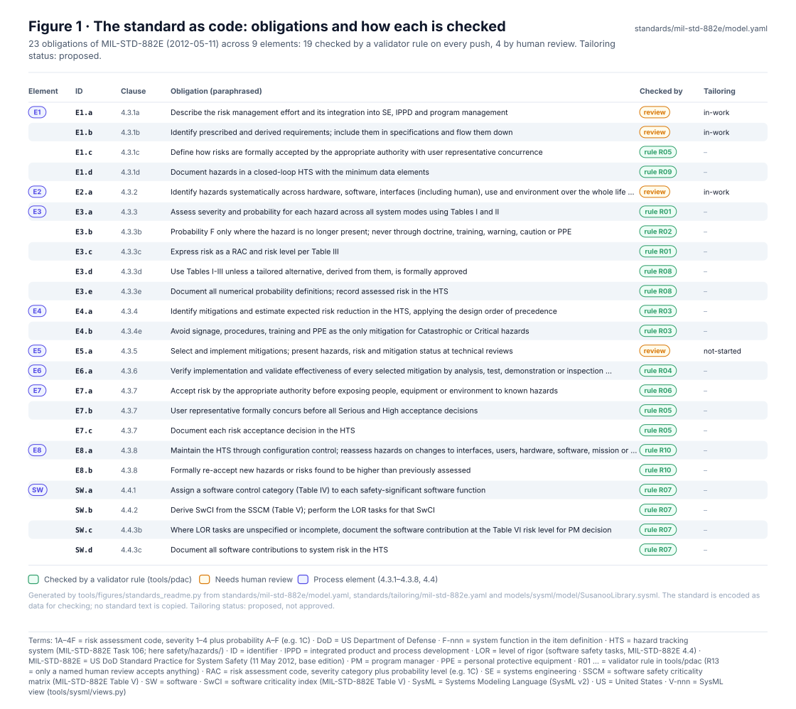
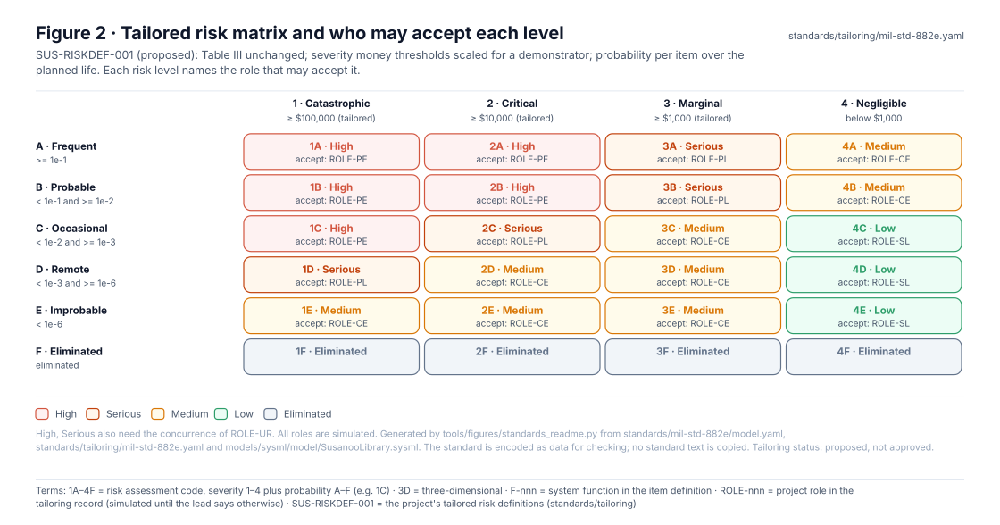
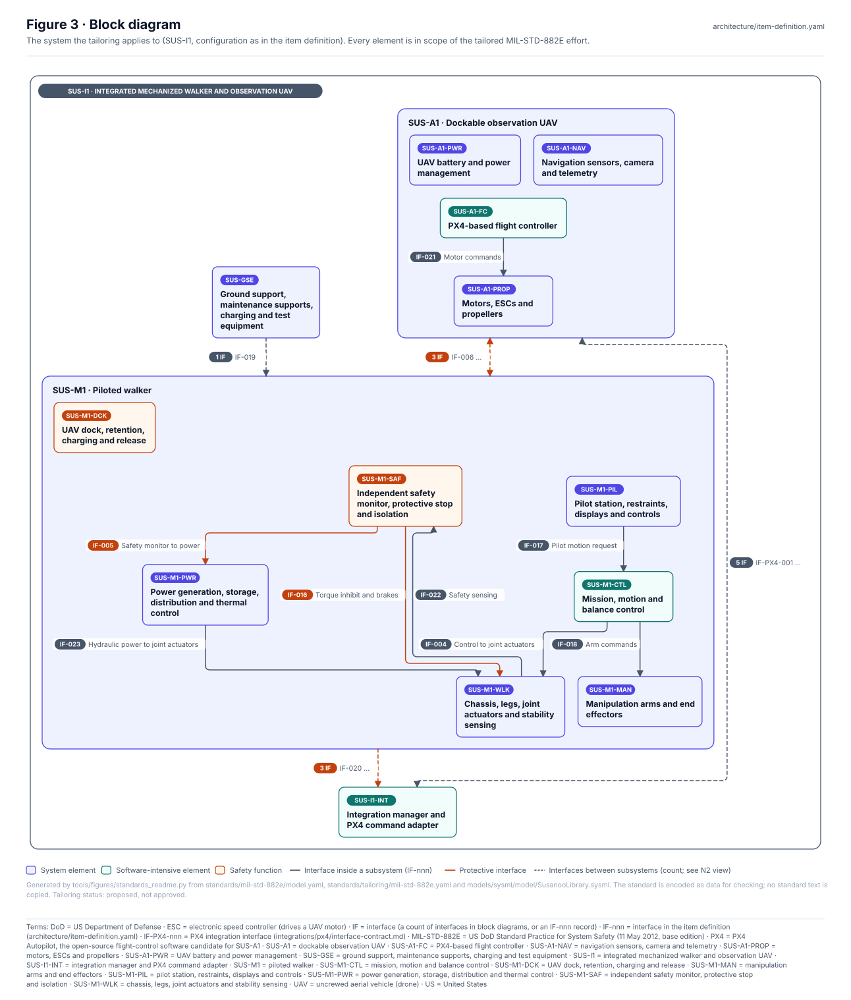
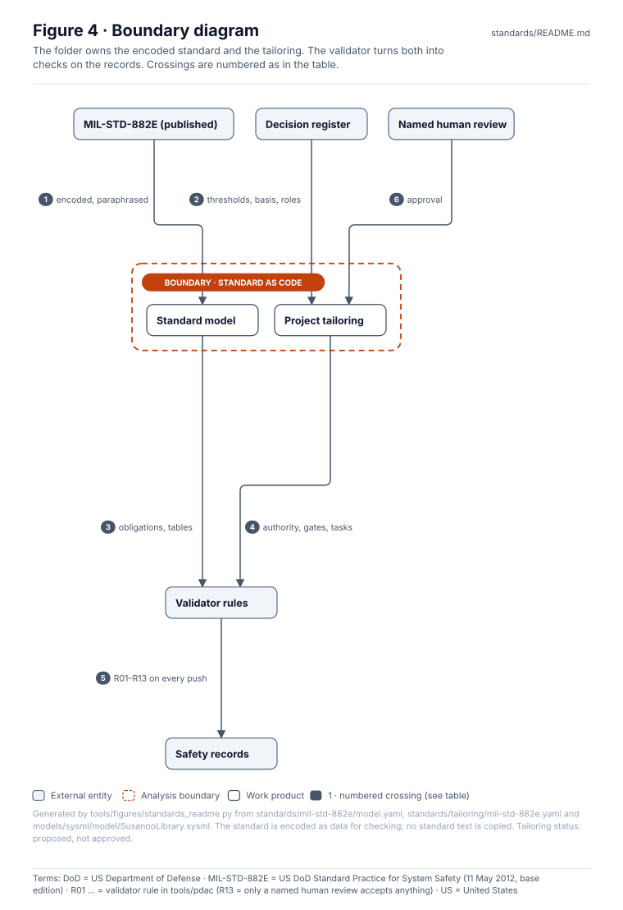
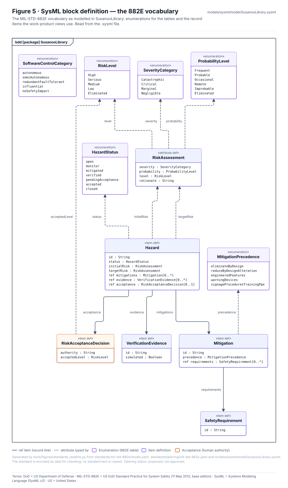
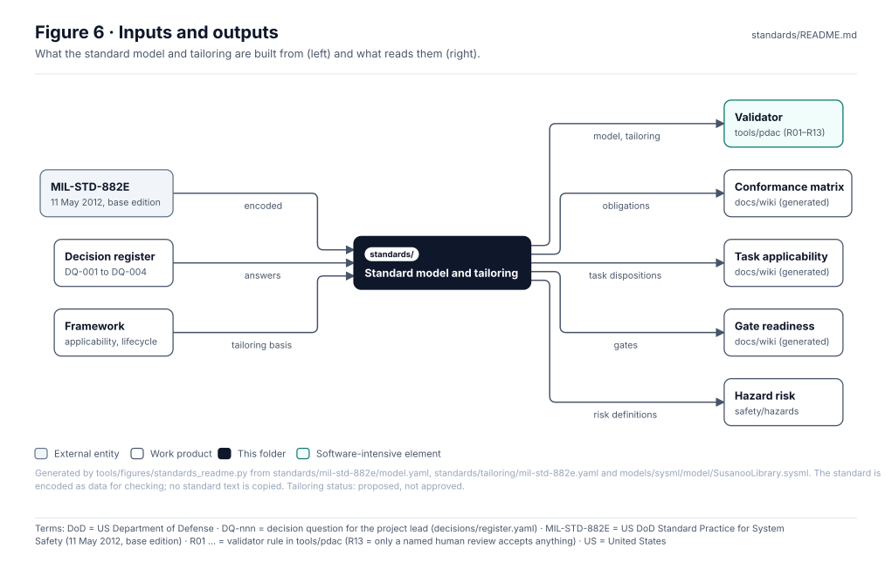

<!-- GENERATED by tools/wiki/build_wiki.py from standards/README.md. Do not edit here; edit the source and re-run. -->

> Published from [`standards/README.md`](https://github.com/jherrodthomas/Project-Susanoo/blob/main/standards/README.md) in the repository.

# Standards and tailoring

> **Status:** MIL-STD-882E (2012-05-11) encoded as data; tailoring for SUS-I1 is **proposed** (approval: not-requested), risk definitions SUS-RISKDEF-001 are proposed. Current gate G0. No standard text is copied; nothing is certified.

<!-- terms:start (generated by tools/terms/terms.py; do not edit by hand) -->

<b>Terms on this page (22)</b>: abbreviations and codes explained

| Term | Meaning |
|---|---|
| A01–A04 | item-definition validator rule (A01–A04) |
| CI | continuous integration (the automated checks GitHub runs on every change) |
| DoD | US Department of Defense |
| DQ-nnn | decision question for the project lead (decisions/register.yaml) |
| ECP | engineering change proposal |
| EMD | engineering and manufacturing development (acquisition phase) |
| G0–G7 | lifecycle gate (G0 concept to G7 change and sustainment) |
| MIL-STD-882E | US DoD Standard Practice for System Safety (11 May 2012, base edition) |
| MSA | materiel solution analysis (acquisition phase) |
| OMG | Object Management Group, publisher of SysML |
| OS | operations and support (acquisition phase) |
| PD | production and deployment (acquisition phase) |
| R01 … | validator rule in tools/pdac (R13 = only a named human review accepts anything) |
| ROLE-nnn | project role in the tailoring record (simulated until the lead says otherwise) |
| SUS-I1 | integrated mechanized walker and observation UAV |
| SUS-RISKDEF-001 | the project's tailored risk definitions (standards/tailoring) |
| SVG | Scalable Vector Graphics, the figure file format |
| SW | software |
| SysML | Systems Modeling Language (SysML v2) |
| TD | technology development (acquisition phase) |
| UAV | uncrewed aerial vehicle (drone) |
| US | United States |

All terms: [abbreviations and record codes](https://github.com/jherrodthomas/Project-Susanoo/blob/main/docs/terms.md).

<!-- terms:end -->

| Field | Value |
|---|---|
| Standard model | [`mil-std-882e/model.yaml`](https://github.com/jherrodthomas/Project-Susanoo/blob/main/standards/mil-std-882e/model.yaml): 9 elements, 23 obligations, 25 tasks, 17 data item descriptions |
| Tailoring | [`tailoring/mil-std-882e.yaml`](https://github.com/jherrodthomas/Project-Susanoo/blob/main/standards/tailoring/mil-std-882e.yaml): 2 conditional, 2 not-applicable, 2 not-selected, 19 selected tasks; 8 gates; 8 roles |
| SysML vocabulary | [`SusanooLibrary.sysml`](https://github.com/jherrodthomas/Project-Susanoo/blob/main/models/sysml/model/SusanooLibrary.sysml) |
| Checked by | `python -m tools.pdac.validate` (rules R01–R13 and A01–A04) |
| Generated views | [conformance](MIL-STD-882E-Conformance.md), [applicability](MIL-STD-882E-Applicability.md), [gate readiness](Gate-Readiness.md) |

## Purpose

MIL-STD-882E is encoded here as data so it can be checked like code: its process elements and obligations, the severity, probability and risk tables, software control categories and level-of-rigor tables, the hazard tracking system's minimum data elements, and the tasks with their applicability. The tailoring records what this project selects, the risk definitions it uses, its gates, roles and acceptance authority. The validator reads both and checks every record on every push. Obligations are paraphrased; no standard text is copied.

## Obligations and checks

| Element | Title | Clause | Obligations | Checked by rule | By review |
|---|---|---|---|---|---|
| E1 | Document the system safety approach | 4.3.1 | 4 | R05, R09 | 2 |
| E2 | Identify and document hazards | 4.3.2 | 1 | — | 1 |
| E3 | Assess and document risk | 4.3.3 | 5 | R01, R02, R08 | — |
| E4 | Identify and document risk mitigation measures | 4.3.4 | 2 | R03 | — |
| E5 | Reduce risk | 4.3.5 | 1 | — | 1 |
| E6 | Verify, validate and document risk reduction | 4.3.6 | 1 | R04 | — |
| E7 | Accept risk and document | 4.3.7 | 3 | R05, R06 | — |
| E8 | Manage life-cycle risk | 4.3.8 | 2 | R10 | — |
| SW | Software contribution to system risk | 4.4 | 4 | R07 | — |

## Tailored risk definitions

| Risk level | Accepted by | User concurrence |
|---|---|---|
| High | ROLE-PE · Program Executive (simulated) | yes, ROLE-UR |
| Serious | ROLE-PL · Program Lead (simulated) | yes, ROLE-UR |
| Medium | ROLE-CE · Chief Engineer (simulated) | no |
| Low | ROLE-SL · Safety Lead (simulated) | no |

Severity: Table I injury and environmental criteria unchanged. Monetary thresholds scaled by 1/100 because Table I values ($100K/$1M/$10M) exceed the total value of a simulation-and-bench demonstrator and would place all equipment loss in Negligible. Thresholds chosen by the lead in decision DQ-002 (2026-11-12); the definitions still need formal approval by ROLE-PE on a review record (4.3.3d).

Probability: Table II qualitative definitions with Appendix A Table A-II quantitative bands. Basis: per item over the planned demonstrator life.

| Gate | Phase | Title |
|---|---|---|
| G0 | MSA | Concept |
| G1 | MSA | Requirements |
| G2 | TD | Preliminary architecture |
| G3 | EMD | Detailed design |
| G4 | EMD | Bench and simulation readiness |
| G5 | EMD | Verification and assessment |
| G6 | PD | Release |
| G7 | OS | Change and sustainment |

Task tailoring

| Task | Title | Disposition | Gate | Owner |
|---|---|---|---|---|
| 101 | Hazard Identification and Mitigation Effort Using the System Safety Methodology | selected | G0 | ROLE-SL |
| 102 | System Safety Program Plan | selected | G0 | ROLE-SL |
| 103 | Hazard Management Plan | not-selected | — | ROLE-SL |
| 104 | Support of Government Reviews/Audits | conditional | — | ROLE-SL |
| 105 | Integrated Product Team/Working Group Support | selected | G0 | ROLE-SL |
| 106 | Hazard Tracking System | selected | G0 | ROLE-SL |
| 107 | Hazard Management Progress Report | selected | G1 | ROLE-SL |
| 108 | Hazardous Materials Management Plan | selected | G2 | ROLE-WLK |
| 201 | Preliminary Hazard List | selected | G0 | ROLE-SL |
| 202 | Preliminary Hazard Analysis | selected | G2 | ROLE-SL |
| 203 | System Requirements Hazard Analysis | selected | G1 | ROLE-CE |
| 204 | Subsystem Hazard Analysis | selected | G3 | ROLE-SL |
| 205 | System Hazard Analysis | selected | G3 | ROLE-SL |
| 206 | Operating and Support Hazard Analysis | selected | G3 | ROLE-SL |
| 207 | Health Hazard Analysis | selected | G3 | ROLE-SL |
| 208 | Functional Hazard Analysis | selected | G2 | ROLE-SWL |
| 209 | System-of-Systems Hazard Analysis | conditional | — | ROLE-SL |
| 210 | Environmental Hazard Analysis | selected | G3 | ROLE-SL |
| 301 | Safety Assessment Report | selected | G5 | ROLE-SL |
| 302 | Hazard Management Assessment Report | not-selected | — | ROLE-SL |
| 303 | Test and Evaluation Participation | selected | G4 | ROLE-SL |
| 304 | Review of ECPs, Change Notices, Deficiency Reports, Mishaps, and Requests for Deviation/Waiver | selected | G1 | ROLE-SL |
| 401 | Safety Verification | selected | G4 | ROLE-SL |
| 402 | Explosives Hazard Classification Data | not-applicable | — | ROLE-SL |
| 403 | Explosive Ordnance Disposal Data | not-applicable | — | ROLE-SL |

## Block diagram

Elements and interfaces: [`architecture/item-definition.yaml`](https://github.com/jherrodthomas/Project-Susanoo/blob/main/architecture/item-definition.yaml).

## Boundary diagram

| # | From | To | Crossing / interaction |
|---|---|---|---|
| 1 | MIL-STD-882E (published) | Standard model | elements, obligations, tables and tasks, paraphrased |
| 2 | Decision register | Project tailoring | the lead's answers: edition, thresholds, basis, roles |
| 3 | Standard model | Validator rules | obligations and tables the rules check against |
| 4 | Project tailoring | Validator rules | acceptance authority, gates, task dispositions |
| 5 | Validator rules | Safety records | R01–R13 run on every push and pull request |
| 6 | Named human review | Project tailoring | approval of the tailoring and risk definitions (R13) |

**Explicitly excluded:** the text of the standard (copyright), other standards' clause mappings (see [standards applicability](https://github.com/jherrodthomas/Project-Susanoo/blob/main/framework/standards-applicability.md)), and approval itself.

## SysML model

Model of record for the vocabulary: [`SusanooLibrary.sysml`](https://github.com/jherrodthomas/Project-Susanoo/blob/main/models/sysml/model/SusanooLibrary.sysml) in the project model, validated by the OMG pilot in CI. The figure is read from that file.

## Inputs and outputs

| Input | Source |
|---|---|
| MIL-STD-882E | the published standard (not copied) |
| Lead decisions | [Decision register](Decision-Register.md) |
| Applicability and lifecycle | [`framework/`](Framework.md) |

| Output | Destination |
|---|---|
| Rules on every record | [`tools/pdac`](https://github.com/jherrodthomas/Project-Susanoo/blob/main/tools/pdac/README.md) |
| Conformance matrix | [MIL-STD-882E-Conformance](MIL-STD-882E-Conformance.md) |
| Task applicability | [MIL-STD-882E-Applicability](MIL-STD-882E-Applicability.md) |
| Gate readiness | [Gate-Readiness](Gate-Readiness.md) |
| Risk definitions | [Safety records](Safety-Records.md) |

## Folder contents

| Item | Description | State |
|---|---|---|
| [`mil-std-882e/`](https://github.com/jherrodthomas/Project-Susanoo/blob/main/standards/mil-std-882e/README.md) | MIL-STD-882E as data (`model.yaml`) | folder |
| [`tailoring/`](https://github.com/jherrodthomas/Project-Susanoo/blob/main/standards/tailoring/README.md) | Project tailoring (`mil-std-882e.yaml`) | folder |
| [`figures/`](https://github.com/jherrodthomas/Project-Susanoo/tree/main/standards/figures) | Generated SVG figures (do not edit) | generated |
| `README.md` | This page, generated above the END marker | generated |

## Changing the model or the tailoring

1. Change `model.yaml` only to correct the encoding of the standard; paraphrase, never copy.
2. Tailoring choices (thresholds, basis, roles, task selection) are lead decisions; record them in the decision register first, then apply them to `tailoring/mil-std-882e.yaml`.
3. Regenerate (`python -m tools.pdac.report`, `python3 tools/figures/standards_readme.py`) and run the full check list in [`CLAUDE.md`](https://github.com/jherrodthomas/Project-Susanoo/blob/main/CLAUDE.md).
4. Approving the tailoring or the risk definitions is a named human review in the approval's `authority_role` (rule R13).

<!-- END GENERATED: content below this line is human-authored and preserved -->
