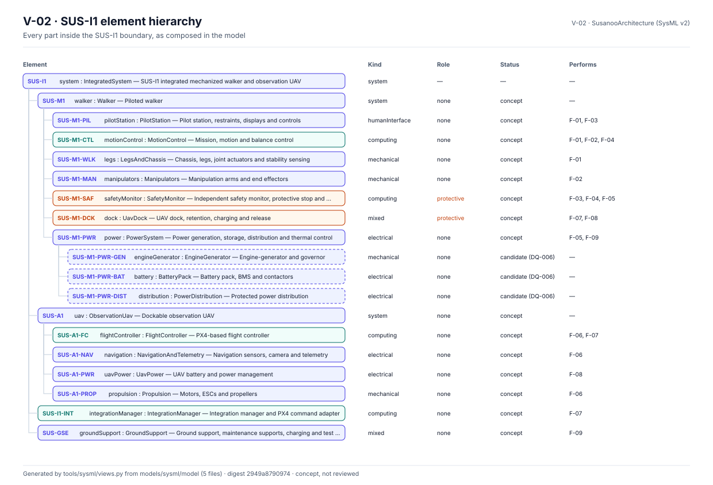
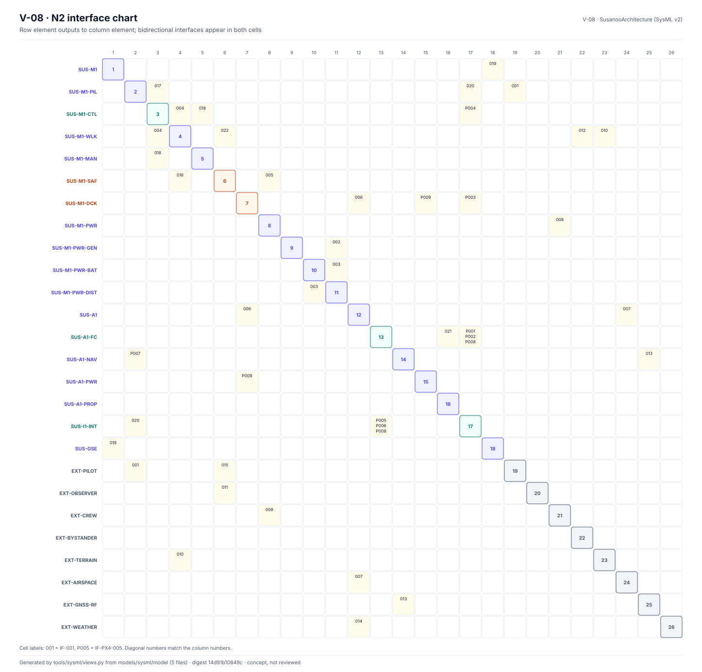
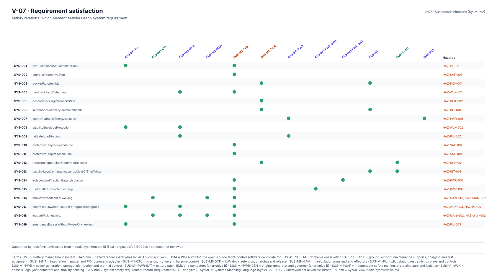

<!-- GENERATED by tools/sysml/views.py from models/sysml/model. Do not edit by hand. -->

# SysML v2 Model

Textual SysML v2 model of SUS-I1 in `models/sysml/model` (digest `b9eb0c56c6c1`): 27 parts (8 external), 30 connections, 9 functions, 9 requirements, 16 satisfy relations.

> Concept model, not reviewed. Checked against the records by `tools/sysml/check.py` and validated as SysML v2 by the OMG pilot implementation (`tools/sysml/pilot/validate.sh`). Neither check is a review.

| File | Source | Lines |
|---|---|---|
| `SusanooLibrary.sysml` | hand-written | 167 |
| `Functions.sysml` | hand-written | 25 |
| `Architecture.sysml` | hand-written | 270 |
| `Requirements.sysml` | generated by `tools/sysml/gen_requirements.py` | 52 |
| `Satisfaction.sysml` | generated by `tools/sysml/gen_requirements.py` | 24 |

## V-02 Element hierarchy

## V-08 N2 interface chart

## V-07 Requirement satisfaction

Context and boundary views: [SUS-I1 Item Definition](SUS-I1-Item-Definition).
