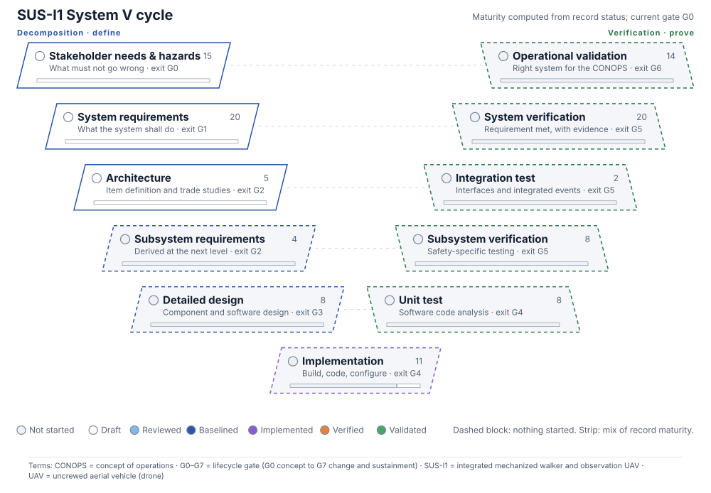

<!-- GENERATED by tools/vcycle/build_vcycle.py from the records. Do not edit by hand. -->

# System V Cycle

The System V cycle of SUS-I1, built from the records: the left side defines (hazards, requirements, architecture, design), the bottom builds, and the right side proves (code analysis, testing, integration, verification, validation). Each block lists the records that sit in it and takes the colour of the least mature one. Maturity is computed from record status for orientation only; nothing on this page reviews, verifies or accepts anything (rule R13).

<!-- terms:start (generated by tools/terms/terms.py; do not edit by hand) -->

<b>Terms on this page (16)</b>: abbreviations and codes explained

| Term | Meaning |
|---|---|
| AI | artificial intelligence (here, an AI assistant drafting at independence level I0) |
| CONOPS | concept of operations |
| DoD | US Department of Defense |
| G0–G7 | lifecycle gate (G0 concept to G7 change and sustainment) |
| I0–I3 | review independence level (I0 none, e.g. the author or an AI, to I3 independent organisation) |
| MIL-STD-882E | US DoD Standard Practice for System Safety (11 May 2012, base edition) |
| PX4 | PX4 Autopilot, the open-source flight-control software candidate for SUS-A1 |
| R01 … | validator rule in tools/pdac (R13 = only a named human review accepts anything) |
| SSF-nnn | safety-significant software function record (safety/software/) |
| SUS-A1 | dockable observation UAV |
| SUS-GSE | ground support, maintenance supports, charging and test equipment |
| SUS-I1 | integrated mechanized walker and observation UAV |
| SUS-I1-INT | integration manager and PX4 command adapter |
| SUS-M1 | piloted walker |
| UAV | uncrewed aerial vehicle (drone) |
| US | United States |

All terms: [abbreviations and record codes](https://github.com/jherrodthomas/Project-Susanoo/blob/main/docs/terms.md).

<!-- terms:end -->

**Now:** 22 requirements, 19 hazards and 8 SSFs; 0 of 22 requirements have verification evidence. Current gate G0.

## Open the interactive page

GitHub does not run scripts in wiki pages or repository files, so this page shows a still. For the interactive page, open `docs/vcycle/index.html` from a local checkout in a browser. It has five views:

- **Maturity.** Click any block for its records. Open an element to see its own V, down to a single SSF, where the blocks become the MIL-STD-882E level-of-rigor tasks.
- **Gate scrubber.** Pick a gate; blocks due by then are marked met or gap. The rule used (left side baselined, right side verified by the exit gate) is a placeholder for real exit criteria.
- **Trace a requirement.** One requirement drawn across the cycle: hazard, requirement, element, SSF, verification method, evidence, scenario.
- **Change ripple.** Pick a change request and see which hazards it reopens (the same links as validator rule R10) and what needs rework and re-verification. Records in `changes/` come first; the rest are examples.
- **Evidence clock.** Replays the git history of the records. Not in the committed page; build a local copy with `python -m tools.vcycle.build_vcycle --history <file.html>`.

## Blocks at system level

| Block | Side | Exit gate | Records | Lowest maturity |
|---|---|---|---|---|
| Stakeholder needs & hazards | left (define) | G0 | 19 hazards | Draft |
| System requirements | left (define) | G1 | 22 requirements | Draft |
| Architecture | left (define) | G2 | 5 trade studies and top-level elements | Draft |
| Subsystem requirements | left (define) | G2 | 4 top-level elements, SUS-M1 21, SUS-A1 4, SUS-I1-INT 3, SUS-GSE 1 requirements allocated, none derived | Not started |
| Detailed design | left (define) | G3 | 8 SSF design analyses | Not started |
| Implementation | bottom | G4 | 11 SSF software items | Not started |
| Unit test | right (prove) | G4 | 8 SSF code analyses | Not started |
| Subsystem verification | right (prove) | G5 | 8 SSF safety-specific testing | Not started |
| Integration test | right (prove) | G5 | 2 events | Not started |
| System verification | right (prove) | G5 | 22 requirements, 0 with evidence | Not started |
| Operational validation | right (prove) | G6 | 14 CONOPS scenarios | Not started |

## Maturity ladder

| Rung | What it means | Who may move a record to it |
|---|---|---|
| Not started | No record yet | Anyone may open a draft |
| Draft | open, draft, candidate, in-work | Author or AI (I0) |
| Reviewed | Review record by a named human | Human reviewer, I1 or higher |
| Baselined | Requirement baselined, task approved | Lead, through a review record (R13) |
| Implemented | Built or configured item under control | Design owner, after review |
| Verified | Evidence accepted; hazard verified | Named human reviewer in role (R13) |
| Validated | Meets intended use; risk accepted | Risk acceptance authority |

Generated by `tools/vcycle/build_vcycle.py` from `requirements/`, `safety/hazards/`, `safety/software/`, `safety/events/`, `architecture/`, `changes/`, `standards/tailoring/mil-std-882e.yaml` and `framework/lifecycle.md`.
