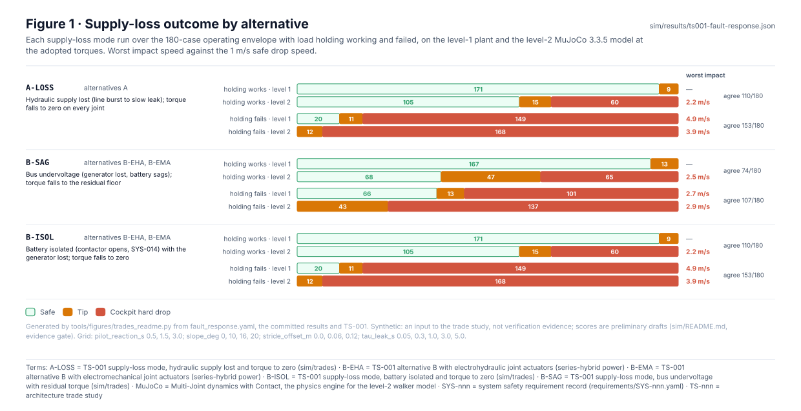
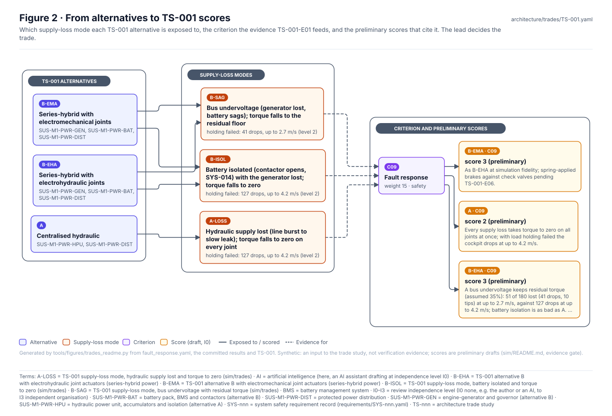
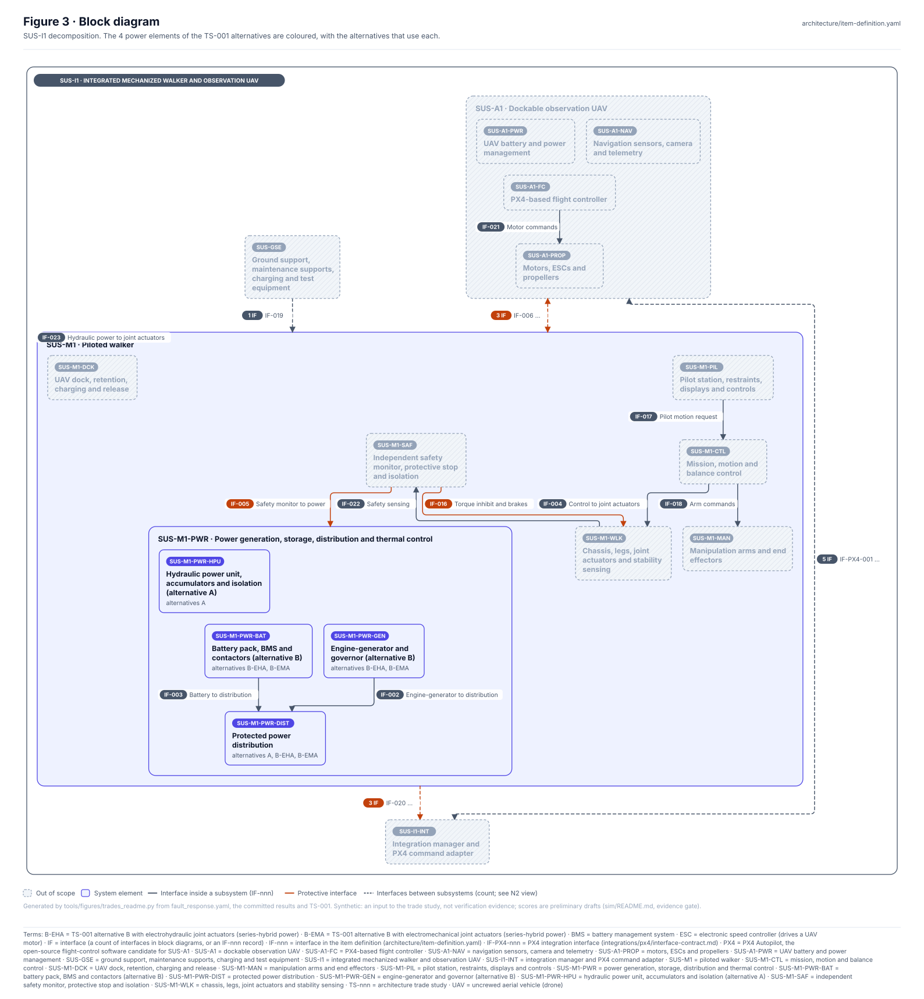
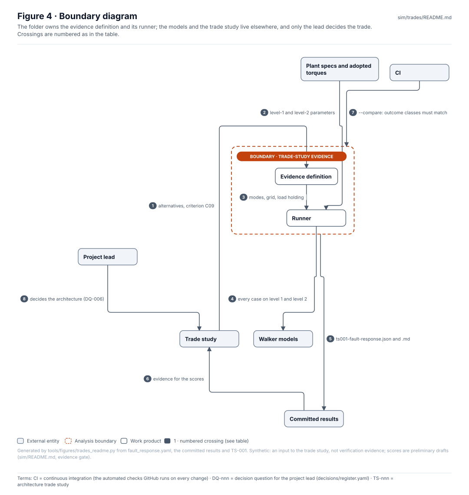
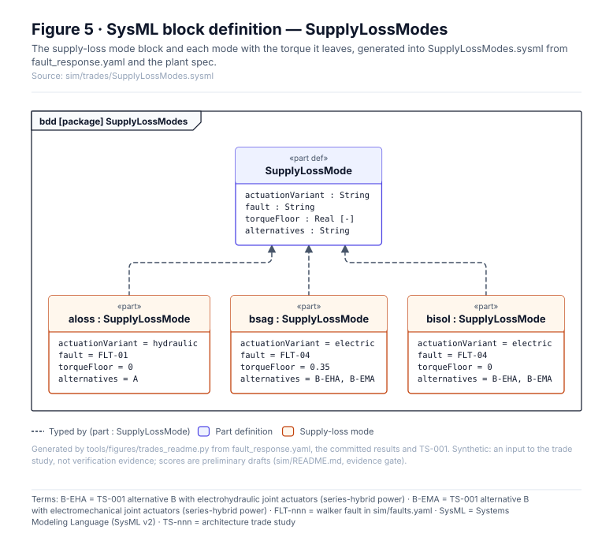
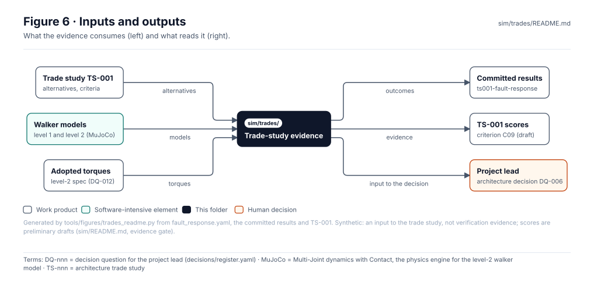

<!-- GENERATED by tools/wiki/build_wiki.py from sim/trades/README.md. Do not edit here; edit the source and re-run. -->

> Published from [`sim/trades/README.md`](https://github.com/jherrodthomas/Project-Susanoo/blob/main/sim/trades/README.md) in the repository.

# Trade-study evidence

> **Status:** 3 supply-loss modes × 2 load-holding cases × 2 levels over 180 envelope cases, feeding TS-001 criterion C09 (done). Synthetic, **no evidence credit**: an input to the trade study, which the lead decides.

<!-- terms:start (generated by tools/terms/terms.py; do not edit by hand) -->

<b>Terms on this page (14)</b>: abbreviations and codes explained

| Term | Meaning |
|---|---|
| A-LOSS | TS-001 supply-loss mode, hydraulic supply lost and torque to zero (sim/trades) |
| B-EHA | TS-001 alternative B with electrohydraulic joint actuators (series-hybrid power) |
| B-EMA | TS-001 alternative B with electromechanical joint actuators (series-hybrid power) |
| B-ISOL | TS-001 supply-loss mode, battery isolated and torque to zero (sim/trades) |
| B-SAG | TS-001 supply-loss mode, bus undervoltage with residual torque (sim/trades) |
| CI | continuous integration (the automated checks GitHub runs on every change) |
| CL-nnn | concept layout (cad/params/CL-nn.yaml; CL-01 to CL-05, CL-05 the reference layout) |
| DQ-nnn | decision question for the project lead (decisions/register.yaml) |
| L00 | link-resolution validator rule (L00) |
| OMG | Object Management Group, publisher of SysML |
| SVG | Scalable Vector Graphics, the figure file format |
| SYS-nnn | system safety requirement record (requirements/SYS-nnn.yaml) |
| SysML | Systems Modeling Language (SysML v2) |
| TS-nnn | architecture trade study |

All terms: [abbreviations and record codes](https://github.com/jherrodthomas/Project-Susanoo/blob/main/docs/terms.md).

<!-- terms:end -->

| Field | Value |
|---|---|
| Evidence | TS-001-E01 · Supply-loss response by actuation and power alternative |
| Trade study | [`TS-001`](https://github.com/jherrodthomas/Project-Susanoo/blob/main/architecture/trades/TS-001.yaml) · Actuation and power architecture (in-work) |
| Run | `python -m sim.trades.fault_response` (about 1 minute); `--compare` in CI |
| Results | [`ts001-fault-response.md`](https://github.com/jherrodthomas/Project-Susanoo/blob/main/sim/results/ts001-fault-response.md) |
| SysML | [`SupplyLossModes.sysml`](https://github.com/jherrodthomas/Project-Susanoo/blob/main/sim/trades/SupplyLossModes.sysml) (generated) |

## Purpose

Runs the simulations the architecture trade studies need. For TS-001 (actuation and power architecture), the alternatives differ at simulation fidelity only in how joint torque falls when supply is lost, so each loss mode is run over the operating envelope with load holding working and failed, on both walker models. The result is evidence for one criterion; it scores nothing and decides nothing.

## Outcomes

| Mode | Alternatives | Load holding | Level 1 (safe / tip / drop) | Level 2 (safe / tip / drop) | Worst impact L2 | Agree |
|---|---|---|---|---|---|---|
| A-LOSS | A | works | 171 / 9 / 0 | 105 / 15 / 60 | 2.2 m/s | 110/180 |
| A-LOSS | A | fails | 20 / 11 / 149 | 0 / 12 / 168 | 3.9 m/s | 153/180 |
| B-SAG | B-EHA, B-EMA | works | 167 / 13 / 0 | 68 / 47 / 65 | 2.5 m/s | 74/180 |
| B-SAG | B-EHA, B-EMA | fails | 66 / 13 / 101 | 0 / 43 / 137 | 2.9 m/s | 107/180 |
| B-ISOL | B-EHA, B-EMA | works | 171 / 9 / 0 | 105 / 15 / 60 | 2.2 m/s | 110/180 |
| B-ISOL | B-EHA, B-EMA | fails | 20 / 11 / 149 | 0 / 12 / 168 | 3.9 m/s | 153/180 |

Summary recorded in TS-001: On the reverse-kneed 4,590 kg reference layout (CL-05 link masses, inertias and leg geometry, DQ-023, DQ-025) with ankle 40.5 and knee 26.5 kN m (DQ-024, DQ-026), level 2 loses cases in every supply-loss mode even with load holding working: CL-05 stands with its knee bent about 58 degrees, so one leg needs about 25 kN m at the knee and the knee gives way before load holding engages at 0.4 of supply. A hydraulic loss (A) and an isolated battery (B, SYS-014) lose 75 of 180 (60 drops at up to 2.2 m/s, 15 tips); a bus undervoltage that keeps 35% of torque (B, assumed floor) loses 112 (65 drops, 47 tips). With load holding failed, A and an isolated battery lose all 180 (168 drops at up to 3.9 m/s), and the bus undervoltage all 180 (137 drops at up to 2.9 m/s). The knee, not the power architecture, decides C09 until the knee torque or the standing posture is settled (DQ-027; sim/results/sizing-cf4.md).

## Where the evidence goes

| Alternative | Criterion | Score | Note |
|---|---|---|---|
| A | C09 | 2 (preliminary) | Every supply loss takes torque to zero on all joints at once. Held at the forward-knee score: on the reverse-knee model the undersized knee loses cases in every mode (TS-001-E01), so C09 is re-scored once the knee or posture is settled (DQ-027). |
| B-EHA | C09 | 3 (preliminary) | A bus undervoltage keeps residual torque (assumed 35%); battery isolation is as bad as A. Held at the forward-knee score: on the reverse-knee model the bus undervoltage loses more cases than A with load holding working (112 against 75 of 180), because 35% torque keeps the walker out of load holding while its knee gives way; re-scored once the knee or posture is settled (DQ-027). Local actuator leaks pending TS-001-E06. |
| B-EMA | C09 | 3 (preliminary) | As B-EHA at simulation fidelity; spring-applied brakes against check valves pending TS-001-E06. |

## Block diagram

## Boundary diagram

| # | From | To | Crossing / interaction |
|---|---|---|---|
| 1 | Trade study | Evidence definition | alternatives, criterion C09 |
| 2 | Plant specs and adopted torques | Runner | level-1 and level-2 parameters |
| 3 | Evidence definition | Runner | modes, grid, load holding |
| 4 | Runner | Walker models | every case on level 1 and level 2 |
| 5 | Trade-study evidence | Committed results | ts001-fault-response.json and .md |
| 6 | Committed results | Trade study | evidence for the scores |
| 7 | CI | Trade-study evidence | --compare: outcome classes must match |
| 8 | Project lead | Trade study | decides the architecture (DQ-006) |

**Explicitly excluded:** actuator dynamics and faults local to one joint (not modelled at this fidelity), the other criteria, and the trade decision itself.

## SysML model

[`SupplyLossModes.sysml`](https://github.com/jherrodthomas/Project-Susanoo/blob/main/sim/trades/SupplyLossModes.sysml) is generated from the evidence definition and validated with the project model by the OMG pilot in CI.

## Inputs and outputs

| Input | Source |
|---|---|
| Alternatives and criteria | [`TS-001`](https://github.com/jherrodthomas/Project-Susanoo/blob/main/architecture/trades/TS-001.yaml) |
| Walker models | [`sim/plant/`](Walker-Plant.md), [`sim/mujoco/`](Level-2-MuJoCo.md) |
| Adopted torques | [`sim/spec/walker_l2.yaml`](https://github.com/jherrodthomas/Project-Susanoo/blob/main/sim/spec/walker_l2.yaml) |

| Output | Destination |
|---|---|
| Results | [`sim/results/`](Simulation-Results.md) |
| Evidence TS-001-E01 | [`TS-001`](https://github.com/jherrodthomas/Project-Susanoo/blob/main/architecture/trades/TS-001.yaml) criterion C09; the lead decides the trade |

## Folder contents

| Item | Description | State |
|---|---|---|
| [`fault_response.yaml`](https://github.com/jherrodthomas/Project-Susanoo/blob/main/sim/trades/fault_response.yaml) | The supply-loss evidence definition | hand-written |
| [`fault_response.py`](https://github.com/jherrodthomas/Project-Susanoo/blob/main/sim/trades/fault_response.py) | Runs it on both levels and writes the results | code |
| [`SupplyLossModes.sysml`](https://github.com/jherrodthomas/Project-Susanoo/blob/main/sim/trades/SupplyLossModes.sysml) | The modes as SysML | generated |
| [`figures/`](https://github.com/jherrodthomas/Project-Susanoo/tree/main/sim/trades/figures) | Generated SVG figures (do not edit) | generated |
| `README.md` | This page | generated |

<!-- END GENERATED: content below this line is human-authored and preserved -->
