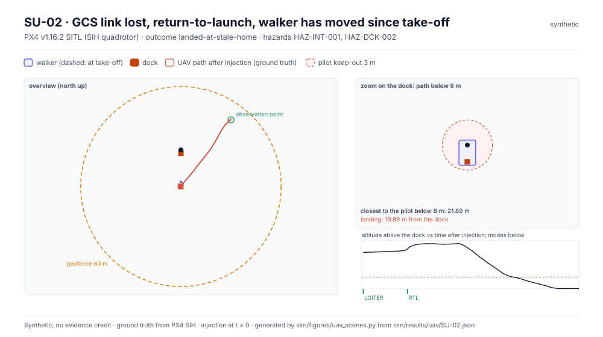
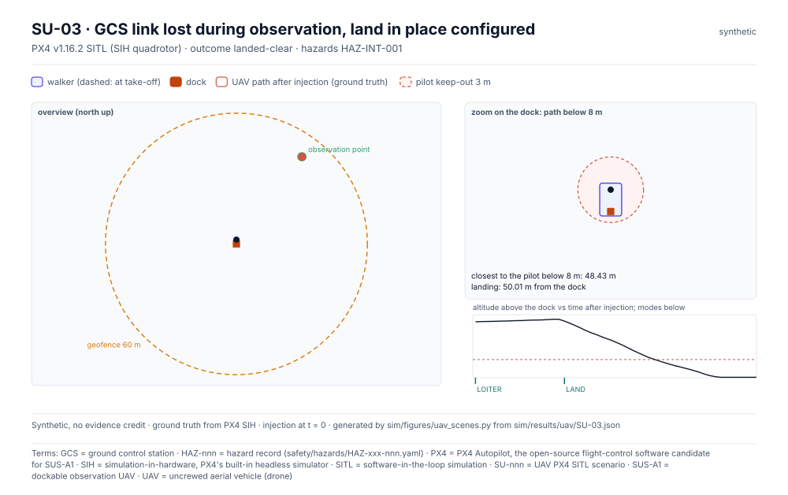
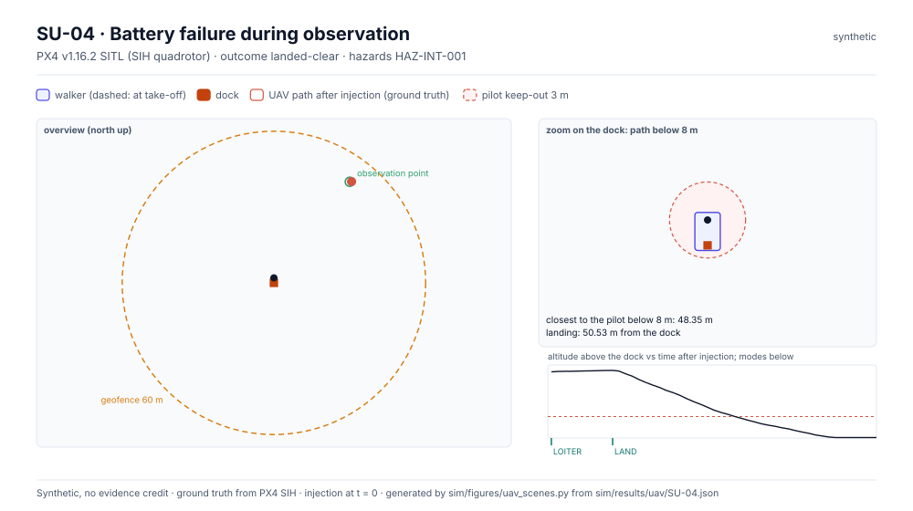
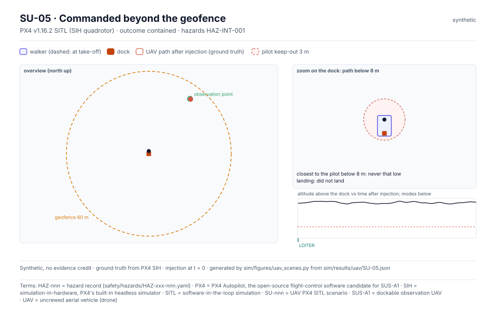
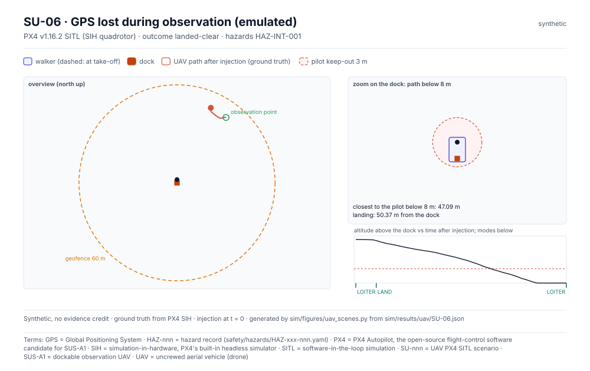

<!-- GENERATED by sim/figures/uav_scenes.py from sim/results/uav. Do not edit by hand. -->

# UAV Simulation (PX4 SITL)

> Synthetic simulation output; design aid only, no evidence credit (sim/README.md, evidence gate).

PX4 v1.16.2, SIH quadrotor, headless, speed factor 4. Positions are simulator ground truth. The harness acts as the ground station; there is no integration manager, so these runs show what PX4's own failsafes do when no recovery permit exists. Parameters are candidate configurations, not decisions.

| ID | Scenario | PX4 parameters | First failsafe | Outcome | Min distance to pilot below keep-out altitude (m) | Landing to dock (m) | Max distance from home (m) | Max estimate error (m) |
|---|---|---|---|---|---|---|---|---|
| SU-01 | GCS link lost during observation, return-to-launch configured | `NAV_DLL_ACT=2` | AUTO.RTL at 12.7 s | **keepout-breach** | 1.85 | 0.21 | 50.24 | 0.54 |
| SU-02 | GCS link lost, return-to-launch, walker has moved since take-off | `NAV_DLL_ACT=2` | AUTO.RTL at 13.4 s | **landed-at-stale-home** | 21.89 | 19.89 | 50.29 | 0.53 |
| SU-03 | GCS link lost during observation, land in place configured | `NAV_DLL_ACT=3` | AUTO.LAND at 13.5 s | **landed-clear** | 48.43 | 50.01 | 50.49 | 0.51 |
| SU-04 | Battery failure during observation | `COM_LOW_BAT_ACT=3` | AUTO.LAND at 7.3 s | **landed-clear** | 48.35 | 50.53 | 50.69 | 0.49 |
| SU-05 | Commanded beyond the geofence | `GF_ACTION=2, GF_MAX_HOR_DIST=60` | — | **contained** | None | None | 50.53 | 0.56 |
| SU-06 | GPS lost during observation (emulated) | `defaults` | AUTO.LAND at 4.9 s | **landed-clear** | 47.09 | 50.37 | 50.37 | 170.02 |

## Findings for review

- **FND-UAV-01** (SU-01; HAZ-INT-001): PX4 return-to-launch brings the aircraft to the dock, inside the pilot keep-out, with no integration manager recovery permit (IF-PX4-005/006 are bypassed)
- **FND-UAV-02** (SU-02; HAZ-INT-001): PX4 home is the take-off point; after the walker moves, a return lands where the dock used to be, possibly among the ground crew
- **FND-UAV-03** (SU-06; HAZ-INT-001): PX4's reported position (IF-PX4-001) was wrong by more than 10 m; the integration manager must not trust it without validity checks (max_estimate_error_m = 170.02)

Findings are drafts for the safety lead (CLAUDE.md). Scenario notes: SU-06: SIH has no GPS failure injection (PX4 v1.16.2 supports it only in the Gazebo/jMAVSim bridge); GPS fusion is disabled in flight instead, which is the loss as the estimator sees it.

## Scenes

### SU-01 · GCS link lost during observation, return-to-launch configured

### SU-02 · GCS link lost, return-to-launch, walker has moved since take-off

### SU-03 · GCS link lost during observation, land in place configured

### SU-04 · Battery failure during observation

### SU-05 · Commanded beyond the geofence

### SU-06 · GPS lost during observation (emulated)

