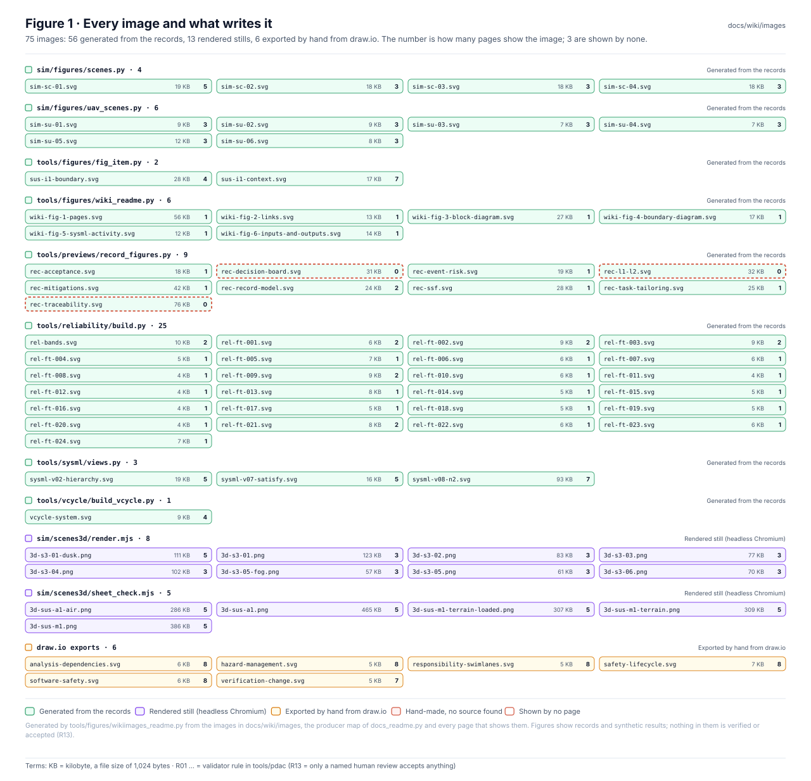
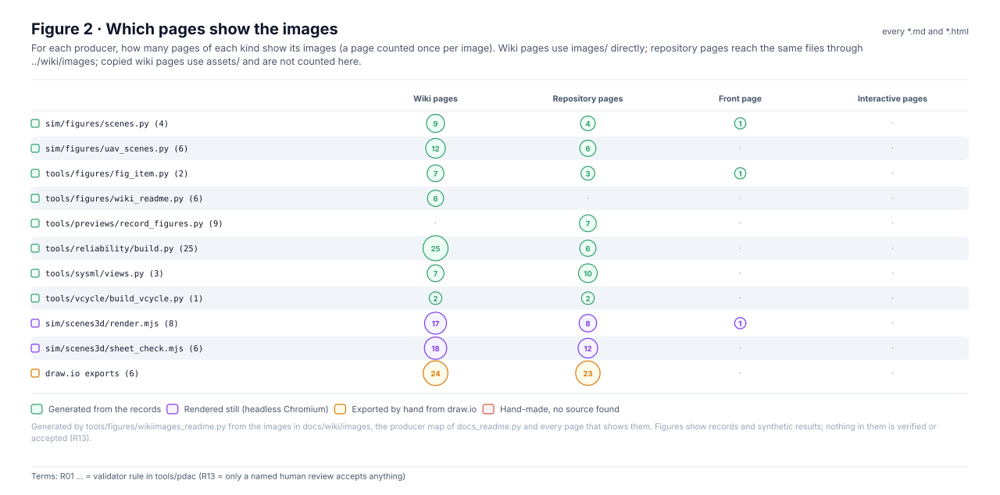
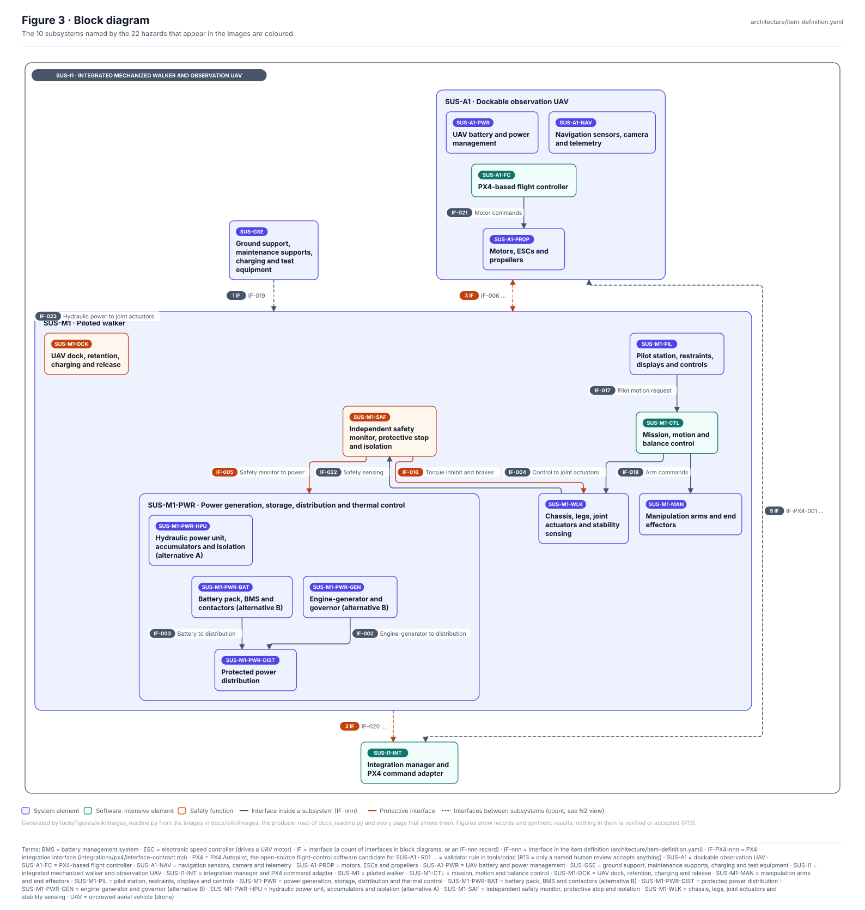
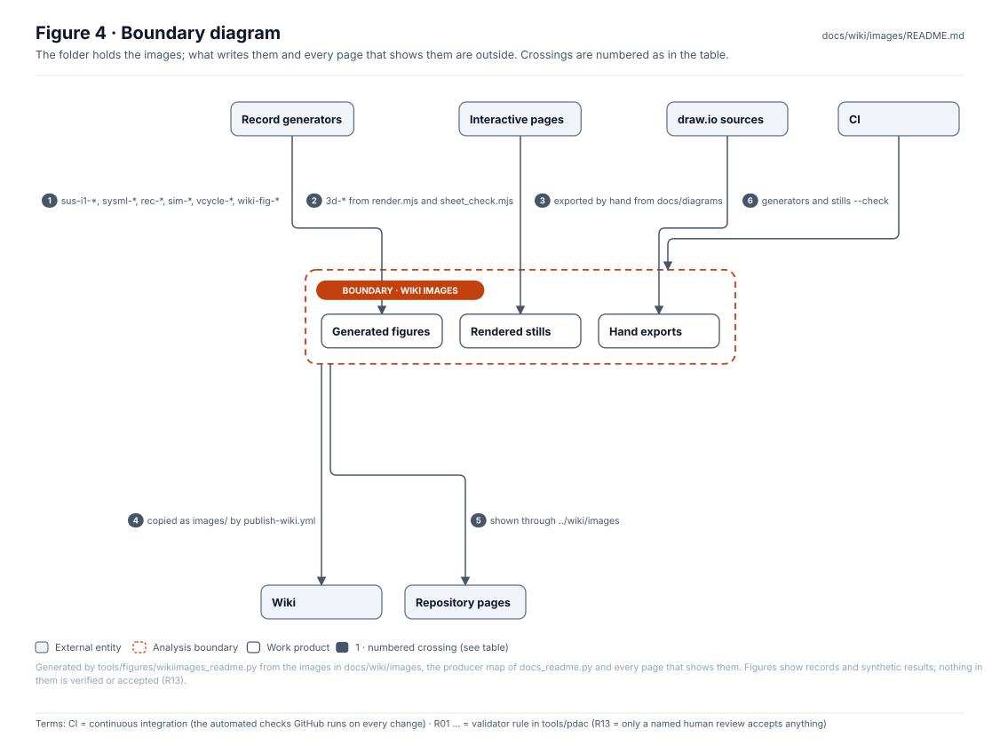
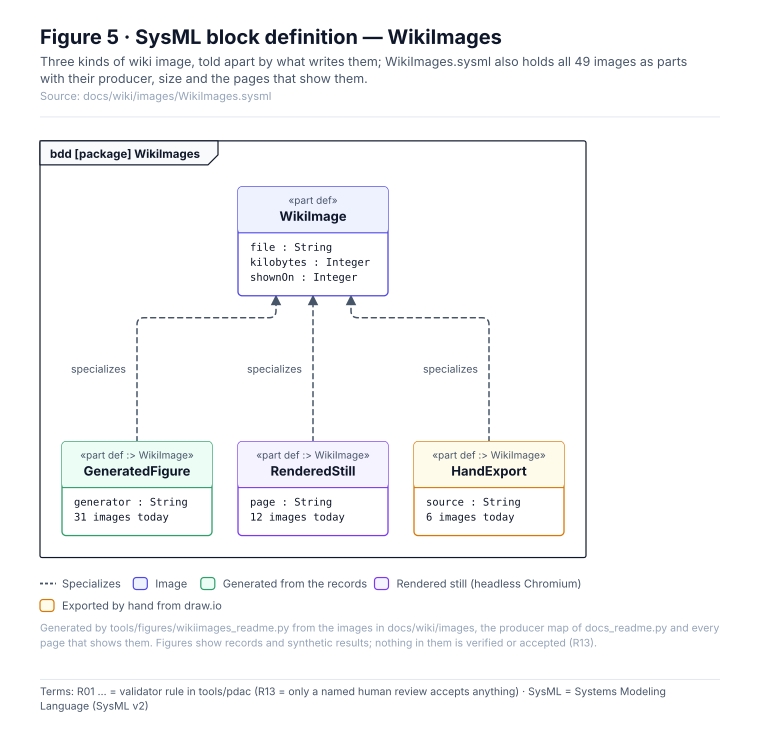
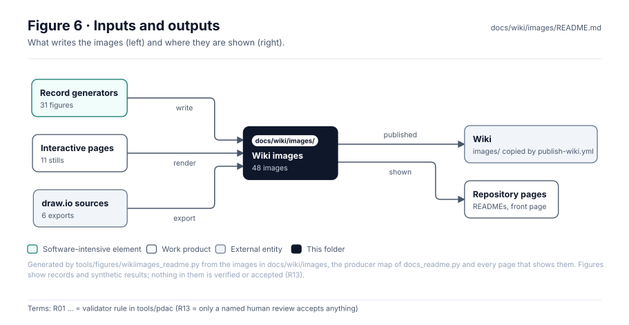

<!-- GENERATED by tools/figures/wikiimages_readme.py from the images in docs/wiki/images and the pages that show them; regenerate. -->

# Wiki images

> **Status:** 48 images: 31 generated from the records, 11 rendered stills, 6 exported by hand from draw.io; 3 images shown by no page. Never edit a generated image; regenerate it. Nothing in them is verified or accepted (rule R13).

<!-- terms:start (generated by tools/terms/terms.py; do not edit by hand) -->

<b>Terms on this page (6)</b>: abbreviations and codes explained

| Term | Meaning |
|---|---|
| 3D | three-dimensional |
| CI | continuous integration (the automated checks GitHub runs on every change) |
| KB | kilobyte, a file size of 1,024 bytes |
| OMG | Object Management Group, publisher of SysML |
| R01 … | validator rule in tools/pdac (R13 = only a named human review accepts anything) |
| SysML | Systems Modeling Language (SysML v2) |

All terms: [abbreviations and record codes](https://github.com/jherrodthomas/Project-Susanoo/blob/main/docs/terms.md).

<!-- terms:end -->

| Field | Value |
|---|---|
| Published | copied to the wiki as `images/` by `.github/workflows/publish-wiki.yml` |
| Shown on | [the wiki source](../README.md), and repository pages through `../wiki/images` |
| SysML | [`WikiImages.sysml`](WikiImages.sysml) (generated) |

## Purpose

The figures the wiki shows directly: item-definition and SysML views, record figures, simulation scenes, 3D stills, the V cycle still, the process-map exports and the wiki source page's own figures. This page says what writes each one and which pages show it, so a stale or orphaned image is easy to spot.

## Images

| Image | Written by | Size | Shown on |
|---|---|---|---|
| [`3d-s3-01-dusk.png`](3d-s3-01-dusk.png) | `sim/scenes3d/render.mjs` | 108 KB | 3 wiki pages, 1 repository page, 1 front page |
| [`3d-s3-01.png`](3d-s3-01.png) | `sim/scenes3d/render.mjs` | 118 KB | 2 wiki pages, 1 repository page |
| [`3d-s3-02.png`](3d-s3-02.png) | `sim/scenes3d/render.mjs` | 83 KB | 2 wiki pages, 2 repository pages |
| [`3d-s3-03.png`](3d-s3-03.png) | `sim/scenes3d/render.mjs` | 82 KB | 2 wiki pages, 1 repository page |
| [`3d-s3-04.png`](3d-s3-04.png) | `sim/scenes3d/render.mjs` | 111 KB | 2 wiki pages, 2 repository pages |
| [`3d-s3-05-fog.png`](3d-s3-05-fog.png) | `sim/scenes3d/render.mjs` | 57 KB | 2 wiki pages, 1 repository page |
| [`3d-s3-05.png`](3d-s3-05.png) | `sim/scenes3d/render.mjs` | 61 KB | 2 wiki pages, 1 repository page |
| [`3d-s3-06.png`](3d-s3-06.png) | `sim/scenes3d/render.mjs` | 70 KB | 2 wiki pages, 1 repository page |
| [`3d-sus-a1-air.png`](3d-sus-a1-air.png) | `sim/scenes3d/sheet_check.mjs` | 287 KB | 3 wiki pages, 2 repository pages |
| [`3d-sus-a1.png`](3d-sus-a1.png) | `sim/scenes3d/sheet_check.mjs` | 465 KB | 3 wiki pages, 2 repository pages |
| [`3d-sus-m1.png`](3d-sus-m1.png) | `sim/scenes3d/sheet_check.mjs` | 386 KB | 3 wiki pages, 2 repository pages |
| [`analysis-dependencies.svg`](analysis-dependencies.svg) | `docs/diagrams/mil-std-882e/analysis-dependencies.drawio` | 6 KB | 4 wiki pages, 4 repository pages |
| [`hazard-management.svg`](hazard-management.svg) | `docs/diagrams/mil-std-882e/hazard-management.drawio` | 5 KB | 4 wiki pages, 4 repository pages |
| [`rec-acceptance.svg`](rec-acceptance.svg) | `tools/previews/record_figures.py` | 18 KB | 1 repository page |
| [`rec-decision-board.svg`](rec-decision-board.svg) | `tools/previews/record_figures.py` | 30 KB | **no page** |
| [`rec-event-risk.svg`](rec-event-risk.svg) | `tools/previews/record_figures.py` | 19 KB | 1 repository page |
| [`rec-l1-l2.svg`](rec-l1-l2.svg) | `tools/previews/record_figures.py` | 32 KB | **no page** |
| [`rec-mitigations.svg`](rec-mitigations.svg) | `tools/previews/record_figures.py` | 42 KB | 1 repository page |
| [`rec-record-model.svg`](rec-record-model.svg) | `tools/previews/record_figures.py` | 24 KB | 2 repository pages |
| [`rec-ssf.svg`](rec-ssf.svg) | `tools/previews/record_figures.py` | 28 KB | 1 repository page |
| [`rec-task-tailoring.svg`](rec-task-tailoring.svg) | `tools/previews/record_figures.py` | 25 KB | 1 repository page |
| [`rec-traceability.svg`](rec-traceability.svg) | `tools/previews/record_figures.py` | 76 KB | **no page** |
| [`responsibility-swimlanes.svg`](responsibility-swimlanes.svg) | `docs/diagrams/mil-std-882e/responsibility-swimlanes.drawio` | 5 KB | 4 wiki pages, 4 repository pages |
| [`safety-lifecycle.svg`](safety-lifecycle.svg) | `docs/diagrams/mil-std-882e/safety-lifecycle.drawio` | 7 KB | 4 wiki pages, 4 repository pages |
| [`sim-sc-01.svg`](sim-sc-01.svg) | `sim/figures/scenes.py` | 18 KB | 3 wiki pages, 1 repository page, 1 front page |
| [`sim-sc-02.svg`](sim-sc-02.svg) | `sim/figures/scenes.py` | 17 KB | 2 wiki pages, 1 repository page |
| [`sim-sc-03.svg`](sim-sc-03.svg) | `sim/figures/scenes.py` | 17 KB | 2 wiki pages, 1 repository page |
| [`sim-sc-04.svg`](sim-sc-04.svg) | `sim/figures/scenes.py` | 18 KB | 2 wiki pages, 1 repository page |
| [`sim-su-01.svg`](sim-su-01.svg) | `sim/figures/uav_scenes.py` | 9 KB | 2 wiki pages, 1 repository page |
| [`sim-su-02.svg`](sim-su-02.svg) | `sim/figures/uav_scenes.py` | 9 KB | 2 wiki pages, 1 repository page |
| [`sim-su-03.svg`](sim-su-03.svg) | `sim/figures/uav_scenes.py` | 7 KB | 2 wiki pages, 1 repository page |
| [`sim-su-04.svg`](sim-su-04.svg) | `sim/figures/uav_scenes.py` | 7 KB | 2 wiki pages, 1 repository page |
| [`sim-su-05.svg`](sim-su-05.svg) | `sim/figures/uav_scenes.py` | 12 KB | 2 wiki pages, 1 repository page |
| [`sim-su-06.svg`](sim-su-06.svg) | `sim/figures/uav_scenes.py` | 8 KB | 2 wiki pages, 1 repository page |
| [`software-safety.svg`](software-safety.svg) | `docs/diagrams/mil-std-882e/software-safety.drawio` | 6 KB | 4 wiki pages, 4 repository pages |
| [`sus-i1-boundary.svg`](sus-i1-boundary.svg) | `tools/figures/fig_item.py` | 28 KB | 3 wiki pages, 1 repository page |
| [`sus-i1-context.svg`](sus-i1-context.svg) | `tools/figures/fig_item.py` | 17 KB | 4 wiki pages, 2 repository pages, 1 front page |
| [`sysml-v02-hierarchy.svg`](sysml-v02-hierarchy.svg) | `tools/sysml/views.py` | 19 KB | 2 wiki pages, 3 repository pages |
| [`sysml-v07-satisfy.svg`](sysml-v07-satisfy.svg) | `tools/sysml/views.py` | 16 KB | 2 wiki pages, 3 repository pages |
| [`sysml-v08-n2.svg`](sysml-v08-n2.svg) | `tools/sysml/views.py` | 93 KB | 3 wiki pages, 4 repository pages |
| [`vcycle-system.svg`](vcycle-system.svg) | `tools/vcycle/build_vcycle.py` | 9 KB | 2 wiki pages, 2 repository pages |
| [`verification-change.svg`](verification-change.svg) | `docs/diagrams/mil-std-882e/verification-change.drawio` | 5 KB | 4 wiki pages, 3 repository pages |
| [`wiki-fig-1-pages.svg`](wiki-fig-1-pages.svg) | `tools/figures/wiki_readme.py` | 55 KB | 1 wiki page |
| [`wiki-fig-2-links.svg`](wiki-fig-2-links.svg) | `tools/figures/wiki_readme.py` | 13 KB | 1 wiki page |
| [`wiki-fig-3-block-diagram.svg`](wiki-fig-3-block-diagram.svg) | `tools/figures/wiki_readme.py` | 27 KB | 1 wiki page |
| [`wiki-fig-4-boundary-diagram.svg`](wiki-fig-4-boundary-diagram.svg) | `tools/figures/wiki_readme.py` | 17 KB | 1 wiki page |
| [`wiki-fig-5-sysml-activity.svg`](wiki-fig-5-sysml-activity.svg) | `tools/figures/wiki_readme.py` | 13 KB | 1 wiki page |
| [`wiki-fig-6-inputs-and-outputs.svg`](wiki-fig-6-inputs-and-outputs.svg) | `tools/figures/wiki_readme.py` | 14 KB | 1 wiki page |

## Where they are shown

## Block diagram

## Boundary diagram

| # | From | To | Crossing / interaction |
|---|---|---|---|
| 1 | Record generators | Generated figures | sus-i1-*, sysml-*, rec-*, sim-*, vcycle-*, wiki-fig-* |
| 2 | Interactive pages | Rendered stills | 3d-* from render.mjs and sheet_check.mjs |
| 3 | draw.io sources | Hand exports | exported by hand from docs/diagrams |
| 4 | Wiki images | Wiki | copied as images/ by publish-wiki.yml |
| 5 | Wiki images | Repository pages | shown through ../wiki/images |
| 6 | CI | Wiki images | generators and stills --check |

**Explicitly excluded:** the figures of copied pages (the wiki gets those as `assets/`, listed in `docs/wiki/assets.txt`), this page's own figures (in `readme/`, which is not published), and any judgement of what the images show.

## SysML model

[`WikiImages.sysml`](WikiImages.sysml) is generated from the folder and validated with the project model by the OMG pilot in CI.

## Inputs and outputs

| Input | Source |
|---|---|
| sim/figures/scenes.py | 4 images |
| sim/figures/uav_scenes.py | 6 images |
| tools/figures/fig_item.py | 2 images |
| tools/figures/wiki_readme.py | 6 images |
| tools/previews/record_figures.py | 9 images |
| tools/sysml/views.py | 3 images |
| tools/vcycle/build_vcycle.py | 1 image |
| sim/scenes3d/render.mjs | 8 images |
| sim/scenes3d/sheet_check.mjs | 3 images |
| draw.io exports | 6 images |

| Output | Destination |
|---|---|
| Published images | the GitHub Wiki, `images/` |
| Shown in the repository | the pages listed per image above |

## Adding or changing an image

1. A generated image: change its records or its generator (Figure 1 names it) and rerun it; never edit the file.
2. A process map: edit its draw.io source in `docs/diagrams/` and export it here with the same name.
3. Regenerate this page and run the full check list in [`CLAUDE.md`](../../../CLAUDE.md).

## Folder contents

| Item | Description | State |
|---|---|---|
| `*.svg`, `*.png` | 48 images, as in Figure 1 | generated or exported |
| [`WikiImages.sysml`](WikiImages.sysml) | The images as SysML | generated |
| [`readme/`](readme/) | This page's figures (do not edit) | generated |
| `README.md` | This page | generated |

<!-- END GENERATED: content below this line is human-authored and preserved -->
