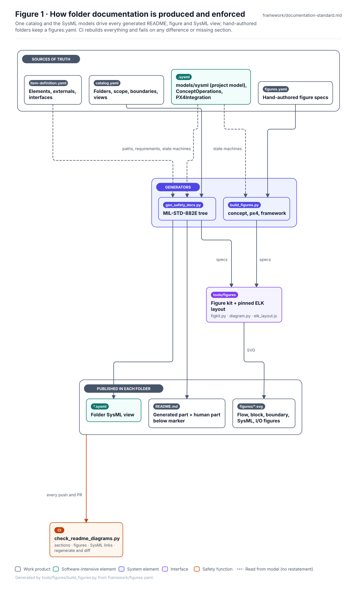

# Documentation Standard — Folder READMEs, Figures and SysML Models

**Status:** Draft v0.2 · **Applies to:** every folder README in an enforced documentation root
(`safety/mil-std-882e/`, `concept/`, `integrations/px4/`, `requirements/`, `verification/`, `changes/`, `reviews/`, `decisions/`, `architecture/`, `safety/` (front page), `sim/` (front page), `standards/`, `models/`, `integrations/`, `framework/` (front page), `tools/`, `docs/`, `cad/`, `sim/uav/`) and, as guidance, every new engineering folder.

<!-- terms:start (generated by tools/terms/terms.py; do not edit by hand) -->

<b>Terms on this page (32)</b>: abbreviations and codes explained

| Term | Meaning |
|---|---|
| 3D | three-dimensional |
| ARP4754B | SAE guidelines for development of civil aircraft and systems |
| ARP4761A | SAE guidelines for the safety assessment process on civil aircraft |
| CAD | computer-aided design |
| CI | continuous integration (the automated checks GitHub runs on every change) |
| CL-nnn | concept layout (cad/params/CL-nn.yaml; CL-01 to CL-05, CL-05 the reference layout) |
| CONOPS | concept of operations |
| D01 | decision-register validator rule (D01) |
| DoD | US Department of Defense |
| ELK | Eclipse Layout Kernel, the engine that lays out the generated figures |
| ID | identifier |
| IF-nnn | interface in the item definition (architecture/item-definition.yaml) |
| MIL-STD-882E | US DoD Standard Practice for System Safety (11 May 2012, base edition) |
| MOD-nnn | operating mode from the CONOPS (MOD-01 to MOD-10) |
| OMG | Object Management Group, publisher of SysML |
| PHL | preliminary hazard list (MIL-STD-882E Task 201) |
| PX4 | PX4 Autopilot, the open-source flight-control software candidate for SUS-A1 |
| R01 … | validator rule in tools/pdac (R13 = only a named human review accepts anything) |
| SAE | SAE International, publisher of ARP4754B and ARP4761A |
| SAR | safety assessment report (MIL-STD-882E Task 301) |
| SHA | system hazard analysis (MIL-STD-882E Task 205) |
| SITL | software-in-the-loop simulation |
| SSF-nnn | safety-significant software function record (safety/software/) |
| SUS-A1 | dockable observation UAV |
| SUS-I1 | integrated mechanized walker and observation UAV |
| SUS-M1-SAF | independent safety monitor, protective stop and isolation |
| SVG | Scalable Vector Graphics, the figure file format |
| SYS-nnn | system safety requirement record (requirements/SYS-nnn.yaml) |
| SysML | Systems Modeling Language (SysML v2) |
| UAV | uncrewed aerial vehicle (drone) |
| US | United States |
| YAML | a plain-text data format used for the records |

All terms: [abbreviations and record codes](https://github.com/jherrodthomas/Project-Susanoo/blob/main/docs/terms.md).

<!-- terms:end -->

A folder README is the entry point to a controlled work product. A reader must be able to see, without opening
anything else, **what part of the system it covers, where its boundary is, how it is modelled, and what flows in
and out**. Prose alone is not enough, and neither is a sketch: figures are generated, styled consistently, and
checked in CI like code.

## Required README sections

| # | Section (exact `##` heading) | Must contain |
|---|---|---|
| 1 | `Purpose` | 2–5 sentences: what this folder is for |
| 2 | `Position in the MIL-STD-882E flow` *(safety tree only)* | The eight-element process rail with this folder highlighted |
| 3 | `Block diagram` | SUS-I1 decomposition; in-scope blocks in their tone, out-of-scope blocks hatched |
| 4 | `Boundary diagram` | Dashed boundary, inside elements, external entities, every crossing numbered; plus the crossing table and explicit exclusions |
| 5 | `SysML model` | Link to the `.sysml` model of record **and** at least one SysML figure (bdd, ibd, req, act, stm or uc) |
| 6 | `Inputs and outputs` | Data-flow figure plus input and output tables linking source and destination folders |
| 7 | `Folder contents` | Subfolders and expected files, each marked present / planned / generated |

Every diagram section embeds a generated SVG from the folder's `figures/` directory. Mermaid is not used: it
cannot hold the house style, and CI rejects it in enforced roots. A metadata table and a status line stating
what is **not** claimed precede section 1.

## Folder previews

Every folder in the repository shows a reader what it holds before they open a file: a main figure and a thumbnail
gallery, each linking to the full figure or its page. Folders in the enforced roots above meet this through their
README sections. Every other folder is listed in [`docs/previews.yaml`](../docs/previews.yaml):

- **No README:** `python -m tools.previews.build_previews` writes one, with a title, purpose, the preview and a
  contents table built from the folder (record titles are read from the files).
- **Hand-written README:** it inserts a preview block under the page's opening and leaves the rest alone.
- **No figure yet:** the entry says what the figure will show (`planned`) until it exists.
- **Exempt:** tests, tooling internals and `figures/` stores, which the README above them already shows.

CI fails on a folder with no entry, on a missing image and on a stale preview, so a new folder gets a preview from
the start.

## Abbreviations, acronyms and record codes

Readers should never meet an unexplained abbreviation. Every term is defined once, in
[`docs/terms.yaml`](../docs/terms.yaml), and listed on the generated [terms page](../docs/terms.md); element IDs such
as `SUS-M1-SAF` are defined from the item definition.

- **Pages:** a folded *Terms on this page* block near the opening lists only the terms that page uses.
- **Figures:** a *Terms:* line at the bottom defines what the figure draws, so it still explains itself when copied out.
- **3D scenes:** a terms line above the play bar.
- **How:** every generator passes its output through `tools.terms.terms.decorate`; hand-written pages are updated by
  `python -m tools.terms.terms`. CI fails on a stale block or line, or on any abbreviation not in the list. To add a
  term, add it to `docs/terms.yaml` and run the command; ordinary words written in capitals go under `not_terms`.

## Figure style

Figures follow one house style, shared with the LionDriver assurance figures, so a reader learns it once.

**Anatomy.** Every figure has, top to bottom: `Figure N · Title` (bold, 20 px); a one- or two-line subtitle that
says what to look at; the source reference (top right, or under the subtitle when the title is long); a hairline;
the drawing; a legend that lists only what this figure uses; and a "Generated by … from …" footer naming the
script and the source file. The SVG `<title>` and `<desc>` repeat the title and subtitle for screen readers.

**Tones.** A colour means the same thing in every figure:

| Tone | Stroke / fill | Meaning |
|---|---|---|
| System | `#4F46E5` / `#EEF2FF` | System element |
| Software | `#0F766E` / `#F0FDFA` | Software-intensive element (motion control, flight control) |
| Safety | `#C2410C` / `#FFF7ED` | Safety function, protective element, authority path, analysis boundary |
| Interface | `#7C3AED` / `#F5F3FF` | Interface (dock), enumerations in SysML views |
| External | `#64748B` / `#F1F5F9` | Outside the system of interest; imported definitions |
| Work product | `#475569` / white | Another folder or document |
| This folder | `#0F172A` fill, white text | The folder the README belongs to |
| Out of scope | grey hatch, dashed | Present in the system, not in this folder's scope |

**Cards.** Rounded cards carry an ID pill (`SUS-M1-SAF`), a bold title and a muted subtitle. Containers use a
dark banner (`SUS-I1 · INTEGRATED MECH + UAV SYSTEM`) or a bold title. Boundaries are dashed amber with an amber
banner. **Connectors** are orthogonal with rounded corners; labels sit on a white chip; numbered or interface pills
(`1`, `005/006`) tie a crossing to its table row. Dashed connectors mean iteration, «satisfy» / «verify» /
«deriveReqt», or a read-only relationship.

**SysML figures** sit in a SysML diagram frame with the standard tab — `stm [state def] OperatingModes`,
`bdd [package] RiskAssessment` — and use SysML shapes: compartmented blocks with «stereotype», requirement boxes
with `id =` and risk / verification pills, rounded states with mode-ID pills, initial and final pseudostates,
actors and use-case ellipses.

**Size.** Layouts are computed by a pinned ELK engine. Each figure is laid out left-to-right and top-to-bottom and
the version that fits a 1040 px content width is kept, so text stays readable at GitHub page width without
horizontal scrolling.

## Choosing the SysML view

| Folder holds… | Primary view | Example |
|---|---|---|
| Records or reports (PHL, SAR, hazard log) | **bdd**: record structure | Task 201, Task 301 |
| Requirements | **req**: requirements with satisfy / verify / derive | Task 203, safety requirements |
| A procedure or analysis flow | **act**: activity | Task 101, element 4 |
| Lifecycles, modes, approvals | **stm**: state machine | Task 103, Task 206 |
| Interfaces or external context | **ibd**: parts and connectors | Task 205, Task 209 |
| Operational scenarios | **uc**: use cases and actors | concept |

## Modelling rules

1. **SysML v2 textual notation is the model of record.** Figures are drawn from the same data.
2. There is one system model: [`models/sysml/model`](../models/sysml/model/) (`SusanooArchitecture`,
   `SusanooLibrary`, `SusanooRequirements`), checked against the records in `architecture/` and `requirements/`.
   Elements, externals and interfaces are read from [`architecture/item-definition.yaml`](../architecture/item-definition.yaml).
   Every folder view imports the model; do not redefine system parts, requirements or risk enums locally.
3. A model element has one owner. Other folders reference it rather than restating it: requirements by
   qualified name; state machines by reading the owning `.sysml` file. Task 206 (O&SHA), for example,
   analyses `ConceptOperations::OperatingModes`, and its figure is drawn from `concept/ConceptOperations.sysml`.
4. Element IDs (`SUS-M1-SAF`, `SYS-002`, `MOD-04`) are SysML short names, so models, YAML records and figures
   share one identifier.
5. MIL-STD-882E risk and ARP4761A failure-condition classification stay in separate packages.
6. Every documentation `.sysml` file must pass the OMG pilot implementation (0.62.0, pinned by
   `tools/sysml/pilot`) with no errors or warnings: `tools/validate_doc_sysml.sh`, run in CI. Names must not be
   SysML keywords (`requirement`, `verify`, `decide` …); the catalog validator rejects them before generation.

## Producing and checking figures

| Folder kind | Source | Command |
|---|---|---|
| MIL-STD-882E tree (generated READMEs) | `safety/mil-std-882e/catalog.yaml` + SysML models | `python3 tools/gen_safety_docs.py` |
| Hand-authored READMEs (`concept/`, `integrations/px4/`, `framework/`) | `<folder>/figures.yaml` + SysML models | `python3 tools/figures/build_figures.py` |
| Requirement register (generated README) | `requirements/SYS-*.yaml`, hazards, item definition, SysML model | `python3 tools/figures/requirements_readme.py` |
| Verification records (generated README) | `verification/`, hazard mitigations, requirements, 882E catalog | `python3 tools/figures/verification_readme.py` |
| Change requests (generated README) | `changes/`, hazard links (rule R10), 882E catalog | `python3 tools/figures/changes_readme.py` |
| Review records (generated README) | `reviews/`, tailoring authority, records rule R13 checks, 882E catalog | `python3 tools/figures/reviews_readme.py` |
| Decision register (generated README and SysML) | `decisions/register.yaml`, rule D01 | `python3 tools/figures/decisions_readme.py` |
| Architecture records (generated README) | `architecture/item-definition.yaml`, hazards, requirements, SysML model | `python3 tools/figures/architecture_readme.py` |
| Safety records front page (generated README) | hazards, SSFs, events, 882E catalog | `python3 tools/figures/safety_readme.py` |
| Simulation track (generated top, hand-written below) | `sim/` inputs and committed results | `python3 tools/figures/sim_readme.py` |
| Standards and tailoring (generated README) | 882E model, tailoring, SusanooLibrary.sysml | `python3 tools/figures/standards_readme.py` |
| Models (generated README) | `.sysml` files, `tools/sysml/check.py`, records | `python3 tools/figures/models_readme.py` |
| Integrations (generated README) | IF-PX4 interfaces, `PX4Integration.sysml`, SSFs, PX4 SITL results | `python3 tools/figures/integrations_readme.py` |
| Framework (generated README top) | applicability table, 882E tailoring gates, task records | `python3 tools/figures/framework_readme.py` |
| Tools (generated README) | tool docstrings and imports, `.github/workflows/` | `python3 tools/figures/tools_readme.py` |
| CAD (generated section of a hand-written README) | `cad/metrics.json`, layout parameters, CL-05 findings, records | `python3 tools/figures/cad_readme.py` |
| UAV SITL harness (generated README) | `sim/uav/scenarios.yaml`, `spec.yaml`, `sim/results/uav/` | `python3 tools/figures/uav_readme.py` |
| Docs (generated README) | the files in `docs/` and their GENERATED markers, `build_wiki.sources()` | `python3 tools/figures/docs_readme.py` |
| Concept: modes and scenarios section (generated, inside the hand-written README) | ConceptOperations.sysml, CONOPS.md, hazards, requirements | `python3 tools/figures/concept_readme.py` |
| Everything | | `python3 tools/check_readme_diagrams.py` |

One-time setup: `npm ci` in `tools/figures` (installs the pinned `elkjs` layout engine) and `pip install pyyaml`.

1. In the safety tree, edit the catalog, regenerate, and write analysis content **below** the `END GENERATED`
   marker of a README; that part is preserved.
2. In hand-authored folders, edit `figures.yaml`, rebuild, and embed each figure as
   ``.
3. Never edit an SVG by hand. CI regenerates every figure and fails on any difference, a missing README,
   section or figure, a broken SysML link, or Mermaid in an enforced root.

To bring another documentation root under enforcement, add it to `ENFORCED` in
`tools/check_readme_diagrams.py` (and to `FOLDERS` in `tools/figures/build_figures.py` if it has hand-authored
figures).
