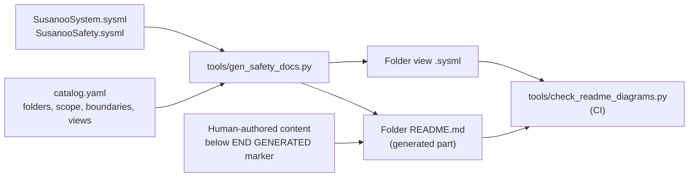

# Documentation Standard — Folder READMEs, Diagrams and SysML Models

**Status:** Draft v0.1 · **Applies to:** every folder README in an enforced documentation root
(currently `safety/mil-std-882e/`, `concept/` and `integrations/px4/`) and, as guidance, every new engineering folder in this repository.

A folder README is the entry point to a controlled work product. A reader must be able to see,
without opening anything else, **what part of the system it covers, where its boundary is, how it
is modelled, and what flows in and out**. Prose alone is not enough.

## Required README sections

| # | Section (exact `##` heading) | Must contain | Notation |
|---|---|---|---|
| 1 | `Purpose` | 2–5 sentences: what this folder is for | Prose |
| 2 | `Position in the MIL-STD-882E flow` *(safety tree only)* | The eight-element flow with this folder highlighted | Mermaid flowchart |
| 3 | `Block diagram` | SUS-I1 decomposition with in-scope blocks coloured, out-of-scope greyed | Mermaid flowchart (subgraphs = composition) |
| 4 | `Boundary diagram` | Dashed boundary frame, inside elements, external entities, every crossing labelled; plus a crossing table and explicit exclusions | Mermaid flowchart |
| 5 | `SysML model` | Link to the `.sysml` model of record **and** at least one rendered view (bdd, ibd, req, act or stm) | SysML v2 textual + Mermaid rendering |
| 6 | `Inputs and outputs` | Data-flow diagram plus input and output tables linking source/destination folders | Mermaid flowchart + tables |
| 7 | `Folder contents` | Subfolders and expected files, each marked present / planned / generated | Table |

A metadata table (element, tasks, gate, applicability, accountable role) and a status line stating
what is **not** claimed precede section 1.

## Choosing the SysML view

| Folder holds… | Primary view | Example |
|---|---|---|
| Records or reports (PHL, SAR, hazard log) | **bdd** — record structure | Task 201, Task 301 |
| Requirements | **req** — requirements with satisfy / verify / derive | Task 203, safety requirements |
| A procedure or analysis flow | **act** — activity | Task 101, element 4 |
| Lifecycles, modes, approvals | **stm** — state machine | Task 103, Task 206 |
| Interfaces or external context | **ibd** — parts and connections | Task 205, Task 209 |

Use more than one view when it helps (e.g. hazard tracking system: bdd + stm).

## Modelling rules

1. **SysML v2 textual notation is the model of record.** Mermaid diagrams are reading aids.
2. Canonical packages live in `safety/mil-std-882e/00-system-definition/sysml/`:
   `SusanooSystem` (structure, ports, dock interface) and `SusanooSafety` (severity, probability,
   risk level, software control category, mitigation precedence, hazard record).
   Every folder view imports both; do not redefine system parts or risk enums locally.
3. Element IDs (`SUS-M1-SAF`, `SYS-002`, …) are SysML short names (`<'SUS-M1-SAF'>`) so models,
   YAML records and diagrams share one identifier.
4. MIL-STD-882E risk and ARP4761A failure-condition classification stay in separate packages.
5. A requirement is defined once (in the folder that owns it) and referenced elsewhere by
   qualified name.

## Diagram conventions

| Colour | Meaning |
|---|---|
| Blue `#dceaf7` | System element |
| Amber `#fff0d9` | Safety function / protective element |
| Purple `#eae7f5` | Interface |
| Green `#e8f1e9` | External entity (people, environment, other systems) |
| Grey dashed | Out of scope for this folder |
| Solid amber-brown | "You are here" highlight |

- Boundaries are drawn as a **dashed amber frame**; every arrow crossing it must be labelled.
- Mermaid is used inline because GitHub renders it; complex editable layouts may additionally keep a
  Draw.io source under `docs/diagrams/` and link it.
- Diagrams describe proposed or planned design unless the status line says otherwise. Never present
  a diagram as evidence of verification.

## How the safety tree is produced and enforced (PDaC)

1. Edit `safety/mil-std-882e/catalog.yaml` (add a folder, change scope, boundary, inputs/outputs or views).
2. Run `python3 tools/gen_safety_docs.py`. The catalog is validated first (unique IDs, resolvable
   references, well-formed flows) and the READMEs and `.sysml` views are regenerated.
3. Write analysis content **below** the `END GENERATED` marker in a README; it is preserved.
4. Run `python3 tools/check_readme_diagrams.py`. CI runs the same check on every push and pull request
   and fails if a folder lacks a README, a required section or diagram is missing, a SysML link is
   broken, or generated files are stale.

`concept/` and `integrations/px4/` are hand-authored (no generator): their READMEs carry the same
required sections and link their own `.sysml` model (`ConceptOperations.sysml`, `PX4Integration.sysml`),
and the same CI check enforces them. To bring another documentation root under enforcement, add it to
`ENFORCED` in `tools/check_readme_diagrams.py` and provide the required sections.
