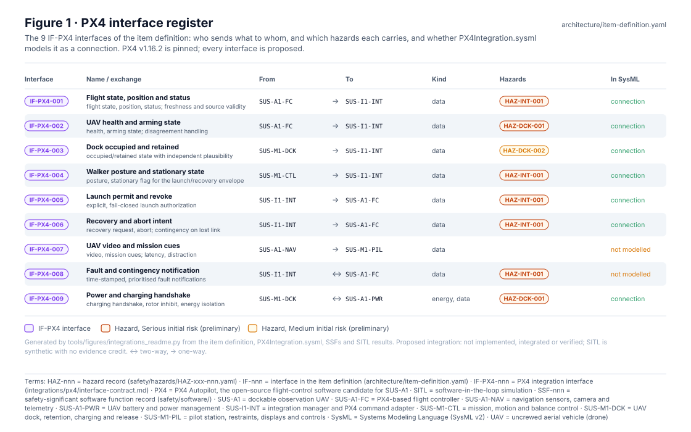
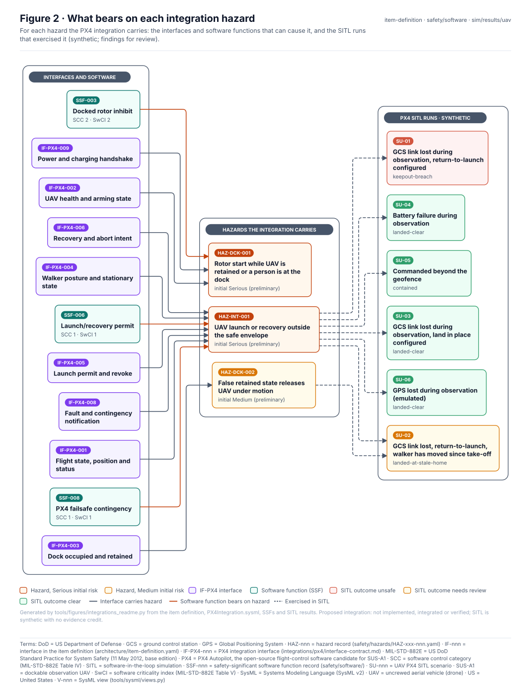
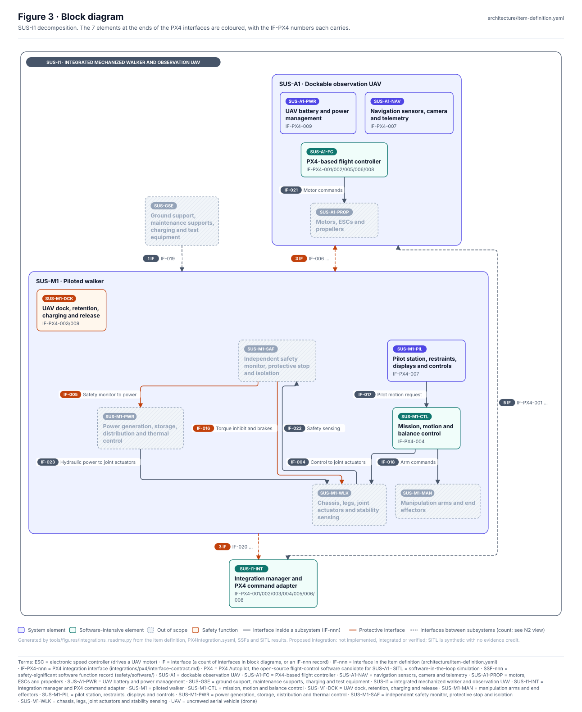
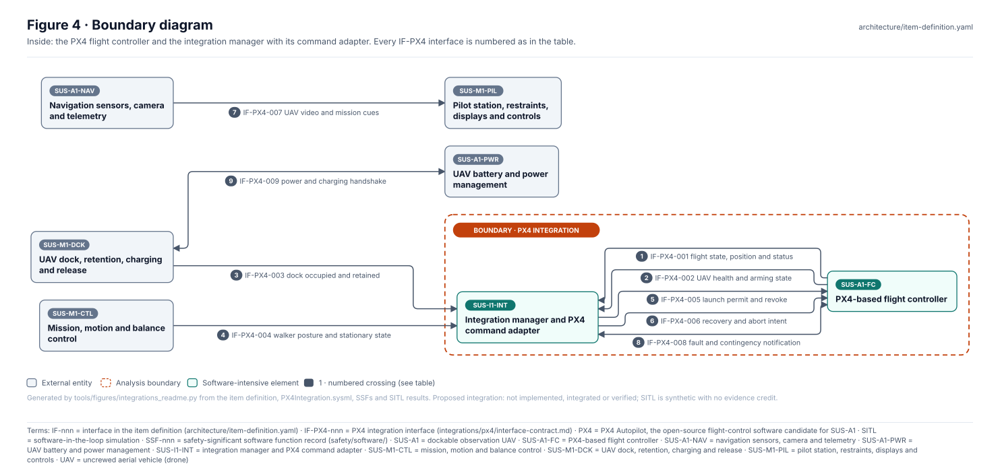
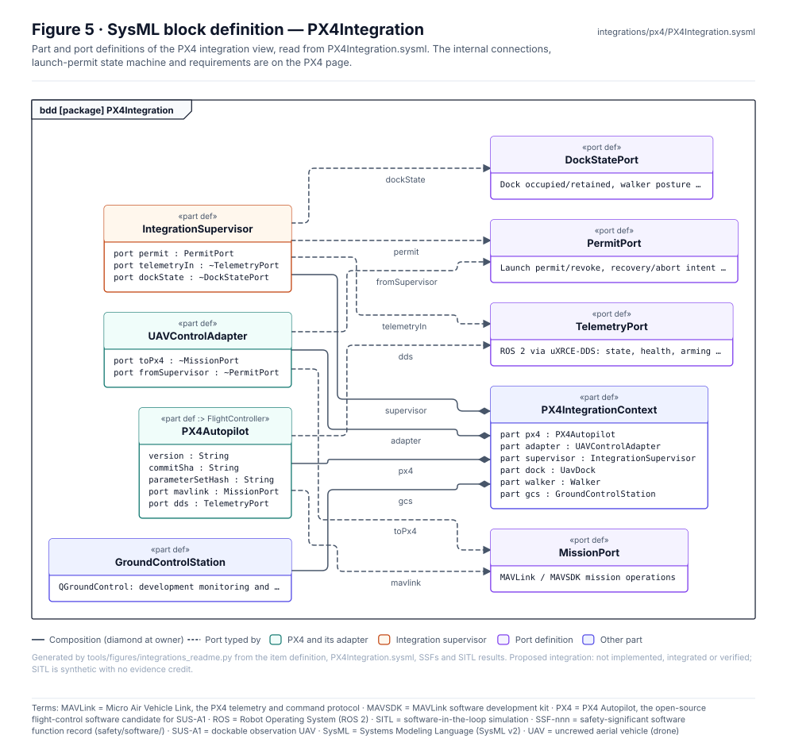
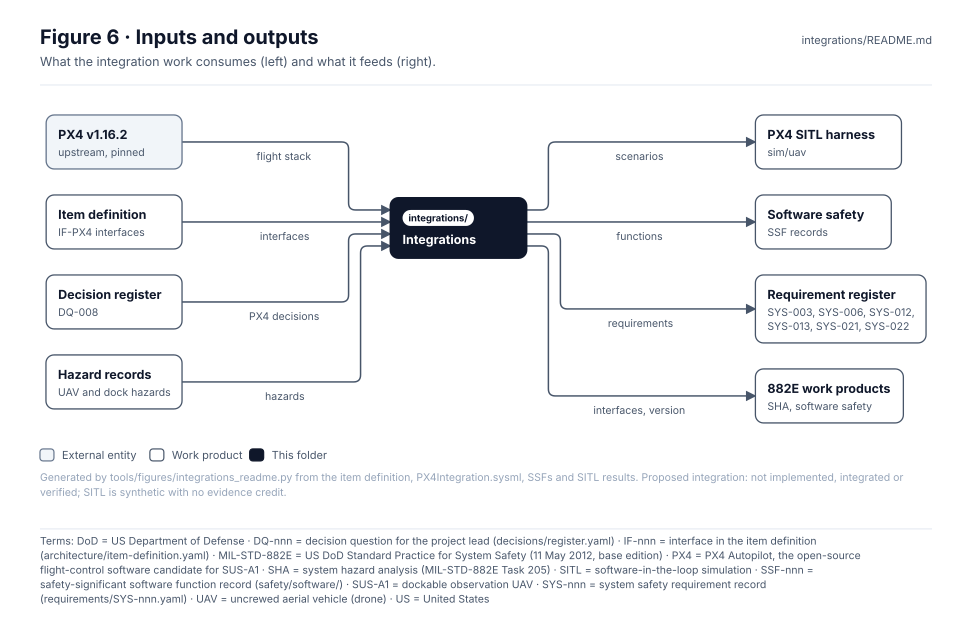

<!-- GENERATED by tools/figures/integrations_readme.py from the item definition, PX4Integration.sysml, SSFs and SITL results; edit those and regenerate. Content below the END GENERATED marker is preserved. -->

# Integrations

> **Status:** one integration, PX4 v1.16.2 for SUS-A1: 9 interfaces, 4 integration requirements, 6 SITL runs (synthetic). Proposed: not implemented, integrated or verified.

<!-- terms:start (generated by tools/terms/terms.py; do not edit by hand) -->

<b>Terms on this page (26)</b>: abbreviations and codes explained

| Term | Meaning |
|---|---|
| CI | continuous integration (the automated checks GitHub runs on every change) |
| DQ-nnn | decision question for the project lead (decisions/register.yaml) |
| GCS | ground control station |
| GPS | Global Positioning System |
| HAZ-nnn | hazard record (safety/hazards/HAZ-xxx-nnn.yaml) |
| IF-nnn | interface in the item definition (architecture/item-definition.yaml) |
| IF-PX4-nnn | PX4 integration interface (integrations/px4/interface-contract.md) |
| OMG | Object Management Group, publisher of SysML |
| PX4 | PX4 Autopilot, the open-source flight-control software candidate for SUS-A1 |
| PX4-R-nnn | PX4 integration requirement (integrations/px4/PX4Integration.sysml) |
| SITL | software-in-the-loop simulation |
| SU-nnn | UAV PX4 SITL scenario |
| SUS-A1 | dockable observation UAV |
| SUS-A1-FC | PX4-based flight controller |
| SUS-A1-NAV | navigation sensors, camera and telemetry |
| SUS-A1-PWR | UAV battery and power management |
| SUS-I1 | integrated mechanized walker and observation UAV |
| SUS-I1-INT | integration manager and PX4 command adapter |
| SUS-M1 | piloted walker |
| SUS-M1-CTL | mission, motion and balance control |
| SUS-M1-DCK | UAV dock, retention, charging and release |
| SUS-M1-PIL | pilot station, restraints, displays and controls |
| SVG | Scalable Vector Graphics, the figure file format |
| SYS-nnn | system safety requirement record (requirements/SYS-nnn.yaml) |
| SysML | Systems Modeling Language (SysML v2) |
| UAV | uncrewed aerial vehicle (drone) |

All terms: [abbreviations and record codes](https://github.com/jherrodthomas/Project-Susanoo/blob/main/docs/terms.md).

<!-- terms:end -->

| Field | Value |
|---|---|
| PX4 | [`px4/`](px4/README.md) · upstream tag `v1.16.2`, pinned in [`sim/uav/fetch_px4.sh`](../sim/uav/fetch_px4.sh) |
| Interface contract | [`px4/interface-contract.md`](px4/interface-contract.md) |
| SysML model | [`PX4Integration.sysml`](px4/PX4Integration.sysml) |
| SITL | [UAV simulation](../docs/wiki/UAV-Simulation.md), [`sim/results/uav/`](../sim/results/uav/) |

## Purpose

Third-party software integrated into SUS-I1, each behind its own assurance boundary. Today this is the PX4 flight stack on SUS-A1: PX4 owns flight once airborne, while launch, recovery and every command from the rest of SUS-I1 pass through the integration manager and a fail-closed command adapter. This page shows the interfaces, what bears on each hazard they carry, and the evidence so far; the PX4 page holds the contract, the launch-permit logic and the integration requirements.

## PX4 interfaces

| Interface | Name | From | To | Direction | Exchange | Hazards | In SysML |
|---|---|---|---|---|---|---|---|
| IF-PX4-001 | Flight state, position and status | `SUS-A1-FC` | `SUS-I1-INT` | uni | flight state, position, status; freshness and source validity | [HAZ-INT-001](../safety/hazards/HAZ-INT-001.yaml) | connection |
| IF-PX4-002 | UAV health and arming state | `SUS-A1-FC` | `SUS-I1-INT` | uni | health, arming state; disagreement handling | [HAZ-DCK-001](../safety/hazards/HAZ-DCK-001.yaml) | connection |
| IF-PX4-003 | Dock occupied and retained | `SUS-M1-DCK` | `SUS-I1-INT` | uni | occupied/retained state with independent plausibility | [HAZ-DCK-002](../safety/hazards/HAZ-DCK-002.yaml) | connection |
| IF-PX4-004 | Walker posture and stationary state | `SUS-M1-CTL` | `SUS-I1-INT` | uni | posture, stationary flag for the launch/recovery envelope | [HAZ-INT-001](../safety/hazards/HAZ-INT-001.yaml) | connection |
| IF-PX4-005 | Launch permit and revoke | `SUS-I1-INT` | `SUS-A1-FC` | uni | explicit, fail-closed launch authorization | [HAZ-INT-001](../safety/hazards/HAZ-INT-001.yaml) | connection |
| IF-PX4-006 | Recovery and abort intent | `SUS-I1-INT` | `SUS-A1-FC` | uni | recovery request, abort; contingency on lost link | [HAZ-INT-001](../safety/hazards/HAZ-INT-001.yaml) | connection |
| IF-PX4-007 | UAV video and mission cues | `SUS-A1-NAV` | `SUS-M1-PIL` | uni | video, mission cues; latency, distraction | — | not modelled |
| IF-PX4-008 | Fault and contingency notification | `SUS-I1-INT` | `SUS-A1-FC` | bi | time-stamped, prioritised fault notifications | [HAZ-INT-001](../safety/hazards/HAZ-INT-001.yaml) | not modelled |
| IF-PX4-009 | Power and charging handshake | `SUS-M1-DCK` | `SUS-A1-PWR` | bi | charging handshake, rotor inhibit, energy isolation | [HAZ-DCK-001](../safety/hazards/HAZ-DCK-001.yaml) | connection |

## What bears on each hazard

| Integration requirement | Statement |
|---|---|
| PX4-R-001 · LaunchOnlyWhenPermitted | Launch shall be authorised only in correct walker posture and dock state. |
| PX4-R-002 · StaleStateBlocksLaunch | Stale or inconsistent dock state shall prevent launch authorisation. |
| PX4-R-003 · NoAuthorityCollision | Flight and ground controller authority collision shall be prevented. |
| PX4-R-004 · LinkLossDoesNotMoveWalker | Lost link during docking shall abort appropriately and not command walker movement. |

| SITL run | Scenario | Hazards | Outcome |
|---|---|---|---|
| SU-01 | GCS link lost during observation, return-to-launch configured | HAZ-INT-001 | keepout-breach |
| SU-02 | GCS link lost, return-to-launch, walker has moved since take-off | HAZ-INT-001, HAZ-DCK-002 | landed-at-stale-home |
| SU-03 | GCS link lost during observation, land in place configured | HAZ-INT-001 | landed-clear |
| SU-04 | Battery failure during observation | HAZ-INT-001 | landed-clear |
| SU-05 | Commanded beyond the geofence | HAZ-INT-001 | contained |
| SU-06 | GPS lost during observation (emulated) | HAZ-INT-001 | landed-clear |

SITL outcomes are synthetic findings for the safety lead, not verification evidence (see the [simulation evidence gate](../sim/README.md#evidence-gate)).

## Block diagram

Elements and interfaces: [`architecture/item-definition.yaml`](../architecture/item-definition.yaml).

## Boundary diagram

| # | From | To | Crossing / interaction |
|---|---|---|---|
| 1 | `SUS-A1-FC` | `SUS-I1-INT` | IF-PX4-001 Flight state, position and status: flight state, position, status; freshness and source validity |
| 2 | `SUS-A1-FC` | `SUS-I1-INT` | IF-PX4-002 UAV health and arming state: health, arming state; disagreement handling |
| 3 | `SUS-M1-DCK` | `SUS-I1-INT` | IF-PX4-003 Dock occupied and retained: occupied/retained state with independent plausibility |
| 4 | `SUS-M1-CTL` | `SUS-I1-INT` | IF-PX4-004 Walker posture and stationary state: posture, stationary flag for the launch/recovery envelope |
| 5 | `SUS-I1-INT` | `SUS-A1-FC` | IF-PX4-005 Launch permit and revoke: explicit, fail-closed launch authorization |
| 6 | `SUS-I1-INT` | `SUS-A1-FC` | IF-PX4-006 Recovery and abort intent: recovery request, abort; contingency on lost link |
| 7 | `SUS-A1-NAV` | `SUS-M1-PIL` | IF-PX4-007 UAV video and mission cues: video, mission cues; latency, distraction |
| 8 | `SUS-I1-INT` | `SUS-A1-FC` | IF-PX4-008 Fault and contingency notification: time-stamped, prioritised fault notifications |
| 9 | `SUS-M1-DCK` | `SUS-A1-PWR` | IF-PX4-009 Power and charging handshake: charging handshake, rotor inhibit, energy isolation |

**Explicitly excluded:** PX4 controlling walker joints; PX4 as a pilot-safety controller for SUS-M1; QGroundControl as an operations procedure; weapons or autonomous targeting. (from the [PX4 page](px4/README.md#boundary-diagram))

## SysML model

Model of record: [`PX4Integration.sysml`](px4/PX4Integration.sysml), hand-written, importing `SusanooArchitecture` and validated by the OMG pilot in CI. Its internal block, state machine and requirement views are on the [PX4 page](px4/README.md).

## Inputs and outputs

| Input | Source |
|---|---|
| PX4 flight stack | upstream PX4, tag `v1.16.2` |
| IF-PX4 interfaces | [Architecture records](../architecture/README.md) |
| DQ-008: What should the UAV do when it loses the link to the integration manager? (applied) | [Decision register](../decisions/README.md) |
| UAV and dock hazards | [Safety records](../safety/README.md) |

| Output | Destination |
|---|---|
| SITL scenarios | [Simulation track](../sim/README.md) |
| Software functions | [`safety/software/`](../safety/software/README.md) |
| Allocated requirements SYS-003, SYS-006, SYS-012, SYS-013, SYS-021, SYS-022 | [Requirement register](../requirements/README.md) |
| Interfaces and version | [882E work products](../safety/mil-std-882e/README.md) |

## Folder contents

| Item | Description | State |
|---|---|---|
| [`px4/`](px4/README.md) | PX4 integration: contract, SysML view, figures (hand-written page) | folder |
| [`figures/`](figures/) | Generated SVG figures (do not edit) | generated |
| `README.md` | This page, generated above the END marker | generated |

<!-- END GENERATED: content below this line is human-authored and preserved -->
