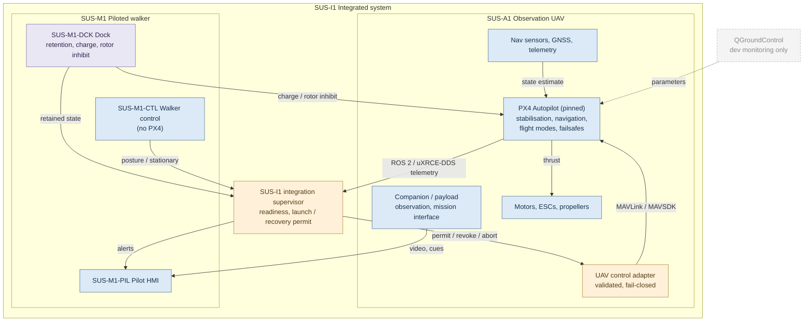
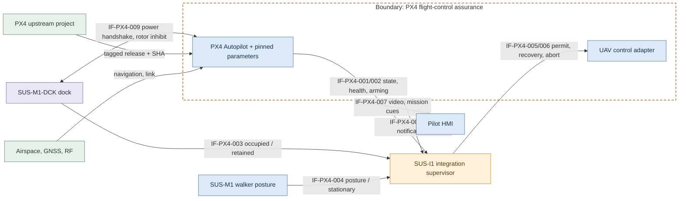
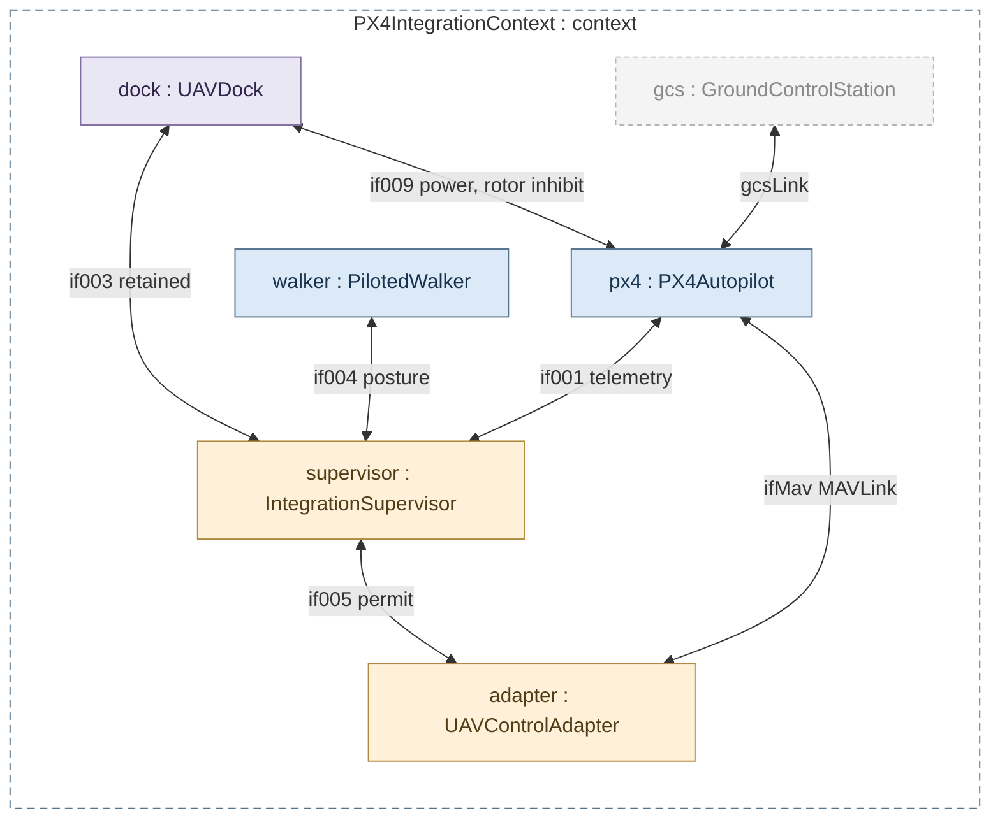
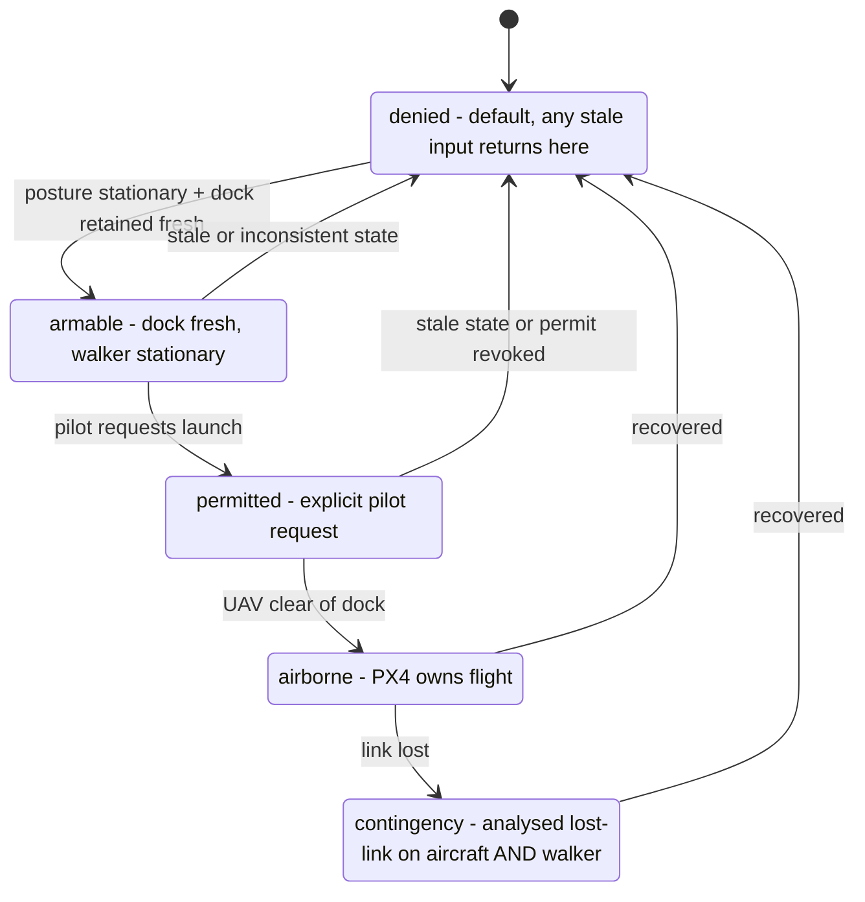
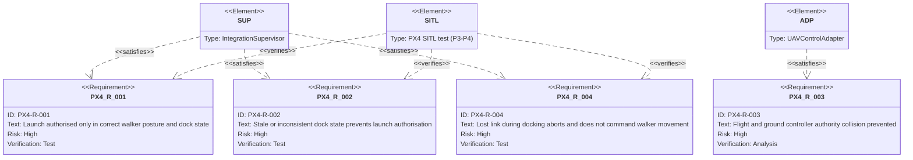
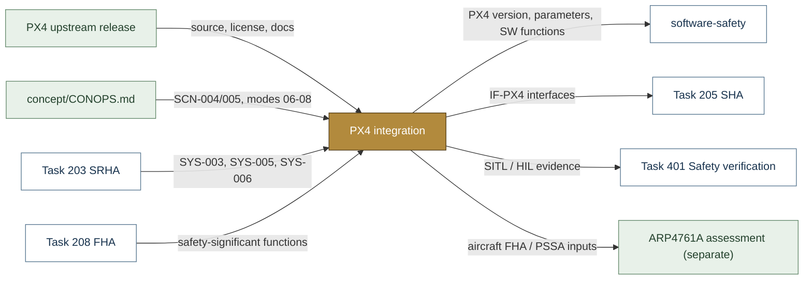

# PX4 Integration — SUS-A1 Candidate Flight-Control Baseline

> **Status:** proposed, not integrated or verified. This is an engineering integration plan, not a claim that PX4 or SUS-A1 is certified or airworthy.

| Field | Value |
|---|---|
| System element | SUS-A1-FCS (flight control) and its SUS-I1 interfaces |
| Lifecycle gate | G2 (architecture) through G4 (simulation readiness) |
| Accountable role | UAV lead with software safety lead |
| Interface contract | [`interface-contract.md`](interface-contract.md) |
| Documentation standard | [`framework/documentation-standard.md`](../../framework/documentation-standard.md) |

## Purpose

Adopt [PX4 Autopilot](https://github.com/PX4/PX4-Autopilot) as the **candidate** SUS-A1 flight-control software baseline. Keep PX4 upstream and version-pinned as an external dependency; do not vendor or fork PX4 in Susanoo until an actual divergence is justified.

**License:** BSD 3-Clause. Preserve original source/license notices when redistributing. External dependency review shall capture licenses and third-party notices.

### Functional split
- PX4: flight stabilization, navigation, flight modes, configured onboard failsafes and vehicle telemetry.
- SUS-A1 companion/integration: payload observation, mission interface and UAV dock handshake, avoiding unsafe simultaneous control authorities.
- SUS-M1: piloted walking/manipulation and pilot station. SUS-M1 does **not** use PX4 to control walker joints.
- SUS-I1 supervisory layer: coordinate readiness, UAV launch/recovery, operator alerting, docking interlocks, and system safety.
- QGroundControl: development/flight monitoring and parameter configuration, not a substitute for an approved operations procedure.

### Proposed interfaces
1. ROS 2 and uXRCE-DDS for telemetry and high-level integration where supported.
2. MAVLink/MAVSDK for mission-management operations under explicit state/authority constraints.
3. Defined application interface for dock readiness, retained state, mechanical release, rotor inhibit, launch clearance, approach permit and abort.
4. PDaC trace links from PX4 version/configuration through scenarios, safety analyses, requirements and tests.

## Block diagram

PX4 and the Susanoo-owned integration parts. Blue = system, amber = protective/authority function,
purple = interface, grey = external dependency or tool.

## Boundary diagram

Dashed frame = the **PX4 flight-control assurance boundary**. It is distinct from the walker
motion-control boundary; every crossing is an IF-PX4 contract item.

| Crossing | Interface | Control / safety concern |
|---|---|---|
| PX4 → supervisor | IF-PX4-001/002 | Freshness, source validity, disagreement |
| Dock / walker → supervisor | IF-PX4-003/004 | Independent plausibility, launch envelope |
| Supervisor → adapter | IF-PX4-005/006 | Explicit authorisation, fail-closed, lost-link contingency |
| UAV → pilot HMI | IF-PX4-007 | Latency, distraction, trust |
| Both directions | IF-PX4-008 | Time stamping and priority |
| Dock ↔ UAV power | IF-PX4-009 | Rotor inhibit, energy isolation |

**Explicitly excluded:** PX4 controlling walker joints; PX4 as a pilot-safety controller for SUS-M1;
QGroundControl as an operations procedure; weapons or autonomous targeting.

## SysML model

SysML v2 textual model: [`PX4Integration.sysml`](PX4Integration.sysml) — integration context (parts and
IF-PX4 connections), the fail-closed launch-permit state machine and the integration requirements derived
from the contract's acceptance tests. It imports
[`SusanooSystem`](../../safety/mil-std-882e/00-system-definition/sysml/SusanooSystem.sysml); `PX4Autopilot`
specialises `SusanooSystem::FlightControl`.

### Internal block / context (ibd) — PX4IntegrationContext

### State machine (stm) — LaunchPermit (fail-closed)

### Requirements (req) — integration requirements

## Inputs and outputs

| Input | Source |
|---|---|
| Source, license, documentation | [PX4 Autopilot](https://github.com/PX4/PX4-Autopilot) (pinned tag + SHA, TBD) |
| Observation and recovery scenarios, UAV modes | [`concept/CONOPS.md`](../../concept/CONOPS.md) |
| SYS-003, SYS-005, SYS-006 | [Task 203 SRHA](../../safety/mil-std-882e/02-hazard-identification/task-203-system-requirements-hazard-analysis/README.md) |
| Safety-significant functions | [Task 208 FHA](../../safety/mil-std-882e/02-hazard-identification/task-208-functional-hazard-analysis/README.md) |

| Output | Destination |
|---|---|
| PX4 version, parameters, software functions | [Software safety](../../safety/mil-std-882e/software-safety/README.md) |
| IF-PX4 interface hazards | [Task 205 SHA](../../safety/mil-std-882e/02-hazard-identification/task-205-system-hazard-analysis/README.md) |
| SITL / HIL evidence | [Task 401 Safety verification](../../safety/mil-std-882e/06-verification/task-401-safety-verification/README.md) |
| Aircraft FHA / PSSA inputs | ARP4761A assessment (separate scale; not yet created) |

## Folder contents

| Item | Description | State |
|---|---|---|
| [`interface-contract.md`](interface-contract.md) | IF-PX4-001..009, authority principles, acceptance tests | present |
| [`PX4Integration.sysml`](PX4Integration.sysml) | SysML v2 context, launch permit, requirements | present |
| `dependency-baseline.yaml` | Pinned PX4, airframe, parameters, ROS 2, simulator versions | planned |

## Dependency baseline register
| Item | Required baseline information |
|---|---|
| PX4 version | Tagged release and exact commit SHA (TBD) |
| Airframe | Model/geometry and airframe ID (TBD) |
| Firmware target | Board and OS (TBD) |
| Parameters | Exported configured parameter set (TBD) |
| ROS 2 | Distribution, px4_msgs branch/version and DDS bridge (TBD) |
| Gazebo | Tested simulator version and world model (TBD) |
| MAVLink/MAVSDK | Version and messages/API contract (TBD) |
| QGroundControl | Version and configuration (TBD) |
| Licenses/SBOM | Recorded and verified (TBD) |

## Incremental integration
**P0:** Run unmodified PX4 multicopter SITL; record build and simulator versions.  
**P1:** Connect QGroundControl and collect telemetry/logs.  
**P2:** Connect ROS 2 telemetry only; record message compatibility and time sync.  
**P3:** Implement simulation-only launch/recover mission state machine with explicit authority and mode checks.  
**P4:** Add simulated docking sensors, rotor inhibit and abort; inject faults.  
**P5:** Conduct UAV FHA, PSSA and system interface hazard analyses, close design gaps.  
**P6:** Evaluate HIL and physical test readiness through formal safety reviews; no automatic flight authorization.

## Offboard control warning
Do not publish setpoints indiscriminately. PX4's own documentation warns that ROS 2 setpoints can collide with onboard controller publishers. Use documented control modes and verify loss-of-offboard behavior. Prefer the PX4 ROS 2 Interface Library for custom modes if justified; experimental interfaces must be pinned and assessed.

## Review references
- https://github.com/PX4/PX4-Autopilot
- https://docs.px4.io/main/en/ros2/
- https://docs.px4.io/main/en/simulation/
- https://docs.px4.io/main/en/flight_modes/offboard.html
- https://github.com/PX4/px4_msgs

**Non-goals:** weapons, autonomous targeting, using PX4 as a pilot-safety controller for SUS-M1, or asserting DO-178C/ARP4761A qualification without evidence.
