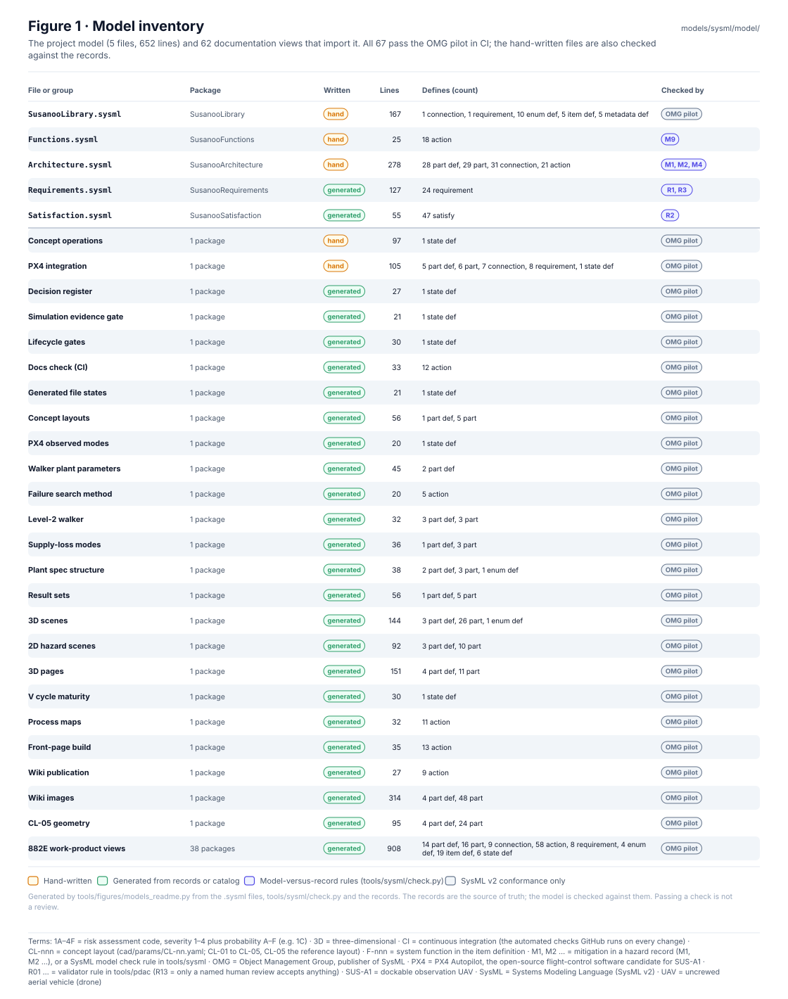
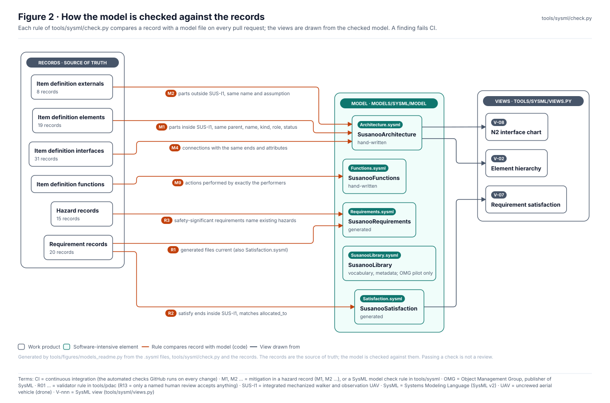
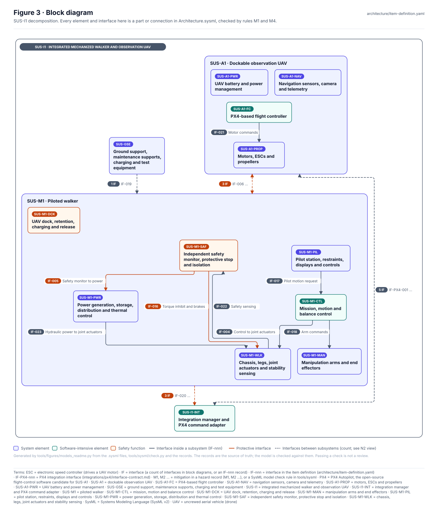
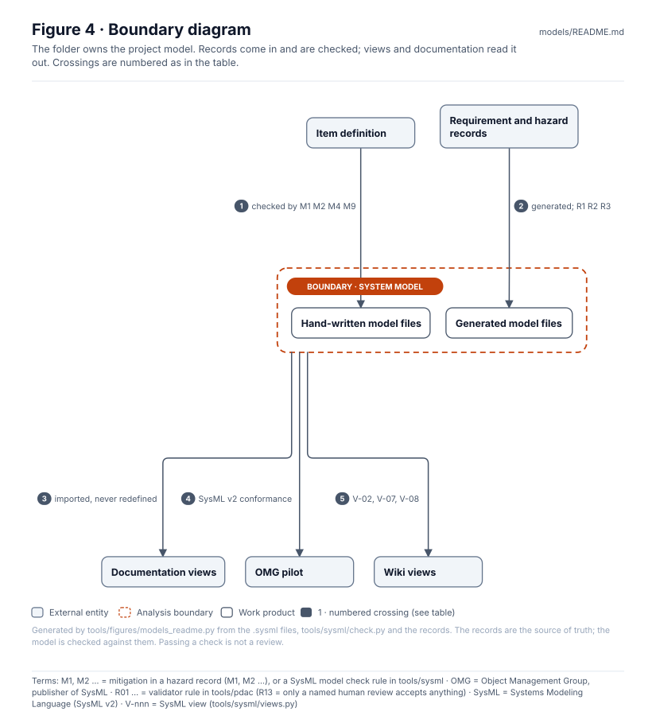
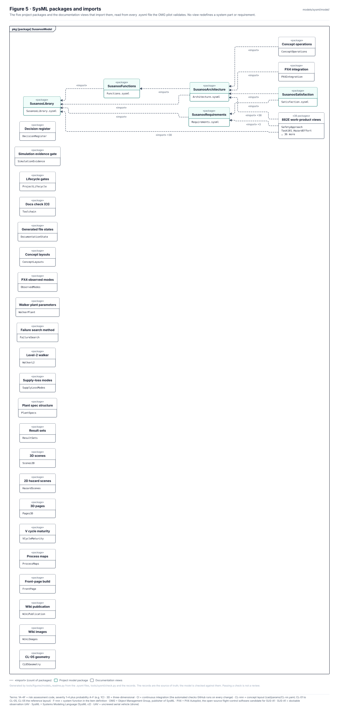
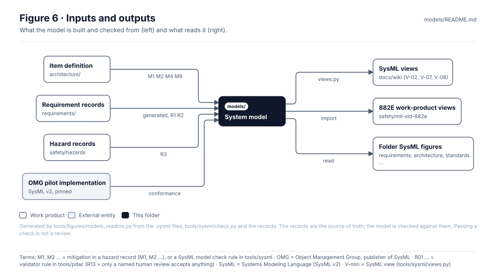

<!-- GENERATED by tools/figures/models_readme.py from the model files and records; edit those and regenerate. Content below the END GENERATED marker is preserved. -->

# Models

> **Status:** the SysML v2 model of SUS-I1, 5 files (652 lines), checked against the records on every pull request and validated with 59 documentation views by the OMG pilot. The records stay the source of truth; passing the checks is not a review.

<!-- terms:start (generated by tools/terms/terms.py; do not edit by hand) -->

<b>Terms on this page (10)</b>: abbreviations and codes explained

| Term | Meaning |
|---|---|
| CONOPS | concept of operations |
| M1, M2 … | mitigation in a hazard record (M1, M2 …), or a SysML model check rule in tools/sysml |
| OMG | Object Management Group, publisher of SysML |
| R01 … | validator rule in tools/pdac (R13 = only a named human review accepts anything) |
| SUS-I1 | integrated mechanized walker and observation UAV |
| SVG | Scalable Vector Graphics, the figure file format |
| SysML | Systems Modeling Language (SysML v2) |
| UAV | uncrewed aerial vehicle (drone) |
| V-nnn | SysML view (tools/sysml/views.py) |
| VCRM | verification cross-reference matrix |

All terms: [abbreviations and record codes](https://github.com/jherrodthomas/Project-Susanoo/blob/main/docs/terms.md).

<!-- terms:end -->

| Field | Value |
|---|---|
| Model | [`sysml/model/`](sysml/model/) — see [`sysml/README.md`](sysml/README.md) |
| Checks | `python -m tools.sysml.check` (M1 M2 M4 M9 R1 R2 R3), `tools/sysml/pilot/validate.sh`, `tools/validate_doc_sysml.sh` |
| Views | [SysML model wiki page](../docs/wiki/SysML-Model.md) (V-02, V-07, V-08) |

## Purpose

System models of record. Today this is the textual SysML v2 model in `sysml/`: the architecture, functions and 882E vocabulary are written by hand and checked against the item definition and records; the requirements and their satisfaction are generated from `requirements/`. Every documentation view in the repository imports these packages rather than redefining parts or requirements.

## Model inventory

| File | Package | Written | Lines | Defines |
|---|---|---|---|---|
| [`SusanooLibrary.sysml`](../models/sysml/model/SusanooLibrary.sysml) | SusanooLibrary | hand | 167 | 1 connection, 1 requirement, 10 enum def, 5 item def, 5 metadata def |
| [`Functions.sysml`](../models/sysml/model/Functions.sysml) | SusanooFunctions | hand | 25 | 18 action |
| [`Architecture.sysml`](../models/sysml/model/Architecture.sysml) | SusanooArchitecture | hand | 278 | 28 part def, 29 part, 31 connection, 21 action |
| [`Requirements.sysml`](../models/sysml/model/Requirements.sysml) | SusanooRequirements | generated | 127 | 24 requirement |
| [`Satisfaction.sysml`](../models/sysml/model/Satisfaction.sysml) | SusanooSatisfaction | generated | 55 | 47 satisfy |

Documentation views validated with the model

| File | Package | Imports |
|---|---|---|
| [`concept/ConceptOperations.sysml`](../concept/ConceptOperations.sysml) | ConceptOperations | ScalarValues, SusanooArchitecture |
| [`integrations/px4/PX4Integration.sysml`](../integrations/px4/PX4Integration.sysml) | PX4Integration | ScalarValues, SusanooArchitecture |
| [`decisions/DecisionRegister.sysml`](../decisions/DecisionRegister.sysml) | DecisionRegister | — |
| [`sim/SimulationEvidence.sysml`](../sim/SimulationEvidence.sysml) | SimulationEvidence | — |
| [`framework/Lifecycle.sysml`](../framework/Lifecycle.sysml) | ProjectLifecycle | — |
| [`tools/Toolchain.sysml`](../tools/Toolchain.sysml) | Toolchain | — |
| [`docs/Documentation.sysml`](../docs/Documentation.sysml) | DocumentationState | — |
| [`cad/ConceptLayouts.sysml`](../cad/ConceptLayouts.sysml) | ConceptLayouts | ScalarValues |
| [`sim/uav/ObservedModes.sysml`](../sim/uav/ObservedModes.sysml) | ObservedModes | — |
| [`sim/plant/WalkerPlant.sysml`](../sim/plant/WalkerPlant.sysml) | WalkerPlant | ScalarValues |
| [`sim/search/FailureSearch.sysml`](../sim/search/FailureSearch.sysml) | FailureSearch | — |
| [`sim/mujoco/WalkerL2.sysml`](../sim/mujoco/WalkerL2.sysml) | WalkerL2 | ScalarValues |
| [`sim/trades/SupplyLossModes.sysml`](../sim/trades/SupplyLossModes.sysml) | SupplyLossModes | ScalarValues |
| [`sim/spec/PlantSpecs.sysml`](../sim/spec/PlantSpecs.sysml) | PlantSpecs | ScalarValues |
| [`sim/results/ResultSets.sysml`](../sim/results/ResultSets.sysml) | ResultSets | ScalarValues |
| [`sim/scenes3d/Scenes3D.sysml`](../sim/scenes3d/Scenes3D.sysml) | Scenes3D | ScalarValues |
| [`sim/figures/HazardScenes.sysml`](../sim/figures/HazardScenes.sysml) | HazardScenes | ScalarValues |
| [`docs/3d/Pages3D.sysml`](../docs/3d/Pages3D.sysml) | Pages3D | ScalarValues |
| [`docs/vcycle/MaturityLadder.sysml`](../docs/vcycle/MaturityLadder.sysml) | VCycleMaturity | — |
| [`docs/diagrams/ProcessMaps.sysml`](../docs/diagrams/ProcessMaps.sysml) | ProcessMaps | — |
| [`docs/readme/FrontPage.sysml`](../docs/readme/FrontPage.sysml) | FrontPage | — |
| [`safety/mil-std-882e/01-safety-approach/SafetyApproach.sysml`](../safety/mil-std-882e/01-safety-approach/SafetyApproach.sysml) | SafetyApproach | ScalarValues, SusanooArchitecture, SusanooLibrary |
| [`safety/mil-std-882e/01-safety-approach/task-101-hazard-identification-and-mitigation-effort/Task101_HazardEffort.sysml`](../safety/mil-std-882e/01-safety-approach/task-101-hazard-identification-and-mitigation-effort/Task101_HazardEffort.sysml) | Task101_HazardEffort | ScalarValues, SusanooArchitecture, SusanooLibrary |
| [`safety/mil-std-882e/01-safety-approach/task-102-system-safety-program-plan/Task102_SSPP.sysml`](../safety/mil-std-882e/01-safety-approach/task-102-system-safety-program-plan/Task102_SSPP.sysml) | Task102_SSPP | ScalarValues, SusanooArchitecture, SusanooLibrary |
| [`safety/mil-std-882e/01-safety-approach/task-103-hazard-management-plan/Task103_HMP.sysml`](../safety/mil-std-882e/01-safety-approach/task-103-hazard-management-plan/Task103_HMP.sysml) | Task103_HMP | ScalarValues, SusanooArchitecture, SusanooLibrary |
| [`safety/mil-std-882e/01-safety-approach/task-104-government-reviews-and-audits/Task104_Reviews.sysml`](../safety/mil-std-882e/01-safety-approach/task-104-government-reviews-and-audits/Task104_Reviews.sysml) | Task104_Reviews | ScalarValues, SusanooArchitecture, SusanooLibrary |
| [`safety/mil-std-882e/01-safety-approach/task-105-integrated-product-team-support/Task105_IPT.sysml`](../safety/mil-std-882e/01-safety-approach/task-105-integrated-product-team-support/Task105_IPT.sysml) | Task105_IPT | ScalarValues, SusanooArchitecture, SusanooLibrary |
| [`safety/mil-std-882e/01-safety-approach/task-108-hazardous-materials-management-plan/Task108_HMMP.sysml`](../safety/mil-std-882e/01-safety-approach/task-108-hazardous-materials-management-plan/Task108_HMMP.sysml) | Task108_HMMP | ScalarValues, SusanooArchitecture, SusanooLibrary |
| [`safety/mil-std-882e/02-hazard-identification/HazardAnalyses.sysml`](../safety/mil-std-882e/02-hazard-identification/HazardAnalyses.sysml) | HazardAnalyses | ScalarValues, SusanooArchitecture, SusanooLibrary |
| [`safety/mil-std-882e/02-hazard-identification/task-201-preliminary-hazard-list/Task201_PHL.sysml`](../safety/mil-std-882e/02-hazard-identification/task-201-preliminary-hazard-list/Task201_PHL.sysml) | Task201_PHL | ScalarValues, SusanooArchitecture, SusanooLibrary |
| [`safety/mil-std-882e/02-hazard-identification/task-202-preliminary-hazard-analysis/Task202_PHA.sysml`](../safety/mil-std-882e/02-hazard-identification/task-202-preliminary-hazard-analysis/Task202_PHA.sysml) | Task202_PHA | ScalarValues, SusanooArchitecture, SusanooLibrary |
| [`safety/mil-std-882e/02-hazard-identification/task-203-system-requirements-hazard-analysis/Task203_SRHA.sysml`](../safety/mil-std-882e/02-hazard-identification/task-203-system-requirements-hazard-analysis/Task203_SRHA.sysml) | Task203_SRHA | RequirementDerivation, ScalarValues, SusanooArchitecture, SusanooLibrary, SusanooRequirements |
| [`safety/mil-std-882e/02-hazard-identification/task-204-subsystem-hazard-analysis/Task204_SSHA.sysml`](../safety/mil-std-882e/02-hazard-identification/task-204-subsystem-hazard-analysis/Task204_SSHA.sysml) | Task204_SSHA | ScalarValues, SusanooArchitecture, SusanooLibrary |
| [`safety/mil-std-882e/02-hazard-identification/task-205-system-hazard-analysis/Task205_SHA.sysml`](../safety/mil-std-882e/02-hazard-identification/task-205-system-hazard-analysis/Task205_SHA.sysml) | Task205_SHA | ScalarValues, SusanooArchitecture, SusanooLibrary |
| [`safety/mil-std-882e/02-hazard-identification/task-206-operating-and-support-hazard-analysis/Task206_OSHA.sysml`](../safety/mil-std-882e/02-hazard-identification/task-206-operating-and-support-hazard-analysis/Task206_OSHA.sysml) | Task206_OSHA | ConceptOperations, ScalarValues, SusanooArchitecture, SusanooLibrary |
| [`safety/mil-std-882e/02-hazard-identification/task-207-health-hazard-analysis/Task207_HHA.sysml`](../safety/mil-std-882e/02-hazard-identification/task-207-health-hazard-analysis/Task207_HHA.sysml) | Task207_HHA | ScalarValues, SusanooArchitecture, SusanooLibrary |
| [`safety/mil-std-882e/02-hazard-identification/task-208-functional-hazard-analysis/Task208_FHA.sysml`](../safety/mil-std-882e/02-hazard-identification/task-208-functional-hazard-analysis/Task208_FHA.sysml) | Task208_FHA | ScalarValues, SusanooArchitecture, SusanooLibrary |
| [`safety/mil-std-882e/02-hazard-identification/task-209-system-of-systems-hazard-analysis/Task209_SoSHA.sysml`](../safety/mil-std-882e/02-hazard-identification/task-209-system-of-systems-hazard-analysis/Task209_SoSHA.sysml) | Task209_SoSHA | ScalarValues, SusanooArchitecture, SusanooLibrary |
| [`safety/mil-std-882e/02-hazard-identification/task-210-environmental-hazard-analysis/Task210_EHA.sysml`](../safety/mil-std-882e/02-hazard-identification/task-210-environmental-hazard-analysis/Task210_EHA.sysml) | Task210_EHA | ScalarValues, SusanooArchitecture, SusanooLibrary |
| [`safety/mil-std-882e/03-risk-assessment/RiskAssessment.sysml`](../safety/mil-std-882e/03-risk-assessment/RiskAssessment.sysml) | RiskAssessment | ScalarValues, SusanooArchitecture, SusanooLibrary |
| [`safety/mil-std-882e/04-mitigation-identification/MitigationIdentification.sysml`](../safety/mil-std-882e/04-mitigation-identification/MitigationIdentification.sysml) | MitigationIdentification | ScalarValues, SusanooArchitecture, SusanooLibrary |
| [`safety/mil-std-882e/05-risk-reduction/RiskReduction.sysml`](../safety/mil-std-882e/05-risk-reduction/RiskReduction.sysml) | RiskReduction | ScalarValues, SusanooArchitecture, SusanooLibrary |
| [`safety/mil-std-882e/05-risk-reduction/safety-requirements/SafetyRequirements.sysml`](../safety/mil-std-882e/05-risk-reduction/safety-requirements/SafetyRequirements.sysml) | SafetyRequirements | RequirementDerivation, ScalarValues, SusanooArchitecture, SusanooLibrary, SusanooRequirements |
| [`safety/mil-std-882e/06-verification/SafetyVerification.sysml`](../safety/mil-std-882e/06-verification/SafetyVerification.sysml) | SafetyVerification | ScalarValues, SusanooArchitecture, SusanooLibrary |
| [`safety/mil-std-882e/06-verification/task-303-test-and-evaluation-participation/Task303_TestParticipation.sysml`](../safety/mil-std-882e/06-verification/task-303-test-and-evaluation-participation/Task303_TestParticipation.sysml) | Task303_TestParticipation | ScalarValues, SusanooArchitecture, SusanooLibrary |
| [`safety/mil-std-882e/06-verification/task-401-safety-verification/Task401_SafetyVerification.sysml`](../safety/mil-std-882e/06-verification/task-401-safety-verification/Task401_SafetyVerification.sysml) | Task401_SafetyVerification | ScalarValues, SusanooArchitecture, SusanooLibrary, SusanooRequirements |
| [`safety/mil-std-882e/06-verification/task-402-explosives-hazard-classification-data/Task402_Applicability.sysml`](../safety/mil-std-882e/06-verification/task-402-explosives-hazard-classification-data/Task402_Applicability.sysml) | Task402_Applicability | ScalarValues, SusanooArchitecture, SusanooLibrary |
| [`safety/mil-std-882e/06-verification/task-403-explosive-ordnance-disposal-data/Task403_Applicability.sysml`](../safety/mil-std-882e/06-verification/task-403-explosive-ordnance-disposal-data/Task403_Applicability.sysml) | Task403_Applicability | ScalarValues, SusanooArchitecture, SusanooLibrary |
| [`safety/mil-std-882e/07-risk-acceptance/RiskAcceptance.sysml`](../safety/mil-std-882e/07-risk-acceptance/RiskAcceptance.sysml) | RiskAcceptance | ScalarValues, SusanooArchitecture, SusanooLibrary |
| [`safety/mil-std-882e/07-risk-acceptance/acceptance-records/AcceptanceRecords.sysml`](../safety/mil-std-882e/07-risk-acceptance/acceptance-records/AcceptanceRecords.sysml) | AcceptanceRecords | ScalarValues, SusanooArchitecture, SusanooLibrary |
| [`safety/mil-std-882e/07-risk-acceptance/task-301-safety-assessment-report/Task301_SAR.sysml`](../safety/mil-std-882e/07-risk-acceptance/task-301-safety-assessment-report/Task301_SAR.sysml) | Task301_SAR | ScalarValues, SusanooArchitecture, SusanooLibrary |
| [`safety/mil-std-882e/07-risk-acceptance/task-302-hazard-management-assessment-report/Task302_HMAR.sysml`](../safety/mil-std-882e/07-risk-acceptance/task-302-hazard-management-assessment-report/Task302_HMAR.sysml) | Task302_HMAR | ScalarValues, SusanooArchitecture, SusanooLibrary |
| [`safety/mil-std-882e/08-lifecycle-risk-management/LifecycleRisk.sysml`](../safety/mil-std-882e/08-lifecycle-risk-management/LifecycleRisk.sysml) | LifecycleRisk | ScalarValues, SusanooArchitecture, SusanooLibrary |
| [`safety/mil-std-882e/08-lifecycle-risk-management/task-107-hazard-management-progress-report/Task107_ProgressReport.sysml`](../safety/mil-std-882e/08-lifecycle-risk-management/task-107-hazard-management-progress-report/Task107_ProgressReport.sysml) | Task107_ProgressReport | ScalarValues, SusanooArchitecture, SusanooLibrary |
| [`safety/mil-std-882e/08-lifecycle-risk-management/task-304-review-changes-deficiencies-mishaps-deviations/Task304_ChangeReview.sysml`](../safety/mil-std-882e/08-lifecycle-risk-management/task-304-review-changes-deficiencies-mishaps-deviations/Task304_ChangeReview.sysml) | Task304_ChangeReview | ScalarValues, SusanooArchitecture, SusanooLibrary |
| [`safety/mil-std-882e/SafetyProgramFlow.sysml`](../safety/mil-std-882e/SafetyProgramFlow.sysml) | SafetyProgramFlow | ScalarValues, SusanooArchitecture, SusanooLibrary |
| [`safety/mil-std-882e/hazard-tracking-system/HazardTrackingSystem.sysml`](../safety/mil-std-882e/hazard-tracking-system/HazardTrackingSystem.sysml) | HazardTrackingSystem | ScalarValues, SusanooArchitecture, SusanooLibrary |
| [`safety/mil-std-882e/software-safety/SoftwareSafety.sysml`](../safety/mil-std-882e/software-safety/SoftwareSafety.sysml) | SoftwareSafety | ScalarValues, SusanooArchitecture, SusanooLibrary |
| [`safety/mil-std-882e/templates/TemplateSchemas.sysml`](../safety/mil-std-882e/templates/TemplateSchemas.sysml) | TemplateSchemas | ScalarValues, SusanooArchitecture, SusanooLibrary |

## How the model is checked

| Rule | Compares | With | Check |
|---|---|---|---|
| M1 | Item definition elements | `Architecture.sysml` | parts inside SUS-I1, same parent, name, kind, role, status |
| M2 | Item definition externals | `Architecture.sysml` | parts outside SUS-I1, same name and assumption |
| M4 | Item definition interfaces | `Architecture.sysml` | connections with the same ends and attributes |
| M9 | Item definition functions | `Functions.sysml` | actions performed by exactly the performers |
| R1 | Requirement records | `Requirements.sysml` | generated files current (also Satisfaction.sysml) |
| R2 | Requirement records | `Satisfaction.sysml` | satisfy ends inside SUS-I1, matches allocated_to |
| R3 | Hazard records | `Requirements.sysml` | safety-significant requirements name existing hazards |

Views drawn from the checked model: [V-02 Element hierarchy](../docs/wiki/images/sysml-v02-hierarchy.svg), [V-07 Requirement satisfaction](../docs/wiki/images/sysml-v07-satisfy.svg), [V-08 N2 interface chart](../docs/wiki/images/sysml-v08-n2.svg).

## Block diagram

Elements and interfaces: [`architecture/item-definition.yaml`](../architecture/item-definition.yaml).

## Boundary diagram

| # | From | To | Crossing / interaction |
|---|---|---|---|
| 1 | Item definition | Hand-written model files | elements, externals, interfaces and functions, compared by M1 M2 M4 M9 |
| 2 | Requirement and hazard records | Generated model files | Requirements.sysml and Satisfaction.sysml, regenerated and compared (R1), satisfy and hazards checked (R2, R3) |
| 3 | System model | Documentation views | folder views import the packages; they never redefine parts |
| 4 | System model | OMG pilot | every file must pass with no errors or warnings |
| 5 | System model | Wiki views | V-02 hierarchy, V-07 satisfaction, V-08 N2 |

**Explicitly excluded:** CONOPS modes as a state machine, verification cases and the VCRM (not yet modelled; see [`sysml/README.md`](sysml/README.md)).

## SysML model

Model of record: the five files in [`sysml/model/`](sysml/model/), starting with [`Architecture.sysml`](sysml/model/Architecture.sysml). The package diagram is read from every `.sysml` file the OMG pilot validates.

## Inputs and outputs

| Input | Source |
|---|---|
| Elements, externals, interfaces, functions | [Architecture records](../architecture/README.md) |
| Requirements | [Requirement register](../requirements/README.md) |
| Hazards | [Safety records](../safety/README.md) |
| SysML v2 conformance | OMG pilot implementation, pinned in `tools/sysml/pilot` |

| Output | Destination |
|---|---|
| V-02, V-07, V-08 | [SysML model wiki page](../docs/wiki/SysML-Model.md) |
| Imported by every work-product view | [882E work products](../safety/mil-std-882e/README.md) |
| Read by folder figures | requirements, architecture, standards pages |

## Folder contents

| Item | Description | State |
|---|---|---|
| [`sysml/`](sysml/README.md) | SUS-I1 SysML v2 model, commands and rules (hand-written page) | folder |
| [`figures/`](figures/) | Generated SVG figures (do not edit) | generated |
| `README.md` | This page, generated above the END marker | generated |

<!-- END GENERATED: content below this line is human-authored and preserved -->
