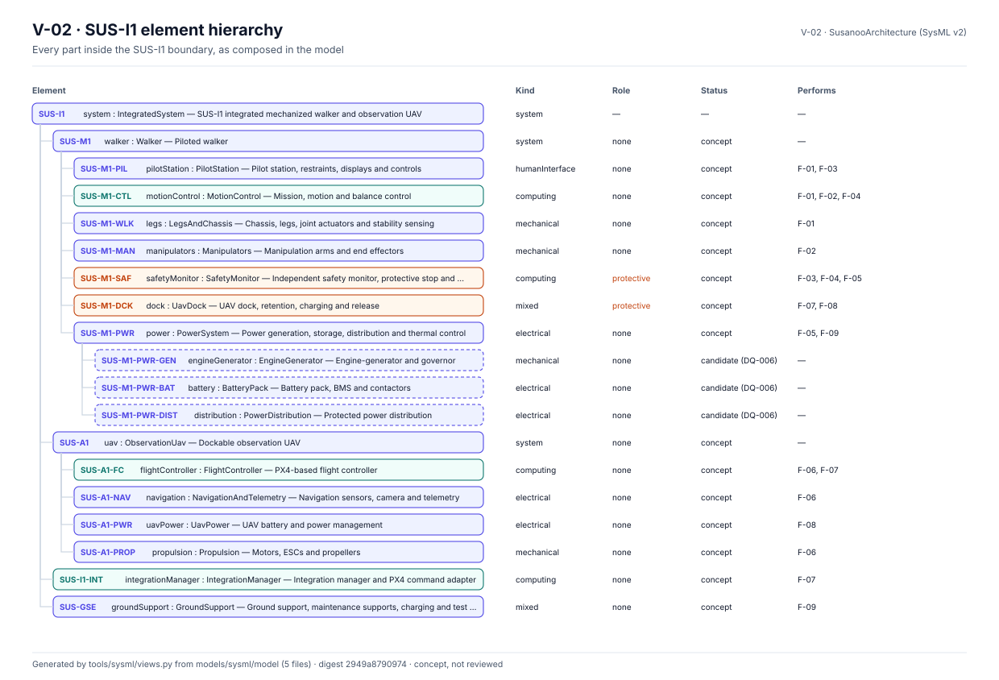
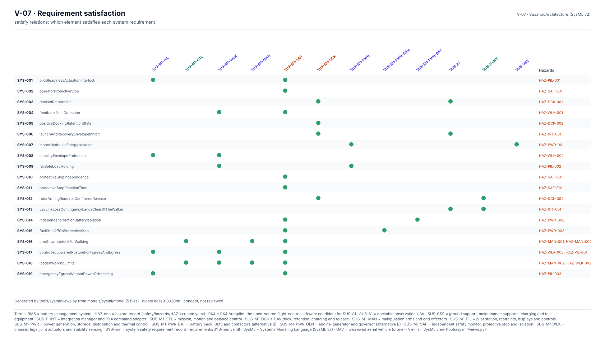
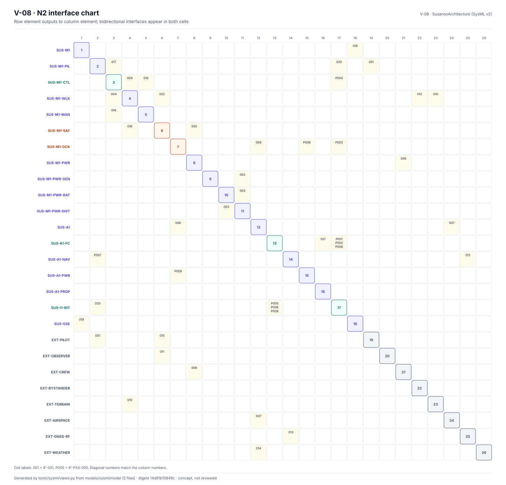

<!-- GENERATED by tools/previews/build_previews.py from docs/previews.yaml; do not edit. Edit the entry there and re-run. -->

# SysML v2 model files

The textual SysML v2 model. `Architecture`, `Functions` and `SusanooLibrary` are hand-written and checked against the records; `Requirements` and `Satisfaction` are generated from `requirements/`. Every file passes the OMG pilot implementation in CI.

<!-- terms:start (generated by tools/terms/terms.py; do not edit by hand) -->

<b>Terms on this page (4)</b>: abbreviations and codes explained

| Term | Meaning |
|---|---|
| CI | continuous integration (the automated checks GitHub runs on every change) |
| OMG | Object Management Group, publisher of SysML |
| SysML | Systems Modeling Language (SysML v2) |
| V-nnn | SysML view (tools/sysml/views.py) |

All terms: [abbreviations and record codes](https://github.com/jherrodthomas/Project-Susanoo/blob/main/docs/terms.md).

<!-- terms:end -->

<!-- preview:start (generated by tools/previews/build_previews.py from docs/previews.yaml; do not edit by hand) -->

Part hierarchy (view V-02)

<table>
<tr><td width="33%" valign="top"> Requirement satisfaction (view V-07)</td><td width="33%" valign="top"> N2 interface chart (view V-08)</td></tr>
</table>

<!-- preview:end -->

## Folder contents

| Item | Title |
|---|---|
| [`Architecture.sysml`](Architecture.sysml) |  |
| [`Functions.sysml`](Functions.sysml) |  |
| [`Requirements.sysml`](Requirements.sysml) |  |
| [`Satisfaction.sysml`](Satisfaction.sysml) |  |
| [`SusanooLibrary.sysml`](SusanooLibrary.sysml) |  |
