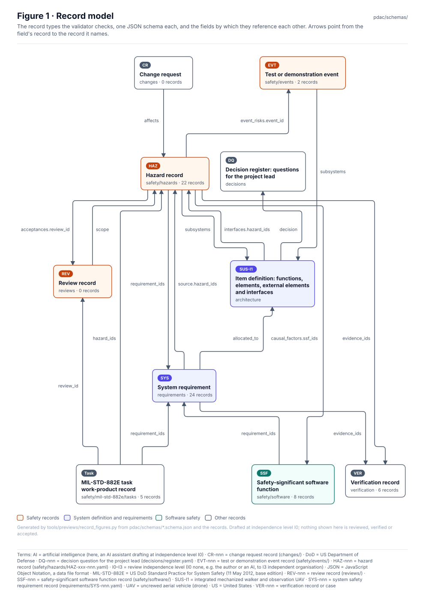

<!-- GENERATED by tools/previews/build_previews.py from docs/previews.yaml; do not edit. Edit the entry there and re-run. -->

# PDaC product definition

The Product Development as Code product record and the JSON schemas every record is validated against (`python -m tools.pdac.validate`).

<!-- terms:start (generated by tools/terms/terms.py; do not edit by hand) -->

<b>Terms on this page (2)</b>: abbreviations and codes explained

| Term | Meaning |
|---|---|
| JSON | JavaScript Object Notation, a data file format |
| PDaC | Product Development as Code |

All terms: [abbreviations and record codes](https://github.com/jherrodthomas/Project-Susanoo/blob/main/docs/terms.md).

<!-- terms:end -->

<!-- preview:start (generated by tools/previews/build_previews.py from docs/previews.yaml; do not edit by hand) -->

Record model: how the record types reference each other

<!-- preview:end -->

## Folder contents

| Item | Title |
|---|---|
| [`schemas/`](schemas/) | Record schemas |
| [`product.yaml`](product.yaml) |  |
