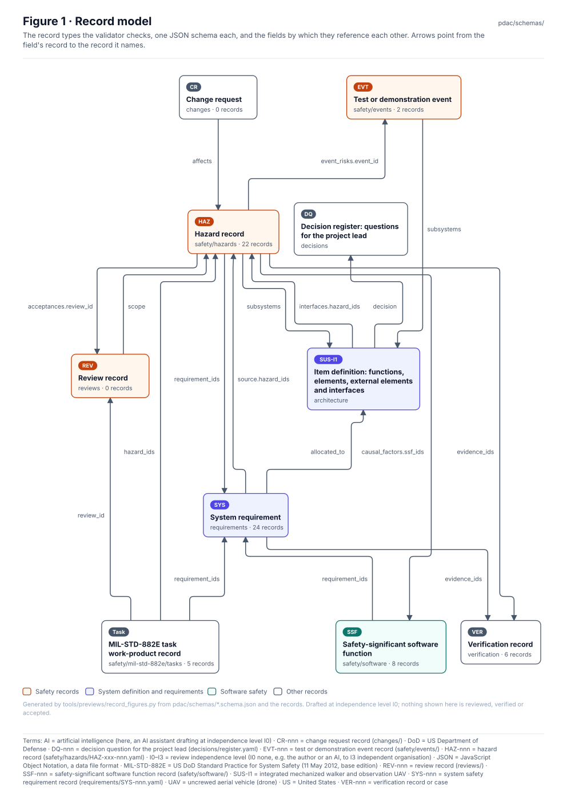

<!-- GENERATED by tools/previews/build_previews.py from docs/previews.yaml; do not edit. Edit the entry there and re-run. -->

# Record schemas

One JSON schema per record type. The validator checks every record against its schema before the MIL-STD-882E rules run.

<!-- terms:start (generated by tools/terms/terms.py; do not edit by hand) -->

<b>Terms on this page (5)</b>: abbreviations and codes explained

| Term | Meaning |
|---|---|
| DoD | US Department of Defense |
| HTS | hazard tracking system (MIL-STD-882E Task 106; here safety/hazards/) |
| JSON | JavaScript Object Notation, a data file format |
| MIL-STD-882E | US DoD Standard Practice for System Safety (11 May 2012, base edition) |
| US | United States |

All terms: [abbreviations and record codes](https://github.com/jherrodthomas/Project-Susanoo/blob/main/docs/terms.md).

<!-- terms:end -->

<!-- preview:start (generated by tools/previews/build_previews.py from docs/previews.yaml; do not edit by hand) -->

Record model: how the record types reference each other

<!-- preview:end -->

## Folder contents

| Item | Title |
|---|---|
| [`change-request.schema.json`](change-request.schema.json) | Change request (MIL-STD-882E 4.3.8, Task 304) |
| [`decision-register.schema.json`](decision-register.schema.json) | Decision register: questions for the project lead |
| [`event.schema.json`](event.schema.json) | Test or demonstration event (event risk, MIL-STD-882E 3.2.8, 4.3.7, Task 303) |
| [`hazard.schema.json`](hazard.schema.json) | Hazard record (MIL-STD-882E Task 106 HTS entry) |
| [`item-definition.schema.json`](item-definition.schema.json) | Item definition: functions, elements, external elements and interfaces |
| [`requirement.schema.json`](requirement.schema.json) | System requirement |
| [`review.schema.json`](review.schema.json) | Review record (the only way anything is accepted) |
| [`ssf.schema.json`](ssf.schema.json) | Safety-significant software function (MIL-STD-882E 4.4, Appendix B) |
| [`task-record.schema.json`](task-record.schema.json) | MIL-STD-882E task work-product record |
| [`verification.schema.json`](verification.schema.json) | Verification record (MIL-STD-882E 4.3.6, Task 401) |
