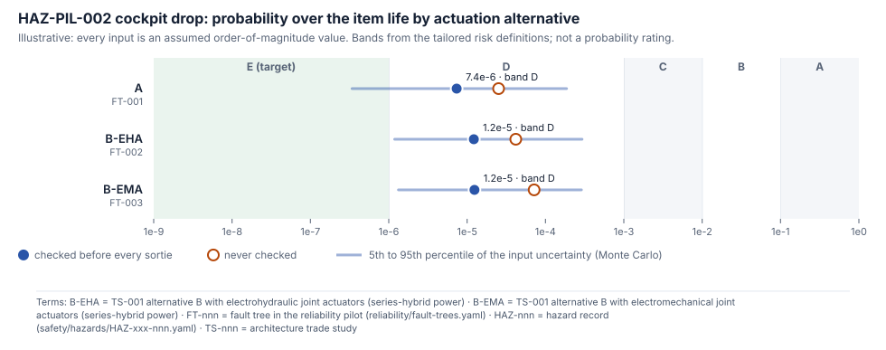
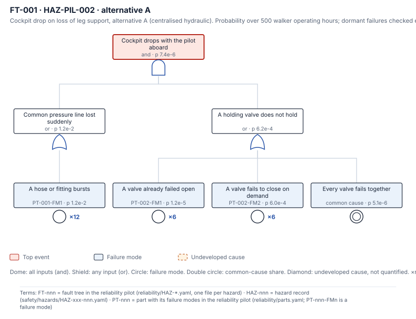
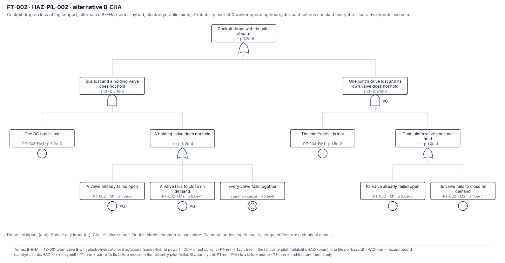
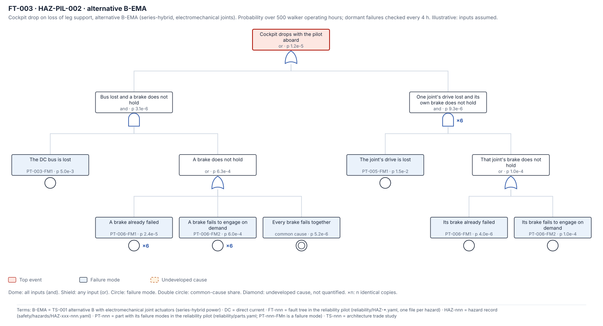
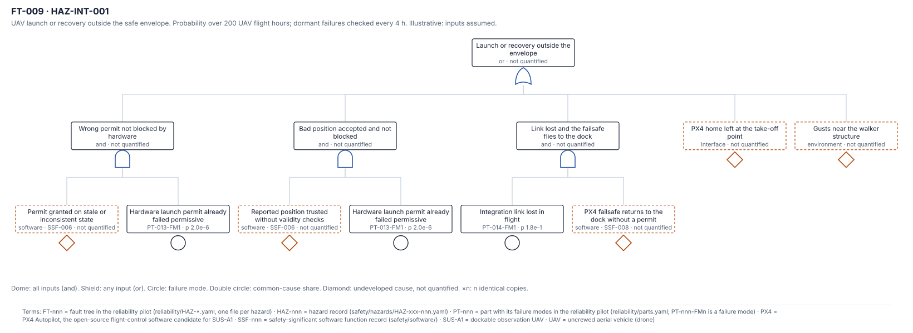
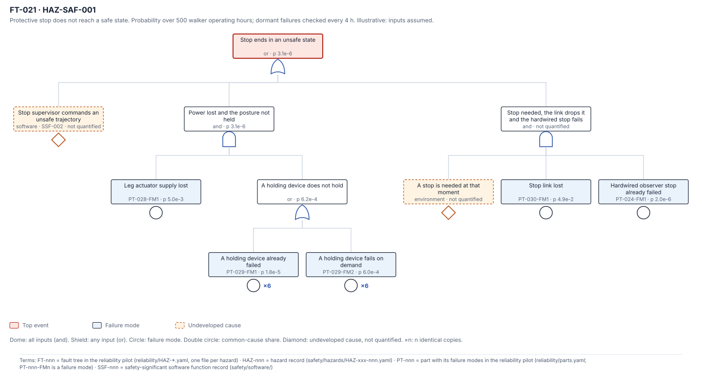

<!-- GENERATED by tools/previews/build_previews.py from docs/previews.yaml; do not edit. Edit the entry there and re-run. -->

# Reliability pilot records

Parts, failure modes, shared parameters and one fault-tree file per hazard for the reliability pilot (`tools/reliability`). Hardware causes are quantified against the tailored probability bands; software, human and environmental causes are undeveloped events, traced but not given a number. Every value is still assumed, so every result is illustrative: not evidence and not a probability rating.

<!-- terms:start (generated by tools/terms/terms.py; do not edit by hand) -->

<b>Terms on this page (9)</b>: abbreviations and codes explained

| Term | Meaning |
|---|---|
| AI | artificial intelligence (here, an AI assistant drafting at independence level I0) |
| B-EHA | TS-001 alternative B with electrohydraulic joint actuators (series-hybrid power) |
| B-EMA | TS-001 alternative B with electromechanical joint actuators (series-hybrid power) |
| CF1, CF2 … | causal factor in a hazard record (CF1, CF2 …) |
| FT-nnn | fault tree in the reliability pilot (reliability/HAZ-*.yaml, one file per hazard) |
| HAZ-nnn | hazard record (safety/hazards/HAZ-xxx-nnn.yaml) |
| I0–I3 | review independence level (I0 none, e.g. the author or an AI, to I3 independent organisation) |
| TS-nnn | architecture trade study |
| UAV | uncrewed aerial vehicle (drone) |

All terms: [abbreviations and record codes](https://github.com/jherrodthomas/Project-Susanoo/blob/main/docs/terms.md).

<!-- terms:end -->

<!-- preview:start (generated by tools/previews/build_previews.py from docs/previews.yaml; do not edit by hand) -->

Quantified hardware paths against the bands (illustrative)

<table>
<tr><td width="33%" valign="top"> FT-001: alternative A</td><td width="33%" valign="top"> FT-002: alternative B-EHA</td><td width="33%" valign="top"> FT-003: alternative B-EMA</td></tr>
<tr><td width="33%" valign="top"> FT-009: UAV launch or recovery outside the envelope</td><td width="33%" valign="top"> FT-021: protective stop not reaching a safe state</td></tr>
</table>

**Open:** [Reliability Pilot (wiki page)](../docs/wiki/Reliability-Pilot.md) · [Engine and record format](../tools/reliability/README.md)

<!-- preview:end -->

## Folder contents

| Item | Title |
|---|---|
| [`HAZ-DCK-001.yaml`](HAZ-DCK-001.yaml) | Fault tree for HAZ-DCK-001 (tools/reliability). Drafted by an AI at independence I0. |
| [`HAZ-DCK-002.yaml`](HAZ-DCK-002.yaml) | Fault tree for HAZ-DCK-002 (tools/reliability). Drafted by an AI at independence I0. |
| [`HAZ-DCK-003.yaml`](HAZ-DCK-003.yaml) | Fault tree for HAZ-DCK-003 (tools/reliability). Drafted by an AI at independence I0. |
| [`HAZ-DCK-004.yaml`](HAZ-DCK-004.yaml) | Fault tree for HAZ-DCK-004 (tools/reliability). Drafted by an AI at independence I0. |
| [`HAZ-GSE-001.yaml`](HAZ-GSE-001.yaml) | Fault tree for HAZ-GSE-001 (tools/reliability). Drafted by an AI at independence I0. |
| [`HAZ-INT-001.yaml`](HAZ-INT-001.yaml) | Fault tree for HAZ-INT-001 (tools/reliability). Drafted by an AI at independence I0. |
| [`HAZ-INT-002.yaml`](HAZ-INT-002.yaml) | Fault tree for HAZ-INT-002 (tools/reliability). Drafted by an AI at independence I0. |
| [`HAZ-MAN-001.yaml`](HAZ-MAN-001.yaml) | Fault tree for HAZ-MAN-001 (tools/reliability). Drafted by an AI at independence I0. |
| [`HAZ-MAN-002.yaml`](HAZ-MAN-002.yaml) | Fault tree for HAZ-MAN-002 (tools/reliability). Drafted by an AI at independence I0. |
| [`HAZ-PIL-001.yaml`](HAZ-PIL-001.yaml) | Fault tree for HAZ-PIL-001 (tools/reliability). Drafted by an AI at independence I0. |
| [`HAZ-PIL-002.yaml`](HAZ-PIL-002.yaml) | Fault trees for HAZ-PIL-002 (tools/reliability): one per TS-001 actuation alternative, all for CF1 |
| [`HAZ-PIL-003.yaml`](HAZ-PIL-003.yaml) | Fault tree for HAZ-PIL-003 (tools/reliability). Drafted by an AI at independence I0. |
| [`HAZ-PIL-004.yaml`](HAZ-PIL-004.yaml) | Fault tree for HAZ-PIL-004 (tools/reliability). Drafted by an AI at independence I0. |
| [`HAZ-PIL-005.yaml`](HAZ-PIL-005.yaml) | Fault tree for HAZ-PIL-005 (tools/reliability). Drafted by an AI at independence I0. |
| [`HAZ-PIL-006.yaml`](HAZ-PIL-006.yaml) | Fault tree for HAZ-PIL-006 (tools/reliability). Drafted by an AI at independence I0. |
| [`HAZ-PWR-001.yaml`](HAZ-PWR-001.yaml) | Fault tree for HAZ-PWR-001 (tools/reliability). Drafted by an AI at independence I0. |
| [`HAZ-PWR-002.yaml`](HAZ-PWR-002.yaml) | Fault tree for HAZ-PWR-002 (tools/reliability). Drafted by an AI at independence I0. |
| [`HAZ-PWR-003.yaml`](HAZ-PWR-003.yaml) | Fault tree for HAZ-PWR-003 (tools/reliability). Drafted by an AI at independence I0. |
| [`HAZ-SAF-001.yaml`](HAZ-SAF-001.yaml) | Fault tree for HAZ-SAF-001 (tools/reliability). Drafted by an AI at independence I0. |
| [`HAZ-WLK-001.yaml`](HAZ-WLK-001.yaml) | Fault tree for HAZ-WLK-001 (tools/reliability). Drafted by an AI at independence I0. |
| [`HAZ-WLK-002.yaml`](HAZ-WLK-002.yaml) | Fault tree for HAZ-WLK-002 (tools/reliability). Drafted by an AI at independence I0. |
| [`HAZ-WLK-003.yaml`](HAZ-WLK-003.yaml) | Fault tree for HAZ-WLK-003 (tools/reliability). Drafted by an AI at independence I0. |
| [`parameters.yaml`](parameters.yaml) | Parameters shared by the fault trees in reliability/HAZ-*.yaml (tools/reliability). |
| [`parts.yaml`](parts.yaml) | Parts and failure modes for the reliability pilot (tools/reliability). |
