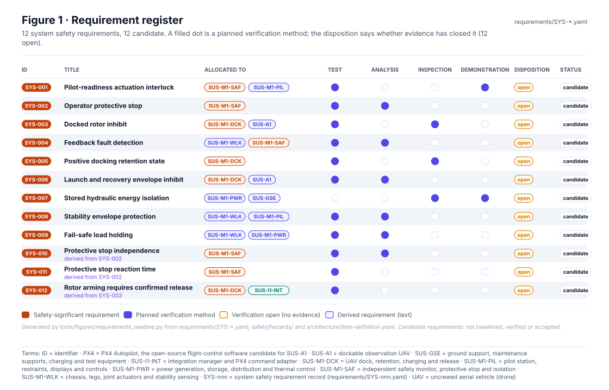
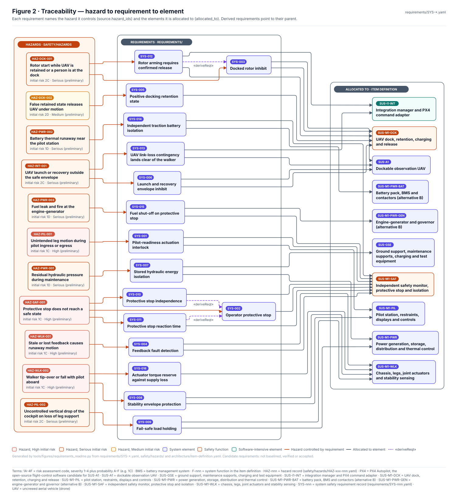
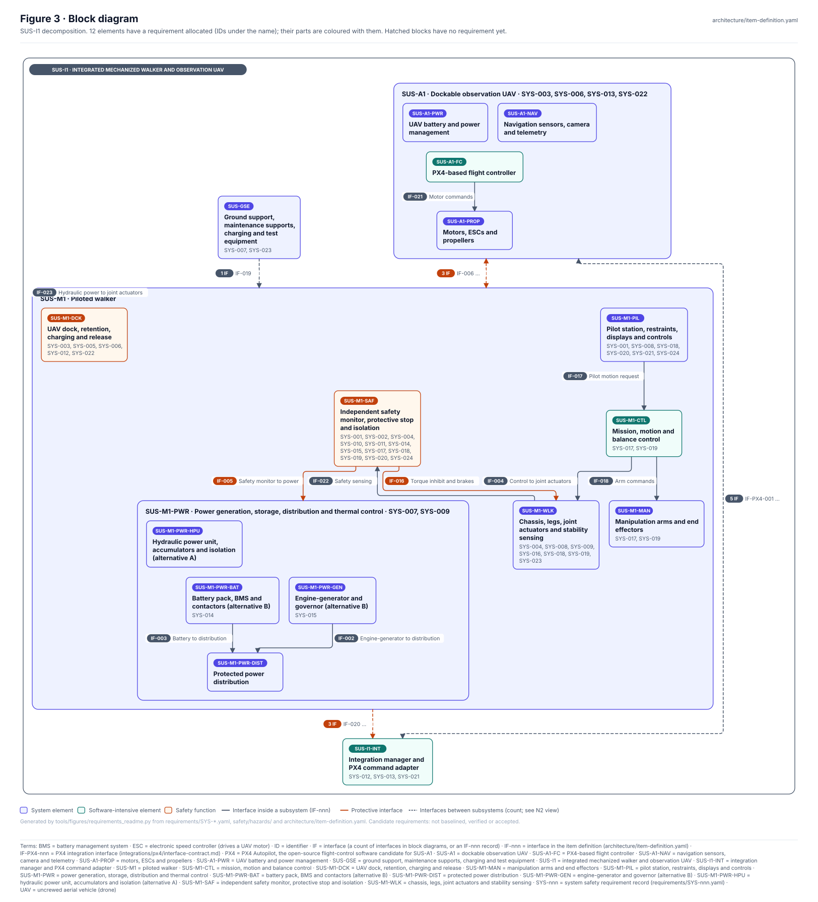
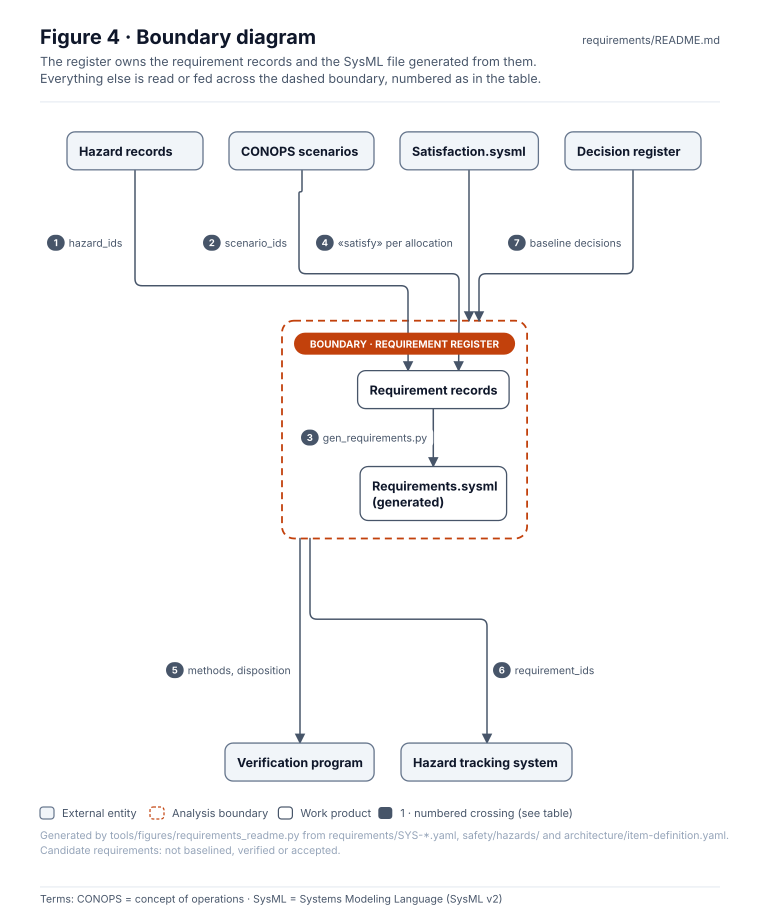
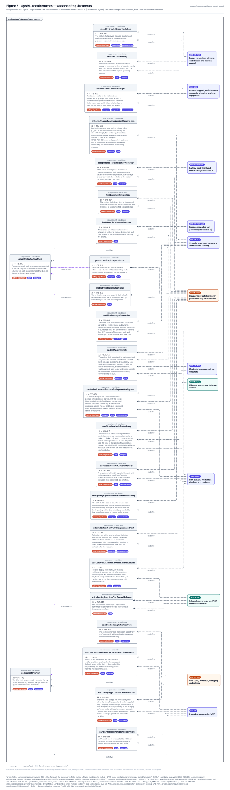
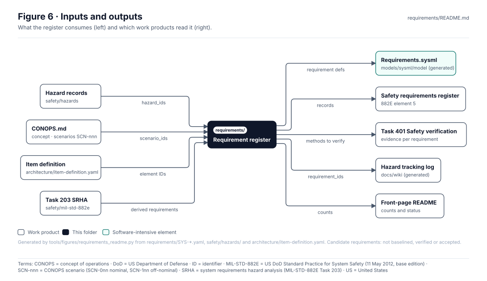

<!-- GENERATED by tools/figures/requirements_readme.py from requirements/SYS-*.yaml; edit the records and regenerate. Content below the END GENERATED marker is preserved. -->

# Requirements — system safety requirement register

> **Status:** 12 candidate. No requirement is baselined, verified or accepted; verification is open for 12. Allocation and verification methods are preliminary drafting.

<!-- terms:start (generated by tools/terms/terms.py; do not edit by hand) -->

<b>Terms on this page (27)</b>: abbreviations and codes explained

| Term | Meaning |
|---|---|
| AI | artificial intelligence (here, an AI assistant drafting at independence level I0) |
| CI | continuous integration (the automated checks GitHub runs on every change) |
| CONOPS | concept of operations |
| DoD | US Department of Defense |
| HAZ-nnn | hazard record (safety/hazards/HAZ-xxx-nnn.yaml) |
| I0–I3 | review independence level (I0 none, e.g. the author or an AI, to I3 independent organisation) |
| ID | identifier |
| MIL-STD-882E | US DoD Standard Practice for System Safety (11 May 2012, base edition) |
| OMG | Object Management Group, publisher of SysML |
| PX4 | PX4 Autopilot, the open-source flight-control software candidate for SUS-A1 |
| SCN-nnn | CONOPS scenario (SCN-0nn nominal, SCN-1nn off-nominal) |
| SRHA | system requirements hazard analysis (MIL-STD-882E Task 203) |
| SUS-A1 | dockable observation UAV |
| SUS-GSE | ground support, maintenance supports, charging and test equipment |
| SUS-I1 | integrated mechanized walker and observation UAV |
| SUS-I1-INT | integration manager and PX4 command adapter |
| SUS-M1-DCK | UAV dock, retention, charging and release |
| SUS-M1-PIL | pilot station, restraints, displays and controls |
| SUS-M1-PWR | power generation, storage, distribution and thermal control |
| SUS-M1-SAF | independent safety monitor, protective stop and isolation |
| SUS-M1-WLK | chassis, legs, joint actuators and stability sensing |
| SVG | Scalable Vector Graphics, the figure file format |
| SYS-nnn | system safety requirement record (requirements/SYS-nnn.yaml) |
| SysML | Systems Modeling Language (SysML v2) |
| UAV | uncrewed aerial vehicle (drone) |
| US | United States |
| YAML | a plain-text data format used for the records |

All terms: [abbreviations and record codes](https://github.com/jherrodthomas/Project-Susanoo/blob/main/docs/terms.md).

<!-- terms:end -->

| Field | Value |
|---|---|
| Records | 12 (`SYS-nnn.yaml`, schema `susanoo/requirement/v0.1`) |
| Hazards traced | 9 of 9 hazard records |
| Elements allocated | 8 |
| MIL-STD-882E | element 5 · [Safety Requirements Register](../safety/mil-std-882e/05-risk-reduction/safety-requirements/README.md) |
| SysML model | [`Requirements.sysml`](../models/sysml/model/Requirements.sysml) (generated), [`Satisfaction.sysml`](../models/sysml/model/Satisfaction.sysml) |
| Validated by | `python -m tools.pdac.validate` (traceability rules), `python -m tools.sysml.check` |

## Purpose

This folder holds the system safety requirements of SUS-I1 as typed records, one YAML file per requirement. Each record states what the system shall do, which hazard and CONOPS scenarios it comes from, which elements of the item definition it is allocated to, and how it will be verified. The records are the source of truth: the SysML requirement model, the hazard tracking log and every figure on this page are generated from them.

## Requirement register

| ID | Title | Hazards | Scenarios | Allocated to | Verification | Status |
|---|---|---|---|---|---|---|
| [SYS-001](SYS-001.yaml) | Pilot-readiness actuation interlock | [HAZ-PIL-001](../safety/hazards/HAZ-PIL-001.yaml) | SCN-001 | SUS-M1-SAF, SUS-M1-PIL | test, demonstration (open) | candidate |
| [SYS-002](SYS-002.yaml) | Operator protective stop | [HAZ-SAF-001](../safety/hazards/HAZ-SAF-001.yaml) | SCN-101 | SUS-M1-SAF | test, analysis (open) | candidate |
| [SYS-003](SYS-003.yaml) | Docked rotor inhibit | [HAZ-DCK-001](../safety/hazards/HAZ-DCK-001.yaml) | SCN-107 | SUS-M1-DCK, SUS-A1 | test, inspection (open) | candidate |
| [SYS-004](SYS-004.yaml) | Feedback fault detection | [HAZ-WLK-001](../safety/hazards/HAZ-WLK-001.yaml) | SCN-002, SCN-101 | SUS-M1-WLK, SUS-M1-SAF | test, analysis (open) | candidate |
| [SYS-005](SYS-005.yaml) | Positive docking retention state | [HAZ-DCK-002](../safety/hazards/HAZ-DCK-002.yaml) | SCN-005, SCN-106 | SUS-M1-DCK | test, inspection (open) | candidate |
| [SYS-006](SYS-006.yaml) | Launch and recovery envelope inhibit | [HAZ-INT-001](../safety/hazards/HAZ-INT-001.yaml) | SCN-004, SCN-005, SCN-106 | SUS-M1-DCK, SUS-A1 | test, analysis (open) | candidate |
| [SYS-007](SYS-007.yaml) | Stored hydraulic energy isolation | [HAZ-PWR-001](../safety/hazards/HAZ-PWR-001.yaml) | SCN-102, SCN-006 | SUS-M1-PWR, SUS-GSE | inspection, demonstration (open) | candidate |
| [SYS-008](SYS-008.yaml) | Stability envelope protection | [HAZ-WLK-002](../safety/hazards/HAZ-WLK-002.yaml) | SCN-002, SCN-003, SCN-103 | SUS-M1-WLK, SUS-M1-PIL | analysis, test (open) | candidate |
| [SYS-009](SYS-009.yaml) | Fail-safe load holding | [HAZ-PIL-002](../safety/hazards/HAZ-PIL-002.yaml) | SCN-102, SCN-103 | SUS-M1-WLK, SUS-M1-PWR | test, analysis (open) | candidate |
| [SYS-010](SYS-010.yaml) | Protective stop independence _(derived from SYS-002)_ | [HAZ-SAF-001](../safety/hazards/HAZ-SAF-001.yaml) | SCN-101 | SUS-M1-SAF | analysis, test (open) | candidate |
| [SYS-011](SYS-011.yaml) | Protective stop reaction time _(derived from SYS-002)_ | [HAZ-SAF-001](../safety/hazards/HAZ-SAF-001.yaml) | SCN-101, SCN-103 | SUS-M1-SAF | test (open) | candidate |
| [SYS-012](SYS-012.yaml) | Rotor arming requires confirmed release _(derived from SYS-003)_ | [HAZ-DCK-001](../safety/hazards/HAZ-DCK-001.yaml) | SCN-107 | SUS-M1-DCK, SUS-I1-INT | test (open) | candidate |

Requirement statements

- **SYS-001 · Pilot-readiness actuation interlock.** The system shall inhibit leg actuation until pilot station readiness conditions (restraint fastened, hatch secured, controls neutral, exclusion zone confirmed) are satisfied.
- **SYS-002 · Operator protective stop.** The system shall provide an operator-requested protective stop with a defined, analyzed safe behavior for each operating mode that does not depend on instant zero torque.
- **SYS-003 · Docked rotor inhibit.** The UAV shall be prevented from rotor startup while mechanically retained, except under an approved maintenance procedure.
- **SYS-004 · Feedback fault detection.** The system shall detect loss or staleness of essential actuator and posture feedback and transition to a documented degraded state.
- **SYS-005 · Positive docking retention state.** The docking interface shall report a positively confirmed retained/unretained state derived from independent sensing.
- **SYS-006 · Launch and recovery envelope inhibit.** UAV launch and recovery shall be inhibited outside a verified operational envelope of walker posture, motion and dock state.
- **SYS-007 · Stored hydraulic energy isolation.** The walker shall provide lockable isolation and verifiable dissipation of stored hydraulic pressure before maintenance access.
- **SYS-008 · Stability envelope protection.** The walker shall limit commanded motion and payload to a verified static and dynamic stability envelope, including a terrain slope limit of 20 degrees with the centre of mass no more than 0.12 m ahead of the stance foot, and provide pilot protection in a fall or overturn.
- **SYS-009 · Fail-safe load holding.** The walker shall hold its posture without supply or command on loss of actuator supply, with load holding engaging in less than the free-fall time from the highest operating posture.
- **SYS-010 · Protective stop independence.** The protective stop path shall achieve its defined safe behavior without depending on the mission, motion and balance control software.
- **SYS-011 · Protective stop reaction time.** The protective stop shall begin its defined safe behavior within the reaction time allocated by hazard analysis for each operating mode.
- **SYS-012 · Rotor arming requires confirmed release.** UAV rotor arming shall require a positively confirmed unretained dock state reported over the docking interface.

## Traceability

The same links are checked by `tools/pdac` (a safety-significant requirement must trace to a hazard and to an element) and listed per hazard in the [hazard tracking log](../docs/wiki/Hazard-Tracking-Log.md).

## Block diagram

Elements and interfaces: [`architecture/item-definition.yaml`](../architecture/item-definition.yaml).

## Boundary diagram

| # | From | To | Crossing / interaction |
|---|---|---|---|
| 1 | Hazard records | Requirement records | `source.hazard_ids` names the hazard each requirement controls |
| 2 | CONOPS scenarios | Requirement records | `source.scenario_ids` names the operating scenarios |
| 3 | Requirement records | Requirements.sysml | `python -m tools.sysml.gen_requirements` writes one SysML requirement per record |
| 4 | Satisfaction.sysml | Requirement register | hand-written «satisfy» per `allocated_to` entry, checked by `tools.sysml.check` |
| 5 | Requirement register | Verification program | planned methods and disposition; evidence comes back as `evidence_ids` |
| 6 | Requirement register | Hazard tracking system | requirements listed against each hazard |
| 7 | Decision register | Requirement register | baselining is a lead decision; the AI may not set `baselined` |

**Explicitly excluded:** acceptance of residual risk (reviews/), verification evidence itself (verification/), and the MIL-STD-882E task analyses that derive requirements (safety/mil-std-882e/).

## SysML model

Model of record: [`Requirements.sysml`](../models/sysml/model/Requirements.sysml), generated from these records by `python -m tools.sysml.gen_requirements`; allocation is modelled as «satisfy» in [`Satisfaction.sysml`](../models/sysml/model/Satisfaction.sysml). Both are part of the project model in [`models/sysml/model`](../models/sysml/model/) and pass the OMG pilot in CI.

## Inputs and outputs

| Input | Source |
|---|---|
| Hazards and preliminary risk | [`safety/hazards/`](../safety/hazards/) |
| Operating scenarios | [`concept/CONOPS.md`](../concept/CONOPS.md) |
| Elements to allocate to | [`architecture/item-definition.yaml`](../architecture/item-definition.yaml) |
| Derived requirements | [Task 203 SRHA](../safety/mil-std-882e/02-hazard-identification/task-203-system-requirements-hazard-analysis/README.md) |

| Output | Destination |
|---|---|
| SysML requirement definitions | [`Requirements.sysml`](../models/sysml/model/Requirements.sysml) |
| Safety requirements register | [element 5](../safety/mil-std-882e/05-risk-reduction/safety-requirements/README.md) |
| Requirements to verify | [Task 401](../safety/mil-std-882e/06-verification/task-401-safety-verification/README.md) |
| Requirement IDs per hazard | [Hazard tracking log](../docs/wiki/Hazard-Tracking-Log.md) |
| Counts and status | [front-page README](../README.md) |

## Folder contents

| Item | Description | State |
|---|---|---|
| [`SYS-001.yaml`](SYS-001.yaml) | Pilot-readiness actuation interlock | present |
| [`SYS-002.yaml`](SYS-002.yaml) | Operator protective stop | present |
| [`SYS-003.yaml`](SYS-003.yaml) | Docked rotor inhibit | present |
| [`SYS-004.yaml`](SYS-004.yaml) | Feedback fault detection | present |
| [`SYS-005.yaml`](SYS-005.yaml) | Positive docking retention state | present |
| [`SYS-006.yaml`](SYS-006.yaml) | Launch and recovery envelope inhibit | present |
| [`SYS-007.yaml`](SYS-007.yaml) | Stored hydraulic energy isolation | present |
| [`SYS-008.yaml`](SYS-008.yaml) | Stability envelope protection | present |
| [`SYS-009.yaml`](SYS-009.yaml) | Fail-safe load holding | present |
| [`SYS-010.yaml`](SYS-010.yaml) | Protective stop independence | present |
| [`SYS-011.yaml`](SYS-011.yaml) | Protective stop reaction time | present |
| [`SYS-012.yaml`](SYS-012.yaml) | Rotor arming requires confirmed release | present |
| [`figures/`](figures/) | Generated SVG figures (do not edit) | generated |
| `README.md` | This page, generated above the END marker | generated |

## Adding or changing a requirement

1. Add or edit `SYS-nnn.yaml` with status `candidate` or `draft`; name its hazards, scenarios, allocation and verification methods.
2. Add a matching «satisfy» line per allocated element to [`Satisfaction.sysml`](../models/sysml/model/Satisfaction.sysml).
3. Regenerate: `python -m tools.sysml.gen_requirements`, `python3 tools/figures/requirements_readme.py`, then run the full check list in [`CLAUDE.md`](../CLAUDE.md).
4. Baselining (`baselined`) and verification closure are human decisions; see the [Decision Inbox](../docs/wiki/Decision-Inbox.md).

<!-- END GENERATED: content below this line is human-authored and preserved -->
