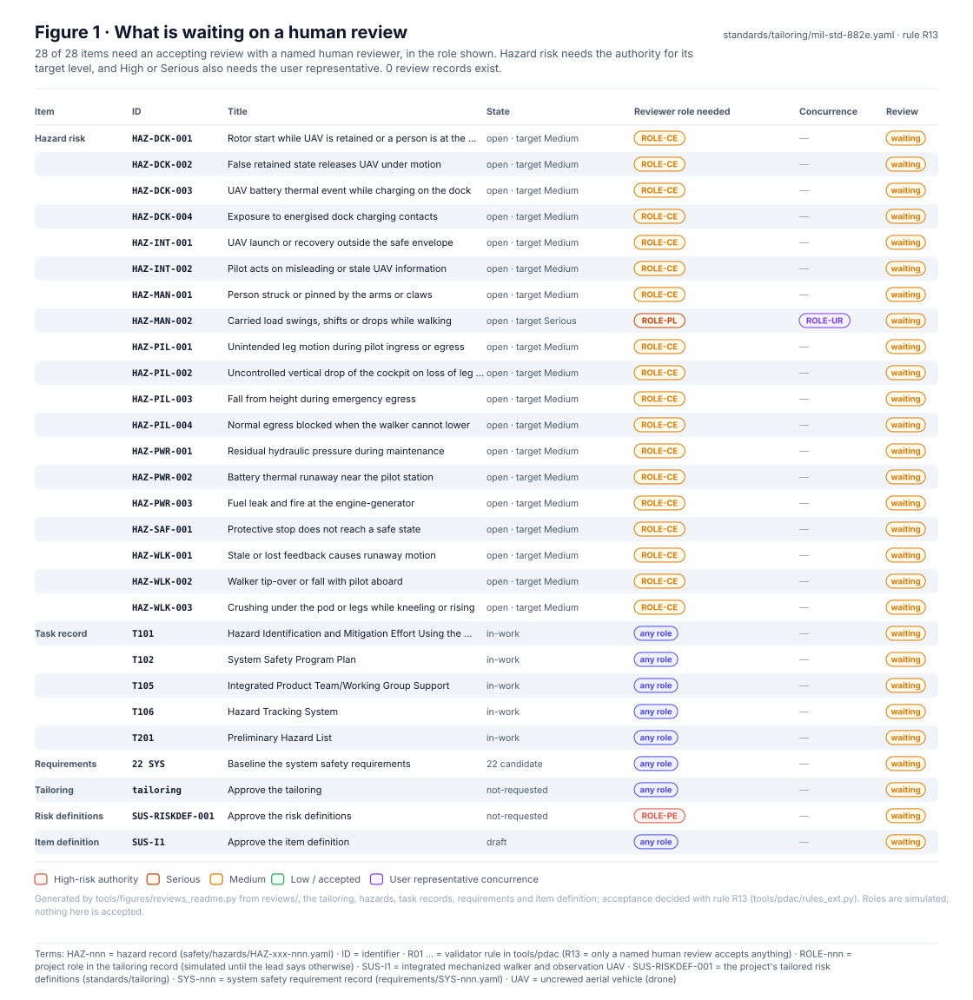
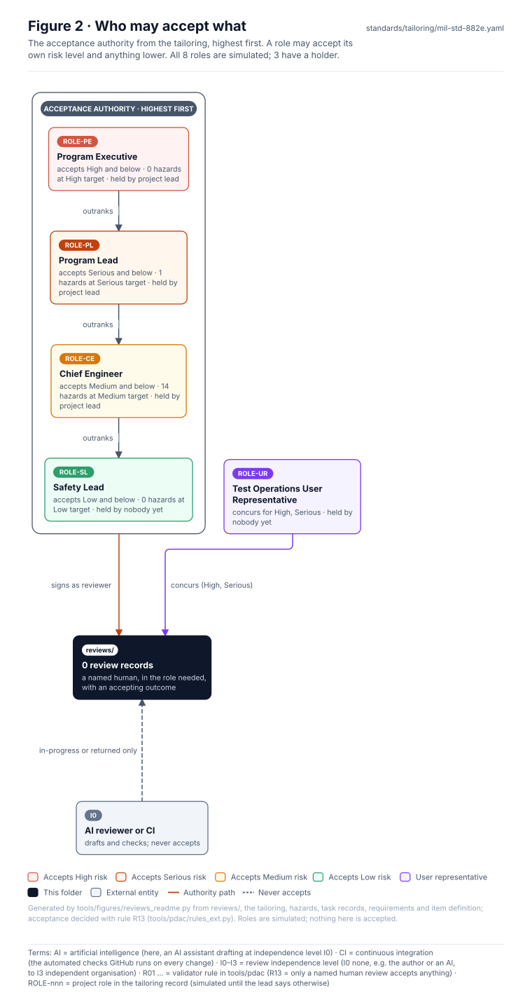
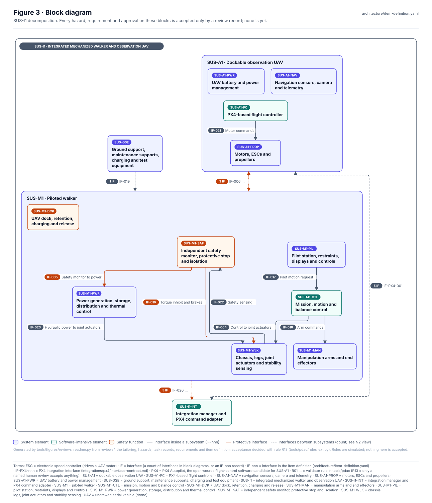
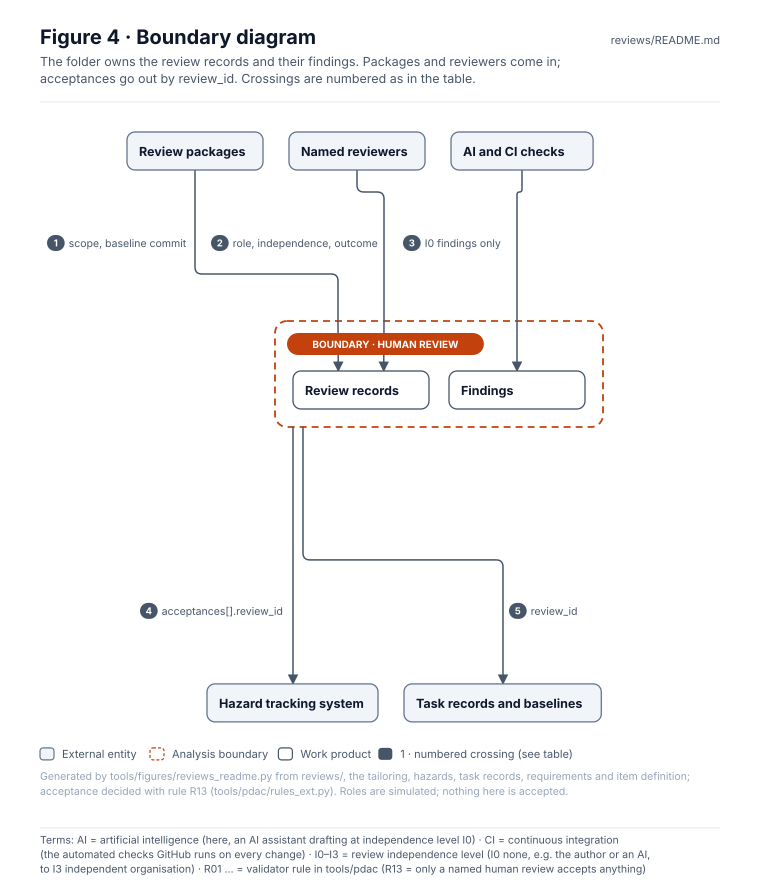
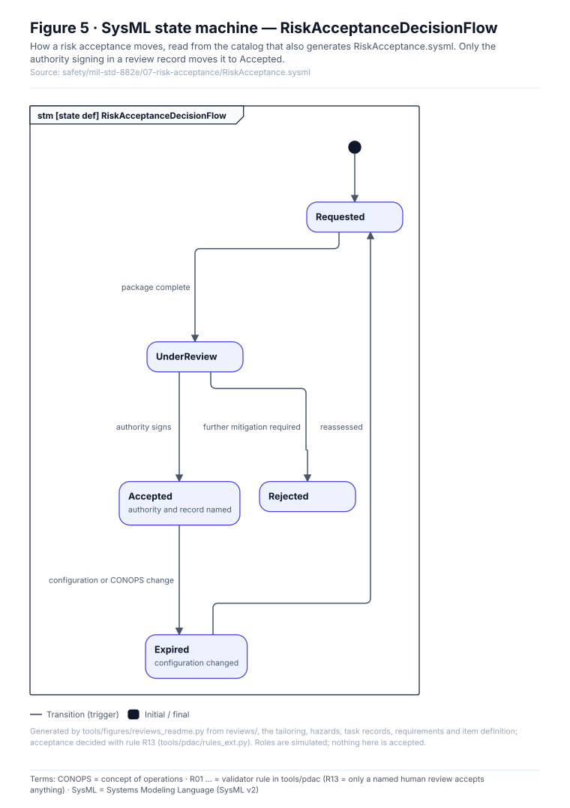
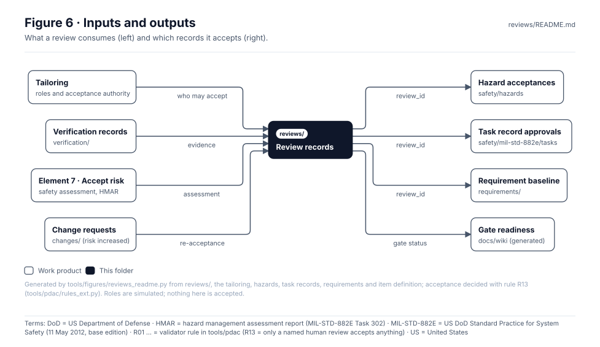

<!-- GENERATED by tools/figures/reviews_readme.py from reviews/, the tailoring and the records it accepts; edit the records and regenerate. Content below the END GENERATED marker is preserved. -->

# Review records

> **Status:** 0 review records yet; 24 of 24 items are waiting on a human review. Every role is simulated and 3 of 8 have a holder. Nothing is accepted.

<!-- terms:start (generated by tools/terms/terms.py; do not edit by hand) -->
<details><summary><b>Terms on this page (17)</b>: abbreviations and codes explained</summary>

| Term | Meaning |
|---|---|
| AI | artificial intelligence (here, an AI assistant drafting at independence level I0) |
| CI | continuous integration (the automated checks GitHub runs on every change) |
| DoD | US Department of Defense |
| HAZ-nnn | hazard record (safety/hazards/HAZ-xxx-nnn.yaml) |
| I0–I3 | review independence level (I0 none, e.g. the author or an AI, to I3 independent organisation) |
| ID | identifier |
| MIL-STD-882E | US DoD Standard Practice for System Safety (11 May 2012, base edition) |
| OMG | Object Management Group, publisher of SysML |
| R01 … | validator rule in tools/pdac (R13 = only a named human review accepts anything) |
| ROLE-nnn | project role in the tailoring record (simulated until the lead says otherwise) |
| SUS-I1 | integrated mechanized walker and observation UAV |
| SUS-RISKDEF-001 | the project's tailored risk definitions (standards/tailoring) |
| SVG | Scalable Vector Graphics, the figure file format |
| SYS-nnn | system safety requirement record (requirements/SYS-nnn.yaml) |
| SysML | Systems Modeling Language (SysML v2) |
| UAV | uncrewed aerial vehicle (drone) |
| US | United States |

All terms: [abbreviations and record codes](https://github.com/jherrodthomas/Project-Susanoo/blob/main/docs/terms.md).

</details>
<!-- terms:end -->

| Field | Value |
|---|---|
| Records | 0 (`REV-YYYY-NNN.yaml`, schema [`review.schema.json`](../pdac/schemas/review.schema.json)) |
| Waiting on review | 24 of 24 items (hazard risk, task records, requirements, tailoring, risk definitions, item definition) |
| Authority | [`mil-std-882e.yaml`](../standards/tailoring/mil-std-882e.yaml) · acceptance authority per risk level and user representative concurrence |
| MIL-STD-882E | element 7 · [Accept Risk and Document](../safety/mil-std-882e/07-risk-acceptance/README.md) (4.3.7) |
| SysML model | [`RiskAcceptance.sysml`](../safety/mil-std-882e/07-risk-acceptance/RiskAcceptance.sysml) (generated from the 882E catalog) |
| Rules | R13 (acceptance only through a recorded human review), R05 (authority per risk level) — `python -m tools.pdac.validate` |

## Purpose

One `REV-YYYY-NNN.yaml` per review. A review record is the **only** way anything in Susanoo is accepted (rule R13): it names what it covers in `scope`, the commit it reviewed in `baseline`, each reviewer's role, whether they are human and their independence, and the outcome. An AI reviewer is recorded with `human: false` and independence `I0`. A review with no named human reviewer can never have an accepting outcome. CI passing, tests passing or a file existing never accept anything.

| To do this | You need an accepting review that lists the item in `scope` and has a named human reviewer |
|---|---|
| Accept a hazard's risk (`acceptances[].review_id`) | in the acceptance authority's role; plus the user representative for High and Serious |
| Approve a task record (`status: approved`, `review_id`) | any tailoring role |
| Baseline a requirement (`status: baselined`, `review_id`) | any tailoring role |
| Approve the tailoring or the risk definitions (`approval.record`) | in the approval's `authority_role` |
| Approve the item definition (`status: approved`, `review_id`) | any tailoring role |

## What is waiting on a human review



_No review records yet._ The table lists what each item needs before it can be accepted.

| Item | ID | State | Reviewer role needed | Concurrence | Review |
|---|---|---|---|---|---|
| Hazard risk | [HAZ-DCK-001](../safety/hazards/HAZ-DCK-001.yaml) | open · target Medium | ROLE-CE · Chief Engineer | — | waiting |
| Hazard risk | [HAZ-DCK-002](../safety/hazards/HAZ-DCK-002.yaml) | open · target Medium | ROLE-CE · Chief Engineer | — | waiting |
| Hazard risk | [HAZ-INT-001](../safety/hazards/HAZ-INT-001.yaml) | open · target Medium | ROLE-CE · Chief Engineer | — | waiting |
| Hazard risk | [HAZ-MAN-001](../safety/hazards/HAZ-MAN-001.yaml) | open · target Medium | ROLE-CE · Chief Engineer | — | waiting |
| Hazard risk | [HAZ-MAN-002](../safety/hazards/HAZ-MAN-002.yaml) | open · target Serious | ROLE-PL · Program Lead | ROLE-UR · Test Operations User Representative | waiting |
| Hazard risk | [HAZ-PIL-001](../safety/hazards/HAZ-PIL-001.yaml) | open · target Medium | ROLE-CE · Chief Engineer | — | waiting |
| Hazard risk | [HAZ-PIL-002](../safety/hazards/HAZ-PIL-002.yaml) | open · target Medium | ROLE-CE · Chief Engineer | — | waiting |
| Hazard risk | [HAZ-PIL-003](../safety/hazards/HAZ-PIL-003.yaml) | open · target Medium | ROLE-CE · Chief Engineer | — | waiting |
| Hazard risk | [HAZ-PWR-001](../safety/hazards/HAZ-PWR-001.yaml) | open · target Medium | ROLE-CE · Chief Engineer | — | waiting |
| Hazard risk | [HAZ-PWR-002](../safety/hazards/HAZ-PWR-002.yaml) | open · target Medium | ROLE-CE · Chief Engineer | — | waiting |
| Hazard risk | [HAZ-PWR-003](../safety/hazards/HAZ-PWR-003.yaml) | open · target Medium | ROLE-CE · Chief Engineer | — | waiting |
| Hazard risk | [HAZ-SAF-001](../safety/hazards/HAZ-SAF-001.yaml) | open · target Medium | ROLE-CE · Chief Engineer | — | waiting |
| Hazard risk | [HAZ-WLK-001](../safety/hazards/HAZ-WLK-001.yaml) | open · target Medium | ROLE-CE · Chief Engineer | — | waiting |
| Hazard risk | [HAZ-WLK-002](../safety/hazards/HAZ-WLK-002.yaml) | open · target Medium | ROLE-CE · Chief Engineer | — | waiting |
| Hazard risk | [HAZ-WLK-003](../safety/hazards/HAZ-WLK-003.yaml) | open · target Medium | ROLE-CE · Chief Engineer | — | waiting |
| Task record | T101 | in-work | any role | — | waiting |
| Task record | T102 | in-work | any role | — | waiting |
| Task record | T105 | in-work | any role | — | waiting |
| Task record | T106 | in-work | any role | — | waiting |
| Task record | T201 | in-work | any role | — | waiting |
| Requirements | 20 SYS | 20 candidate | any role | — | waiting |
| Tailoring | tailoring | not-requested | any role | — | waiting |
| Risk definitions | SUS-RISKDEF-001 | not-requested | ROLE-PE · Program Executive | — | waiting |
| Item definition | SUS-I1 | draft | any role | — | waiting |

## Who may accept what



| Role | Title | Accepts | Holder |
|---|---|---|---|
| ROLE-PE | Program Executive (simulated) | High risk and below | project lead |
| ROLE-PL | Program Lead (simulated) | Serious risk and below | project lead |
| ROLE-CE | Chief Engineer (simulated) | Medium risk and below | project lead |
| ROLE-SL | Safety Lead (simulated) | Low risk and below | — |
| ROLE-UR | Test Operations User Representative (simulated) | concurrence for High, Serious | — |
| ROLE-SWL | Software Safety Lead (simulated) | task records, requirements, item definition | — |
| ROLE-UAV | UAV Lead (simulated) | task records, requirements, item definition | — |
| ROLE-WLK | Walker Lead (simulated) | task records, requirements, item definition | — |

## Block diagram



Elements and interfaces: [`architecture/item-definition.yaml`](../architecture/item-definition.yaml).

## Boundary diagram



| # | From | To | Crossing / interaction |
|---|---|---|---|
| 1 | Review packages | Review records | `scope` lists what is reviewed; `baseline` pins the git commit |
| 2 | Named reviewers | Review records | each reviewer's `role`, `person`, `human` and `independence` |
| 3 | AI and CI checks | Findings | an AI review is I0: `in-progress` or `returned`, never accepting |
| 4 | Human review | Hazard tracking system | a hazard acceptance cites the review by `review_id` |
| 5 | Human review | Task records and baselines | approvals and baselines cite the review by `review_id` |

**Explicitly excluded:** the analyses and evidence being reviewed (their own folders), and the appointment of people to roles (a lead decision in the decision register).

## SysML model

Model of record for the decision flow: [`RiskAcceptance.sysml`](../safety/mil-std-882e/07-risk-acceptance/RiskAcceptance.sysml), generated by `python3 tools/gen_safety_docs.py` from the 882E catalog and validated by the OMG pilot in CI.



## Inputs and outputs



| Input | Source |
|---|---|
| Roles and acceptance authority | [`mil-std-882e.yaml`](../standards/tailoring/mil-std-882e.yaml) |
| Verification evidence | [Verification records](../verification/README.md) |
| Safety assessment | [Element 7](../safety/mil-std-882e/07-risk-acceptance/README.md) |
| Risk increased by a change | [Change requests](../changes/README.md) |

| Output | Destination |
|---|---|
| Hazard acceptances | [Hazard tracking log](../docs/wiki/Hazard-Tracking-Log.md) |
| Task record approvals | [`safety/mil-std-882e/tasks/`](../safety/mil-std-882e/tasks/) |
| Requirement baseline | [Requirement register](../requirements/README.md) |
| Gate status | [Gate readiness](../docs/wiki/Gate-Readiness.md) |

## Folder contents

| Item | Description | State |
|---|---|---|
| `REV-YYYY-NNN.yaml` | Review records | planned |
| [`figures/`](figures/) | Generated SVG figures (do not edit) | generated |
| `README.md` | This page, generated above the END marker | generated |

## Template

```yaml
schema: susanoo/review/v0.1
id: REV-2026-001
title: Risk acceptance for EVT-BENCH-001 event risks
date: 2026-12-01
type: risk-acceptance            # technical-review | risk-acceptance | approval | independent-assessment
scope: [HAZ-PWR-001]
baseline: <git commit reviewed>
reviewers:
  - {role: ROLE-CE, person: <name>, human: true, independence: I1}
outcome: in-progress             # in-progress | accepted | accepted-with-actions | returned
findings: []
record: <link to minutes or signed record, if separate>
```

Only a human writes a review with a named reviewer or an accepting outcome. An AI may draft a review as `human: false, independence: I0` with outcome `in-progress` or `returned`.

<!-- END GENERATED: content below this line is human-authored and preserved -->
