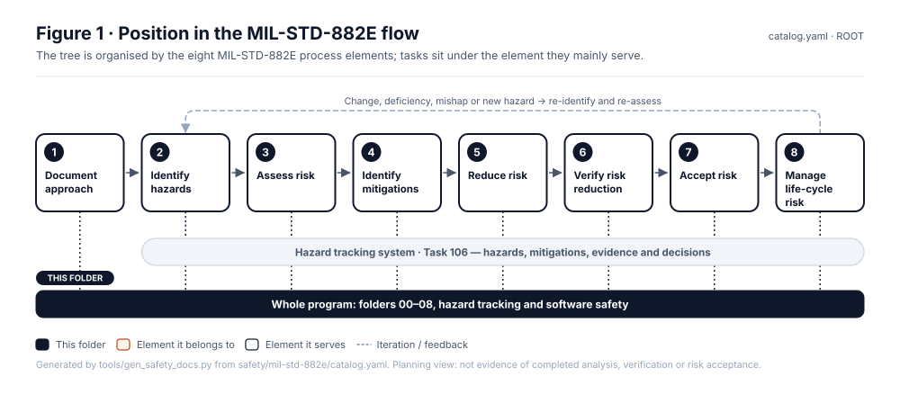
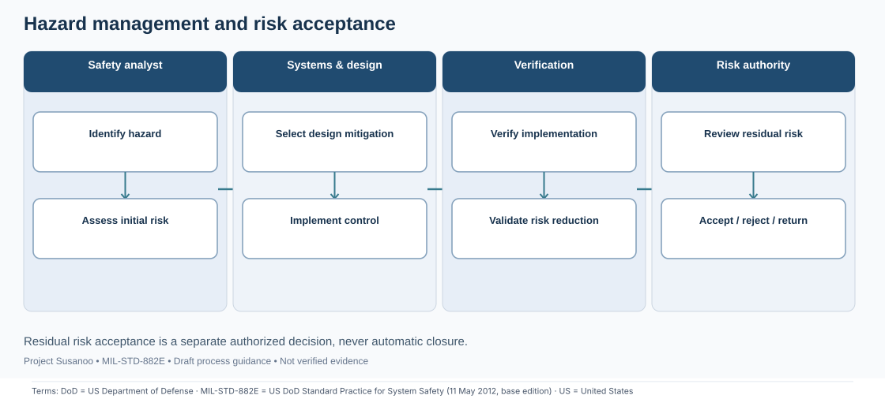
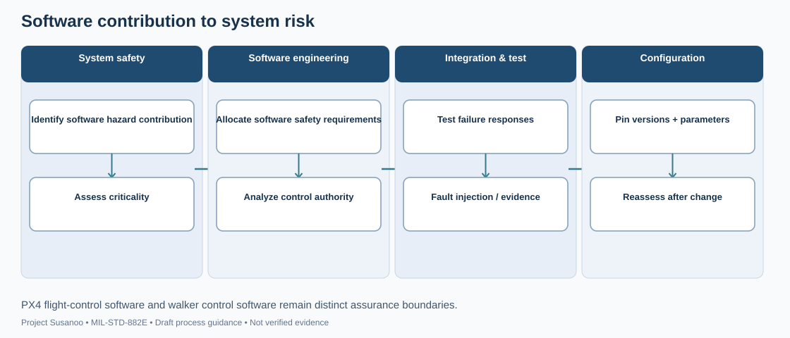

<!-- GENERATED by tools/previews/build_previews.py from docs/previews.yaml; do not edit. Edit the entry there and re-run. -->

# Safety records

The hazard tracking system (`hazards/`), safety-significant software functions (`software/`), test-event risk (`events/`), generated exports (`generated/`) and the MIL-STD-882E work-product tree (`mil-std-882e/`).

<!-- terms:start (generated by tools/terms/terms.py; do not edit by hand) -->

<b>Terms on this page (3)</b>: abbreviations and codes explained

| Term | Meaning |
|---|---|
| DoD | US Department of Defense |
| MIL-STD-882E | US DoD Standard Practice for System Safety (11 May 2012, base edition) |
| US | United States |

All terms: [abbreviations and record codes](https://github.com/jherrodthomas/Project-Susanoo/blob/main/docs/terms.md).

<!-- terms:end -->

<!-- preview:start (generated by tools/previews/build_previews.py from docs/previews.yaml; do not edit by hand) -->

Current hazard risk on the MIL-STD-882E matrix

<table>
<tr><td width="33%" valign="top"> The eight-element MIL-STD-882E process</td><td width="33%" valign="top"> Hazard management process map (illustrative)</td><td width="33%" valign="top"> Software safety process map (illustrative)</td></tr>
</table>

**Open:** [Hazard Tracking Log (wiki page)](../docs/wiki/Hazard-Tracking-Log.md)

<!-- preview:end -->

## Folder contents

| Item | Title |
|---|---|
| [`events/`](events/) | Test and simulation events |
| [`generated/`](generated/) | Generated safety exports |
| [`hazards/`](hazards/) | Hazard records |
| [`mil-std-882e/`](mil-std-882e/) | MIL-STD-882E System Safety Work Products |
| [`software/`](software/) | Safety-significant software functions |
