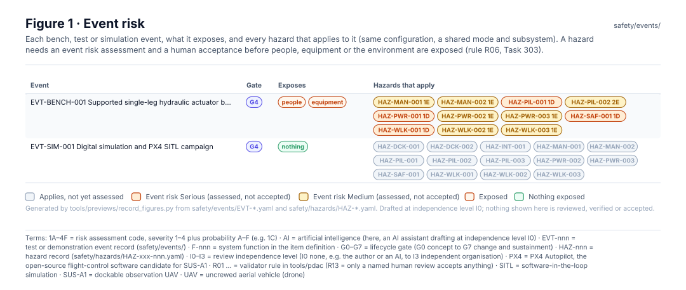
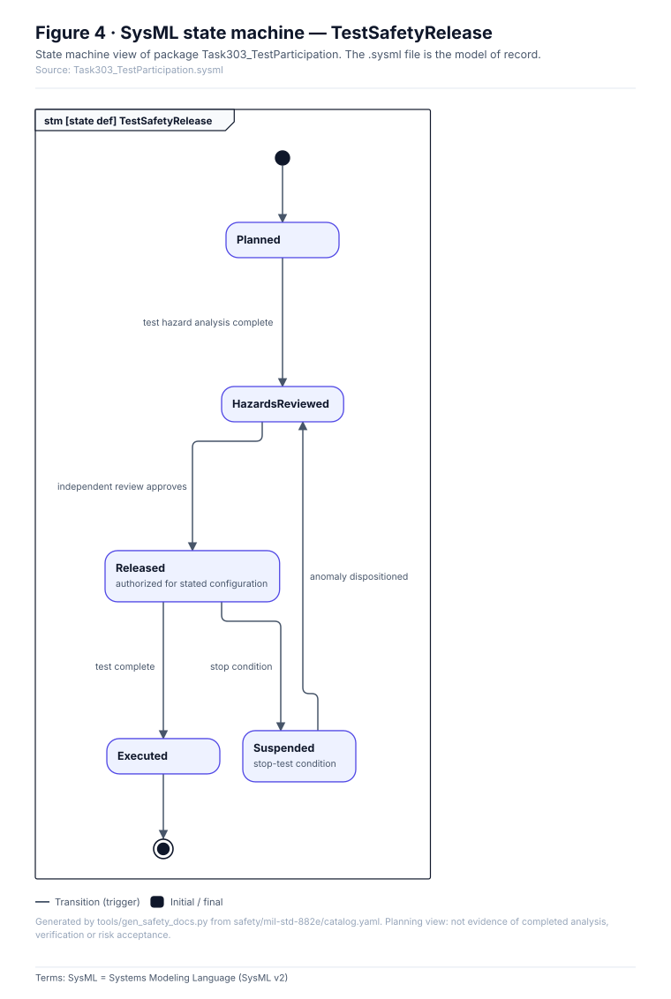

<!-- GENERATED by tools/previews/build_previews.py from docs/previews.yaml; do not edit. Edit the entry there and re-run. -->

# Test and simulation events

One `EVT-*.yaml` per bench, test or simulation event, with the event risk of each hazard that applies (Task 303). An event proceeds only with a human acceptance of its risk.

<!-- terms:start (generated by tools/terms/terms.py; do not edit by hand) -->

<b>Terms on this page (7)</b>: abbreviations and codes explained

| Term | Meaning |
|---|---|
| DoD | US Department of Defense |
| MIL-STD-882E | US DoD Standard Practice for System Safety (11 May 2012, base edition) |
| PX4 | PX4 Autopilot, the open-source flight-control software candidate for SUS-A1 |
| SITL | software-in-the-loop simulation |
| SUS-A1 | dockable observation UAV |
| UAV | uncrewed aerial vehicle (drone) |
| US | United States |

All terms: [abbreviations and record codes](https://github.com/jherrodthomas/Project-Susanoo/blob/main/docs/terms.md).

<!-- terms:end -->

<!-- preview:start (generated by tools/previews/build_previews.py from docs/previews.yaml; do not edit by hand) -->

Event risk: the hazards that apply to each event

<table>
<tr><td width="33%" valign="top"> Task 303: event lifecycle</td><td width="33%" valign="top"> Current hazard risk on the MIL-STD-882E matrix</td></tr>
</table>

<!-- preview:end -->

## Folder contents

| Item | Title |
|---|---|
| [`EVT-BENCH-001.yaml`](EVT-BENCH-001.yaml) | Supported single-leg hydraulic actuator bench rig |
| [`EVT-SIM-001.yaml`](EVT-SIM-001.yaml) | Digital simulation and PX4 SITL campaign |
