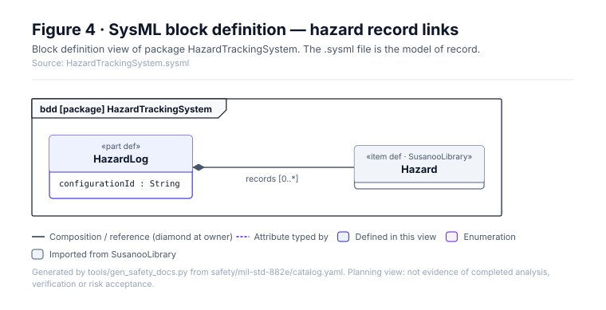

<!-- GENERATED by tools/previews/build_previews.py from docs/previews.yaml; do not edit. Edit the entry there and re-run. -->

# Generated safety exports

Exports built from the hazard records by `python -m tools.pdac.report`. Never edit these; edit the records.

<!-- terms:start (generated by tools/terms/terms.py; do not edit by hand) -->

<b>Terms on this page (3)</b>: abbreviations and codes explained

| Term | Meaning |
|---|---|
| DoD | US Department of Defense |
| MIL-STD-882E | US DoD Standard Practice for System Safety (11 May 2012, base edition) |
| US | United States |

All terms: [abbreviations and record codes](https://github.com/jherrodthomas/Project-Susanoo/blob/main/docs/terms.md).

<!-- terms:end -->

<!-- preview:start (generated by tools/previews/build_previews.py from docs/previews.yaml; do not edit by hand) -->

Current hazard risk on the MIL-STD-882E matrix

<table>
<tr><td width="33%" valign="top"> Hazard record structure</td></tr>
</table>

<!-- preview:end -->

## Folder contents

| Item | Title |
|---|---|
| [`hts.csv`](hts.csv) |  |
| [`worksheets.xlsx`](worksheets.xlsx) |  |
