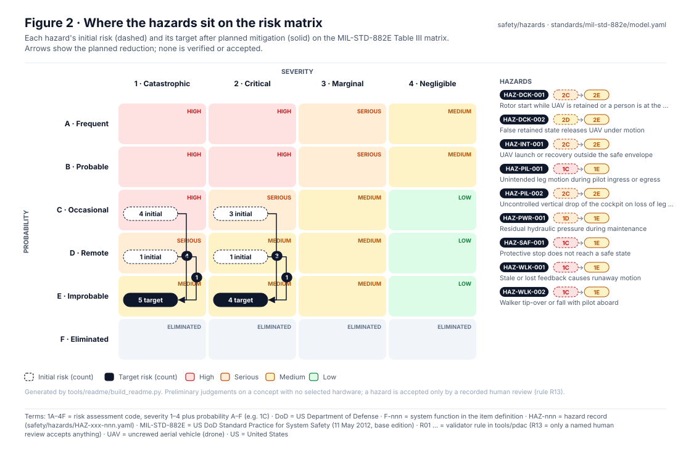
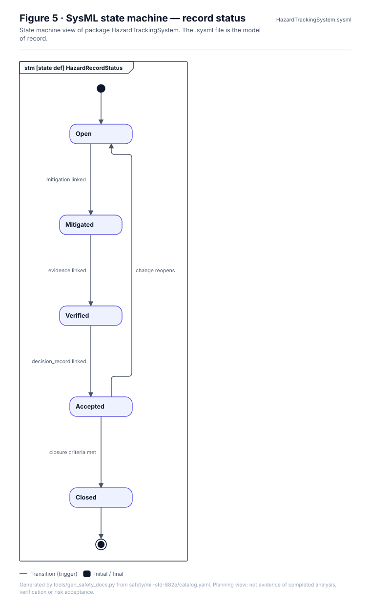
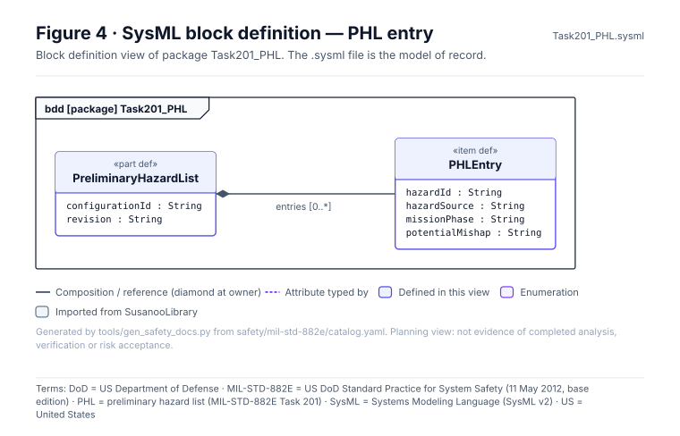
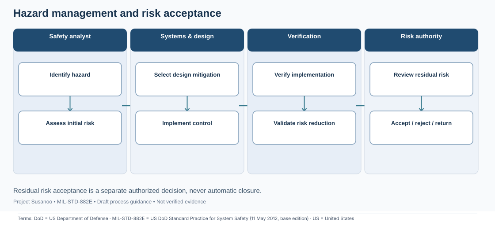

<!-- GENERATED by tools/previews/build_previews.py from docs/previews.yaml; do not edit. Edit the entry there and re-run. -->

# Hazard records

One `HAZ-*.yaml` per hazard: the hazard tracking system (Task 106). Risk is preliminary until the PHA (Task 202), and nothing is accepted without a named human review.

<!-- terms:start (generated by tools/terms/terms.py; do not edit by hand) -->

<b>Terms on this page (5)</b>: abbreviations and codes explained

| Term | Meaning |
|---|---|
| DoD | US Department of Defense |
| MIL-STD-882E | US DoD Standard Practice for System Safety (11 May 2012, base edition) |
| PHA | preliminary hazard analysis (MIL-STD-882E Task 202) |
| UAV | uncrewed aerial vehicle (drone) |
| US | United States |

All terms: [abbreviations and record codes](https://github.com/jherrodthomas/Project-Susanoo/blob/main/docs/terms.md).

<!-- terms:end -->

<!-- preview:start (generated by tools/previews/build_previews.py from docs/previews.yaml; do not edit by hand) -->

Current hazard risk on the MIL-STD-882E matrix

<table>
<tr><td width="33%" valign="top"> Hazard lifecycle</td><td width="33%" valign="top"> Task 201: preliminary hazard list structure</td><td width="33%" valign="top"> Hazard management process map (illustrative)</td></tr>
</table>

**Open:** [Hazard Tracking Log (wiki page)](../../docs/wiki/Hazard-Tracking-Log.md)

<!-- preview:end -->

## Folder contents

| Item | Title |
|---|---|
| [`HAZ-DCK-001.yaml`](HAZ-DCK-001.yaml) | Rotor start while UAV is retained or a person is at the dock |
| [`HAZ-DCK-002.yaml`](HAZ-DCK-002.yaml) | False retained state releases UAV under motion |
| [`HAZ-INT-001.yaml`](HAZ-INT-001.yaml) | UAV launch or recovery outside the safe envelope |
| [`HAZ-PIL-001.yaml`](HAZ-PIL-001.yaml) | Unintended leg motion during pilot ingress or egress |
| [`HAZ-PIL-002.yaml`](HAZ-PIL-002.yaml) | Uncontrolled vertical drop of the cockpit on loss of leg support |
| [`HAZ-PWR-001.yaml`](HAZ-PWR-001.yaml) | Residual hydraulic pressure during maintenance |
| [`HAZ-PWR-002.yaml`](HAZ-PWR-002.yaml) | Battery thermal runaway near the pilot station |
| [`HAZ-PWR-003.yaml`](HAZ-PWR-003.yaml) | Fuel leak and fire at the engine-generator |
| [`HAZ-SAF-001.yaml`](HAZ-SAF-001.yaml) | Protective stop does not reach a safe state |
| [`HAZ-WLK-001.yaml`](HAZ-WLK-001.yaml) | Stale or lost feedback causes runaway motion |
| [`HAZ-WLK-002.yaml`](HAZ-WLK-002.yaml) | Walker tip-over or fall with pilot aboard |
