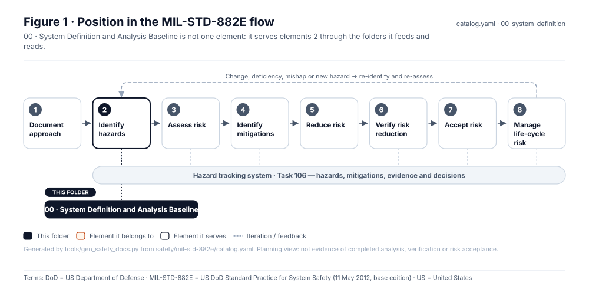
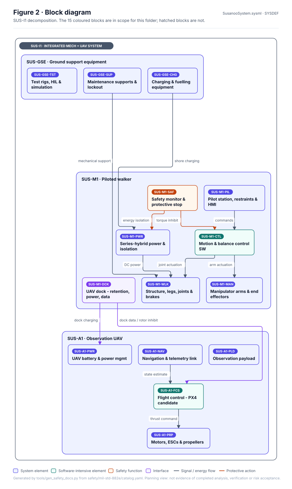
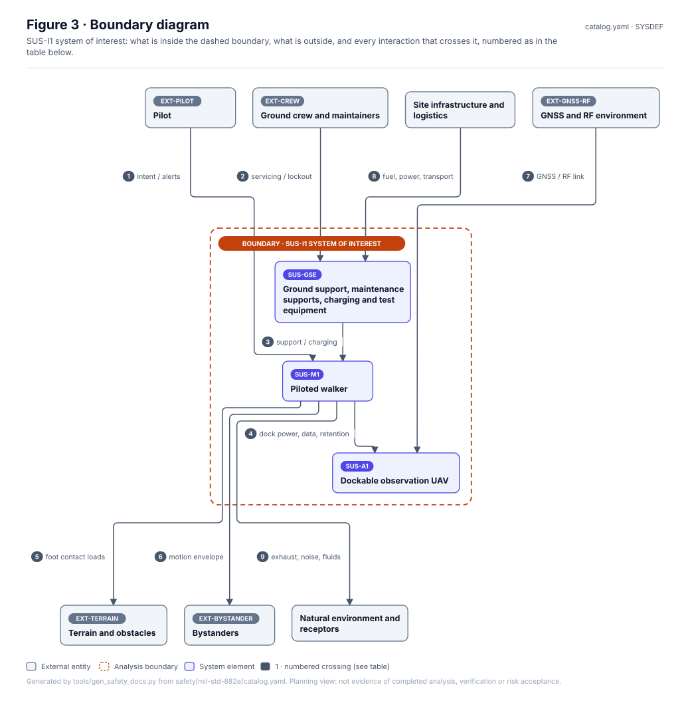
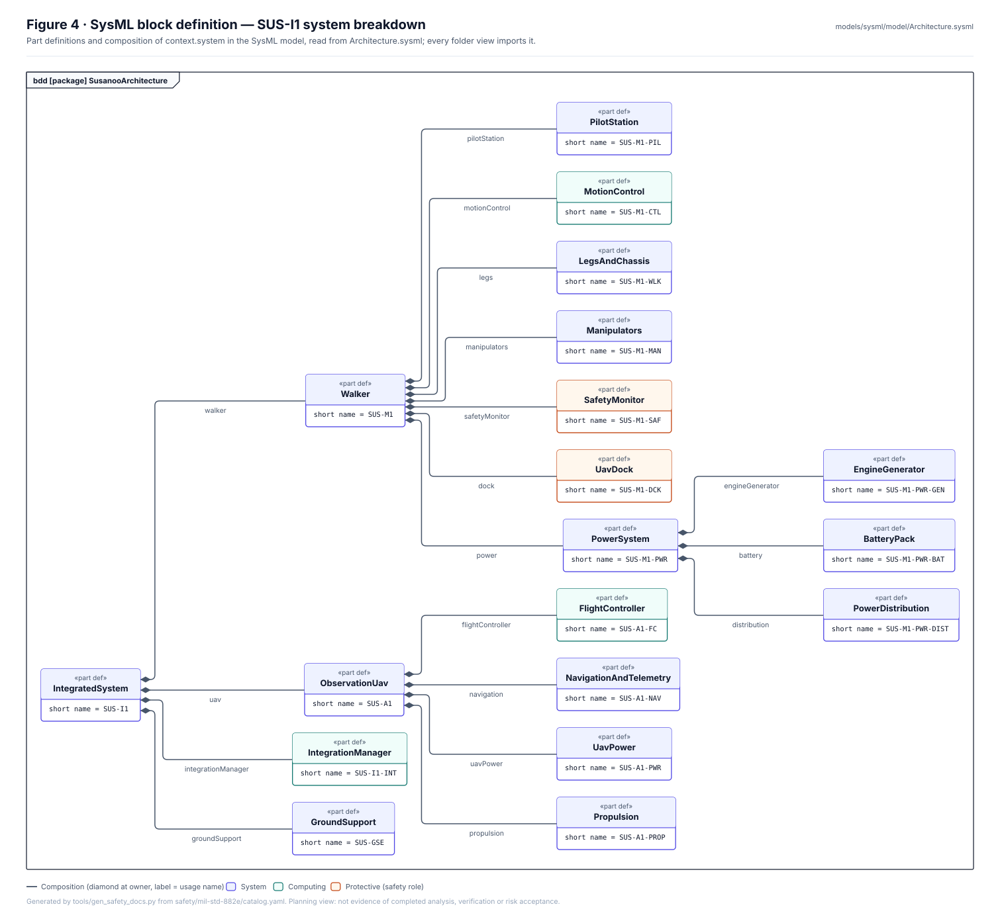
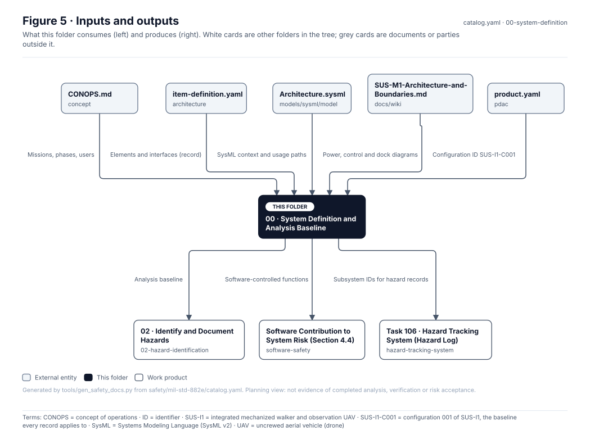

# 00 · System Definition and Analysis Baseline

> **Status:** Scaffold v0.1 — structure, diagrams and model views only
>
> Planning artifact. No completed hazard analysis, verified mitigation, risk acceptance, certification or MIL-STD-882E compliance is claimed. Category names follow MIL-STD-882E; confirm definitions against the controlled standard and the approved SSPP before formal use.

| Field | Value |
|---|---|
| Lifecycle gate | G0 (refreshed at every gate) |
| Accountable role | Systems lead with safety lead |
| Parent folder | [MIL-STD-882E System Safety Work Products](../README.md) |

## Purpose

Defines the system of interest, its decomposition, interfaces and external context that every
hazard analysis uses as its baseline. The records live outside this tree and are not restated here:
[`architecture/item-definition.yaml`](../../../architecture/item-definition.yaml) (elements, externals,
interfaces IF-nnn) and the SysML model in [`models/sysml/model`](../../../models/sysml/model/)
(`SusanooArchitecture`, `SusanooLibrary`, `SusanooRequirements`). Every folder view in this tree imports
that model, and every figure reads its elements and interfaces from the record.

## Position in the MIL-STD-882E flow

## Block diagram

Elements and interfaces: [`architecture/item-definition.yaml`](../../../architecture/item-definition.yaml); SysML: [`Architecture.sysml`](../../../models/sysml/model/Architecture.sysml).

## Boundary diagram

| # | From | To | Crossing / interaction | Interface (item definition) |
|---|---|---|---|---|
| 1 | EXT-PILOT: Pilot | SUS-M1: Piloted walker | intent / alerts | IF-001, IF-015 |
| 2 | EXT-CREW: Ground crew and maintainers | SUS-GSE: Ground support, maintenance supports, charging and test equipment | servicing / lockout | — |
| 3 | SUS-GSE: Ground support, maintenance supports, charging and test equipment | SUS-M1: Piloted walker | support / charging | IF-019 |
| 4 | SUS-M1: Piloted walker | SUS-A1: Dockable observation UAV | dock power, data, retention | IF-006, IF-PX4-007, IF-PX4-009 |
| 5 | SUS-M1: Piloted walker | EXT-TERRAIN: Terrain and obstacles | foot contact loads | IF-010 |
| 6 | SUS-M1: Piloted walker | EXT-BYSTANDER: Bystanders | motion envelope | IF-012 |
| 7 | EXT-GNSS-RF: GNSS and RF environment | SUS-A1: Dockable observation UAV | GNSS / RF link | IF-013 |
| 8 | Site infrastructure and logistics | SUS-GSE: Ground support, maintenance supports, charging and test equipment | fuel, power, transport | — |
| 9 | SUS-M1: Piloted walker | Natural environment and receptors | exhaust, noise, fluids | — |

**Explicitly excluded:** weapons or armament of any kind; public-road operation; autonomous walker operation without a pilot

## SysML model

Project SysML v2 model (model of record for every folder in this tree, validated by the OMG pilot in CI): [`Architecture.sysml`](../../../models/sysml/model/Architecture.sysml), [`SusanooLibrary.sysml`](../../../models/sysml/model/SusanooLibrary.sysml), [`Requirements.sysml`](../../../models/sysml/model/Requirements.sysml).

## Inputs and outputs

| Input | Source |
|---|---|
| Missions, phases, users | [`concept/CONOPS.md`](../../../concept/CONOPS.md) |
| Elements and interfaces (record) | [`architecture/item-definition.yaml`](../../../architecture/item-definition.yaml) |
| SysML context and usage paths | [`models/sysml/model/Architecture.sysml`](../../../models/sysml/model/Architecture.sysml) |
| Power, control and dock diagrams | [`docs/wiki/SUS-M1-Architecture-and-Boundaries.md`](../../../docs/wiki/SUS-M1-Architecture-and-Boundaries.md) |
| Configuration ID SUS-I1-C001 | [`pdac/product.yaml`](../../../pdac/product.yaml) |

| Output | Destination |
|---|---|
| Analysis baseline | [02 · Identify and Document Hazards](../02-hazard-identification/README.md) |
| Software-controlled functions | [Software Contribution to System Risk (Section 4.4)](../software-safety/README.md) |
| Subsystem IDs for hazard records | [Task 106 · Hazard Tracking System (Hazard Log)](../hazard-tracking-system/README.md) |

## Folder contents

| Item | Description | State |
|---|---|---|
| [`figures/`](figures/) | Generated SVG figures (do not edit) | generated |

<!-- END GENERATED: content below this line is human-authored and preserved -->

## Working content

_No analysis content yet. Add authored material below this heading._
