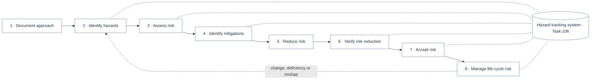
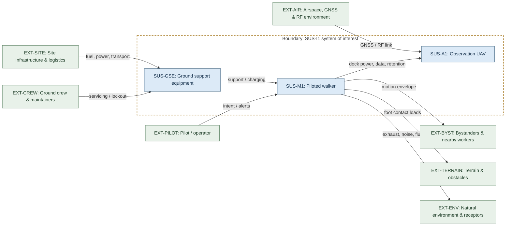
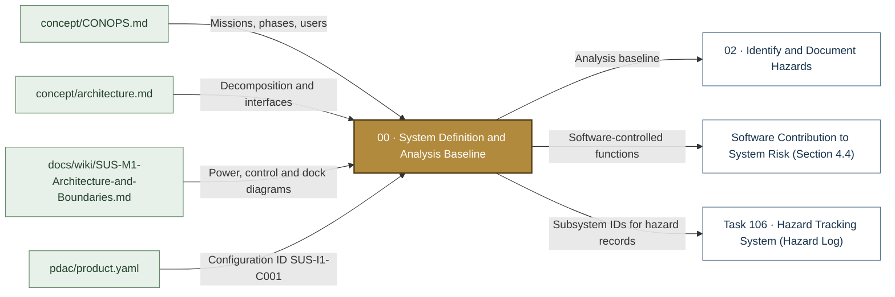

# 00 · System Definition and Analysis Baseline

> **Status:** Scaffold v0.1 — structure, diagrams and model views only
>
> Planning artifact. No completed hazard analysis, verified mitigation, risk acceptance, certification or MIL-STD-882E compliance is claimed. Category names follow MIL-STD-882E; confirm definitions against the controlled standard and the approved SSPP before formal use.

| Field | Value |
|---|---|
| Lifecycle gate | G0 (refreshed at every gate) |
| Accountable role | Systems lead with safety lead |
| Parent folder | [MIL-STD-882E System Safety Work Products](../README.md) |

## Purpose

Defines the system of interest, its decomposition, interfaces and external context that every
hazard analysis uses as its baseline. Holds the canonical SysML v2 models: `SusanooSystem`
(structure, ports, dock interface) and `SusanooSafety` (severity, probability, risk, SwCI,
mitigation precedence, hazard record). Per-folder SysML views import these packages.

## Position in the MIL-STD-882E flow

Highlighted node(s) show where this folder sits in the eight-element iterative flow. Dotted links are feedback and hazard-tracking-system interactions.

## Block diagram

System elements of SUS-I1 in scope for this folder are coloured (blue = system, amber = safety function, purple = interface); greyed blocks are out of scope. Source of truth: [`SusanooSystem.sysml`](sysml/SusanooSystem.sysml).

```mermaid
flowchart TB
  subgraph SUS_I1["SUS-I1: Integrated mech + UAV system"]
    direction TB
    subgraph SUS_M1["SUS-M1: Piloted walker"]
      direction TB
      SUS_M1_WLK["SUS-M1-WLK: Structure, legs, joints & brakes"]
      SUS_M1_MAN["SUS-M1-MAN: Manipulator arms & end effectors"]
      SUS_M1_PIL["SUS-M1-PIL: Pilot station, restraints & HMI"]
      SUS_M1_PWR["SUS-M1-PWR: Series-hybrid power & isolation"]
      SUS_M1_CTL["SUS-M1-CTL: Motion & balance control SW"]
      SUS_M1_SAF["SUS-M1-SAF: Safety monitor & protective stop"]
      SUS_M1_DCK["SUS-M1-DCK: UAV dock - retention, power, data"]
    end
    subgraph SUS_A1["SUS-A1: Observation UAV"]
      direction TB
      SUS_A1_FCS["SUS-A1-FCS: Flight control - PX4 candidate"]
      SUS_A1_PRP["SUS-A1-PRP: Motors, ESCs & propellers"]
      SUS_A1_PWR["SUS-A1-PWR: UAV battery & power mgmt"]
      SUS_A1_NAV["SUS-A1-NAV: Navigation & telemetry link"]
      SUS_A1_PLD["SUS-A1-PLD: Observation payload"]
    end
    subgraph SUS_GSE["SUS-GSE: Ground support equipment"]
      direction TB
      SUS_GSE_SUP["SUS-GSE-SUP: Maintenance supports & lockout"]
      SUS_GSE_CHG["SUS-GSE-CHG: Charging & fuelling equipment"]
      SUS_GSE_TST["SUS-GSE-TST: Test rigs, HIL & simulation"]
    end
  end
  SUS_M1_PIL -->|"commands"| SUS_M1_CTL
  SUS_M1_CTL -->|"joint actuation"| SUS_M1_WLK
  SUS_M1_CTL -->|"arm actuation"| SUS_M1_MAN
  SUS_M1_PWR -->|"DC power"| SUS_M1_WLK
  SUS_M1_SAF -->|"torque inhibit"| SUS_M1_CTL
  SUS_M1_SAF -->|"energy isolation"| SUS_M1_PWR
  SUS_M1_DCK -->|"dock charging"| SUS_A1_PWR
  SUS_M1_DCK -->|"dock data / rotor inhibit"| SUS_A1_FCS
  SUS_A1_NAV -->|"state estimate"| SUS_A1_FCS
  SUS_A1_FCS -->|"thrust command"| SUS_A1_PRP
  SUS_GSE_SUP -->|"mechanical support"| SUS_M1_WLK
  SUS_GSE_CHG -->|"shore charging"| SUS_M1_PWR
  class SUS_M1_WLK system
  class SUS_M1_MAN system
  class SUS_M1_PIL system
  class SUS_M1_PWR system
  class SUS_M1_CTL system
  class SUS_M1_SAF safety
  class SUS_M1_DCK interface
  class SUS_A1_FCS system
  class SUS_A1_PRP system
  class SUS_A1_PWR system
  class SUS_A1_NAV system
  class SUS_A1_PLD system
  class SUS_GSE_SUP system
  class SUS_GSE_CHG system
  class SUS_GSE_TST system
  classDef system fill:#dceaf7,stroke:#55758f,color:#17324d
  classDef safety fill:#fff0d9,stroke:#b28a3d,color:#513c16
  classDef external fill:#e8f1e9,stroke:#63886a,color:#23412c
  classDef interface fill:#eae7f5,stroke:#8370a3,color:#30254a
  classDef muted fill:#f4f4f4,stroke:#b5b5b5,color:#8a8a8a,stroke-dasharray: 4 3
  classDef current fill:#b28a3d,stroke:#513c16,color:#ffffff,stroke-width:2px
  classDef work fill:#ffffff,stroke:#55758f,color:#17324d
```

## Boundary diagram

Dashed frame = **SUS-I1 system of interest** boundary. Everything outside it is an external entity or another folder's scope.

| From | To | Crossing / interaction |
|---|---|---|
| EXT-PILOT: Pilot / operator | SUS-M1: Piloted walker | intent / alerts |
| EXT-CREW: Ground crew & maintainers | SUS-GSE: Ground support equipment | servicing / lockout |
| SUS-GSE: Ground support equipment | SUS-M1: Piloted walker | support / charging |
| SUS-M1: Piloted walker | SUS-A1: Observation UAV | dock power, data, retention |
| SUS-M1: Piloted walker | EXT-TERRAIN: Terrain & obstacles | foot contact loads |
| SUS-M1: Piloted walker | EXT-BYST: Bystanders & nearby workers | motion envelope |
| EXT-AIR: Airspace, GNSS & RF environment | SUS-A1: Observation UAV | GNSS / RF link |
| EXT-SITE: Site infrastructure & logistics | SUS-GSE: Ground support equipment | fuel, power, transport |
| SUS-M1: Piloted walker | EXT-ENV: Natural environment & receptors | exhaust, noise, fluids |

**Explicitly excluded:** weapons or armament of any kind; public-road operation; autonomous walker operation without a pilot

## SysML model

Canonical SysML v2 textual models (model of record for every folder in this tree): [`SusanooSystem.sysml`](sysml/SusanooSystem.sysml), [`SusanooSafety.sysml`](sysml/SusanooSafety.sysml).

### Block definition (bdd) — SUS-I1 system breakdown

```mermaid
classDiagram
  class SUS_I1["IntegratedSystem"] {
    <<part def>>
    SUS-I1
  }
  class SUS_M1["PilotedWalker"] {
    <<part def>>
    SUS-M1
  }
  class SUS_M1_WLK["WalkerStructure"] {
    <<part def>>
    SUS-M1-WLK
  }
  class SUS_M1_MAN["Manipulators"] {
    <<part def>>
    SUS-M1-MAN
  }
  class SUS_M1_PIL["PilotStation"] {
    <<part def>>
    SUS-M1-PIL
  }
  class SUS_M1_PWR["PowerSystem"] {
    <<part def>>
    SUS-M1-PWR
  }
  class SUS_M1_CTL["MotionControl"] {
    <<part def>>
    SUS-M1-CTL
  }
  class SUS_M1_SAF["SafetyMonitor"] {
    <<part def>>
    SUS-M1-SAF
  }
  class SUS_M1_DCK["UAVDock"] {
    <<part def>>
    SUS-M1-DCK
  }
  class SUS_A1["ObservationUAV"] {
    <<part def>>
    SUS-A1
  }
  class SUS_A1_FCS["FlightControl"] {
    <<part def>>
    SUS-A1-FCS
  }
  class SUS_A1_PRP["Propulsion"] {
    <<part def>>
    SUS-A1-PRP
  }
  class SUS_A1_PWR["UAVPower"] {
    <<part def>>
    SUS-A1-PWR
  }
  class SUS_A1_NAV["NavTelemetry"] {
    <<part def>>
    SUS-A1-NAV
  }
  class SUS_A1_PLD["ObservationPayload"] {
    <<part def>>
    SUS-A1-PLD
  }
  class SUS_GSE["GroundSupport"] {
    <<part def>>
    SUS-GSE
  }
  class SUS_GSE_SUP["MaintenanceSupports"] {
    <<part def>>
    SUS-GSE-SUP
  }
  class SUS_GSE_CHG["ChargingEquipment"] {
    <<part def>>
    SUS-GSE-CHG
  }
  class SUS_GSE_TST["TestRigs"] {
    <<part def>>
    SUS-GSE-TST
  }
  SUS_I1 *-- "1" SUS_M1 : m1
  SUS_M1 *-- "1" SUS_M1_WLK : wlk
  SUS_M1 *-- "1" SUS_M1_MAN : man
  SUS_M1 *-- "1" SUS_M1_PIL : pil
  SUS_M1 *-- "1" SUS_M1_PWR : pwr
  SUS_M1 *-- "1" SUS_M1_CTL : ctl
  SUS_M1 *-- "1" SUS_M1_SAF : saf
  SUS_M1 *-- "1" SUS_M1_DCK : dck
  SUS_I1 *-- "1" SUS_A1 : a1
  SUS_A1 *-- "1" SUS_A1_FCS : fcs
  SUS_A1 *-- "1" SUS_A1_PRP : prp
  SUS_A1 *-- "1" SUS_A1_PWR : pwr
  SUS_A1 *-- "1" SUS_A1_NAV : nav
  SUS_A1 *-- "1" SUS_A1_PLD : pld
  SUS_I1 *-- "1" SUS_GSE : gse
  SUS_GSE *-- "1" SUS_GSE_SUP : sup
  SUS_GSE *-- "1" SUS_GSE_CHG : chg
  SUS_GSE *-- "1" SUS_GSE_TST : tst
```

## Inputs and outputs

| Input | Source |
|---|---|
| Missions, phases, users | [`concept/CONOPS.md`](../../../concept/CONOPS.md) |
| Decomposition and interfaces | [`concept/architecture.md`](../../../concept/architecture.md) |
| Power, control and dock diagrams | [`docs/wiki/SUS-M1-Architecture-and-Boundaries.md`](../../../docs/wiki/SUS-M1-Architecture-and-Boundaries.md) |
| Configuration ID SUS-I1-C001 | [`pdac/product.yaml`](../../../pdac/product.yaml) |

| Output | Destination |
|---|---|
| Analysis baseline | [02 · Identify and Document Hazards](../02-hazard-identification/README.md) |
| Software-controlled functions | [Software Contribution to System Risk (Section 4.4)](../software-safety/README.md) |
| Subsystem IDs for hazard records | [Task 106 · Hazard Tracking System (Hazard Log)](../hazard-tracking-system/README.md) |

## Folder contents

| Item | Description | State |
|---|---|---|
| [`sysml/SusanooSystem.sysml`](sysml/SusanooSystem.sysml) | Canonical structure model (parts | present |
| [`sysml/SusanooSafety.sysml`](sysml/SusanooSafety.sysml) | Canonical safety vocabulary (enums | present |
| `interface-register.csv` | Controlled interface list with hazard links | planned |

<!-- END GENERATED: content below this line is human-authored and preserved -->

## Working content

_No analysis content yet. Add authored material below this heading._
