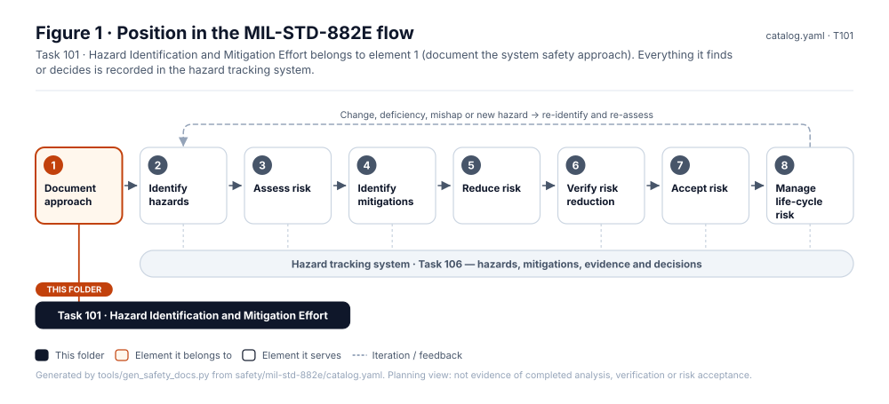
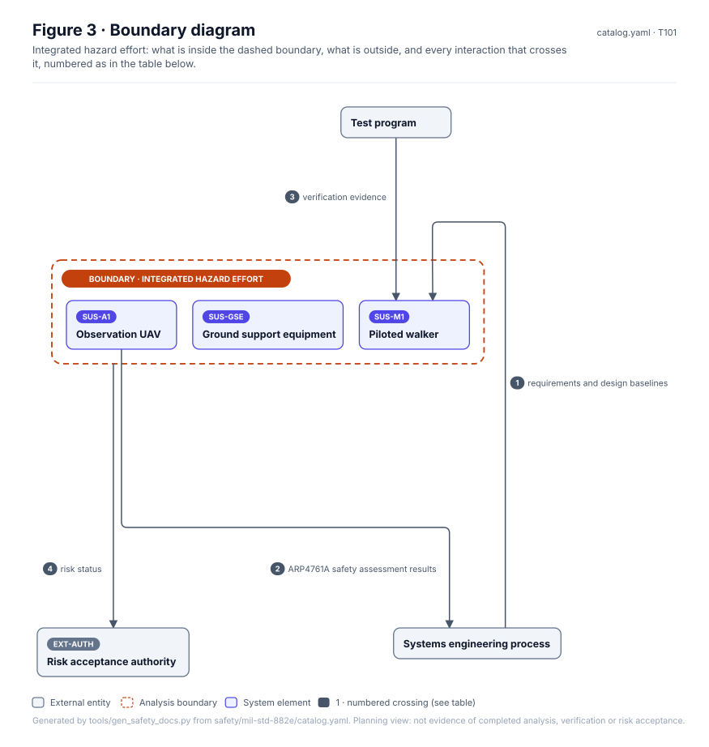
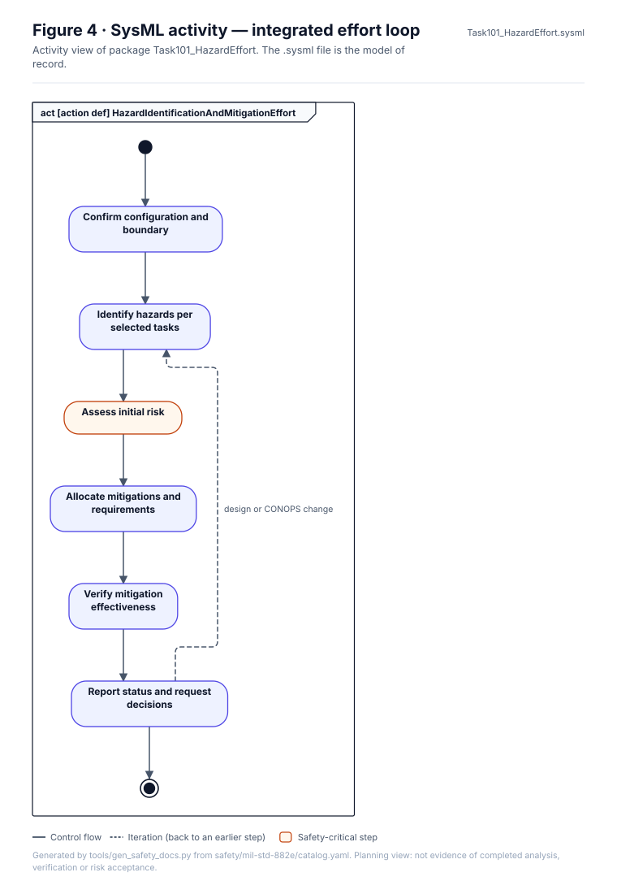
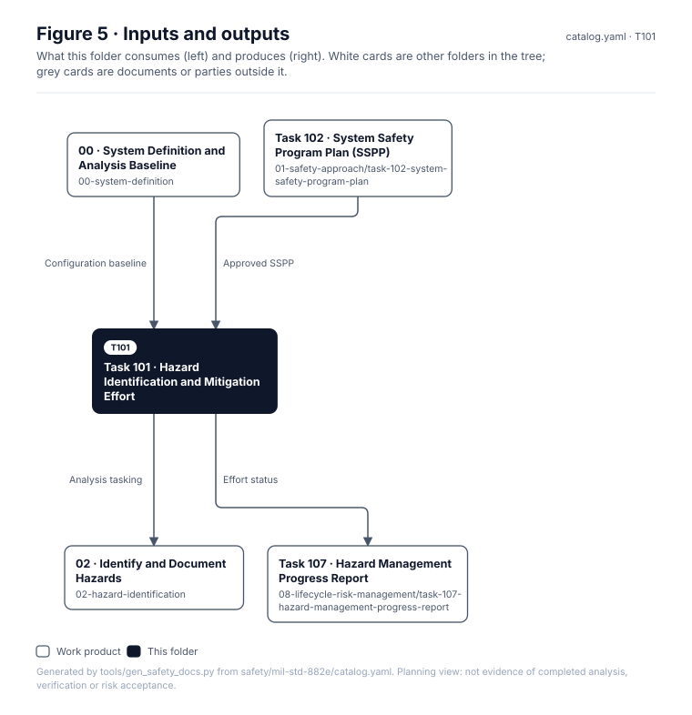

# Task 101 · Hazard Identification and Mitigation Effort

> **Status:** Scaffold v0.1 — structure, diagrams and model views only
>
> Planning artifact. No completed hazard analysis, verified mitigation, risk acceptance, certification or MIL-STD-882E compliance is claimed. Category names follow MIL-STD-882E; confirm definitions against the controlled standard and the approved SSPP before formal use.

| Field | Value |
|---|---|
| MIL-STD-882E element | 1 — Document the system safety approach |
| Tasks | [Task 101 — Hazard Identification and Mitigation Effort](../../../../docs/wiki/MIL-STD-882E-Task-101.md) |
| Lifecycle gate | G0 onward |
| Applicability | Selected |
| Accountable role | Safety lead |
| Parent folder | [01 · Document the System Safety Approach](../README.md) |

## Purpose

Establishes the integrated, iterative effort that runs the eight elements across SUS-M1,
SUS-A1 and their interfaces, using the systems engineering process rather than a parallel one.

## Position in the MIL-STD-882E flow



## Block diagram


Source of truth: [`SusanooSystem.sysml`](../../00-system-definition/sysml/SusanooSystem.sysml).

## Boundary diagram



| # | From | To | Crossing / interaction |
|---|---|---|---|
| 1 | Systems engineering process | SUS-M1: Piloted walker | requirements and design baselines |
| 2 | SUS-A1: Observation UAV | Systems engineering process | ARP4761A safety assessment results |
| 3 | Test program | SUS-M1: Piloted walker | verification evidence |
| 4 | _Integrated hazard effort (boundary)_ | EXT-AUTH: Risk acceptance authority | risk status |

## SysML model

SysML v2 textual view: [`Task101_HazardEffort.sysml`](Task101_HazardEffort.sysml), generated from the catalog. It imports [`SusanooSystem`](../../00-system-definition/sysml/SusanooSystem.sysml) and [`SusanooSafety`](../../00-system-definition/sysml/SusanooSafety.sysml). The figures are drawn from the same data; the `.sysml` file is the model of record.



<details><summary>SysML v2 source</summary>

```sysml
// Task101_HazardEffort — generated by tools/gen_safety_docs.py from safety/mil-std-882e/catalog.yaml.
// Do not edit by hand: change the catalog and regenerate.
// Status: planning view only; not evidence of completed analysis or verification.

package Task101_HazardEffort {
    private import ScalarValues::*;
    private import SusanooSystem::*;
    private import SusanooSafety::*;
    action def HazardIdentificationAndMitigationEffort {
        action defineScope { doc /* Confirm configuration and boundary */ }
        action identify { doc /* Identify hazards per selected tasks */ }
        action assess { doc /* Assess initial risk */ }
        action mitigate { doc /* Allocate mitigations and requirements */ }
        action verifyEffectiveness { doc /* Verify mitigation effectiveness */ }
        action report { doc /* Report status and request decisions */ }
        first start then defineScope;
        first defineScope then identify;
        first identify then assess;
        first assess then mitigate;
        first mitigate then verifyEffectiveness;
        first verifyEffectiveness then report;
        first report then done;
        // iteration: report -> identify when design or CONOPS change (informal; merge node omitted)
    }
}
```

</details>

## Inputs and outputs



| Input | Source |
|---|---|
| Configuration baseline | [00 · System Definition and Analysis Baseline](../../00-system-definition/README.md) |
| Approved SSPP | [Task 102 · System Safety Program Plan (SSPP)](../task-102-system-safety-program-plan/README.md) |

| Output | Destination |
|---|---|
| Analysis tasking | [02 · Identify and Document Hazards](../../02-hazard-identification/README.md) |
| Effort status | [Task 107 · Hazard Management Progress Report](../../08-lifecycle-risk-management/task-107-hazard-management-progress-report/README.md) |

## Folder contents

| Item | Description | State |
|---|---|---|
| `effort-record.yaml` | Task record using templates/task-record.yaml | planned |
| [`figures/`](figures/) | Generated SVG figures (do not edit) | generated |
| [`Task101_HazardEffort.sysml`](Task101_HazardEffort.sysml) | Generated SysML v2 view | generated |

<!-- END GENERATED: content below this line is human-authored and preserved -->

## Working content

_No analysis content yet. Add authored material below this heading._
