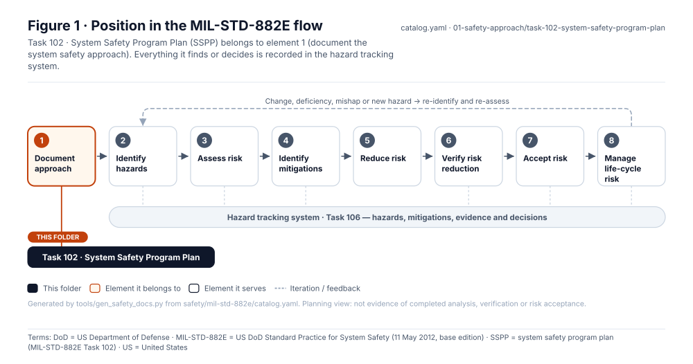
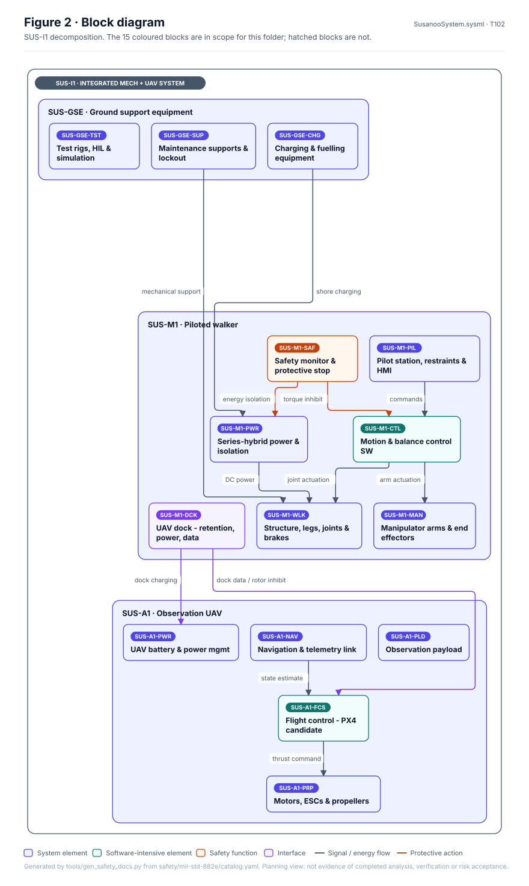
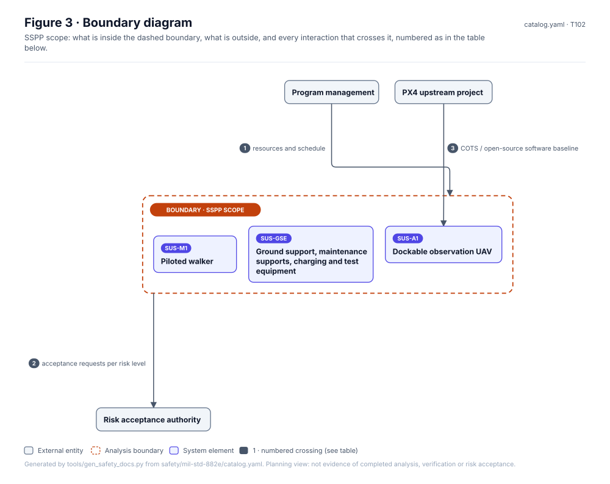
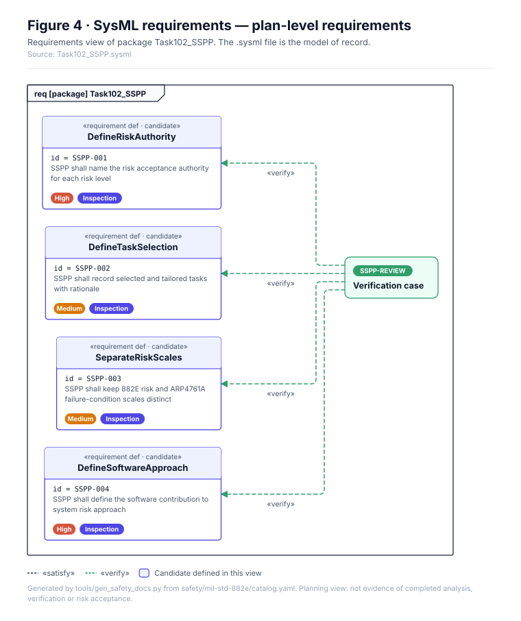
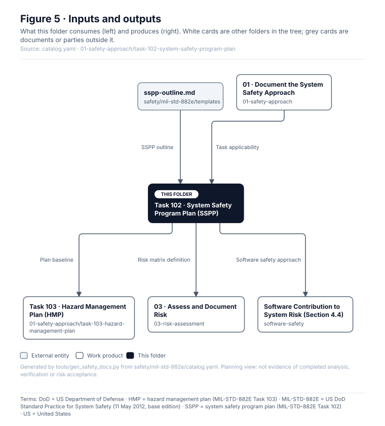

# Task 102 · System Safety Program Plan (SSPP)

> **Status:** Scaffold v0.1 — structure, diagrams and model views only
>
> Planning artifact. No completed hazard analysis, verified mitigation, risk acceptance, certification or MIL-STD-882E compliance is claimed. Category names follow MIL-STD-882E; confirm definitions against the controlled standard and the approved SSPP before formal use.

| Field | Value |
|---|---|
| MIL-STD-882E element | 1 — Document the system safety approach |
| Tasks | [Task 102 — System Safety Program Plan](../../../../docs/wiki/MIL-STD-882E-Task-102.md) |
| Lifecycle gate | G0, revised at G2 and G6 |
| Applicability | Selected |
| Accountable role | Safety lead; approval by program authority |
| Parent folder | [01 · Document the System Safety Approach](../README.md) |

## Purpose

The SSPP: scope, organisation, authority, selected tasks, methods, risk matrix, hazard tracking,
software approach, verification and acceptance. Start from `templates/sspp-outline.md`.

## Position in the MIL-STD-882E flow



## Block diagram



Source of truth: [`SusanooSystem.sysml`](../../00-system-definition/sysml/SusanooSystem.sysml).

## Boundary diagram



| # | From | To | Crossing / interaction |
|---|---|---|---|
| 1 | Program management | _SSPP scope (boundary)_ | resources and schedule |
| 2 | _SSPP scope (boundary)_ | EXT-AUTH: Risk acceptance authority | acceptance requests per risk level |
| 3 | PX4 upstream project | SUS-A1: Observation UAV | COTS / open-source software baseline |

## SysML model

SysML v2 textual view: [`Task102_SSPP.sysml`](Task102_SSPP.sysml), generated from the catalog. It imports [`SusanooSystem`](../../00-system-definition/sysml/SusanooSystem.sysml) and [`SusanooSafety`](../../00-system-definition/sysml/SusanooSafety.sysml). The figures are drawn from the same data; the `.sysml` file is the model of record.



<details><summary>SysML v2 source</summary>

```sysml
// Task102_SSPP — generated by tools/gen_safety_docs.py from safety/mil-std-882e/catalog.yaml.
// Do not edit by hand: change the catalog and regenerate.
// Status: planning view only; not evidence of completed analysis or verification.

package Task102_SSPP {
    private import ScalarValues::*;
    private import SusanooSystem::*;
    private import SusanooSafety::*;
    requirement def <'SSPP-001'> DefineRiskAuthority {
        doc /* SSPP shall name the risk acceptance authority for each risk level */
    }
    requirement sspp_001 : DefineRiskAuthority;
    requirement def <'SSPP-002'> DefineTaskSelection {
        doc /* SSPP shall record selected and tailored tasks with rationale */
    }
    requirement sspp_002 : DefineTaskSelection;
    requirement def <'SSPP-003'> SeparateRiskScales {
        doc /* SSPP shall keep 882E risk and ARP4761A failure-condition scales distinct */
    }
    requirement sspp_003 : SeparateRiskScales;
    requirement def <'SSPP-004'> DefineSoftwareApproach {
        doc /* SSPP shall define the software contribution to system risk approach */
    }
    requirement sspp_004 : DefineSoftwareApproach;
    verification def <'SSPP-REVIEW'> SsppReview {
        objective {
            verify sspp_001;
            verify sspp_002;
            verify sspp_003;
            verify sspp_004;
        }
    }
}
```

</details>

## Inputs and outputs



| Input | Source |
|---|---|
| SSPP outline | [`safety/mil-std-882e/templates/sspp-outline.md`](../../templates/sspp-outline.md) |
| Task applicability | [01 · Document the System Safety Approach](../README.md) |

| Output | Destination |
|---|---|
| Plan baseline | [Task 103 · Hazard Management Plan (HMP)](../task-103-hazard-management-plan/README.md) |
| Risk matrix definition | [03 · Assess and Document Risk](../../03-risk-assessment/README.md) |
| Software safety approach | [Software Contribution to System Risk (Section 4.4)](../../software-safety/README.md) |

## Folder contents

| Item | Description | State |
|---|---|---|
| `sspp.md` | System Safety Program Plan (draft until approved) | planned |
| [`figures/`](figures/) | Generated SVG figures (do not edit) | generated |
| [`Task102_SSPP.sysml`](Task102_SSPP.sysml) | Generated SysML v2 view | generated |

<!-- END GENERATED: content below this line is human-authored and preserved -->

## Working content

_No analysis content yet. Add authored material below this heading._
