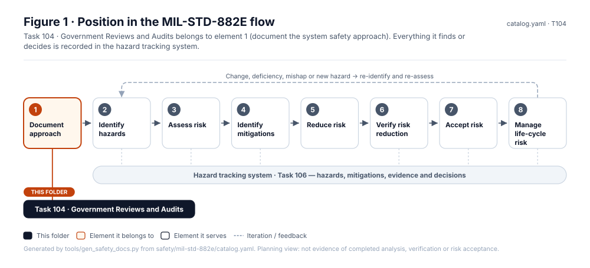
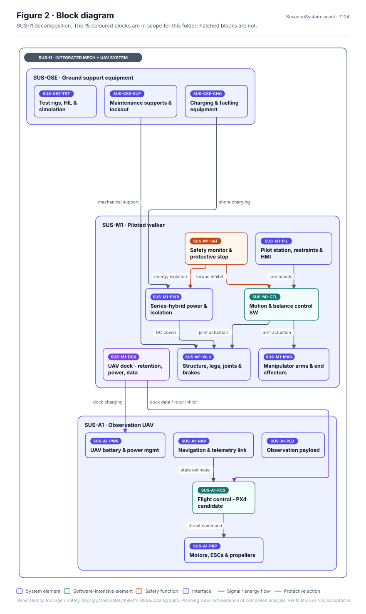
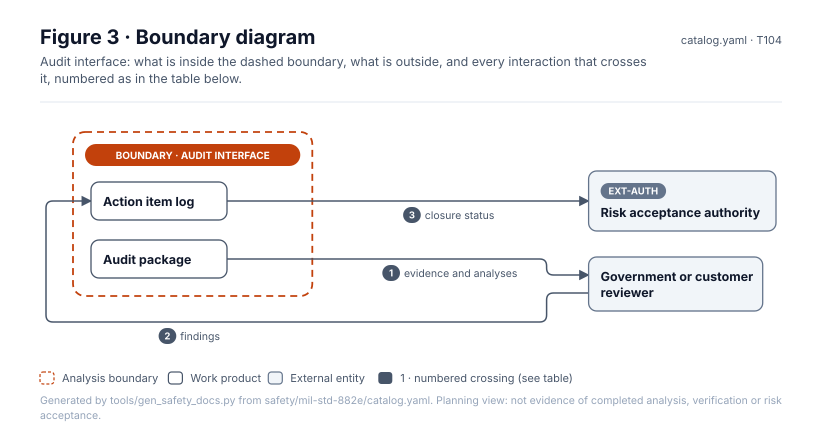
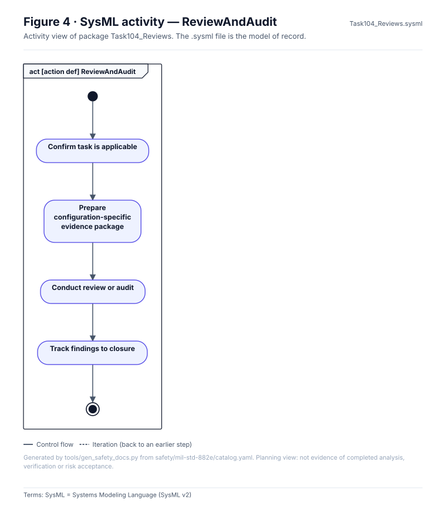
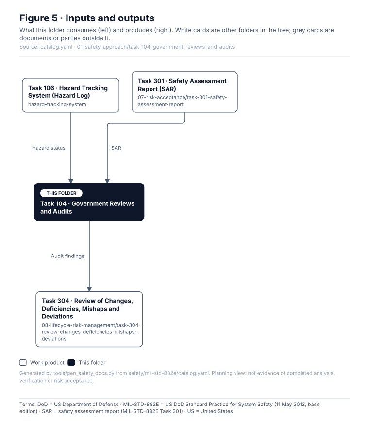

# Task 104 · Government Reviews and Audits

> **Status:** Scaffold v0.1 — structure, diagrams and model views only
>
> Planning artifact. No completed hazard analysis, verified mitigation, risk acceptance, certification or MIL-STD-882E compliance is claimed. Category names follow MIL-STD-882E; confirm definitions against the controlled standard and the approved SSPP before formal use.

| Field | Value |
|---|---|
| MIL-STD-882E element | 1 — Document the system safety approach |
| Tasks | [Task 104 — Government Reviews and Audits](../../../../docs/wiki/MIL-STD-882E-Task-104.md) |
| Lifecycle gate | As scheduled |
| Applicability | Conditional — only if a government customer or authority is engaged |
| Accountable role | Safety lead |
| Parent folder | [01 · Document the System Safety Approach](../README.md) |

## Purpose

Supports external safety reviews and audits. Currently conditional: no government contract or
authority is assumed. Record the applicability decision and re-evaluation trigger here.

## Position in the MIL-STD-882E flow



## Block diagram



Source of truth: [`SusanooSystem.sysml`](../../00-system-definition/sysml/SusanooSystem.sysml).

## Boundary diagram



| # | From | To | Crossing / interaction |
|---|---|---|---|
| 1 | Audit package | Government or customer reviewer | evidence and analyses |
| 2 | Government or customer reviewer | Action item log | findings |
| 3 | Action item log | EXT-AUTH: Risk acceptance authority | closure status |

## SysML model

SysML v2 textual view: [`Task104_Reviews.sysml`](Task104_Reviews.sysml), generated from the catalog. It imports [`SusanooSystem`](../../00-system-definition/sysml/SusanooSystem.sysml) and [`SusanooSafety`](../../00-system-definition/sysml/SusanooSafety.sysml). The figures are drawn from the same data; the `.sysml` file is the model of record.



<details><summary>SysML v2 source</summary>

```sysml
// Task104_Reviews — generated by tools/gen_safety_docs.py from safety/mil-std-882e/catalog.yaml.
// Do not edit by hand: change the catalog and regenerate.
// Status: planning view only; not evidence of completed analysis or verification.

package Task104_Reviews {
    private import ScalarValues::*;
    private import SusanooSystem::*;
    private import SusanooSafety::*;
    action def ReviewAndAudit {
        action confirmApplicability { doc /* Confirm task is applicable */ }
        action preparePackage { doc /* Prepare configuration-specific evidence package */ }
        action conductReview { doc /* Conduct review or audit */ }
        action trackActions { doc /* Track findings to closure */ }
        first start;
        then confirmApplicability;
        first confirmApplicability then preparePackage;
        first preparePackage then conductReview;
        first conductReview then trackActions;
        first trackActions then done;
    }
}
```

</details>

## Inputs and outputs



| Input | Source |
|---|---|
| Hazard status | [Task 106 · Hazard Tracking System (Hazard Log)](../../hazard-tracking-system/README.md) |
| SAR | [Task 301 · Safety Assessment Report (SAR)](../../07-risk-acceptance/task-301-safety-assessment-report/README.md) |

| Output | Destination |
|---|---|
| Audit findings | [Task 304 · Review of Changes, Deficiencies, Mishaps and Deviations](../../08-lifecycle-risk-management/task-304-review-changes-deficiencies-mishaps-deviations/README.md) |

## Folder contents

| Item | Description | State |
|---|---|---|
| `applicability-decision.yaml` | Conditional applicability record | planned |
| [`figures/`](figures/) | Generated SVG figures (do not edit) | generated |
| [`Task104_Reviews.sysml`](Task104_Reviews.sysml) | Generated SysML v2 view | generated |

<!-- END GENERATED: content below this line is human-authored and preserved -->

## Working content

_No analysis content yet. Add authored material below this heading._
