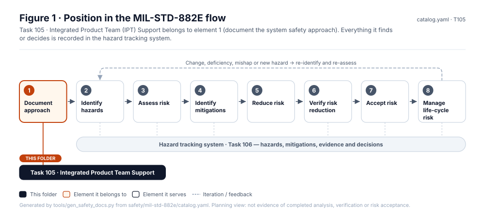
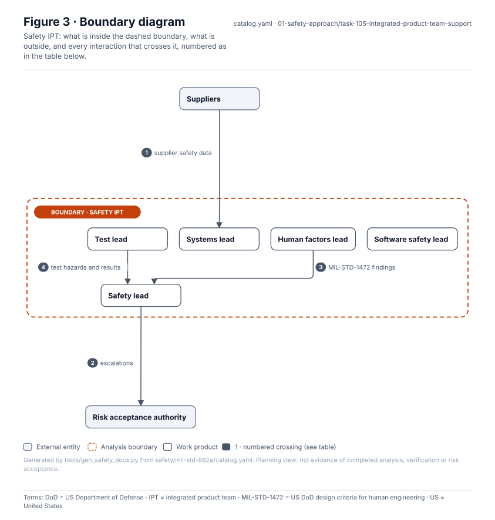
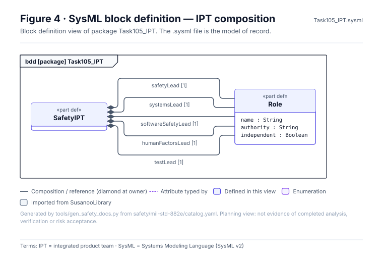
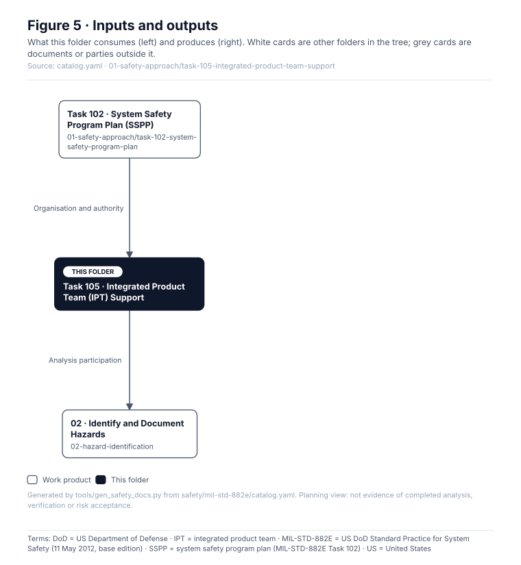

# Task 105 · Integrated Product Team (IPT) Support

> **Status:** Scaffold v0.1 — structure, diagrams and model views only
>
> Planning artifact. No completed hazard analysis, verified mitigation, risk acceptance, certification or MIL-STD-882E compliance is claimed. Category names follow MIL-STD-882E; confirm definitions against the controlled standard and the approved SSPP before formal use.

| Field | Value |
|---|---|
| MIL-STD-882E element | 1 — Document the system safety approach |
| Tasks | [Task 105 — Integrated Product Team Support](../../../../docs/wiki/MIL-STD-882E-Task-105.md) |
| Lifecycle gate | G0 onward |
| Applicability | Selected |
| Accountable role | Safety lead |
| Parent folder | [01 · Document the System Safety Approach](../README.md) |

## Purpose

Embeds safety in the walker, UAV, controls, human factors and test teams so hazards and controls
are worked inside design decisions, not after them.

## Position in the MIL-STD-882E flow



## Block diagram


Source of truth: [`SusanooSystem.sysml`](../../00-system-definition/sysml/SusanooSystem.sysml).

## Boundary diagram



| # | From | To | Crossing / interaction |
|---|---|---|---|
| 1 | Suppliers | Systems lead | supplier safety data |
| 2 | Safety lead | EXT-AUTH: Risk acceptance authority | escalations |
| 3 | Human factors lead | Safety lead | MIL-STD-1472 findings |
| 4 | Test lead | Safety lead | test hazards and results |

## SysML model

SysML v2 textual view: [`Task105_IPT.sysml`](Task105_IPT.sysml), generated from the catalog. It imports [`SusanooSystem`](../../00-system-definition/sysml/SusanooSystem.sysml) and [`SusanooSafety`](../../00-system-definition/sysml/SusanooSafety.sysml). The figures are drawn from the same data; the `.sysml` file is the model of record.



<details><summary>SysML v2 source</summary>

```sysml
// Task105_IPT — generated by tools/gen_safety_docs.py from safety/mil-std-882e/catalog.yaml.
// Do not edit by hand: change the catalog and regenerate.
// Status: planning view only; not evidence of completed analysis or verification.

package Task105_IPT {
    private import ScalarValues::*;
    private import SusanooSystem::*;
    private import SusanooSafety::*;
    part def SafetyIPT {
        part safetyLead : Role[1];
        part systemsLead : Role[1];
        part softwareSafetyLead : Role[1];
        part humanFactorsLead : Role[1];
        part testLead : Role[1];
    }
    part def Role {
        attribute name : String;
        attribute authority : String;
        attribute independent : Boolean;
    }
}
```

</details>

## Inputs and outputs



| Input | Source |
|---|---|
| Organisation and authority | [Task 102 · System Safety Program Plan (SSPP)](../task-102-system-safety-program-plan/README.md) |

| Output | Destination |
|---|---|
| Analysis participation | [02 · Identify and Document Hazards](../../02-hazard-identification/README.md) |

## Folder contents

| Item | Description | State |
|---|---|---|
| `ipt-charter.md` | Charter | planned |
| [`figures/`](figures/) | Generated SVG figures (do not edit) | generated |
| [`Task105_IPT.sysml`](Task105_IPT.sysml) | Generated SysML v2 view | generated |

<!-- END GENERATED: content below this line is human-authored and preserved -->

## Working content

_No analysis content yet. Add authored material below this heading._
