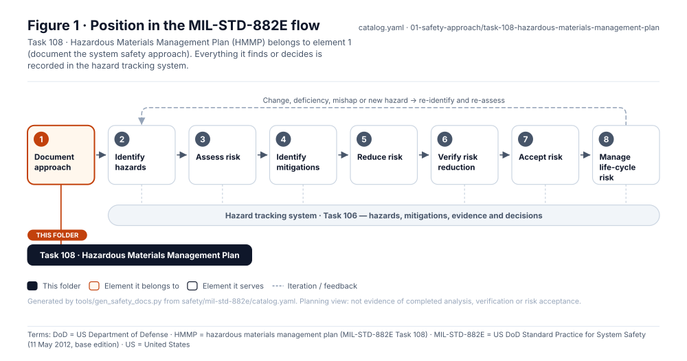
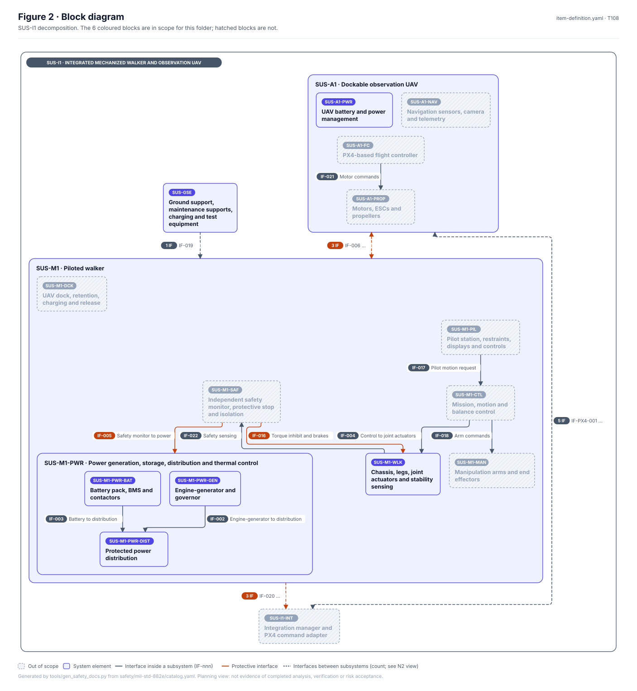
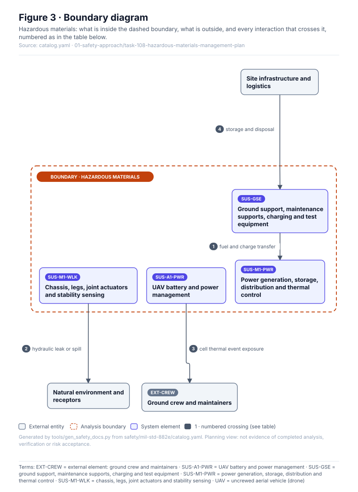
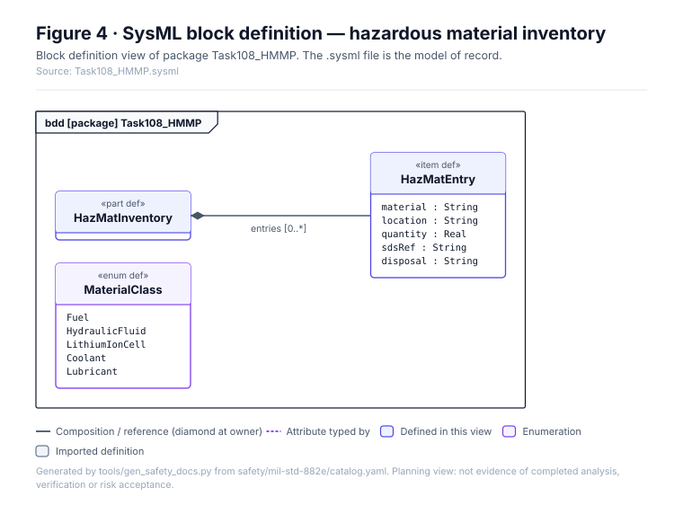
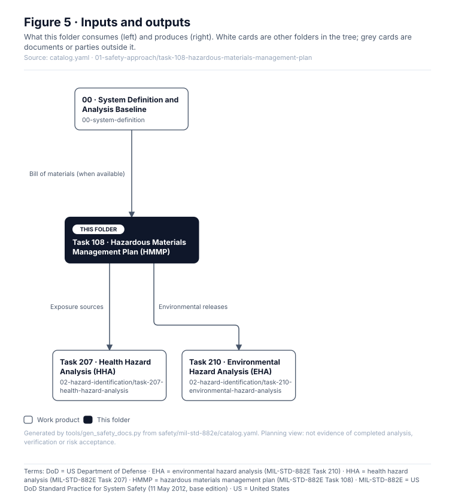

# Task 108 · Hazardous Materials Management Plan (HMMP)

> **Status:** Scaffold v0.1 — structure, diagrams and model views only
>
> Planning artifact. No completed hazard analysis, verified mitigation, risk acceptance, certification or MIL-STD-882E compliance is claimed. Category names follow MIL-STD-882E; confirm definitions against the controlled standard and the approved SSPP before formal use.

| Field | Value |
|---|---|
| MIL-STD-882E element | 1 — Document the system safety approach |
| Tasks | [Task 108 — Hazardous Materials Management Plan](../../../../docs/wiki/MIL-STD-882E-Task-108.md) |
| Lifecycle gate | G1–G3 |
| Applicability | Selected |
| Accountable role | Environmental / HSE lead |
| Parent folder | [01 · Document the System Safety Approach](../README.md) |

## Purpose

Inventories and manages hazardous materials: engine fuel, hydraulic fluid (if electrohydraulic
actuation is chosen), lithium-ion cells in SUS-M1 and SUS-A1, coolants and lubricants.

## Position in the MIL-STD-882E flow



## Block diagram



Source of truth: [`SusanooSystem.sysml`](../../00-system-definition/sysml/SusanooSystem.sysml).

## Boundary diagram



| # | From | To | Crossing / interaction |
|---|---|---|---|
| 1 | SUS-GSE-CHG: Charging & fuelling equipment | SUS-M1-PWR: Series-hybrid power & isolation | fuel and charge transfer |
| 2 | SUS-M1-WLK: Structure, legs, joints & brakes | EXT-ENV: Natural environment & receptors | hydraulic leak or spill |
| 3 | SUS-A1-PWR: UAV battery & power mgmt | EXT-CREW: Ground crew & maintainers | cell thermal event exposure |
| 4 | EXT-SITE: Site infrastructure & logistics | SUS-GSE-CHG: Charging & fuelling equipment | storage and disposal |

## SysML model

SysML v2 textual view: [`Task108_HMMP.sysml`](Task108_HMMP.sysml), generated from the catalog. It imports [`SusanooSystem`](../../00-system-definition/sysml/SusanooSystem.sysml) and [`SusanooSafety`](../../00-system-definition/sysml/SusanooSafety.sysml). The figures are drawn from the same data; the `.sysml` file is the model of record.



<details><summary>SysML v2 source</summary>

```sysml
// Task108_HMMP — generated by tools/gen_safety_docs.py from safety/mil-std-882e/catalog.yaml.
// Do not edit by hand: change the catalog and regenerate.
// Status: planning view only; not evidence of completed analysis or verification.

package Task108_HMMP {
    private import ScalarValues::*;
    private import SusanooSystem::*;
    private import SusanooSafety::*;
    part def HazMatInventory {
        ref item entries : HazMatEntry[0..*];
    }
    item def HazMatEntry {
        attribute material : String;
        attribute location : String;
        attribute quantity : Real;
        attribute sdsRef : String;
        attribute disposal : String;
    }
    enum def MaterialClass {
        enum Fuel;
        enum HydraulicFluid;
        enum LithiumIonCell;
        enum Coolant;
        enum Lubricant;
    }
}
```

</details>

## Inputs and outputs



| Input | Source |
|---|---|
| Bill of materials (when available) | [00 · System Definition and Analysis Baseline](../../00-system-definition/README.md) |

| Output | Destination |
|---|---|
| Exposure sources | [Task 207 · Health Hazard Analysis (HHA)](../../02-hazard-identification/task-207-health-hazard-analysis/README.md) |
| Environmental releases | [Task 210 · Environmental Hazard Analysis (EHA)](../../02-hazard-identification/task-210-environmental-hazard-analysis/README.md) |

## Folder contents

| Item | Description | State |
|---|---|---|
| `hazmat-inventory.csv` | Material | planned |
| [`figures/`](figures/) | Generated SVG figures (do not edit) | generated |
| [`Task108_HMMP.sysml`](Task108_HMMP.sysml) | Generated SysML v2 view | generated |

<!-- END GENERATED: content below this line is human-authored and preserved -->

## Working content

_No analysis content yet. Add authored material below this heading._
