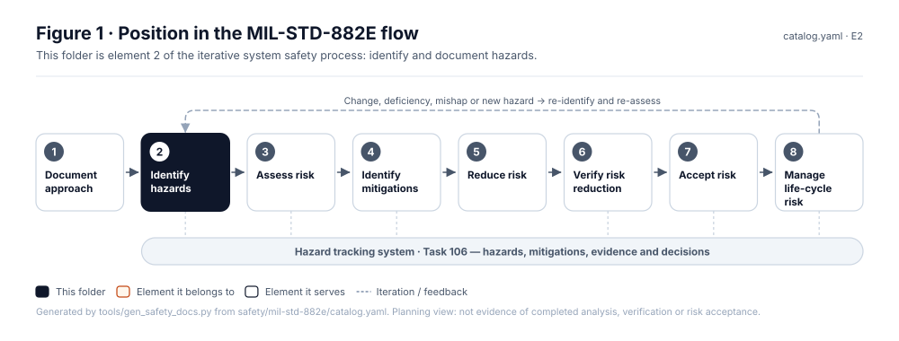
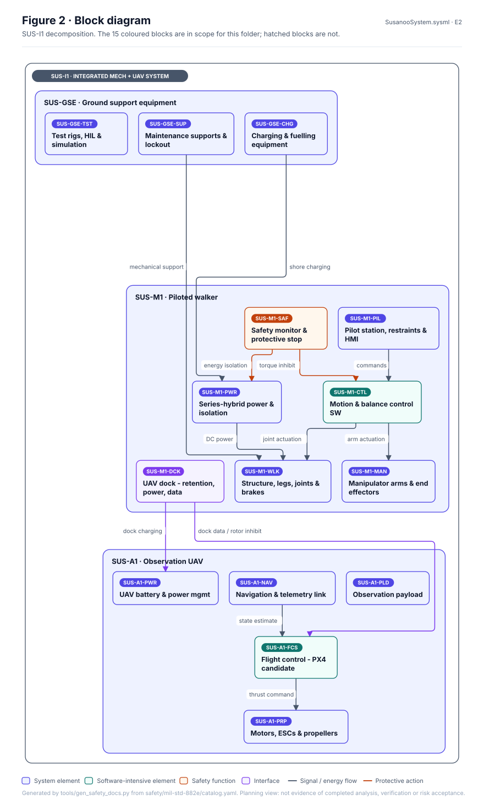
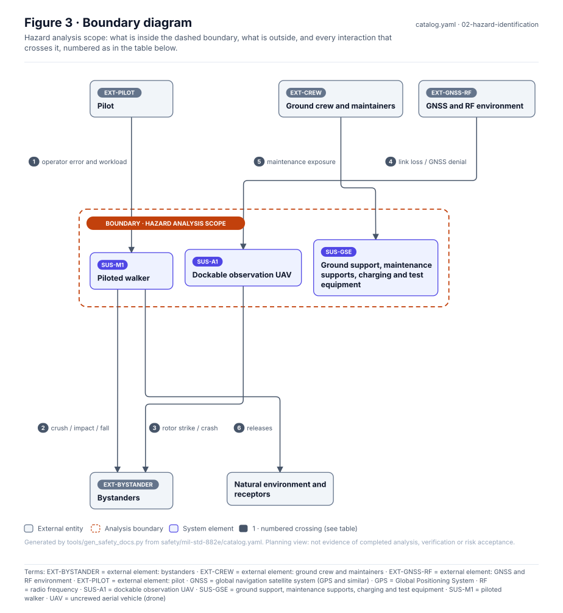
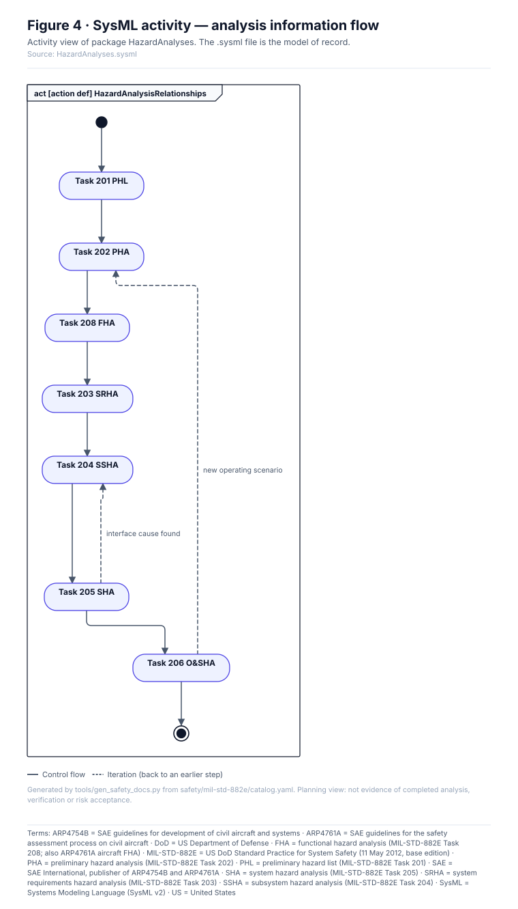
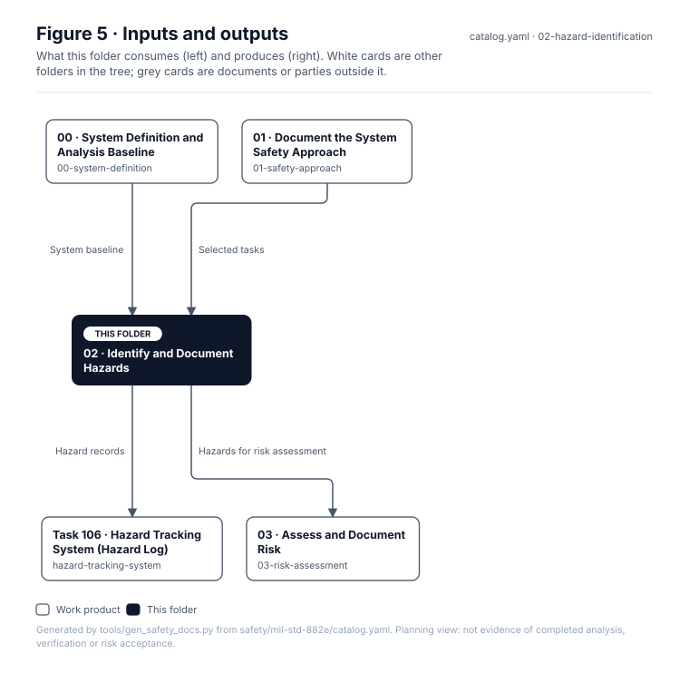

# 02 · Identify and Document Hazards

> **Status:** Scaffold v0.1 — structure, diagrams and model views only
>
> Planning artifact. No completed hazard analysis, verified mitigation, risk acceptance, certification or MIL-STD-882E compliance is claimed. Category names follow MIL-STD-882E; confirm definitions against the controlled standard and the approved SSPP before formal use.

| Field | Value |
|---|---|
| MIL-STD-882E element | 2 — Identify and document hazards |
| Lifecycle gate | G0–G5 |
| Applicability | Selected progressively |
| Accountable role | Safety lead |
| Parent folder | [MIL-STD-882E System Safety Work Products](../README.md) |

## Purpose

All hazard analysis tasks (200-series). Analyses are iterative and feed each other; arrows in
the SysML activity are information flow, not a mandatory waterfall. Every hazard found here is
recorded in the hazard tracking system.

## Position in the MIL-STD-882E flow



## Block diagram



Source of truth: [`SusanooSystem.sysml`](../00-system-definition/sysml/SusanooSystem.sysml).

## Boundary diagram



| # | From | To | Crossing / interaction |
|---|---|---|---|
| 1 | EXT-PILOT: Pilot / operator | SUS-M1: Piloted walker | operator error and workload |
| 2 | SUS-M1: Piloted walker | EXT-BYST: Bystanders & nearby workers | crush / impact / fall |
| 3 | SUS-A1: Observation UAV | EXT-BYST: Bystanders & nearby workers | rotor strike / crash |
| 4 | EXT-AIR: Airspace, GNSS & RF environment | SUS-A1: Observation UAV | link loss / GNSS denial |
| 5 | EXT-CREW: Ground crew & maintainers | SUS-GSE: Ground support equipment | maintenance exposure |
| 6 | SUS-M1: Piloted walker | EXT-ENV: Natural environment & receptors | releases |

## SysML model

SysML v2 textual view: [`HazardAnalyses.sysml`](HazardAnalyses.sysml), generated from the catalog. It imports [`SusanooSystem`](../00-system-definition/sysml/SusanooSystem.sysml) and [`SusanooSafety`](../00-system-definition/sysml/SusanooSafety.sysml). The figures are drawn from the same data; the `.sysml` file is the model of record.



<details><summary>SysML v2 source</summary>

```sysml
// HazardAnalyses — generated by tools/gen_safety_docs.py from safety/mil-std-882e/catalog.yaml.
// Do not edit by hand: change the catalog and regenerate.
// Status: planning view only; not evidence of completed analysis or verification.

package HazardAnalyses {
    private import ScalarValues::*;
    private import SusanooSystem::*;
    private import SusanooSafety::*;
    action def HazardAnalysisRelationships {
        action phl { doc /* Task 201 PHL */ }
        action pha { doc /* Task 202 PHA */ }
        action fha { doc /* Task 208 FHA */ }
        action srha { doc /* Task 203 SRHA */ }
        action ssha { doc /* Task 204 SSHA */ }
        action sha { doc /* Task 205 SHA */ }
        action osha { doc /* Task 206 O&SHA */ }
        first start;
        then phl;
        first phl then pha;
        first pha then fha;
        first fha then srha;
        first srha then ssha;
        first ssha then sha;
        first sha then osha;
        first osha then done;
        // iteration: sha -> ssha when interface cause found (informal; merge node omitted)
        // iteration: osha -> pha when new operating scenario (informal; merge node omitted)
    }
}
```

</details>

## Inputs and outputs



| Input | Source |
|---|---|
| System baseline | [00 · System Definition and Analysis Baseline](../00-system-definition/README.md) |
| Selected tasks | [01 · Document the System Safety Approach](../01-safety-approach/README.md) |

| Output | Destination |
|---|---|
| Hazard records | [Task 106 · Hazard Tracking System (Hazard Log)](../hazard-tracking-system/README.md) |
| Hazards for risk assessment | [03 · Assess and Document Risk](../03-risk-assessment/README.md) |

## Folder contents

| Item | Description | State |
|---|---|---|
| [`task-201-preliminary-hazard-list/`](task-201-preliminary-hazard-list/README.md) | Task 201 · Preliminary Hazard List (PHL) | folder |
| [`task-202-preliminary-hazard-analysis/`](task-202-preliminary-hazard-analysis/README.md) | Task 202 · Preliminary Hazard Analysis (PHA) | folder |
| [`task-203-system-requirements-hazard-analysis/`](task-203-system-requirements-hazard-analysis/README.md) | Task 203 · System Requirements Hazard Analysis (SRHA) | folder |
| [`task-204-subsystem-hazard-analysis/`](task-204-subsystem-hazard-analysis/README.md) | Task 204 · Subsystem Hazard Analysis (SSHA) | folder |
| [`task-205-system-hazard-analysis/`](task-205-system-hazard-analysis/README.md) | Task 205 · System Hazard Analysis (SHA) | folder |
| [`task-206-operating-and-support-hazard-analysis/`](task-206-operating-and-support-hazard-analysis/README.md) | Task 206 · Operating and Support Hazard Analysis (O&SHA) | folder |
| [`task-207-health-hazard-analysis/`](task-207-health-hazard-analysis/README.md) | Task 207 · Health Hazard Analysis (HHA) | folder |
| [`task-208-functional-hazard-analysis/`](task-208-functional-hazard-analysis/README.md) | Task 208 · Functional Hazard Analysis (FHA) | folder |
| [`task-209-system-of-systems-hazard-analysis/`](task-209-system-of-systems-hazard-analysis/README.md) | Task 209 · System-of-Systems Hazard Analysis (SoSHA) | folder |
| [`task-210-environmental-hazard-analysis/`](task-210-environmental-hazard-analysis/README.md) | Task 210 · Environmental Hazard Analysis (EHA) | folder |
| [`figures/`](figures/) | Generated SVG figures (do not edit) | generated |
| [`HazardAnalyses.sysml`](HazardAnalyses.sysml) | Generated SysML v2 view | generated |

<!-- END GENERATED: content below this line is human-authored and preserved -->

## Working content

_No analysis content yet. Add authored material below this heading._
