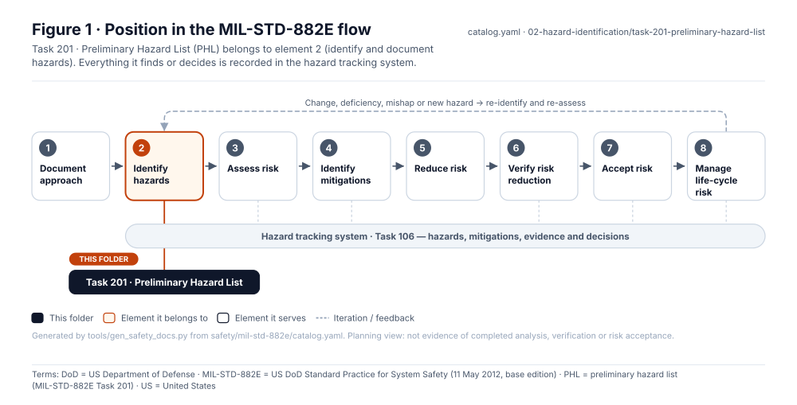
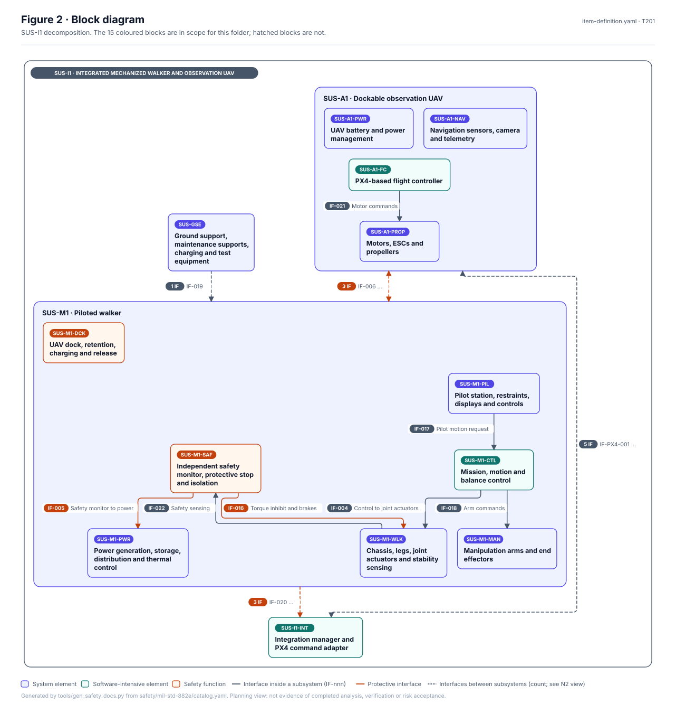
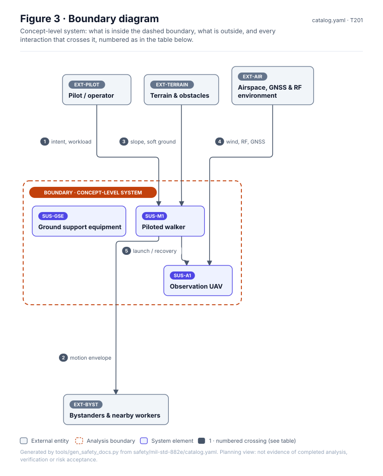
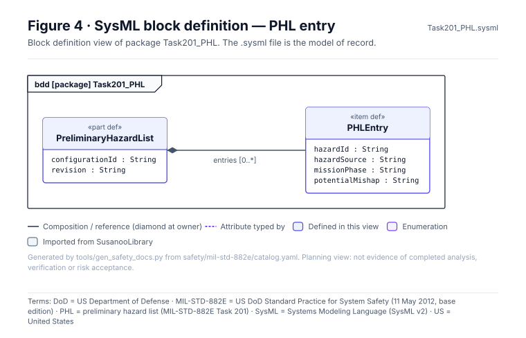
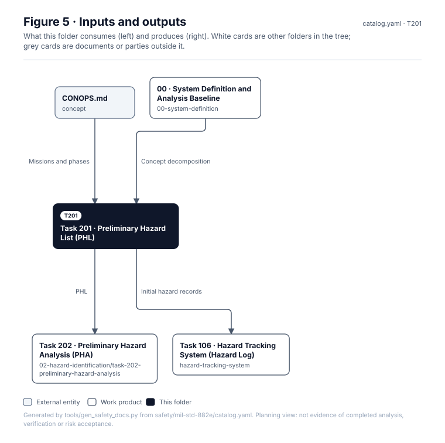

# Task 201 · Preliminary Hazard List (PHL)

> **Status:** Scaffold v0.1 — structure, diagrams and model views only
>
> Planning artifact. No completed hazard analysis, verified mitigation, risk acceptance, certification or MIL-STD-882E compliance is claimed. Category names follow MIL-STD-882E; confirm definitions against the controlled standard and the approved SSPP before formal use.

| Field | Value |
|---|---|
| MIL-STD-882E element | 2 — Identify and document hazards |
| Tasks | [Task 201 — Preliminary Hazard List](../../../../docs/wiki/MIL-STD-882E-Task-201.md) |
| Lifecycle gate | G0 |
| Applicability | Selected |
| Accountable role | Safety lead |
| Parent folder | [02 · Identify and Document Hazards](../README.md) |

## Purpose

First list of potential hazards for the concept: walker instability and fall, unintended motion,
crush and entrapment, stored energy, fire, rotor strike, docking retention failure, link loss.

## Position in the MIL-STD-882E flow



## Block diagram



Elements and interfaces: [`architecture/item-definition.yaml`](../../../../architecture/item-definition.yaml); SysML: [`Architecture.sysml`](../../../../models/sysml/model/Architecture.sysml).

## Boundary diagram



| # | From | To | Crossing / interaction | Interface (item definition) |
|---|---|---|---|---|
| 1 | EXT-PILOT: Pilot | SUS-M1: Piloted walker | intent, workload | IF-001, IF-015 |
| 2 | SUS-M1: Piloted walker | EXT-BYSTANDER: Bystanders | motion envelope | IF-012 |
| 3 | EXT-TERRAIN: Terrain and obstacles | SUS-M1: Piloted walker | slope, soft ground | IF-010 |
| 4 | EXT-GNSS-RF: GNSS and RF environment | SUS-A1: Dockable observation UAV | wind, RF, GNSS | IF-013 |
| 5 | SUS-M1: Piloted walker | SUS-A1: Dockable observation UAV | launch / recovery | IF-006, IF-PX4-007, IF-PX4-009 |

**Explicitly excluded:** detailed component failure modes (Task 204)

## SysML model

SysML v2 textual view: [`Task201_PHL.sysml`](Task201_PHL.sysml), generated from the catalog. It imports the project model in [`models/sysml/model`](../../../../models/sysml/model): `SusanooArchitecture` (elements and usage paths) and `SusanooLibrary` (882E vocabulary). The figures are drawn from the same data; the `.sysml` file is the model of record.



<details><summary>SysML v2 source</summary>

```sysml
// Task201_PHL — generated by tools/gen_safety_docs.py from safety/mil-std-882e/catalog.yaml.
// Do not edit by hand: change the catalog and regenerate.
// Status: planning view only; not evidence of completed analysis or verification.

package Task201_PHL {
    private import ScalarValues::*;
    private import SusanooLibrary::*;
    private import SusanooArchitecture::*;
    part def PreliminaryHazardList {
        attribute configurationId : String;
        attribute revision : String;
        ref item entries : PHLEntry[0..*];
    }
    item def PHLEntry {
        attribute hazardId : String;
        attribute hazardSource : String;
        attribute missionPhase : String;
        attribute potentialMishap : String;
    }
}
```

</details>

## Inputs and outputs



| Input | Source |
|---|---|
| Missions and phases | [`concept/CONOPS.md`](../../../../concept/CONOPS.md) |
| Concept decomposition | [00 · System Definition and Analysis Baseline](../../00-system-definition/README.md) |

| Output | Destination |
|---|---|
| PHL | [Task 202 · Preliminary Hazard Analysis (PHA)](../task-202-preliminary-hazard-analysis/README.md) |
| Initial hazard records | [Task 106 · Hazard Tracking System (Hazard Log)](../../hazard-tracking-system/README.md) |

## Folder contents

| Item | Description | State |
|---|---|---|
| `phl.csv` | Preliminary hazard list | planned |
| [`figures/`](figures/) | Generated SVG figures (do not edit) | generated |
| [`Task201_PHL.sysml`](Task201_PHL.sysml) | Generated SysML v2 view | generated |

<!-- END GENERATED: content below this line is human-authored and preserved -->

## Working content

_No analysis content yet. Add authored material below this heading._
