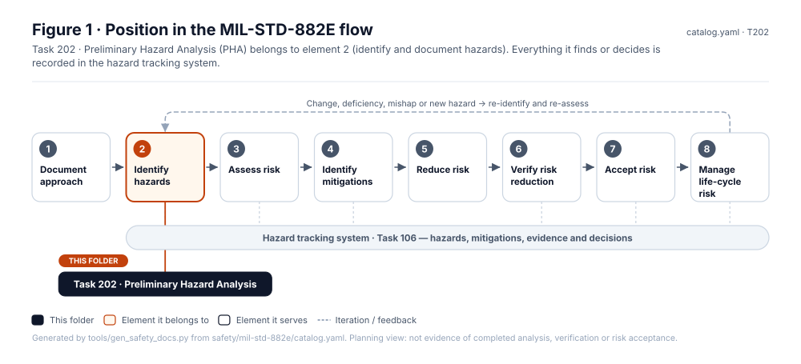
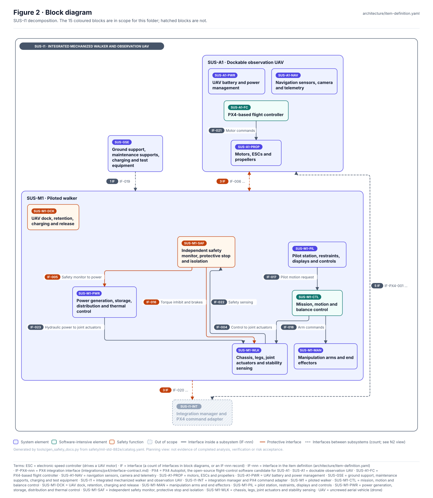
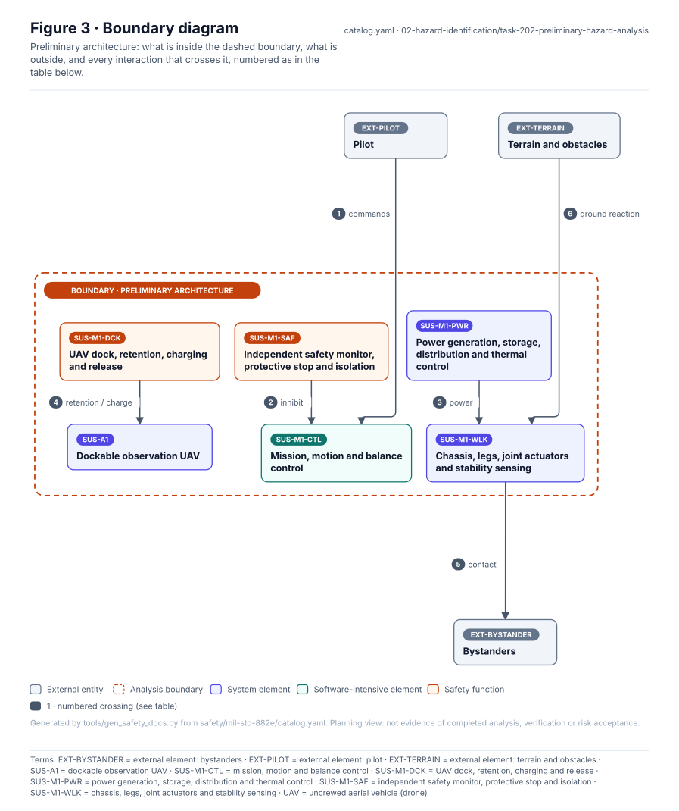
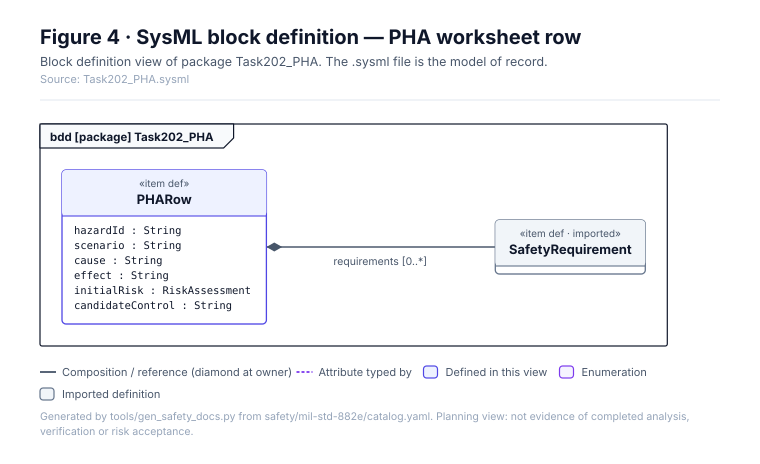
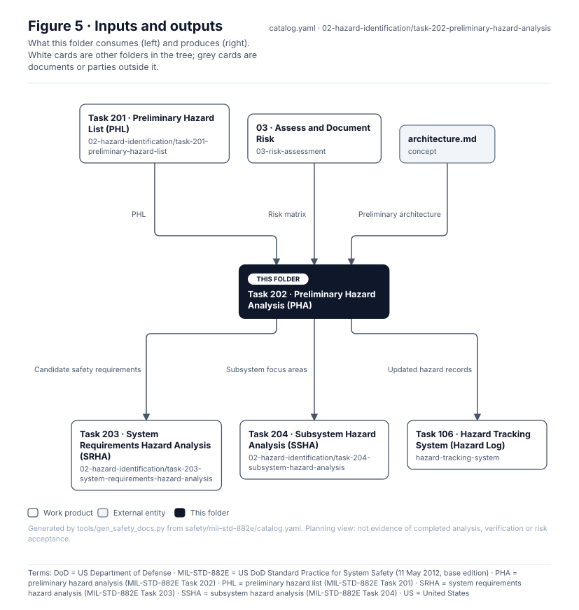

# Task 202 · Preliminary Hazard Analysis (PHA)

> **Status:** Scaffold v0.1 — structure, diagrams and model views only
>
> Planning artifact. No completed hazard analysis, verified mitigation, risk acceptance, certification or MIL-STD-882E compliance is claimed. Category names follow MIL-STD-882E; confirm definitions against the controlled standard and the approved SSPP before formal use.

| Field | Value |
|---|---|
| MIL-STD-882E element | 2 — Identify and document hazards |
| Tasks | [Task 202 — Preliminary Hazard Analysis](../../../../docs/wiki/MIL-STD-882E-Task-202.md) |
| Lifecycle gate | G1–G2 |
| Applicability | Selected |
| Accountable role | Safety lead with systems lead |
| Parent folder | [02 · Identify and Document Hazards](../README.md) |

## Purpose

Develops PHL entries into scenarios with causes, effects, initial risk and candidate controls at
subsystem level. Use `templates/pha-table.csv`.

## Position in the MIL-STD-882E flow



## Block diagram



Elements and interfaces: [`architecture/item-definition.yaml`](../../../../architecture/item-definition.yaml); SysML: [`Architecture.sysml`](../../../../models/sysml/model/Architecture.sysml).

## Boundary diagram



| # | From | To | Crossing / interaction | Interface (item definition) |
|---|---|---|---|---|
| 1 | EXT-PILOT: Pilot | SUS-M1-CTL: Mission, motion and balance control | commands | — |
| 2 | SUS-M1-SAF: Independent safety monitor, protective stop and isolation | SUS-M1-CTL: Mission, motion and balance control | inhibit | — |
| 3 | SUS-M1-PWR: Power generation, storage, distribution and thermal control | SUS-M1-WLK: Chassis, legs, joint actuators and stability sensing | power | — |
| 4 | SUS-M1-DCK: UAV dock, retention, charging and release | SUS-A1: Dockable observation UAV | retention / charge | IF-006, IF-PX4-009 |
| 5 | SUS-M1-WLK: Chassis, legs, joint actuators and stability sensing | EXT-BYSTANDER: Bystanders | contact | IF-012 |
| 6 | EXT-TERRAIN: Terrain and obstacles | SUS-M1-WLK: Chassis, legs, joint actuators and stability sensing | ground reaction | IF-010 |

## SysML model

SysML v2 textual view: [`Task202_PHA.sysml`](Task202_PHA.sysml), generated from the catalog. It imports the project model in [`models/sysml/model`](../../../../models/sysml/model): `SusanooArchitecture` (elements and usage paths) and `SusanooLibrary` (882E vocabulary). The figures are drawn from the same data; the `.sysml` file is the model of record.



<details><summary>SysML v2 source</summary>

```sysml
// Task202_PHA — generated by tools/gen_safety_docs.py from safety/mil-std-882e/catalog.yaml.
// Do not edit by hand: change the catalog and regenerate.
// Status: planning view only; not evidence of completed analysis or verification.

package Task202_PHA {
    private import ScalarValues::*;
    private import SusanooLibrary::*;
    private import SusanooArchitecture::*;
    item def PHARow {
        attribute hazardId : String;
        attribute scenario : String;
        attribute cause : String;
        attribute effect : String;
        attribute initialRisk : RiskAssessment;
        attribute candidateControl : String;
        ref item requirements : SafetyRequirement[0..*];
    }
}
```

</details>

## Inputs and outputs



| Input | Source |
|---|---|
| PHL | [Task 201 · Preliminary Hazard List (PHL)](../task-201-preliminary-hazard-list/README.md) |
| Risk matrix | [03 · Assess and Document Risk](../../03-risk-assessment/README.md) |
| Preliminary architecture | [`concept/architecture.md`](../../../../concept/architecture.md) |

| Output | Destination |
|---|---|
| Candidate safety requirements | [Task 203 · System Requirements Hazard Analysis (SRHA)](../task-203-system-requirements-hazard-analysis/README.md) |
| Subsystem focus areas | [Task 204 · Subsystem Hazard Analysis (SSHA)](../task-204-subsystem-hazard-analysis/README.md) |
| Updated hazard records | [Task 106 · Hazard Tracking System (Hazard Log)](../../hazard-tracking-system/README.md) |

## Folder contents

| Item | Description | State |
|---|---|---|
| `pha.csv` | PHA worksheet based on templates/pha-table.csv | planned |
| [`figures/`](figures/) | Generated SVG figures (do not edit) | generated |
| [`Task202_PHA.sysml`](Task202_PHA.sysml) | Generated SysML v2 view | generated |

<!-- END GENERATED: content below this line is human-authored and preserved -->

## Working content

_No analysis content yet. Add authored material below this heading._
