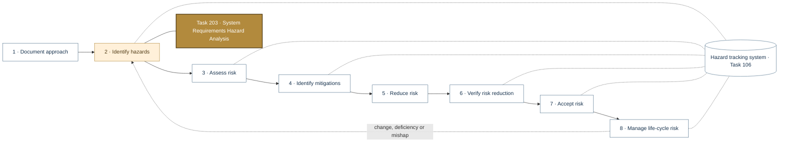
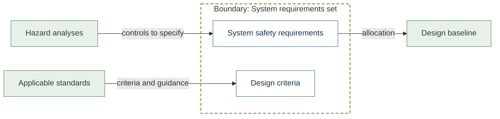
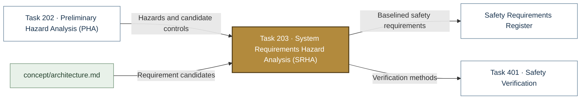

# Task 203 · System Requirements Hazard Analysis (SRHA)

> **Status:** Scaffold v0.1 — structure, diagrams and model views only
>
> Planning artifact. No completed hazard analysis, verified mitigation, risk acceptance, certification or MIL-STD-882E compliance is claimed. Category names follow MIL-STD-882E; confirm definitions against the controlled standard and the approved SSPP before formal use.

| Field | Value |
|---|---|
| MIL-STD-882E element | 2 — Identify and document hazards |
| Tasks | [Task 203 — System Requirements Hazard Analysis](../../../../docs/wiki/MIL-STD-882E-Task-203.md) |
| Lifecycle gate | G1–G2 |
| Applicability | Selected |
| Accountable role | Safety lead with systems lead |
| Parent folder | [02 · Identify and Document Hazards](../README.md) |

## Purpose

Converts hazards and controls into verifiable system safety requirements and checks that the
requirements set, standards and design criteria cover identified hazards. Seeds with the
candidate requirements SYS-001..006 from `concept/architecture.md`.

## Position in the MIL-STD-882E flow

Highlighted node(s) show where this folder sits in the eight-element iterative flow. Dotted links are feedback and hazard-tracking-system interactions.



## Block diagram

System elements of SUS-I1 in scope for this folder are coloured (blue = system, amber = safety function, purple = interface); greyed blocks are out of scope. Source of truth: [`SusanooSystem.sysml`](../../00-system-definition/sysml/SusanooSystem.sysml).

```mermaid
flowchart TB
  subgraph SUS_I1["SUS-I1: Integrated mech + UAV system"]
    direction TB
    subgraph SUS_M1["SUS-M1: Piloted walker"]
      direction TB
      SUS_M1_WLK["SUS-M1-WLK: Structure, legs, joints & brakes"]
      SUS_M1_MAN["SUS-M1-MAN: Manipulator arms & end effectors"]
      SUS_M1_PIL["SUS-M1-PIL: Pilot station, restraints & HMI"]
      SUS_M1_PWR["SUS-M1-PWR: Series-hybrid power & isolation"]
      SUS_M1_CTL["SUS-M1-CTL: Motion & balance control SW"]
      SUS_M1_SAF["SUS-M1-SAF: Safety monitor & protective stop"]
      SUS_M1_DCK["SUS-M1-DCK: UAV dock - retention, power, data"]
    end
    subgraph SUS_A1["SUS-A1: Observation UAV"]
      direction TB
      SUS_A1_FCS["SUS-A1-FCS: Flight control - PX4 candidate"]
      SUS_A1_PRP["SUS-A1-PRP: Motors, ESCs & propellers"]
      SUS_A1_PWR["SUS-A1-PWR: UAV battery & power mgmt"]
      SUS_A1_NAV["SUS-A1-NAV: Navigation & telemetry link"]
      SUS_A1_PLD["SUS-A1-PLD: Observation payload"]
    end
    subgraph SUS_GSE["SUS-GSE: Ground support equipment"]
      direction TB
      SUS_GSE_SUP["SUS-GSE-SUP: Maintenance supports & lockout"]
      SUS_GSE_CHG["SUS-GSE-CHG: Charging & fuelling equipment"]
      SUS_GSE_TST["SUS-GSE-TST: Test rigs, HIL & simulation"]
    end
  end
  SUS_M1_PIL -->|"commands"| SUS_M1_CTL
  SUS_M1_CTL -->|"joint actuation"| SUS_M1_WLK
  SUS_M1_CTL -->|"arm actuation"| SUS_M1_MAN
  SUS_M1_PWR -->|"DC power"| SUS_M1_WLK
  SUS_M1_SAF -->|"torque inhibit"| SUS_M1_CTL
  SUS_M1_SAF -->|"energy isolation"| SUS_M1_PWR
  SUS_M1_DCK -->|"dock charging"| SUS_A1_PWR
  SUS_M1_DCK -->|"dock data / rotor inhibit"| SUS_A1_FCS
  SUS_A1_NAV -->|"state estimate"| SUS_A1_FCS
  SUS_A1_FCS -->|"thrust command"| SUS_A1_PRP
  SUS_GSE_SUP -->|"mechanical support"| SUS_M1_WLK
  SUS_GSE_CHG -->|"shore charging"| SUS_M1_PWR
  class SUS_M1_WLK muted
  class SUS_M1_MAN muted
  class SUS_M1_PIL system
  class SUS_M1_PWR muted
  class SUS_M1_CTL system
  class SUS_M1_SAF safety
  class SUS_M1_DCK interface
  class SUS_A1_FCS system
  class SUS_A1_PRP muted
  class SUS_A1_PWR muted
  class SUS_A1_NAV muted
  class SUS_A1_PLD muted
  class SUS_GSE_SUP muted
  class SUS_GSE_CHG muted
  class SUS_GSE_TST muted
  classDef system fill:#dceaf7,stroke:#55758f,color:#17324d
  classDef safety fill:#fff0d9,stroke:#b28a3d,color:#513c16
  classDef external fill:#e8f1e9,stroke:#63886a,color:#23412c
  classDef interface fill:#eae7f5,stroke:#8370a3,color:#30254a
  classDef muted fill:#f4f4f4,stroke:#b5b5b5,color:#8a8a8a,stroke-dasharray: 4 3
  classDef current fill:#b28a3d,stroke:#513c16,color:#ffffff,stroke-width:2px
  classDef work fill:#ffffff,stroke:#55758f,color:#17324d
```



## Boundary diagram

Dashed frame = **System requirements set** boundary. Everything outside it is an external entity or another folder's scope.



| From | To | Crossing / interaction |
|---|---|---|
| Hazard analyses | System safety requirements | controls to specify |
| Applicable standards | Design criteria | criteria and guidance |
| System safety requirements | Design baseline | allocation |

## SysML model

SysML v2 textual view: [`Task203_SRHA.sysml`](Task203_SRHA.sysml) (generated from the catalog; imports [`SusanooSystem`](../../00-system-definition/sysml/SusanooSystem.sysml) and [`SusanooSafety`](../../00-system-definition/sysml/SusanooSafety.sysml)). The Mermaid rendering below is a reading aid; the `.sysml` file is the model of record.

### Requirements (req) — candidate system safety requirements

```mermaid
requirementDiagram
  requirement SYS_001 {
    id: "SYS-001"
    text: "Inhibit leg actuation until pilot station readiness conditions are satisfied"
    risk: High
    verifymethod: Test
  }
  requirement SYS_002 {
    id: "SYS-002"
    text: "Provide an operator-requested protective stop with defined behavior per operating mode"
    risk: High
    verifymethod: Test
  }
  requirement SYS_003 {
    id: "SYS-003"
    text: "Prevent UAV rotor startup while mechanically retained except under approved maintenance"
    risk: High
    verifymethod: Test
  }
  requirement SYS_004 {
    id: "SYS-004"
    text: "Detect loss of essential feedback and transition to a documented degraded state"
    risk: High
    verifymethod: Analysis
  }
  requirement SYS_005 {
    id: "SYS-005"
    text: "Docking interface shall report positively confirmed retained or unretained state"
    risk: Medium
    verifymethod: Test
  }
  requirement SYS_006 {
    id: "SYS-006"
    text: "Inhibit UAV launch and recovery outside a verified operational envelope"
    risk: Medium
    verifymethod: Demonstration
  }
  element SUS_M1_PIL {
    type: "part"
  }
  element SUS_M1_SAF {
    type: "part"
  }
  element SUS_M1_DCK {
    type: "part"
  }
  element SUS_M1_CTL {
    type: "part"
  }
  element SUS_A1_FCS {
    type: "part"
  }
  SUS_M1_PIL - satisfies -> SYS_001
  SUS_M1_SAF - satisfies -> SYS_002
  SUS_M1_DCK - satisfies -> SYS_003
  SUS_M1_CTL - satisfies -> SYS_004
  SUS_M1_DCK - satisfies -> SYS_005
  SUS_A1_FCS - satisfies -> SYS_006
```



<details><summary>SysML v2 source</summary>

```sysml
// Task203_SRHA — generated by tools/gen_safety_docs.py from safety/mil-std-882e/catalog.yaml.
// Do not edit by hand: change the catalog and regenerate.
// Status: planning view only; not evidence of completed analysis or verification.

package Task203_SRHA {
    private import ScalarValues::*;
    private import SusanooSystem::*;
    private import SusanooSafety::*;
    requirement def <'SYS-001'> PilotReadinessInterlock {
        doc /* Inhibit leg actuation until pilot station readiness conditions are satisfied */
    }
    requirement sys_001 : PilotReadinessInterlock;
    requirement def <'SYS-002'> ProtectiveStop {
        doc /* Provide an operator-requested protective stop with defined behavior per operating mode */
    }
    requirement sys_002 : ProtectiveStop;
    requirement def <'SYS-003'> RetainedRotorInhibit {
        doc /* Prevent UAV rotor startup while mechanically retained except under approved maintenance */
    }
    requirement sys_003 : RetainedRotorInhibit;
    requirement def <'SYS-004'> FeedbackLossDegradedState {
        doc /* Detect loss of essential feedback and transition to a documented degraded state */
    }
    requirement sys_004 : FeedbackLossDegradedState;
    requirement def <'SYS-005'> DockStateReporting {
        doc /* Docking interface shall report positively confirmed retained or unretained state */
    }
    requirement sys_005 : DockStateReporting;
    requirement def <'SYS-006'> LaunchRecoveryEnvelope {
        doc /* Inhibit UAV launch and recovery outside a verified operational envelope */
    }
    requirement sys_006 : LaunchRecoveryEnvelope;
    satisfy sys_001 by susanoo.m1.pil;
    satisfy sys_002 by susanoo.m1.saf;
    satisfy sys_003 by susanoo.m1.dck;
    satisfy sys_004 by susanoo.m1.ctl;
    satisfy sys_005 by susanoo.m1.dck;
    satisfy sys_006 by susanoo.a1.fcs;
}
```

</details>

## Inputs and outputs



| Input | Source |
|---|---|
| Hazards and candidate controls | [Task 202 · Preliminary Hazard Analysis (PHA)](../task-202-preliminary-hazard-analysis/README.md) |
| Requirement candidates | [`concept/architecture.md`](../../../../concept/architecture.md) |

| Output | Destination |
|---|---|
| Baselined safety requirements | [Safety Requirements Register](../../05-risk-reduction/safety-requirements/README.md) |
| Verification methods | [Task 401 · Safety Verification](../../06-verification/task-401-safety-verification/README.md) |

## Folder contents

| Item | Description | State |
|---|---|---|
| `srha.md` | Requirements coverage analysis | planned |
| [`Task203_SRHA.sysml`](Task203_SRHA.sysml) | Generated SysML v2 view | generated |

<!-- END GENERATED: content below this line is human-authored and preserved -->

## Working content

_No analysis content yet. Add authored material below this heading._
