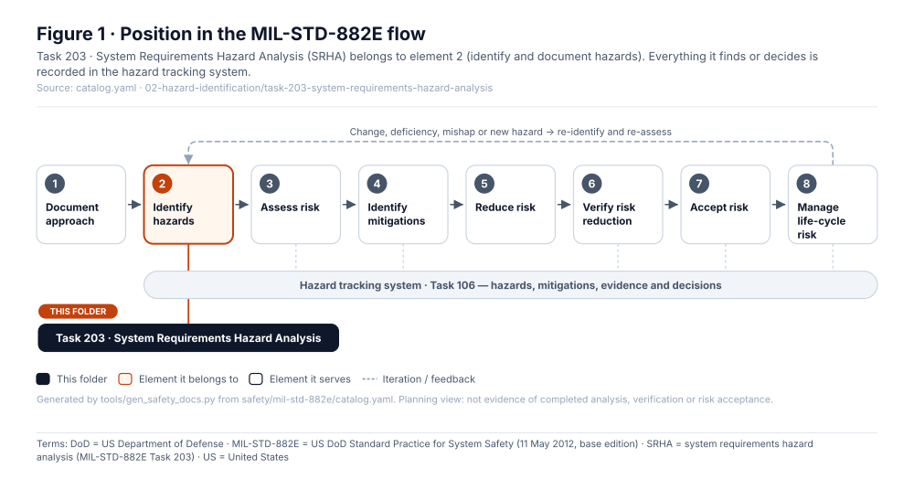
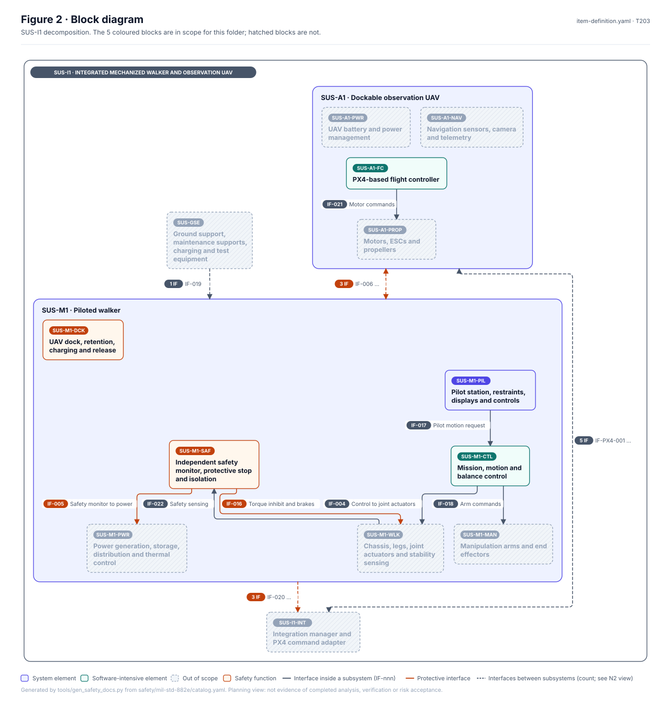
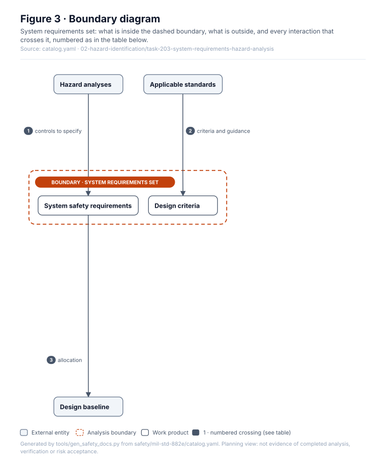
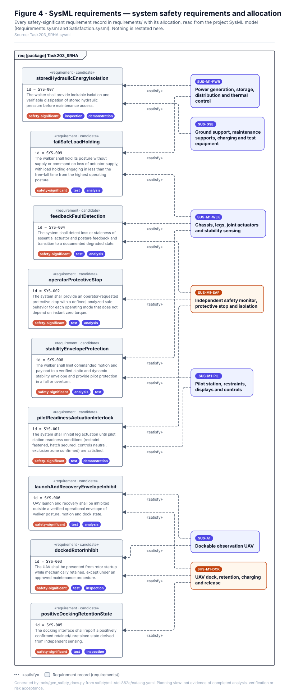
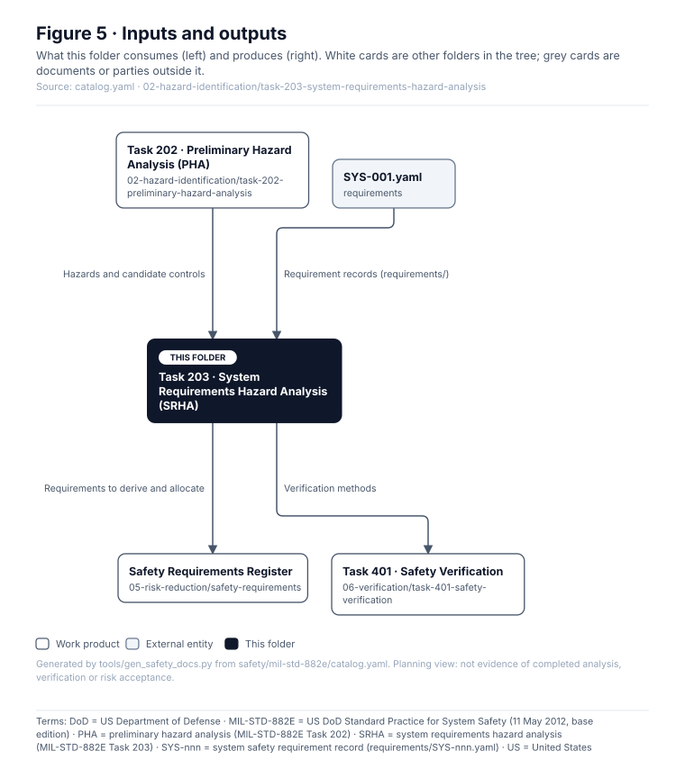

# Task 203 · System Requirements Hazard Analysis (SRHA)

> **Status:** Scaffold v0.1 — structure, diagrams and model views only
>
> Planning artifact. No completed hazard analysis, verified mitigation, risk acceptance, certification or MIL-STD-882E compliance is claimed. Category names follow MIL-STD-882E; confirm definitions against the controlled standard and the approved SSPP before formal use.

<!-- terms:start (generated by tools/terms/terms.py; do not edit by hand) -->
<details><summary><b>Terms on this page (10)</b>: abbreviations and codes explained</summary>

| Term | Meaning |
|---|---|
| DoD | US Department of Defense |
| G0–G7 | lifecycle gate (G0 concept to G7 change and sustainment) |
| MIL-STD-882E | US DoD Standard Practice for System Safety (11 May 2012, base edition) |
| PHA | preliminary hazard analysis (MIL-STD-882E Task 202) |
| SRHA | system requirements hazard analysis (MIL-STD-882E Task 203) |
| SSPP | system safety program plan (MIL-STD-882E Task 102) |
| SVG | Scalable Vector Graphics, the figure file format |
| SYS-nnn | system safety requirement record (requirements/SYS-nnn.yaml) |
| SysML | Systems Modeling Language (SysML v2) |
| US | United States |

All terms: [abbreviations and record codes](https://github.com/jherrodthomas/Project-Susanoo/blob/main/docs/terms.md).

</details>
<!-- terms:end -->

| Field | Value |
|---|---|
| MIL-STD-882E element | 2 — Identify and document hazards |
| Tasks | [Task 203 — System Requirements Hazard Analysis](../../../../docs/wiki/MIL-STD-882E-Task-203.md) |
| Lifecycle gate | G1–G2 |
| Applicability | Selected |
| Accountable role | Safety lead with systems lead |
| Parent folder | [02 · Identify and Document Hazards](../README.md) |

## Purpose

Converts hazards and controls into verifiable system safety requirements and checks that the
requirements set, standards and design criteria cover identified hazards. The requirements themselves
are records in [`requirements/`](../../../../requirements/) (SYS-001 ...); this folder holds the coverage
analysis.

## Position in the MIL-STD-882E flow



## Block diagram



Elements and interfaces: [`architecture/item-definition.yaml`](../../../../architecture/item-definition.yaml); SysML: [`Architecture.sysml`](../../../../models/sysml/model/Architecture.sysml).

## Boundary diagram



| # | From | To | Crossing / interaction | Interface (item definition) |
|---|---|---|---|---|
| 1 | Hazard analyses | System safety requirements | controls to specify | — |
| 2 | Applicable standards | Design criteria | criteria and guidance | — |
| 3 | System safety requirements | Design baseline | allocation | — |

## SysML model

SysML v2 textual view: [`Task203_SRHA.sysml`](Task203_SRHA.sysml), generated from the catalog. It imports the project model in [`models/sysml/model`](../../../../models/sysml/model): `SusanooArchitecture` (elements and usage paths) and `SusanooLibrary` (882E vocabulary). The figures are drawn from the same data; the `.sysml` file is the model of record.



<details><summary>SysML v2 source</summary>

```sysml
// Task203_SRHA — generated by tools/gen_safety_docs.py from safety/mil-std-882e/catalog.yaml.
// Do not edit by hand: change the catalog and regenerate.
// Status: planning view only; not evidence of completed analysis or verification.

package Task203_SRHA {
    private import ScalarValues::*;
    private import SusanooLibrary::*;
    private import SusanooArchitecture::*;
    private import RequirementDerivation::*;
    private import SusanooRequirements::*;
    // Requirement records shown here are owned by models/sysml/model/Requirements.sysml (generated from requirements/); satisfy relations by Satisfaction.sysml.
    view requirementsInScope {
        expose SusanooRequirements::'SYS-001';
        expose SusanooRequirements::'SYS-002';
        expose SusanooRequirements::'SYS-003';
        expose SusanooRequirements::'SYS-004';
        expose SusanooRequirements::'SYS-005';
        expose SusanooRequirements::'SYS-006';
        expose SusanooRequirements::'SYS-007';
        expose SusanooRequirements::'SYS-008';
        expose SusanooRequirements::'SYS-009';
        expose SusanooRequirements::'SYS-010';
        expose SusanooRequirements::'SYS-011';
        expose SusanooRequirements::'SYS-012';
        expose SusanooRequirements::'SYS-013';
        expose SusanooRequirements::'SYS-014';
        expose SusanooRequirements::'SYS-015';
        expose SusanooRequirements::'SYS-016';
        expose SusanooRequirements::'SYS-017';
        expose SusanooRequirements::'SYS-018';
        expose SusanooRequirements::'SYS-019';
    }
    #derivation connection { end #original ::> SusanooRequirements::'SYS-002'; end #derive ::> SusanooRequirements::'SYS-010'; }
    #derivation connection { end #original ::> SusanooRequirements::'SYS-002'; end #derive ::> SusanooRequirements::'SYS-011'; }
    #derivation connection { end #original ::> SusanooRequirements::'SYS-003'; end #derive ::> SusanooRequirements::'SYS-012'; }
}
```

</details>

## Inputs and outputs



| Input | Source |
|---|---|
| Hazards and candidate controls | [Task 202 · Preliminary Hazard Analysis (PHA)](../task-202-preliminary-hazard-analysis/README.md) |
| Requirement records (requirements/) | [`requirements/SYS-001.yaml`](../../../../requirements/SYS-001.yaml) |

| Output | Destination |
|---|---|
| Requirements to derive and allocate | [Safety Requirements Register](../../05-risk-reduction/safety-requirements/README.md) |
| Verification methods | [Task 401 · Safety Verification](../../06-verification/task-401-safety-verification/README.md) |

## Folder contents

| Item | Description | State |
|---|---|---|
| `srha.md` | Requirements coverage analysis | planned |
| [`figures/`](figures/) | Generated SVG figures (do not edit) | generated |
| [`Task203_SRHA.sysml`](Task203_SRHA.sysml) | Generated SysML v2 view | generated |

<!-- END GENERATED: content below this line is human-authored and preserved -->

## Working content

_No analysis content yet. Add authored material below this heading._
