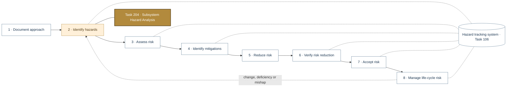
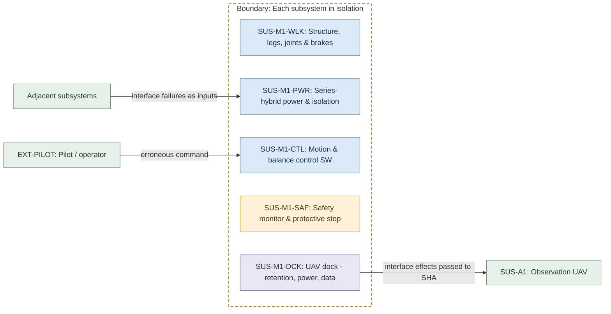
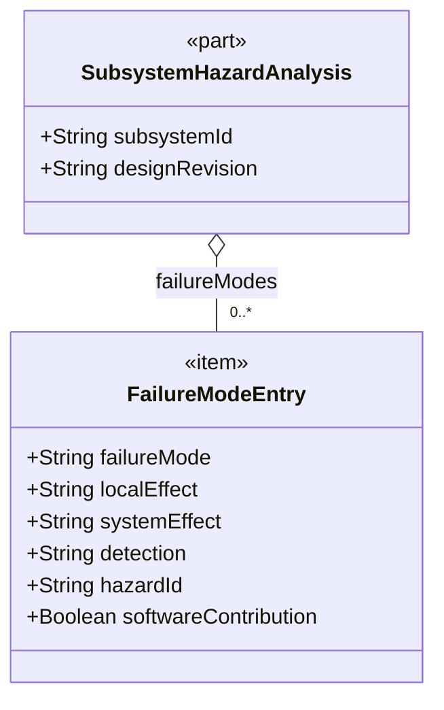
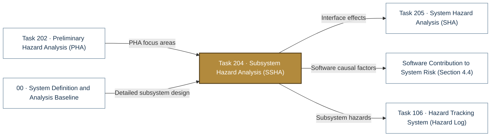

# Task 204 · Subsystem Hazard Analysis (SSHA)

> **Status:** Scaffold v0.1 — structure, diagrams and model views only
>
> Planning artifact. No completed hazard analysis, verified mitigation, risk acceptance, certification or MIL-STD-882E compliance is claimed. Category names follow MIL-STD-882E; confirm definitions against the controlled standard and the approved SSPP before formal use.

| Field | Value |
|---|---|
| MIL-STD-882E element | 2 — Identify and document hazards |
| Tasks | [Task 204 — Subsystem Hazard Analysis](../../../../docs/wiki/MIL-STD-882E-Task-204.md) |
| Lifecycle gate | G3 |
| Applicability | Selected |
| Accountable role | Safety lead with subsystem owners |
| Parent folder | [02 · Identify and Document Hazards](../README.md) |

## Purpose

Analyses each subsystem's design for failure modes, faults and hazardous conditions, including
software and human errors within the subsystem. One subfolder or file per subsystem.

## Position in the MIL-STD-882E flow

Highlighted node(s) show where this folder sits in the eight-element iterative flow. Dotted links are feedback and hazard-tracking-system interactions.



## Block diagram

System elements of SUS-I1 in scope for this folder are coloured (blue = system, amber = safety function, purple = interface); greyed blocks are out of scope. Source of truth: [`SusanooSystem.sysml`](../../00-system-definition/sysml/SusanooSystem.sysml).

```mermaid
flowchart TB
  subgraph SUS_I1["SUS-I1: Integrated mech + UAV system"]
    direction TB
    subgraph SUS_M1["SUS-M1: Piloted walker"]
      direction TB
      SUS_M1_WLK["SUS-M1-WLK: Structure, legs, joints & brakes"]
      SUS_M1_MAN["SUS-M1-MAN: Manipulator arms & end effectors"]
      SUS_M1_PIL["SUS-M1-PIL: Pilot station, restraints & HMI"]
      SUS_M1_PWR["SUS-M1-PWR: Series-hybrid power & isolation"]
      SUS_M1_CTL["SUS-M1-CTL: Motion & balance control SW"]
      SUS_M1_SAF["SUS-M1-SAF: Safety monitor & protective stop"]
      SUS_M1_DCK["SUS-M1-DCK: UAV dock - retention, power, data"]
    end
    subgraph SUS_A1["SUS-A1: Observation UAV"]
      direction TB
      SUS_A1_FCS["SUS-A1-FCS: Flight control - PX4 candidate"]
      SUS_A1_PRP["SUS-A1-PRP: Motors, ESCs & propellers"]
      SUS_A1_PWR["SUS-A1-PWR: UAV battery & power mgmt"]
      SUS_A1_NAV["SUS-A1-NAV: Navigation & telemetry link"]
      SUS_A1_PLD["SUS-A1-PLD: Observation payload"]
    end
    subgraph SUS_GSE["SUS-GSE: Ground support equipment"]
      direction TB
      SUS_GSE_SUP["SUS-GSE-SUP: Maintenance supports & lockout"]
      SUS_GSE_CHG["SUS-GSE-CHG: Charging & fuelling equipment"]
      SUS_GSE_TST["SUS-GSE-TST: Test rigs, HIL & simulation"]
    end
  end
  SUS_M1_PIL -->|"commands"| SUS_M1_CTL
  SUS_M1_CTL -->|"joint actuation"| SUS_M1_WLK
  SUS_M1_CTL -->|"arm actuation"| SUS_M1_MAN
  SUS_M1_PWR -->|"DC power"| SUS_M1_WLK
  SUS_M1_SAF -->|"torque inhibit"| SUS_M1_CTL
  SUS_M1_SAF -->|"energy isolation"| SUS_M1_PWR
  SUS_M1_DCK -->|"dock charging"| SUS_A1_PWR
  SUS_M1_DCK -->|"dock data / rotor inhibit"| SUS_A1_FCS
  SUS_A1_NAV -->|"state estimate"| SUS_A1_FCS
  SUS_A1_FCS -->|"thrust command"| SUS_A1_PRP
  SUS_GSE_SUP -->|"mechanical support"| SUS_M1_WLK
  SUS_GSE_CHG -->|"shore charging"| SUS_M1_PWR
  class SUS_M1_WLK system
  class SUS_M1_MAN system
  class SUS_M1_PIL muted
  class SUS_M1_PWR system
  class SUS_M1_CTL system
  class SUS_M1_SAF safety
  class SUS_M1_DCK interface
  class SUS_A1_FCS system
  class SUS_A1_PRP system
  class SUS_A1_PWR system
  class SUS_A1_NAV system
  class SUS_A1_PLD system
  class SUS_GSE_SUP muted
  class SUS_GSE_CHG muted
  class SUS_GSE_TST muted
  classDef system fill:#dceaf7,stroke:#55758f,color:#17324d
  classDef safety fill:#fff0d9,stroke:#b28a3d,color:#513c16
  classDef external fill:#e8f1e9,stroke:#63886a,color:#23412c
  classDef interface fill:#eae7f5,stroke:#8370a3,color:#30254a
  classDef muted fill:#f4f4f4,stroke:#b5b5b5,color:#8a8a8a,stroke-dasharray: 4 3
  classDef current fill:#b28a3d,stroke:#513c16,color:#ffffff,stroke-width:2px
  classDef work fill:#ffffff,stroke:#55758f,color:#17324d
```



## Boundary diagram

Dashed frame = **Each subsystem in isolation** boundary. Everything outside it is an external entity or another folder's scope.



| From | To | Crossing / interaction |
|---|---|---|
| Adjacent subsystems | SUS-M1-PWR: Series-hybrid power & isolation | interface failures as inputs |
| SUS-M1-DCK: UAV dock - retention, power, data | SUS-A1: Observation UAV | interface effects passed to SHA |
| EXT-PILOT: Pilot / operator | SUS-M1-CTL: Motion & balance control SW | erroneous command |

**Explicitly excluded:** subsystem-to-subsystem interactions (Task 205)

## SysML model

SysML v2 textual view: [`Task204_SSHA.sysml`](Task204_SSHA.sysml) (generated from the catalog; imports [`SusanooSystem`](../../00-system-definition/sysml/SusanooSystem.sysml) and [`SusanooSafety`](../../00-system-definition/sysml/SusanooSafety.sysml)). The Mermaid rendering below is a reading aid; the `.sysml` file is the model of record.

### Block definition (bdd) — SSHA record per subsystem



<details><summary>SysML v2 source</summary>

```sysml
// Task204_SSHA — generated by tools/gen_safety_docs.py from safety/mil-std-882e/catalog.yaml.
// Do not edit by hand: change the catalog and regenerate.
// Status: planning view only; not evidence of completed analysis or verification.

package Task204_SSHA {
    private import ScalarValues::*;
    private import SusanooSystem::*;
    private import SusanooSafety::*;
    part def SubsystemHazardAnalysis {
        attribute subsystemId : String;
        attribute designRevision : String;
        ref item failureModes : FailureModeEntry[0..*];
    }
    item def FailureModeEntry {
        attribute failureMode : String;
        attribute localEffect : String;
        attribute systemEffect : String;
        attribute detection : String;
        attribute hazardId : String;
        attribute softwareContribution : Boolean;
    }
}
```

</details>

## Inputs and outputs



| Input | Source |
|---|---|
| PHA focus areas | [Task 202 · Preliminary Hazard Analysis (PHA)](../task-202-preliminary-hazard-analysis/README.md) |
| Detailed subsystem design | [00 · System Definition and Analysis Baseline](../../00-system-definition/README.md) |

| Output | Destination |
|---|---|
| Interface effects | [Task 205 · System Hazard Analysis (SHA)](../task-205-system-hazard-analysis/README.md) |
| Software causal factors | [Software Contribution to System Risk (Section 4.4)](../../software-safety/README.md) |
| Subsystem hazards | [Task 106 · Hazard Tracking System (Hazard Log)](../../hazard-tracking-system/README.md) |

## Folder contents

| Item | Description | State |
|---|---|---|
| `ssha-<subsystem-id>.csv` | One worksheet per subsystem (e.g. ssha-SUS-M1-PWR.csv) | planned |
| [`Task204_SSHA.sysml`](Task204_SSHA.sysml) | Generated SysML v2 view | generated |

<!-- END GENERATED: content below this line is human-authored and preserved -->

## Working content

_No analysis content yet. Add authored material below this heading._
