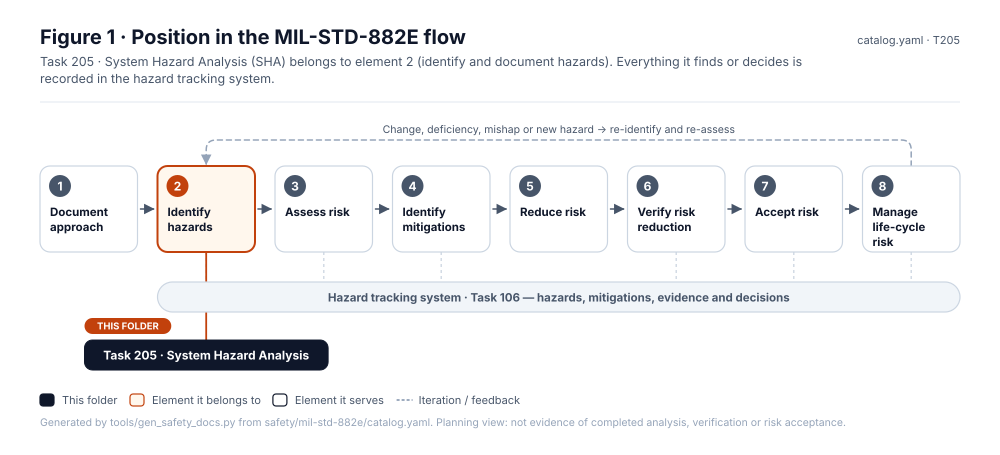
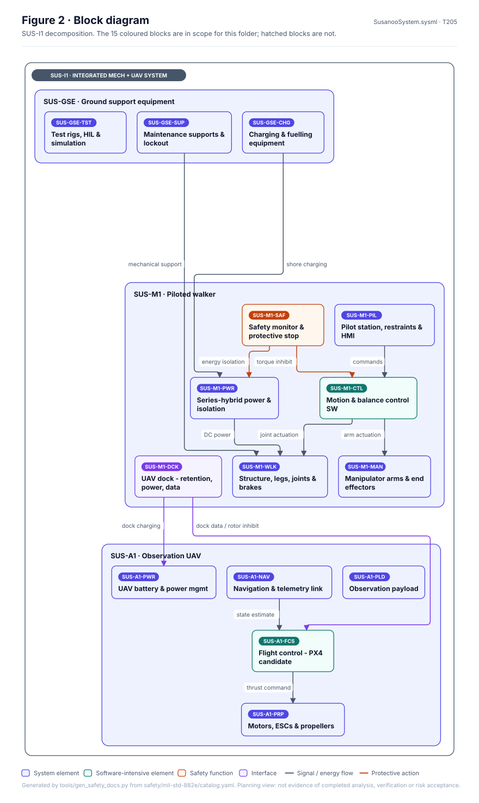
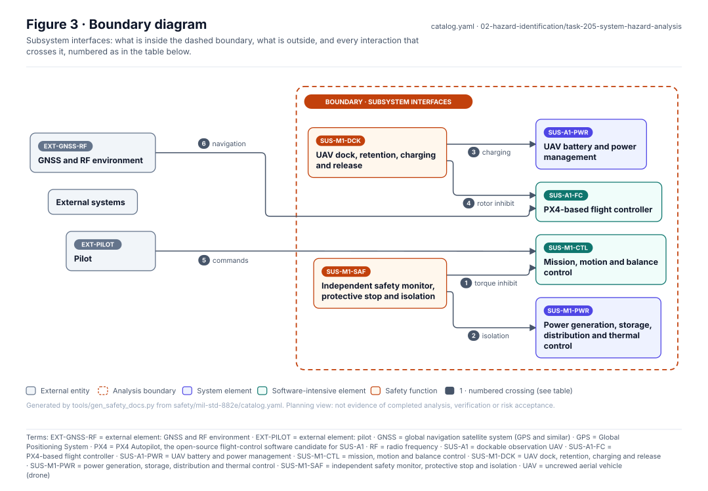
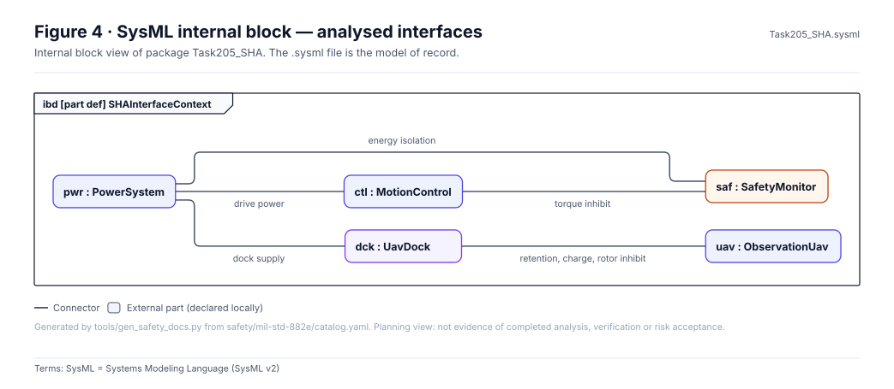
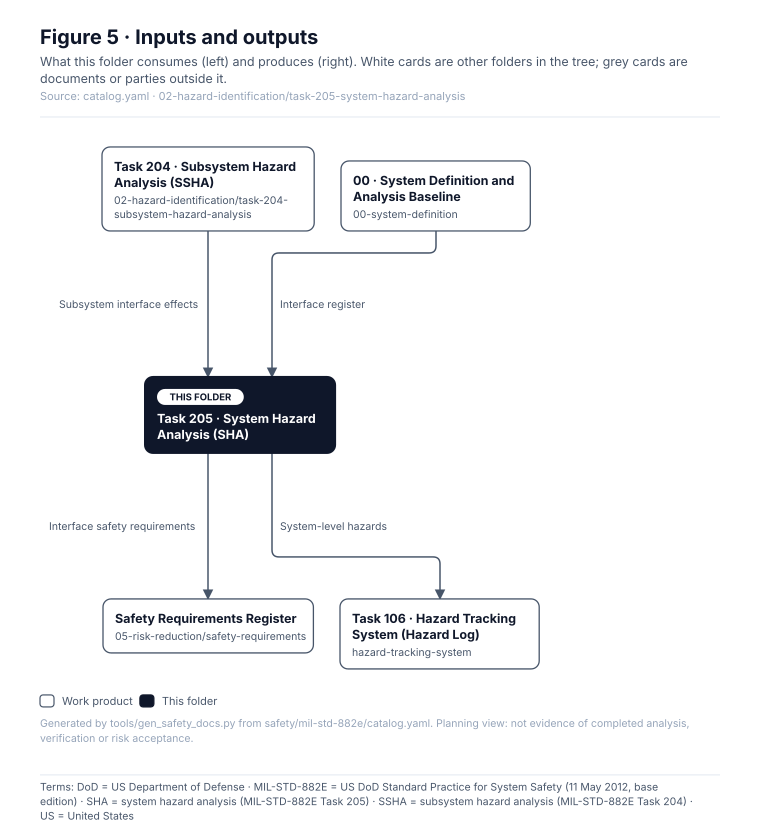
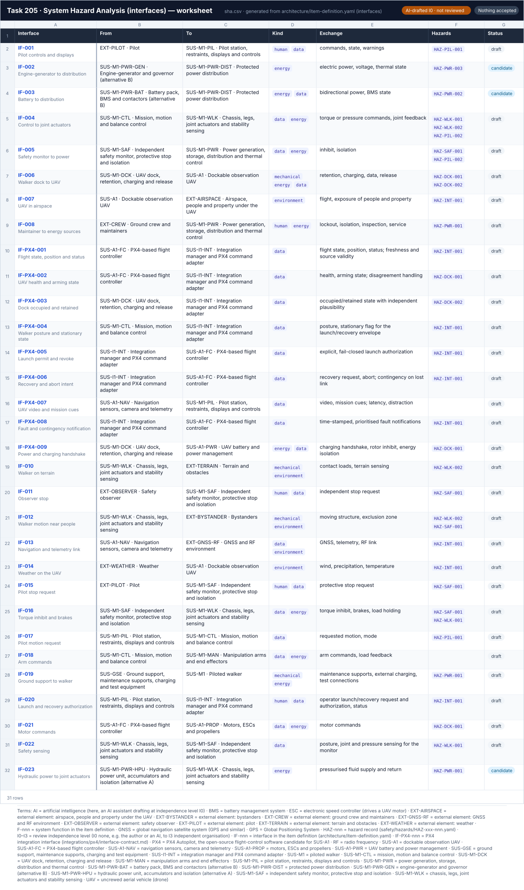

# Task 205 · System Hazard Analysis (SHA)

> **Status:** Scaffold v0.1 — structure, diagrams and model views only
>
> Planning artifact. No completed hazard analysis, verified mitigation, risk acceptance, certification or MIL-STD-882E compliance is claimed. Category names follow MIL-STD-882E; confirm definitions against the controlled standard and the approved SSPP before formal use.

<!-- terms:start (generated by tools/terms/terms.py; do not edit by hand) -->
<details><summary><b>Terms on this page (27)</b>: abbreviations and codes explained</summary>

| Term | Meaning |
|---|---|
| AI | artificial intelligence (here, an AI assistant drafting at independence level I0) |
| DoD | US Department of Defense |
| EXT-GNSS-RF | external element: GNSS and RF environment |
| EXT-PILOT | external element: pilot |
| G0–G7 | lifecycle gate (G0 concept to G7 change and sustainment) |
| GNSS | global navigation satellite system (GPS and similar) |
| GPS | Global Positioning System |
| I0–I3 | review independence level (I0 none, e.g. the author or an AI, to I3 independent organisation) |
| IF-nnn | interface in the item definition (architecture/item-definition.yaml) |
| IF-PX4-nnn | PX4 integration interface (integrations/px4/interface-contract.md) |
| MIL-STD-882E | US DoD Standard Practice for System Safety (11 May 2012, base edition) |
| PX4 | PX4 Autopilot, the open-source flight-control software candidate for SUS-A1 |
| RF | radio frequency |
| SHA | system hazard analysis (MIL-STD-882E Task 205) |
| SSHA | subsystem hazard analysis (MIL-STD-882E Task 204) |
| SSPP | system safety program plan (MIL-STD-882E Task 102) |
| SUS-A1 | dockable observation UAV |
| SUS-A1-FC | PX4-based flight controller |
| SUS-A1-PWR | UAV battery and power management |
| SUS-M1-CTL | mission, motion and balance control |
| SUS-M1-DCK | UAV dock, retention, charging and release |
| SUS-M1-PWR | power generation, storage, distribution and thermal control |
| SUS-M1-SAF | independent safety monitor, protective stop and isolation |
| SVG | Scalable Vector Graphics, the figure file format |
| SysML | Systems Modeling Language (SysML v2) |
| UAV | uncrewed aerial vehicle (drone) |
| US | United States |

All terms: [abbreviations and record codes](https://github.com/jherrodthomas/Project-Susanoo/blob/main/docs/terms.md).

</details>
<!-- terms:end -->

| Field | Value |
|---|---|
| MIL-STD-882E element | 2 — Identify and document hazards |
| Tasks | [Task 205 — System Hazard Analysis](../../../../docs/wiki/MIL-STD-882E-Task-205.md) |
| Lifecycle gate | G3–G5 |
| Applicability | Selected |
| Accountable role | Safety lead |
| Parent folder | [02 · Identify and Document Hazards](../README.md) |

## Purpose

Analyses interfaces and interactions between subsystems and with the pilot: common-cause,
propagation, walker-UAV dock interactions, power and protective-stop interactions.

## Position in the MIL-STD-882E flow



## Block diagram



Elements and interfaces: [`architecture/item-definition.yaml`](../../../../architecture/item-definition.yaml); SysML: [`Architecture.sysml`](../../../../models/sysml/model/Architecture.sysml).

## Boundary diagram



| # | From | To | Crossing / interaction | Interface (item definition) |
|---|---|---|---|---|
| 1 | SUS-M1-SAF: Independent safety monitor, protective stop and isolation | SUS-M1-CTL: Mission, motion and balance control | torque inhibit | — |
| 2 | SUS-M1-SAF: Independent safety monitor, protective stop and isolation | SUS-M1-PWR: Power generation, storage, distribution and thermal control | isolation | IF-005 |
| 3 | SUS-M1-DCK: UAV dock, retention, charging and release | SUS-A1-PWR: UAV battery and power management | charging | IF-PX4-009 |
| 4 | SUS-M1-DCK: UAV dock, retention, charging and release | SUS-A1-FC: PX4-based flight controller | rotor inhibit | — |
| 5 | EXT-PILOT: Pilot | SUS-M1-CTL: Mission, motion and balance control | commands | — |
| 6 | EXT-GNSS-RF: GNSS and RF environment | SUS-A1-FC: PX4-based flight controller | navigation | — |

**Explicitly excluded:** external system-of-systems interactions (Task 209)

## SysML model

SysML v2 textual view: [`Task205_SHA.sysml`](Task205_SHA.sysml), generated from the catalog. It imports the project model in [`models/sysml/model`](../../../../models/sysml/model): `SusanooArchitecture` (elements and usage paths) and `SusanooLibrary` (882E vocabulary). The figures are drawn from the same data; the `.sysml` file is the model of record.



<details><summary>SysML v2 source</summary>

```sysml
// Task205_SHA — generated by tools/gen_safety_docs.py from safety/mil-std-882e/catalog.yaml.
// Do not edit by hand: change the catalog and regenerate.
// Status: planning view only; not evidence of completed analysis or verification.

package Task205_SHA {
    private import ScalarValues::*;
    private import SusanooLibrary::*;
    private import SusanooArchitecture::*;
    part def SHAInterfaceContext {
        part pwr : PowerSystem;
        part ctl : MotionControl;
        part saf : SafetyMonitor;
        part dck : UavDock;
        part uav : ObservationUav;
        connection c1 connect saf to ctl { doc /* torque inhibit */ }
        connection c2 connect saf to pwr { doc /* energy isolation */ }
        connection c3 connect pwr to ctl { doc /* drive power */ }
        connection c4 connect dck to uav { doc /* retention, charge, rotor inhibit */ }
        connection c5 connect pwr to dck { doc /* dock supply */ }
    }
}
```

</details>

## Inputs and outputs



| Input | Source |
|---|---|
| Subsystem interface effects | [Task 204 · Subsystem Hazard Analysis (SSHA)](../task-204-subsystem-hazard-analysis/README.md) |
| Interface register | [00 · System Definition and Analysis Baseline](../../00-system-definition/README.md) |

| Output | Destination |
|---|---|
| Interface safety requirements | [Safety Requirements Register](../../05-risk-reduction/safety-requirements/README.md) |
| System-level hazards | [Task 106 · Hazard Tracking System (Hazard Log)](../../hazard-tracking-system/README.md) |

## Folder contents

| Item | Description | State |
|---|---|---|
| [`sha.svg`](sha.svg) | Spreadsheet view of the worksheet (generated by tools/worksheets/build.py) | present |
| [`sha.csv`](sha.csv) | Interface hazard worksheet | present |
| [`figures/`](figures/) | Generated SVG figures (do not edit) | generated |
| [`Task205_SHA.sysml`](Task205_SHA.sysml) | Generated SysML v2 view | generated |

<!-- END GENERATED: content below this line is human-authored and preserved -->

## Working content

<!-- worksheet:start (generated by tools/worksheets/build.py; do not edit) -->
### Worksheet



Data: [`sha.csv`](sha.csv) · Excel: [`worksheets.xlsx`](../../../generated/worksheets.xlsx), tab **SHA** (risk levels are live Table III formulas). Generated from `architecture/item-definition.yaml (interfaces)` by `tools/worksheets/build.py`; edit the records, not the sheet. AI-drafted (I0), not reviewed.
<!-- worksheet:end -->

