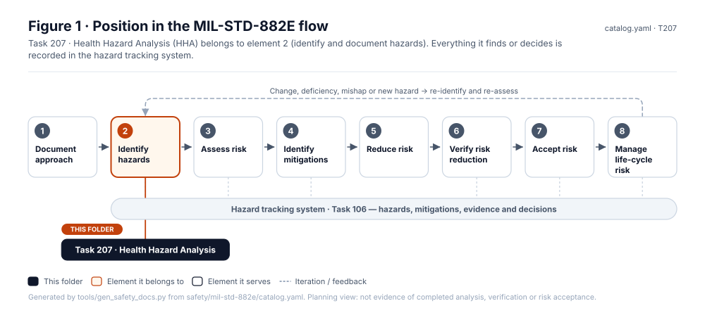
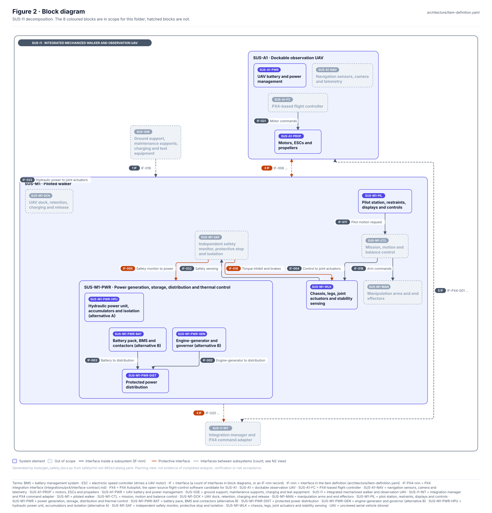
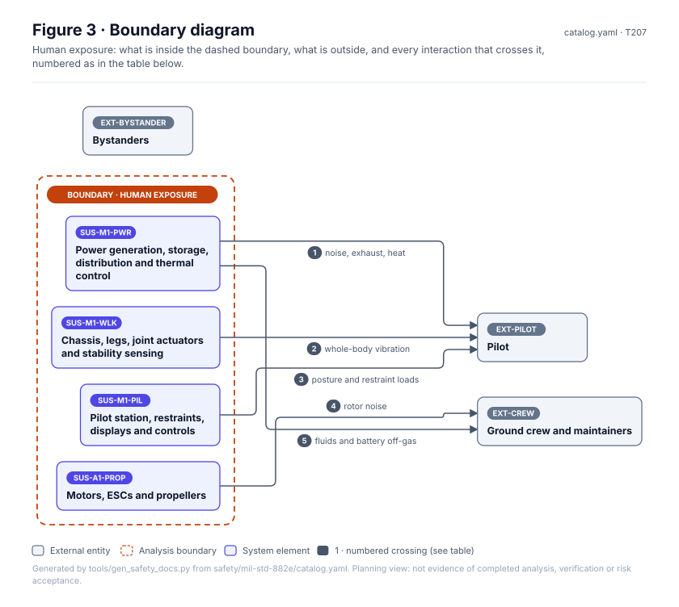
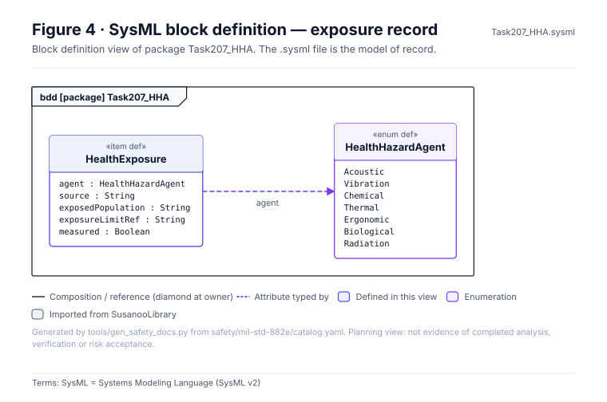
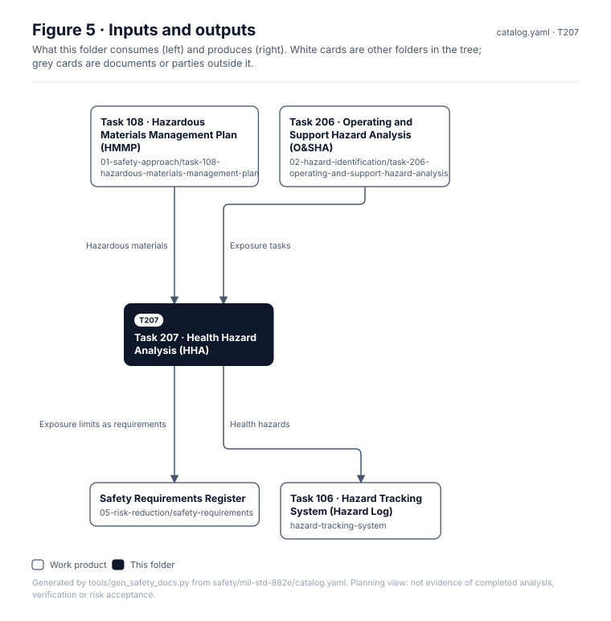

# Task 207 · Health Hazard Analysis (HHA)

> **Status:** Scaffold v0.1 — structure, diagrams and model views only
>
> Planning artifact. No completed hazard analysis, verified mitigation, risk acceptance, certification or MIL-STD-882E compliance is claimed. Category names follow MIL-STD-882E; confirm definitions against the controlled standard and the approved SSPP before formal use.

| Field | Value |
|---|---|
| MIL-STD-882E element | 2 — Identify and document hazards |
| Tasks | [Task 207 — Health Hazard Analysis](../../../../docs/wiki/MIL-STD-882E-Task-207.md) |
| Lifecycle gate | G2–G5 |
| Applicability | Selected |
| Accountable role | Safety lead with human factors lead |
| Parent folder | [02 · Identify and Document Hazards](../README.md) |

## Purpose

Analyses exposure of pilot, crew and bystanders to noise, whole-body vibration, exhaust, heat,
chemicals, battery off-gas, ergonomic load and rotor noise.

## Position in the MIL-STD-882E flow



## Block diagram



Elements and interfaces: [`architecture/item-definition.yaml`](../../../../architecture/item-definition.yaml); SysML: [`Architecture.sysml`](../../../../models/sysml/model/Architecture.sysml).

## Boundary diagram



| # | From | To | Crossing / interaction | Interface (item definition) |
|---|---|---|---|---|
| 1 | SUS-M1-PWR: Power generation, storage, distribution and thermal control | EXT-PILOT: Pilot | noise, exhaust, heat | — |
| 2 | SUS-M1-WLK: Chassis, legs, joint actuators and stability sensing | EXT-PILOT: Pilot | whole-body vibration | — |
| 3 | SUS-M1-PIL: Pilot station, restraints, displays and controls | EXT-PILOT: Pilot | posture and restraint loads | IF-001 |
| 4 | SUS-A1-PROP: Motors, ESCs and propellers | EXT-CREW: Ground crew and maintainers | rotor noise | — |
| 5 | SUS-M1-PWR: Power generation, storage, distribution and thermal control | EXT-CREW: Ground crew and maintainers | fluids and battery off-gas | IF-008 |

**Explicitly excluded:** environmental receptors (Task 210)

## SysML model

SysML v2 textual view: [`Task207_HHA.sysml`](Task207_HHA.sysml), generated from the catalog. It imports the project model in [`models/sysml/model`](../../../../models/sysml/model): `SusanooArchitecture` (elements and usage paths) and `SusanooLibrary` (882E vocabulary). The figures are drawn from the same data; the `.sysml` file is the model of record.



<details><summary>SysML v2 source</summary>

```sysml
// Task207_HHA — generated by tools/gen_safety_docs.py from safety/mil-std-882e/catalog.yaml.
// Do not edit by hand: change the catalog and regenerate.
// Status: planning view only; not evidence of completed analysis or verification.

package Task207_HHA {
    private import ScalarValues::*;
    private import SusanooLibrary::*;
    private import SusanooArchitecture::*;
    item def HealthExposure {
        attribute agent : HealthHazardAgent;
        attribute source : String;
        attribute exposedPopulation : String;
        attribute exposureLimitRef : String;
        attribute measured : Boolean;
    }
    enum def HealthHazardAgent {
        enum Acoustic;
        enum Vibration;
        enum Chemical;
        enum Thermal;
        enum Ergonomic;
        enum Biological;
        enum Radiation;
    }
}
```

</details>

## Inputs and outputs



| Input | Source |
|---|---|
| Hazardous materials | [Task 108 · Hazardous Materials Management Plan (HMMP)](../../01-safety-approach/task-108-hazardous-materials-management-plan/README.md) |
| Exposure tasks | [Task 206 · Operating and Support Hazard Analysis (O&SHA)](../task-206-operating-and-support-hazard-analysis/README.md) |

| Output | Destination |
|---|---|
| Exposure limits as requirements | [Safety Requirements Register](../../05-risk-reduction/safety-requirements/README.md) |
| Health hazards | [Task 106 · Hazard Tracking System (Hazard Log)](../../hazard-tracking-system/README.md) |

## Folder contents

| Item | Description | State |
|---|---|---|
| `hha.csv` | Exposure worksheet | planned |
| [`figures/`](figures/) | Generated SVG figures (do not edit) | generated |
| [`Task207_HHA.sysml`](Task207_HHA.sysml) | Generated SysML v2 view | generated |

<!-- END GENERATED: content below this line is human-authored and preserved -->

## Working content

_No analysis content yet. Add authored material below this heading._
