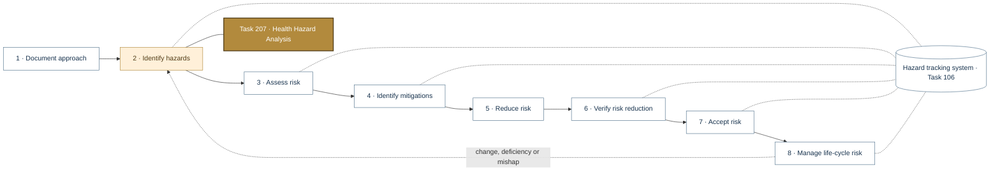
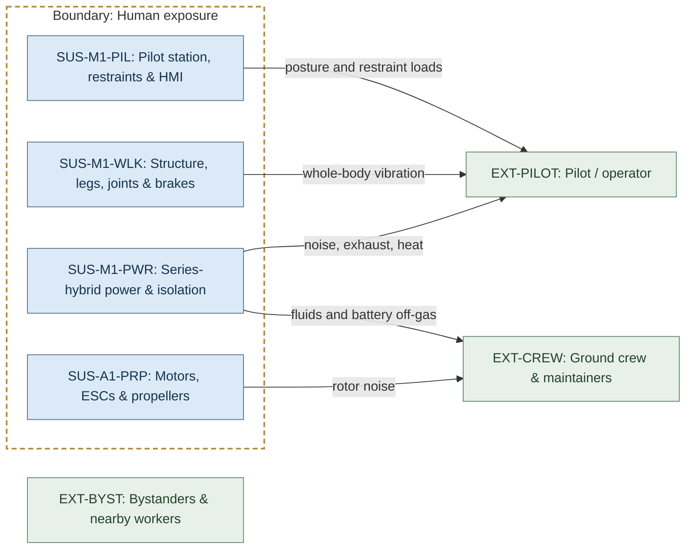
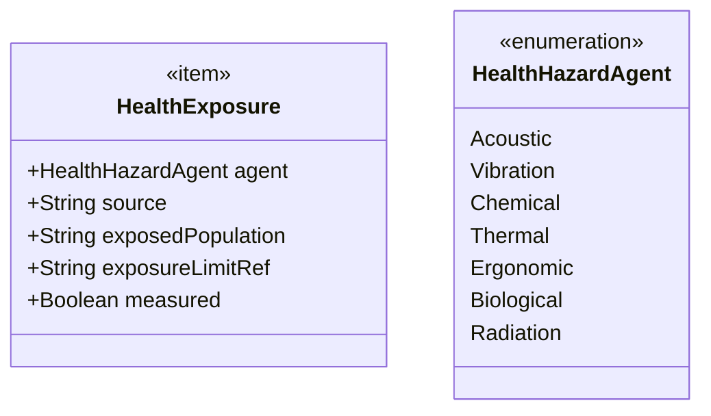
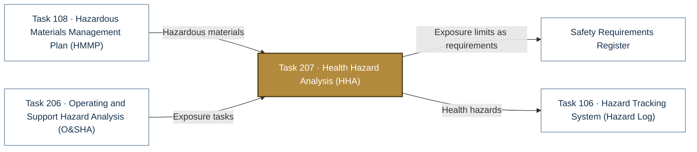

# Task 207 · Health Hazard Analysis (HHA)

> **Status:** Scaffold v0.1 — structure, diagrams and model views only
>
> Planning artifact. No completed hazard analysis, verified mitigation, risk acceptance, certification or MIL-STD-882E compliance is claimed. Category names follow MIL-STD-882E; confirm definitions against the controlled standard and the approved SSPP before formal use.

| Field | Value |
|---|---|
| MIL-STD-882E element | 2 — Identify and document hazards |
| Tasks | [Task 207 — Health Hazard Analysis](../../../../docs/wiki/MIL-STD-882E-Task-207.md) |
| Lifecycle gate | G2–G5 |
| Applicability | Selected |
| Accountable role | Safety lead with human factors lead |
| Parent folder | [02 · Identify and Document Hazards](../README.md) |

## Purpose

Analyses exposure of pilot, crew and bystanders to noise, whole-body vibration, exhaust, heat,
chemicals, battery off-gas, ergonomic load and rotor noise.

## Position in the MIL-STD-882E flow

Highlighted node(s) show where this folder sits in the eight-element iterative flow. Dotted links are feedback and hazard-tracking-system interactions.



## Block diagram

System elements of SUS-I1 in scope for this folder are coloured (blue = system, amber = safety function, purple = interface); greyed blocks are out of scope. Source of truth: [`SusanooSystem.sysml`](../../00-system-definition/sysml/SusanooSystem.sysml).

```mermaid
flowchart TB
  subgraph SUS_I1["SUS-I1: Integrated mech + UAV system"]
    direction TB
    subgraph SUS_M1["SUS-M1: Piloted walker"]
      direction TB
      SUS_M1_WLK["SUS-M1-WLK: Structure, legs, joints & brakes"]
      SUS_M1_MAN["SUS-M1-MAN: Manipulator arms & end effectors"]
      SUS_M1_PIL["SUS-M1-PIL: Pilot station, restraints & HMI"]
      SUS_M1_PWR["SUS-M1-PWR: Series-hybrid power & isolation"]
      SUS_M1_CTL["SUS-M1-CTL: Motion & balance control SW"]
      SUS_M1_SAF["SUS-M1-SAF: Safety monitor & protective stop"]
      SUS_M1_DCK["SUS-M1-DCK: UAV dock - retention, power, data"]
    end
    subgraph SUS_A1["SUS-A1: Observation UAV"]
      direction TB
      SUS_A1_FCS["SUS-A1-FCS: Flight control - PX4 candidate"]
      SUS_A1_PRP["SUS-A1-PRP: Motors, ESCs & propellers"]
      SUS_A1_PWR["SUS-A1-PWR: UAV battery & power mgmt"]
      SUS_A1_NAV["SUS-A1-NAV: Navigation & telemetry link"]
      SUS_A1_PLD["SUS-A1-PLD: Observation payload"]
    end
    subgraph SUS_GSE["SUS-GSE: Ground support equipment"]
      direction TB
      SUS_GSE_SUP["SUS-GSE-SUP: Maintenance supports & lockout"]
      SUS_GSE_CHG["SUS-GSE-CHG: Charging & fuelling equipment"]
      SUS_GSE_TST["SUS-GSE-TST: Test rigs, HIL & simulation"]
    end
  end
  SUS_M1_PIL -->|"commands"| SUS_M1_CTL
  SUS_M1_CTL -->|"joint actuation"| SUS_M1_WLK
  SUS_M1_CTL -->|"arm actuation"| SUS_M1_MAN
  SUS_M1_PWR -->|"DC power"| SUS_M1_WLK
  SUS_M1_SAF -->|"torque inhibit"| SUS_M1_CTL
  SUS_M1_SAF -->|"energy isolation"| SUS_M1_PWR
  SUS_M1_DCK -->|"dock charging"| SUS_A1_PWR
  SUS_M1_DCK -->|"dock data / rotor inhibit"| SUS_A1_FCS
  SUS_A1_NAV -->|"state estimate"| SUS_A1_FCS
  SUS_A1_FCS -->|"thrust command"| SUS_A1_PRP
  SUS_GSE_SUP -->|"mechanical support"| SUS_M1_WLK
  SUS_GSE_CHG -->|"shore charging"| SUS_M1_PWR
  class SUS_M1_WLK system
  class SUS_M1_MAN muted
  class SUS_M1_PIL system
  class SUS_M1_PWR system
  class SUS_M1_CTL muted
  class SUS_M1_SAF muted
  class SUS_M1_DCK muted
  class SUS_A1_FCS muted
  class SUS_A1_PRP system
  class SUS_A1_PWR system
  class SUS_A1_NAV muted
  class SUS_A1_PLD muted
  class SUS_GSE_SUP muted
  class SUS_GSE_CHG muted
  class SUS_GSE_TST muted
  classDef system fill:#dceaf7,stroke:#55758f,color:#17324d
  classDef safety fill:#fff0d9,stroke:#b28a3d,color:#513c16
  classDef external fill:#e8f1e9,stroke:#63886a,color:#23412c
  classDef interface fill:#eae7f5,stroke:#8370a3,color:#30254a
  classDef muted fill:#f4f4f4,stroke:#b5b5b5,color:#8a8a8a,stroke-dasharray: 4 3
  classDef current fill:#b28a3d,stroke:#513c16,color:#ffffff,stroke-width:2px
  classDef work fill:#ffffff,stroke:#55758f,color:#17324d
```



## Boundary diagram

Dashed frame = **Human exposure** boundary. Everything outside it is an external entity or another folder's scope.



| From | To | Crossing / interaction |
|---|---|---|
| SUS-M1-PWR: Series-hybrid power & isolation | EXT-PILOT: Pilot / operator | noise, exhaust, heat |
| SUS-M1-WLK: Structure, legs, joints & brakes | EXT-PILOT: Pilot / operator | whole-body vibration |
| SUS-M1-PIL: Pilot station, restraints & HMI | EXT-PILOT: Pilot / operator | posture and restraint loads |
| SUS-A1-PRP: Motors, ESCs & propellers | EXT-CREW: Ground crew & maintainers | rotor noise |
| SUS-M1-PWR: Series-hybrid power & isolation | EXT-CREW: Ground crew & maintainers | fluids and battery off-gas |

**Explicitly excluded:** environmental receptors (Task 210)

## SysML model

SysML v2 textual view: [`Task207_HHA.sysml`](Task207_HHA.sysml) (generated from the catalog; imports [`SusanooSystem`](../../00-system-definition/sysml/SusanooSystem.sysml) and [`SusanooSafety`](../../00-system-definition/sysml/SusanooSafety.sysml)). The Mermaid rendering below is a reading aid; the `.sysml` file is the model of record.

### Block definition (bdd) — exposure record



<details><summary>SysML v2 source</summary>

```sysml
// Task207_HHA — generated by tools/gen_safety_docs.py from safety/mil-std-882e/catalog.yaml.
// Do not edit by hand: change the catalog and regenerate.
// Status: planning view only; not evidence of completed analysis or verification.

package Task207_HHA {
    private import ScalarValues::*;
    private import SusanooSystem::*;
    private import SusanooSafety::*;
    item def HealthExposure {
        attribute agent : HealthHazardAgent;
        attribute source : String;
        attribute exposedPopulation : String;
        attribute exposureLimitRef : String;
        attribute measured : Boolean;
    }
    enum def HealthHazardAgent {
        enum Acoustic;
        enum Vibration;
        enum Chemical;
        enum Thermal;
        enum Ergonomic;
        enum Biological;
        enum Radiation;
    }
}
```

</details>

## Inputs and outputs



| Input | Source |
|---|---|
| Hazardous materials | [Task 108 · Hazardous Materials Management Plan (HMMP)](../../01-safety-approach/task-108-hazardous-materials-management-plan/README.md) |
| Exposure tasks | [Task 206 · Operating and Support Hazard Analysis (O&SHA)](../task-206-operating-and-support-hazard-analysis/README.md) |

| Output | Destination |
|---|---|
| Exposure limits as requirements | [Safety Requirements Register](../../05-risk-reduction/safety-requirements/README.md) |
| Health hazards | [Task 106 · Hazard Tracking System (Hazard Log)](../../hazard-tracking-system/README.md) |

## Folder contents

| Item | Description | State |
|---|---|---|
| `hha.csv` | Exposure worksheet | planned |
| [`Task207_HHA.sysml`](Task207_HHA.sysml) | Generated SysML v2 view | generated |

<!-- END GENERATED: content below this line is human-authored and preserved -->

## Working content

_No analysis content yet. Add authored material below this heading._
