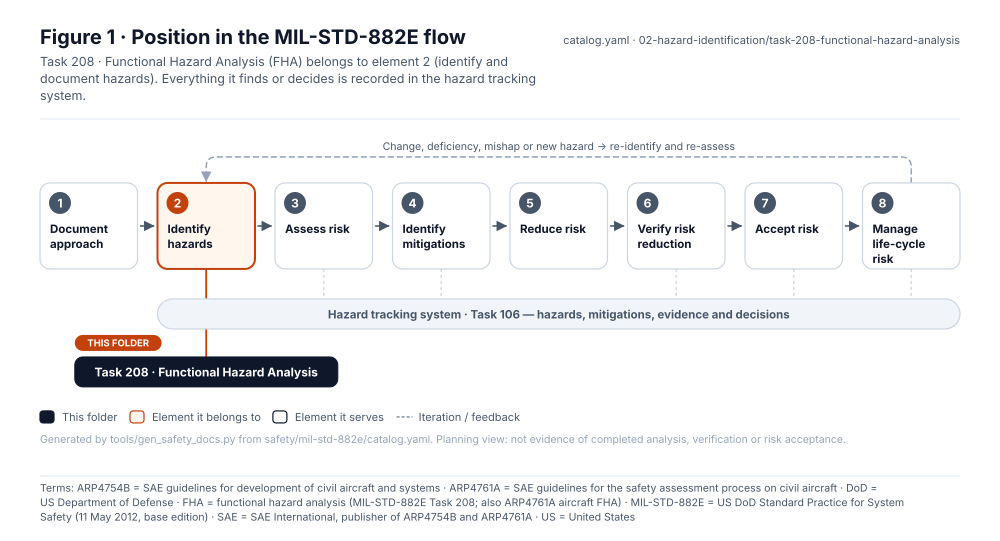
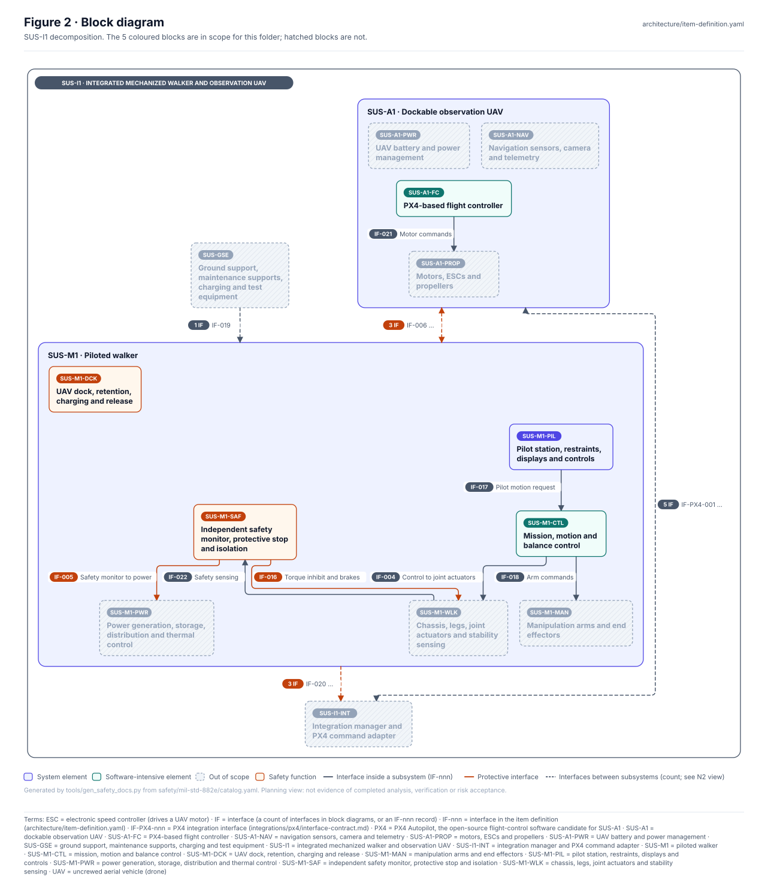
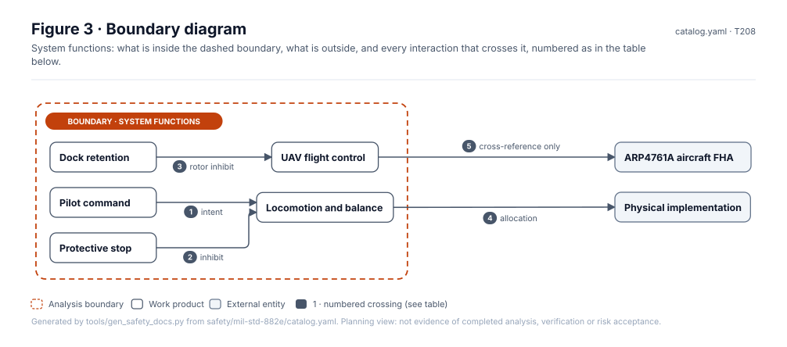
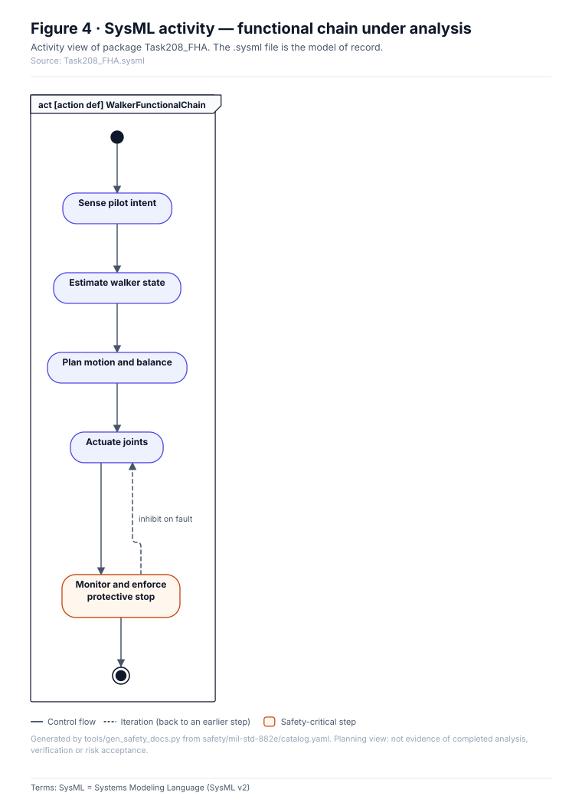
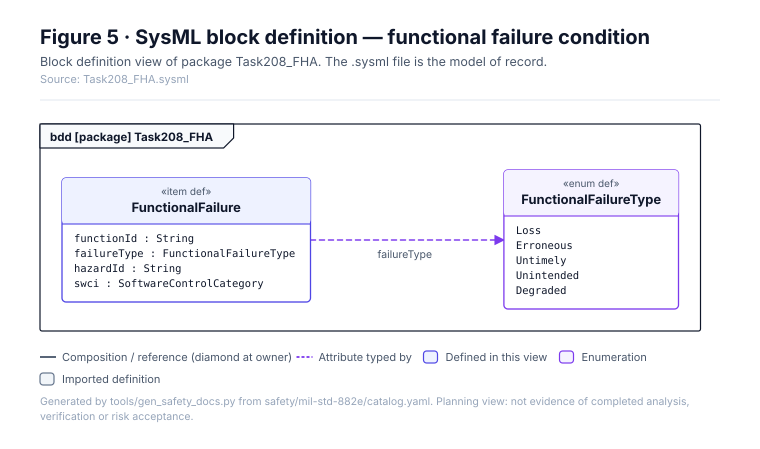
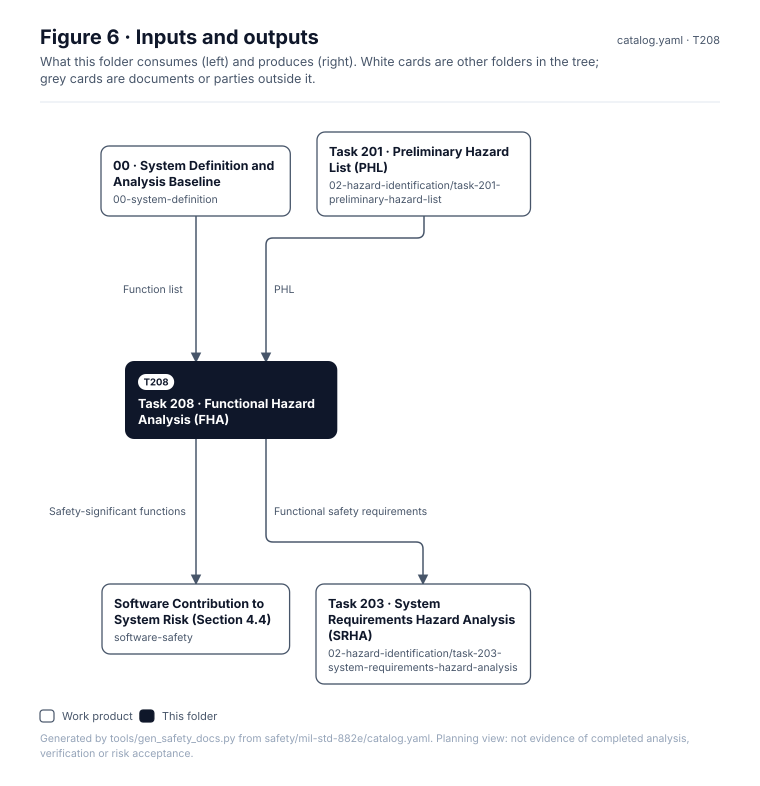
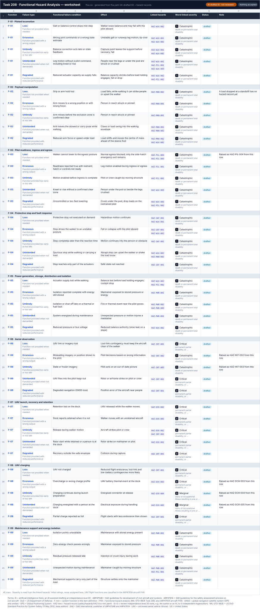

# Task 208 · Functional Hazard Analysis (FHA)

> **Status:** Scaffold v0.1 — structure, diagrams and model views only
>
> Planning artifact. No completed hazard analysis, verified mitigation, risk acceptance, certification or MIL-STD-882E compliance is claimed. Category names follow MIL-STD-882E; confirm definitions against the controlled standard and the approved SSPP before formal use.

<!-- terms:start (generated by tools/terms/terms.py; do not edit by hand) -->
<details><summary><b>Terms on this page (17)</b>: abbreviations and codes explained</summary>

| Term | Meaning |
|---|---|
| AI | artificial intelligence (here, an AI assistant drafting at independence level I0) |
| ARP4754B | SAE guidelines for development of civil aircraft and systems |
| ARP4761A | SAE guidelines for the safety assessment process on civil aircraft |
| DoD | US Department of Defense |
| FHA | functional hazard analysis (MIL-STD-882E Task 208; also ARP4761A aircraft FHA) |
| G0–G7 | lifecycle gate (G0 concept to G7 change and sustainment) |
| I0–I3 | review independence level (I0 none, e.g. the author or an AI, to I3 independent organisation) |
| MIL-STD-882E | US DoD Standard Practice for System Safety (11 May 2012, base edition) |
| PHL | preliminary hazard list (MIL-STD-882E Task 201) |
| SAE | SAE International, publisher of ARP4754B and ARP4761A |
| SRHA | system requirements hazard analysis (MIL-STD-882E Task 203) |
| SSPP | system safety program plan (MIL-STD-882E Task 102) |
| SUS-A1 | dockable observation UAV |
| SVG | Scalable Vector Graphics, the figure file format |
| SysML | Systems Modeling Language (SysML v2) |
| UAV | uncrewed aerial vehicle (drone) |
| US | United States |

All terms: [abbreviations and record codes](https://github.com/jherrodthomas/Project-Susanoo/blob/main/docs/terms.md).

</details>
<!-- terms:end -->

| Field | Value |
|---|---|
| MIL-STD-882E element | 2 — Identify and document hazards |
| Tasks | [Task 208 — Functional Hazard Analysis](../../../../docs/wiki/MIL-STD-882E-Task-208.md) |
| Lifecycle gate | G1–G2 |
| Applicability | Selected |
| Accountable role | Safety lead with software safety lead |
| Parent folder | [02 · Identify and Document Hazards](../README.md) |

## Purpose

Analyses system functions for loss, erroneous, untimely and unintended operation, and identifies
safety-significant functions and their software allocation. The SUS-A1 aircraft FHA under
ARP4761A is a separate artifact with a separate classification scale.

## Position in the MIL-STD-882E flow



## Block diagram



Elements and interfaces: [`architecture/item-definition.yaml`](../../../../architecture/item-definition.yaml); SysML: [`Architecture.sysml`](../../../../models/sysml/model/Architecture.sysml).

## Boundary diagram



| # | From | To | Crossing / interaction | Interface (item definition) |
|---|---|---|---|---|
| 1 | Pilot command | Locomotion and balance | intent | — |
| 2 | Protective stop | Locomotion and balance | inhibit | — |
| 3 | Dock retention | UAV flight control | rotor inhibit | — |
| 4 | Locomotion and balance | Physical implementation | allocation | — |
| 5 | UAV flight control | ARP4761A aircraft FHA | cross-reference only | — |

## SysML model

SysML v2 textual view: [`Task208_FHA.sysml`](Task208_FHA.sysml), generated from the catalog. It imports the project model in [`models/sysml/model`](../../../../models/sysml/model): `SusanooArchitecture` (elements and usage paths) and `SusanooLibrary` (882E vocabulary). The figures are drawn from the same data; the `.sysml` file is the model of record.





<details><summary>SysML v2 source</summary>

```sysml
// Task208_FHA — generated by tools/gen_safety_docs.py from safety/mil-std-882e/catalog.yaml.
// Do not edit by hand: change the catalog and regenerate.
// Status: planning view only; not evidence of completed analysis or verification.

package Task208_FHA {
    private import ScalarValues::*;
    private import SusanooLibrary::*;
    private import SusanooArchitecture::*;
    action def WalkerFunctionalChain {
        action senseIntent { doc /* Sense pilot intent */ }
        action estimateState { doc /* Estimate walker state */ }
        action planMotion { doc /* Plan motion and balance */ }
        action actuateJoints { doc /* Actuate joints */ }
        action monitorSafety { doc /* Monitor and enforce protective stop */ }
        first start then senseIntent;
        first senseIntent then estimateState;
        first estimateState then planMotion;
        first planMotion then actuateJoints;
        first actuateJoints then monitorSafety;
        first monitorSafety then done;
        // iteration: monitorSafety -> actuateJoints when inhibit on fault (informal; merge node omitted)
    }

    item def FunctionalFailure {
        attribute functionId : String;
        attribute failureType : FunctionalFailureType;
        attribute hazardId : String;
        attribute swci : SoftwareControlCategory;
    }
    enum def FunctionalFailureType {
        enum Loss;
        enum Erroneous;
        enum Untimely;
        enum Unintended;
        enum Degraded;
    }
}
```

</details>

## Inputs and outputs



| Input | Source |
|---|---|
| Function list | [00 · System Definition and Analysis Baseline](../../00-system-definition/README.md) |
| PHL | [Task 201 · Preliminary Hazard List (PHL)](../task-201-preliminary-hazard-list/README.md) |

| Output | Destination |
|---|---|
| Safety-significant functions | [Software Contribution to System Risk (Section 4.4)](../../software-safety/README.md) |
| Functional safety requirements | [Task 203 · System Requirements Hazard Analysis (SRHA)](../task-203-system-requirements-hazard-analysis/README.md) |

## Folder contents

| Item | Description | State |
|---|---|---|
| [`fha.yaml`](fha.yaml) | FHA worksheet source: function x failure type rows (AI-drafted, I0) | present |
| [`fha.svg`](fha.svg) | Spreadsheet view of the worksheet (generated by tools/worksheets/build.py) | present |
| [`fha.csv`](fha.csv) | Function x failure-type worksheet | present |
| [`figures/`](figures/) | Generated SVG figures (do not edit) | generated |
| [`Task208_FHA.sysml`](Task208_FHA.sysml) | Generated SysML v2 view | generated |

<!-- END GENERATED: content below this line is human-authored and preserved -->

## Working content

<!-- worksheet:start (generated by tools/worksheets/build.py; do not edit) -->
### Worksheet



Data: [`fha.csv`](fha.csv) · Excel: [`worksheets.xlsx`](../../../generated/worksheets.xlsx), tab **FHA** (risk levels are live Table III formulas). Generated from `fha.yaml (AI-drafted I0) + hazard records` by `tools/worksheets/build.py`; edit the records, not the sheet. AI-drafted (I0), not reviewed.
<!-- worksheet:end -->

