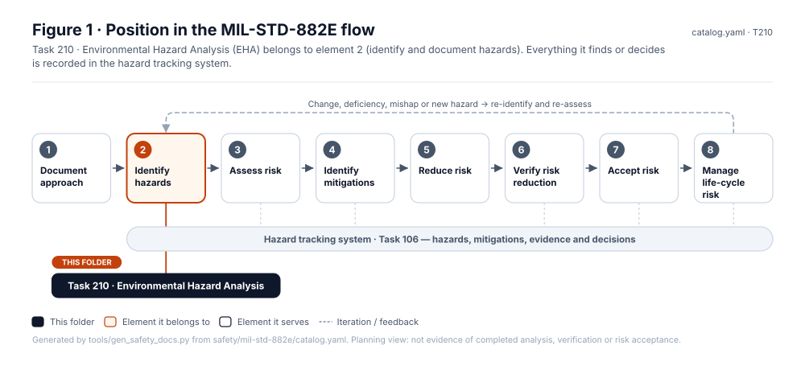
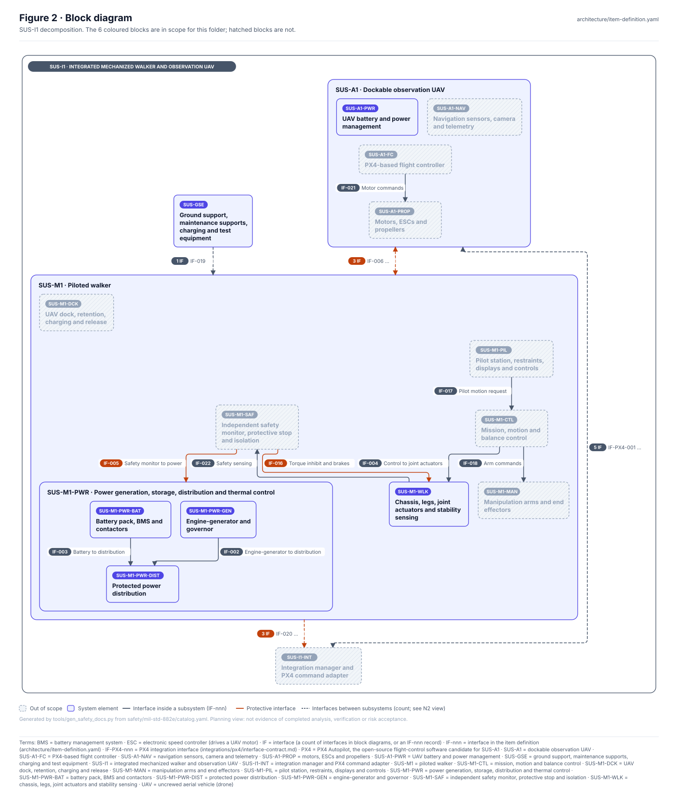
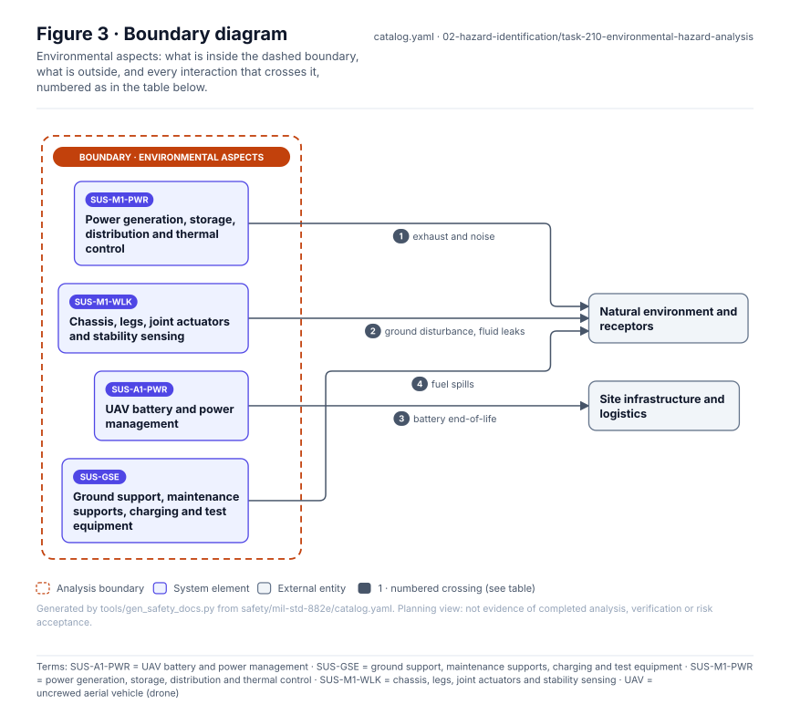
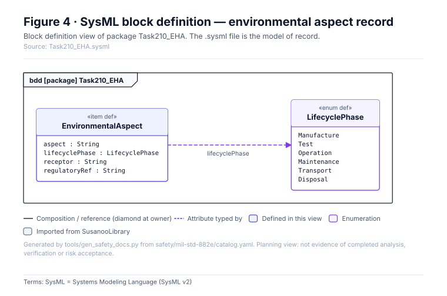
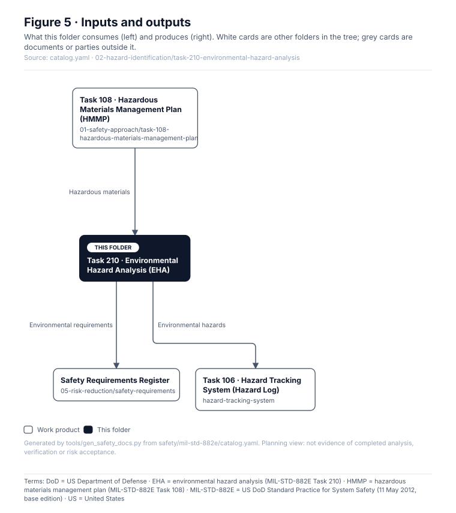

# Task 210 · Environmental Hazard Analysis (EHA)

> **Status:** Scaffold v0.1 — structure, diagrams and model views only
>
> Planning artifact. No completed hazard analysis, verified mitigation, risk acceptance, certification or MIL-STD-882E compliance is claimed. Category names follow MIL-STD-882E; confirm definitions against the controlled standard and the approved SSPP before formal use.

| Field | Value |
|---|---|
| MIL-STD-882E element | 2 — Identify and document hazards |
| Tasks | [Task 210 — Environmental Hazard Analysis](../../../../docs/wiki/MIL-STD-882E-Task-210.md) |
| Lifecycle gate | G2–G5 |
| Applicability | Selected |
| Accountable role | Environmental / HSE lead |
| Parent folder | [02 · Identify and Document Hazards](../README.md) |

## Purpose

Analyses environmental impacts across the lifecycle: emissions, spills, noise, battery
end-of-life, ground disturbance and disposal.

## Position in the MIL-STD-882E flow



## Block diagram



Source of truth: [`SusanooSystem.sysml`](../../00-system-definition/sysml/SusanooSystem.sysml).

## Boundary diagram



| # | From | To | Crossing / interaction |
|---|---|---|---|
| 1 | SUS-M1-PWR: Series-hybrid power & isolation | EXT-ENV: Natural environment & receptors | exhaust and noise |
| 2 | SUS-M1-WLK: Structure, legs, joints & brakes | EXT-ENV: Natural environment & receptors | ground disturbance, fluid leaks |
| 3 | SUS-A1-PWR: UAV battery & power mgmt | EXT-SITE: Site infrastructure & logistics | battery end-of-life |
| 4 | SUS-GSE-CHG: Charging & fuelling equipment | EXT-ENV: Natural environment & receptors | fuel spills |

## SysML model

SysML v2 textual view: [`Task210_EHA.sysml`](Task210_EHA.sysml), generated from the catalog. It imports [`SusanooSystem`](../../00-system-definition/sysml/SusanooSystem.sysml) and [`SusanooSafety`](../../00-system-definition/sysml/SusanooSafety.sysml). The figures are drawn from the same data; the `.sysml` file is the model of record.



<details><summary>SysML v2 source</summary>

```sysml
// Task210_EHA — generated by tools/gen_safety_docs.py from safety/mil-std-882e/catalog.yaml.
// Do not edit by hand: change the catalog and regenerate.
// Status: planning view only; not evidence of completed analysis or verification.

package Task210_EHA {
    private import ScalarValues::*;
    private import SusanooSystem::*;
    private import SusanooSafety::*;
    item def EnvironmentalAspect {
        attribute aspect : String;
        attribute lifecyclePhase : LifecyclePhase;
        attribute receptor : String;
        attribute regulatoryRef : String;
    }
    enum def LifecyclePhase {
        enum Manufacture;
        enum Test;
        enum Operation;
        enum Maintenance;
        enum Transport;
        enum Disposal;
    }
}
```

</details>

## Inputs and outputs



| Input | Source |
|---|---|
| Hazardous materials | [Task 108 · Hazardous Materials Management Plan (HMMP)](../../01-safety-approach/task-108-hazardous-materials-management-plan/README.md) |

| Output | Destination |
|---|---|
| Environmental requirements | [Safety Requirements Register](../../05-risk-reduction/safety-requirements/README.md) |
| Environmental hazards | [Task 106 · Hazard Tracking System (Hazard Log)](../../hazard-tracking-system/README.md) |

## Folder contents

| Item | Description | State |
|---|---|---|
| `eha.csv` | Aspect and impact worksheet | planned |
| [`figures/`](figures/) | Generated SVG figures (do not edit) | generated |
| [`Task210_EHA.sysml`](Task210_EHA.sysml) | Generated SysML v2 view | generated |

<!-- END GENERATED: content below this line is human-authored and preserved -->

## Working content

_No analysis content yet. Add authored material below this heading._
