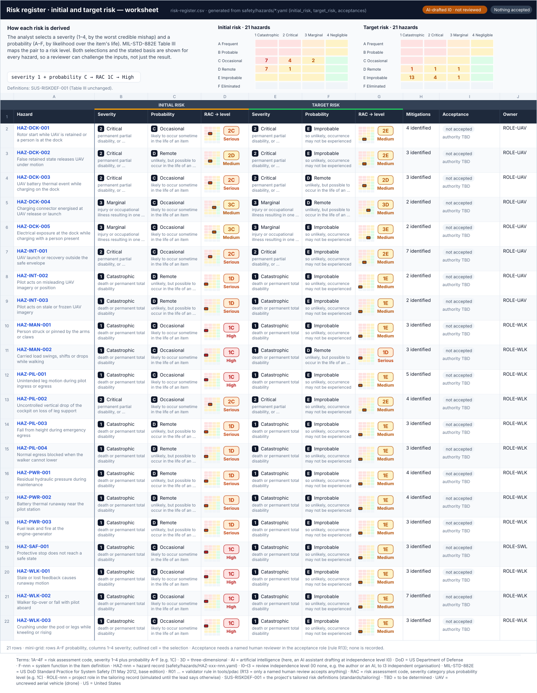

# 03 · Assess and Document Risk

> **Status:** Scaffold v0.1 — structure, diagrams and model views only
>
> Planning artifact. No completed hazard analysis, verified mitigation, risk acceptance, certification or MIL-STD-882E compliance is claimed. Category names follow MIL-STD-882E; confirm definitions against the controlled standard and the approved SSPP before formal use.

<!-- terms:start (generated by tools/terms/terms.py; do not edit by hand) -->
<details><summary><b>Terms on this page (16)</b>: abbreviations and codes explained</summary>

| Term | Meaning |
|---|---|
| AI | artificial intelligence (here, an AI assistant drafting at independence level I0) |
| ARP4754B | SAE guidelines for development of civil aircraft and systems |
| ARP4761A | SAE guidelines for the safety assessment process on civil aircraft |
| DoD | US Department of Defense |
| F-nnn | system function in the item definition |
| G0–G7 | lifecycle gate (G0 concept to G7 change and sustainment) |
| I0–I3 | review independence level (I0 none, e.g. the author or an AI, to I3 independent organisation) |
| MIL-STD-882E | US DoD Standard Practice for System Safety (11 May 2012, base edition) |
| PDaC | Product Development as Code |
| SAE | SAE International, publisher of ARP4754B and ARP4761A |
| SSPP | system safety program plan (MIL-STD-882E Task 102) |
| SUS-I1 | integrated mechanized walker and observation UAV |
| SVG | Scalable Vector Graphics, the figure file format |
| SysML | Systems Modeling Language (SysML v2) |
| UAV | uncrewed aerial vehicle (drone) |
| US | United States |

All terms: [abbreviations and record codes](https://github.com/jherrodthomas/Project-Susanoo/blob/main/docs/terms.md).

</details>
<!-- terms:end -->

| Field | Value |
|---|---|
| MIL-STD-882E element | 3 — Assess and document risk |
| Lifecycle gate | G1 onward |
| Applicability | Selected |
| Accountable role | Safety lead |
| Parent folder | [MIL-STD-882E System Safety Work Products](../README.md) |

## Purpose

Holds the program risk assessment definitions: severity categories, probability levels, the
risk assessment matrix and risk levels, plus quantitative probability bands for SUS-I1 once
exposure is defined. Software contribution uses the separate criteria in `software-safety/`.

## Position in the MIL-STD-882E flow


## Block diagram


Elements and interfaces: [`architecture/item-definition.yaml`](../../../architecture/item-definition.yaml); SysML: [`Architecture.sysml`](../../../models/sysml/model/Architecture.sysml).

## Boundary diagram


| # | From | To | Crossing / interaction | Interface (item definition) |
|---|---|---|---|---|
| 1 | Hazard records | Risk matrix | severity and probability | — |
| 2 | Risk matrix | Risk acceptance authority | risk level drives authority | — |
| 3 | ARP4761A classification | Risk matrix | kept separate - no mapping | — |

## SysML model

SysML v2 textual view: [`RiskAssessment.sysml`](RiskAssessment.sysml), generated from the catalog. It imports the project model in [`models/sysml/model`](../../../models/sysml/model): `SusanooArchitecture` (elements and usage paths) and `SusanooLibrary` (882E vocabulary). The figures are drawn from the same data; the `.sysml` file is the model of record.


<details><summary>SysML v2 source</summary>

```sysml
// RiskAssessment — generated by tools/gen_safety_docs.py from safety/mil-std-882e/catalog.yaml.
// Do not edit by hand: change the catalog and regenerate.
// Status: planning view only; not evidence of completed analysis or verification.

package RiskAssessment {
    private import ScalarValues::*;
    private import SusanooLibrary::*;
    private import SusanooArchitecture::*;

}
```

</details>

## Inputs and outputs


| Input | Source |
|---|---|
| Matrix approval | [Task 102 · System Safety Program Plan (SSPP)](../01-safety-approach/task-102-system-safety-program-plan/README.md) |
| Hazards | [02 · Identify and Document Hazards](../02-hazard-identification/README.md) |

| Output | Destination |
|---|---|
| Prioritised risks | [04 · Identify and Document Risk Mitigation Measures](../04-mitigation-identification/README.md) |
| Risk levels for authority | [07 · Accept Risk and Document](../07-risk-acceptance/README.md) |
| Initial risk | [Task 106 · Hazard Tracking System (Hazard Log)](../hazard-tracking-system/README.md) |

## Folder contents

| Item | Description | State |
|---|---|---|
| [`risk-register.csv`](risk-register.csv) | Risk register: selected severity and probability, Table III level, initial and target (generated) | present |
| [`risk-register.svg`](risk-register.svg) | Spreadsheet view of the worksheet (generated by tools/worksheets/build.py) | present |
| `risk-matrix.yaml` | Machine-readable matrix used by PDaC checks | planned |
| [`figures/`](figures/) | Generated SVG figures (do not edit) | generated |
| [`RiskAssessment.sysml`](RiskAssessment.sysml) | Generated SysML v2 view | generated |

## Candidate risk assessment matrix

Reproduces the structure of MIL-STD-882E Table III for planning. **Confirm against the
controlled standard and record SSPP approval before use.**

| Probability \ Severity | Catastrophic (1) | Critical (2) | Marginal (3) | Negligible (4) |
|---|---|---|---|---|
| Frequent (A) | High | High | Serious | Medium |
| Probable (B) | High | High | Serious | Medium |
| Occasional (C) | High | Serious | Medium | Low |
| Remote (D) | Serious | Medium | Medium | Low |
| Improbable (E) | Medium | Medium | Medium | Low |
| Eliminated (F) | Eliminated | Eliminated | Eliminated | Eliminated |

<!-- END GENERATED: content below this line is human-authored and preserved -->

## Working content

<!-- worksheet:start (generated by tools/worksheets/build.py; do not edit) -->
### Worksheet



Data: [`risk-register.csv`](risk-register.csv) · Excel: [`worksheets.xlsx`](../../generated/worksheets.xlsx), tab **Risk register** (risk levels are live Table III formulas). Generated from `safety/hazards/*.yaml (initial_risk, target_risk, acceptances)` by `tools/worksheets/build.py`; edit the records, not the sheet. AI-drafted (I0), not reviewed.
<!-- worksheet:end -->

