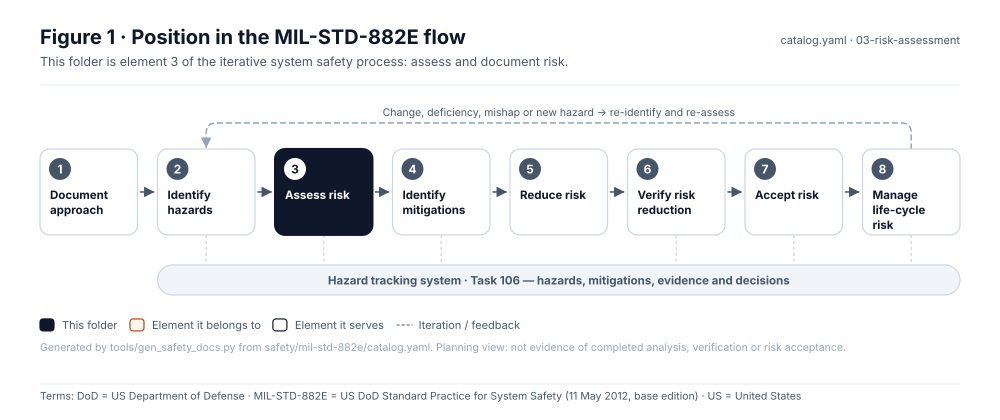
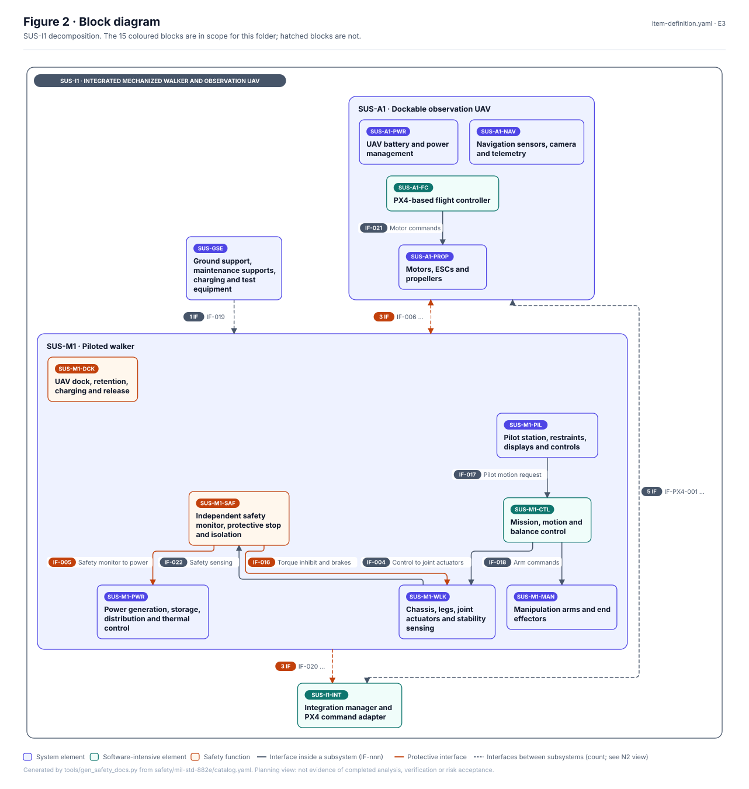
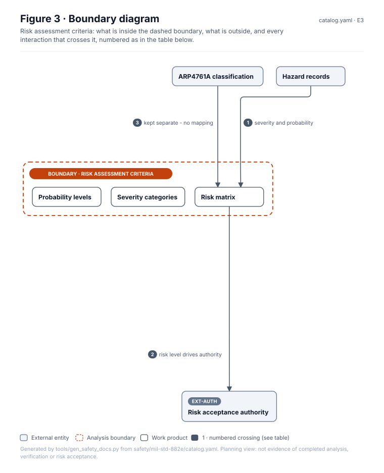
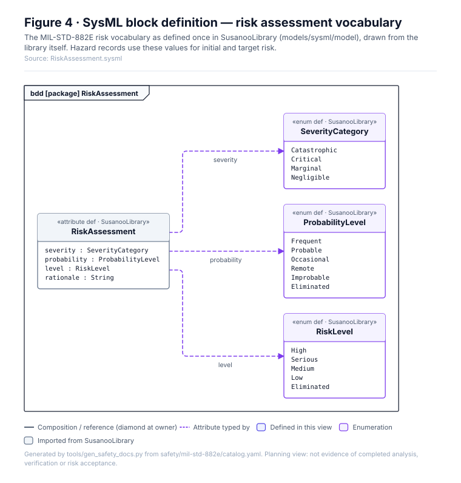
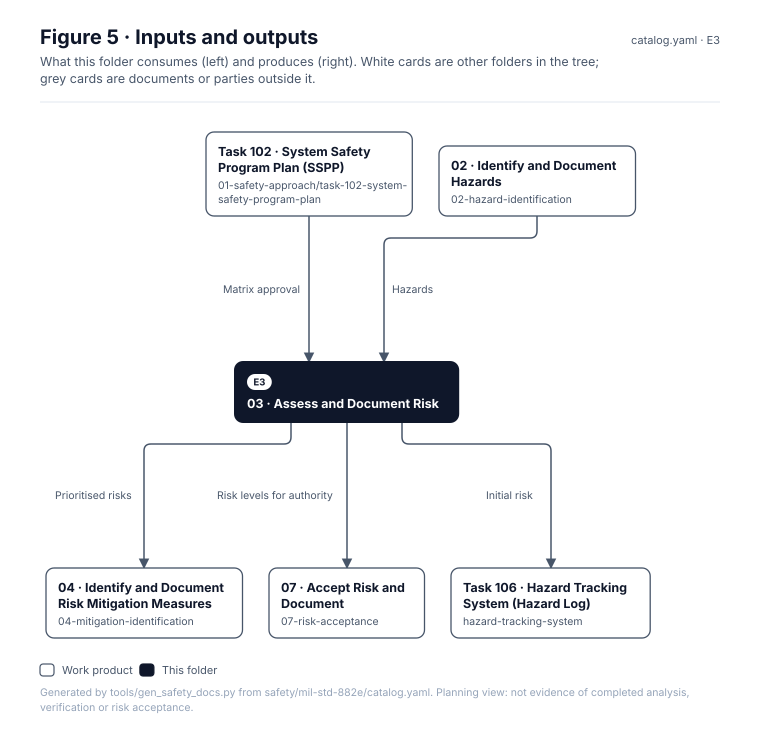

# 03 · Assess and Document Risk

> **Status:** Scaffold v0.1 — structure, diagrams and model views only
>
> Planning artifact. No completed hazard analysis, verified mitigation, risk acceptance, certification or MIL-STD-882E compliance is claimed. Category names follow MIL-STD-882E; confirm definitions against the controlled standard and the approved SSPP before formal use.

| Field | Value |
|---|---|
| MIL-STD-882E element | 3 — Assess and document risk |
| Lifecycle gate | G1 onward |
| Applicability | Selected |
| Accountable role | Safety lead |
| Parent folder | [MIL-STD-882E System Safety Work Products](../README.md) |

## Purpose

Holds the program risk assessment definitions: severity categories, probability levels, the
risk assessment matrix and risk levels, plus quantitative probability bands for SUS-I1 once
exposure is defined. Software contribution uses the separate criteria in `software-safety/`.

## Position in the MIL-STD-882E flow



## Block diagram



Source of truth: [`SusanooSystem.sysml`](../00-system-definition/sysml/SusanooSystem.sysml).

## Boundary diagram



| # | From | To | Crossing / interaction |
|---|---|---|---|
| 1 | Hazard records | Risk matrix | severity and probability |
| 2 | Risk matrix | EXT-AUTH: Risk acceptance authority | risk level drives authority |
| 3 | ARP4761A classification | Risk matrix | kept separate - no mapping |

## SysML model

SysML v2 textual view: [`RiskAssessment.sysml`](RiskAssessment.sysml), generated from the catalog. It imports [`SusanooSystem`](../00-system-definition/sysml/SusanooSystem.sysml) and [`SusanooSafety`](../00-system-definition/sysml/SusanooSafety.sysml). The figures are drawn from the same data; the `.sysml` file is the model of record.



<details><summary>SysML v2 source</summary>

```sysml
// RiskAssessment — generated by tools/gen_safety_docs.py from safety/mil-std-882e/catalog.yaml.
// Do not edit by hand: change the catalog and regenerate.
// Status: planning view only; not evidence of completed analysis or verification.

package RiskAssessment {
    private import ScalarValues::*;
    private import SusanooSystem::*;
    private import SusanooSafety::*;
    enum def SeverityCategory {
        enum Catastrophic;
        enum Critical;
        enum Marginal;
        enum Negligible;
    }
    enum def ProbabilityLevel {
        enum Frequent;
        enum Probable;
        enum Occasional;
        enum Remote;
        enum Improbable;
        enum Eliminated;
    }
    enum def RiskLevel {
        enum High;
        enum Serious;
        enum Medium;
        enum Low;
        enum Eliminated;
    }
    attribute def RiskAssessmentRecord {
        attribute severity : SeverityCategory;
        attribute probability : ProbabilityLevel;
        attribute level : RiskLevel;
        attribute rationale : String;
    }
}
```

</details>

## Inputs and outputs



| Input | Source |
|---|---|
| Matrix approval | [Task 102 · System Safety Program Plan (SSPP)](../01-safety-approach/task-102-system-safety-program-plan/README.md) |
| Hazards | [02 · Identify and Document Hazards](../02-hazard-identification/README.md) |

| Output | Destination |
|---|---|
| Prioritised risks | [04 · Identify and Document Risk Mitigation Measures](../04-mitigation-identification/README.md) |
| Risk levels for authority | [07 · Accept Risk and Document](../07-risk-acceptance/README.md) |
| Initial risk | [Task 106 · Hazard Tracking System (Hazard Log)](../hazard-tracking-system/README.md) |

## Folder contents

| Item | Description | State |
|---|---|---|
| `risk-matrix.yaml` | Machine-readable matrix used by PDaC checks | planned |
| [`figures/`](figures/) | Generated SVG figures (do not edit) | generated |
| [`RiskAssessment.sysml`](RiskAssessment.sysml) | Generated SysML v2 view | generated |

## Candidate risk assessment matrix

Reproduces the structure of MIL-STD-882E Table III for planning. **Confirm against the
controlled standard and record SSPP approval before use.**

| Probability \ Severity | Catastrophic (1) | Critical (2) | Marginal (3) | Negligible (4) |
|---|---|---|---|---|
| Frequent (A) | High | High | Serious | Medium |
| Probable (B) | High | High | Serious | Medium |
| Occasional (C) | High | Serious | Medium | Low |
| Remote (D) | Serious | Medium | Medium | Low |
| Improbable (E) | Medium | Medium | Medium | Low |
| Eliminated (F) | Eliminated | Eliminated | Eliminated | Eliminated |

<!-- END GENERATED: content below this line is human-authored and preserved -->

## Working content

_No analysis content yet. Add authored material below this heading._
