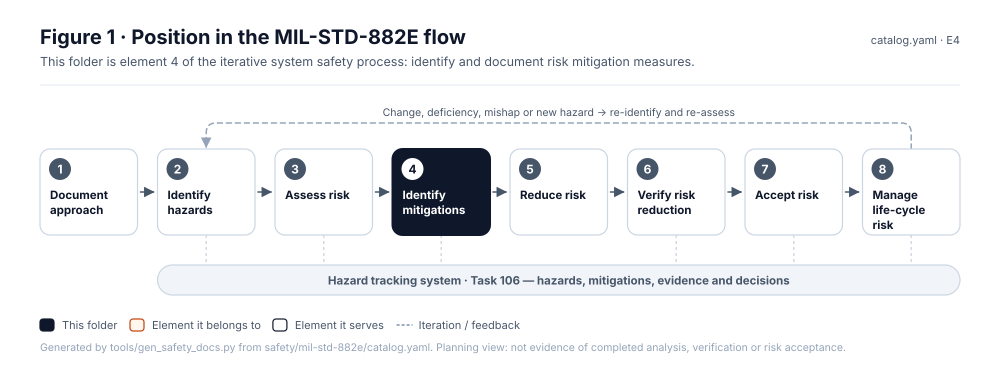
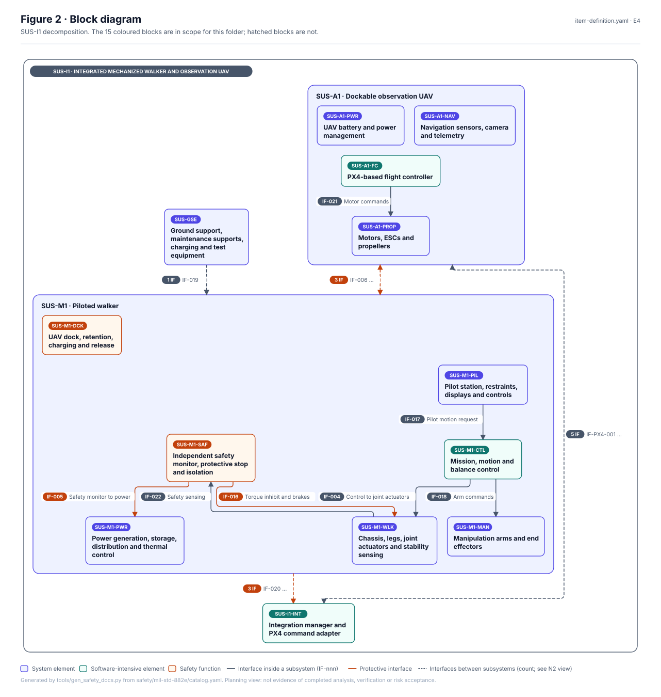
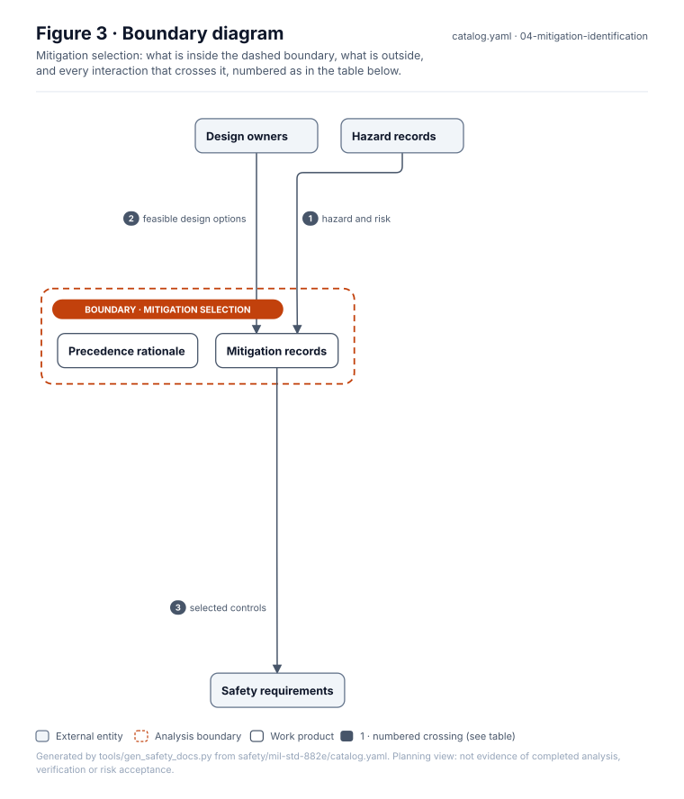
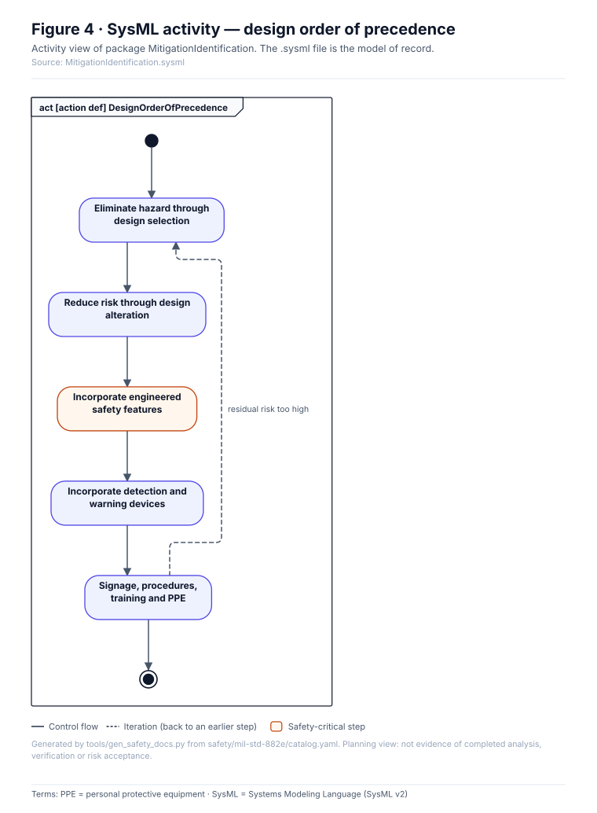
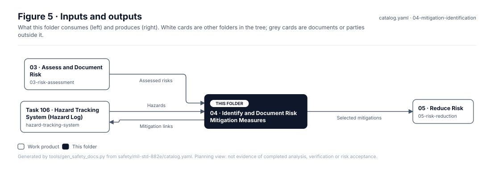

# 04 · Identify and Document Risk Mitigation Measures

> **Status:** Scaffold v0.1 — structure, diagrams and model views only
>
> Planning artifact. No completed hazard analysis, verified mitigation, risk acceptance, certification or MIL-STD-882E compliance is claimed. Category names follow MIL-STD-882E; confirm definitions against the controlled standard and the approved SSPP before formal use.

| Field | Value |
|---|---|
| MIL-STD-882E element | 4 — Identify and document risk mitigation measures |
| Lifecycle gate | G2–G3 |
| Applicability | Selected |
| Accountable role | Safety lead with design owners |
| Parent folder | [MIL-STD-882E System Safety Work Products](../README.md) |

## Purpose

Records candidate mitigations for each hazard, ordered by the system safety design order of
precedence, and the rationale when a lower-precedence measure is chosen.

## Position in the MIL-STD-882E flow



## Block diagram



Source of truth: [`SusanooSystem.sysml`](../00-system-definition/sysml/SusanooSystem.sysml).

## Boundary diagram



| # | From | To | Crossing / interaction |
|---|---|---|---|
| 1 | Hazard records | Mitigation records | hazard and risk |
| 2 | Design owners | Mitigation records | feasible design options |
| 3 | Mitigation records | Safety requirements | selected controls |

## SysML model

SysML v2 textual view: [`MitigationIdentification.sysml`](MitigationIdentification.sysml), generated from the catalog. It imports [`SusanooSystem`](../00-system-definition/sysml/SusanooSystem.sysml) and [`SusanooSafety`](../00-system-definition/sysml/SusanooSafety.sysml). The figures are drawn from the same data; the `.sysml` file is the model of record.



<details><summary>SysML v2 source</summary>

```sysml
// MitigationIdentification — generated by tools/gen_safety_docs.py from safety/mil-std-882e/catalog.yaml.
// Do not edit by hand: change the catalog and regenerate.
// Status: planning view only; not evidence of completed analysis or verification.

package MitigationIdentification {
    private import ScalarValues::*;
    private import SusanooSystem::*;
    private import SusanooSafety::*;
    action def DesignOrderOfPrecedence {
        action eliminate { doc /* Eliminate hazard through design selection */ }
        action reduceByDesign { doc /* Reduce risk through design alteration */ }
        action engineeredFeatures { doc /* Incorporate engineered safety features */ }
        action warningDevices { doc /* Incorporate detection and warning devices */ }
        action procedures { doc /* Signage, procedures, training and PPE */ }
        first start;
        then eliminate;
        first eliminate then reduceByDesign;
        first reduceByDesign then engineeredFeatures;
        first engineeredFeatures then warningDevices;
        first warningDevices then procedures;
        first procedures then done;
        // iteration: procedures -> eliminate when residual risk too high (informal; merge node omitted)
    }
}
```

</details>

## Inputs and outputs



| Input | Source |
|---|---|
| Assessed risks | [03 · Assess and Document Risk](../03-risk-assessment/README.md) |
| Hazards | [Task 106 · Hazard Tracking System (Hazard Log)](../hazard-tracking-system/README.md) |

| Output | Destination |
|---|---|
| Selected mitigations | [05 · Reduce Risk](../05-risk-reduction/README.md) |
| Mitigation links | [Task 106 · Hazard Tracking System (Hazard Log)](../hazard-tracking-system/README.md) |

## Folder contents

| Item | Description | State |
|---|---|---|
| `mitigations.csv` | Mitigation register with precedence level | planned |
| [`figures/`](figures/) | Generated SVG figures (do not edit) | generated |
| [`MitigationIdentification.sysml`](MitigationIdentification.sysml) | Generated SysML v2 view | generated |

<!-- END GENERATED: content below this line is human-authored and preserved -->

## Working content

_No analysis content yet. Add authored material below this heading._
