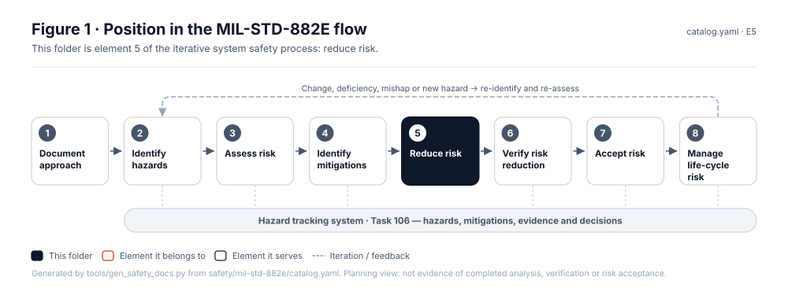
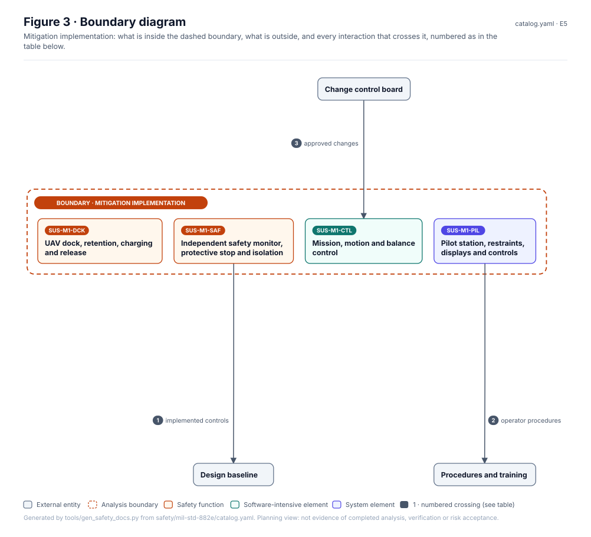
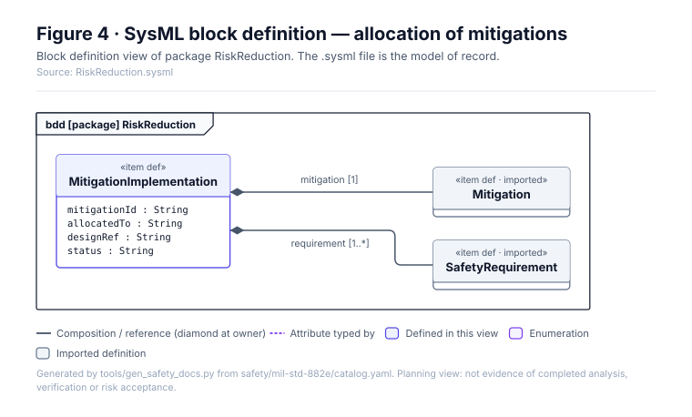
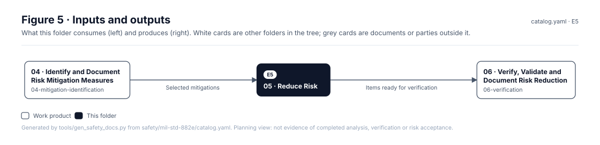

# 05 · Reduce Risk

> **Status:** Scaffold v0.1 — structure, diagrams and model views only
>
> Planning artifact. No completed hazard analysis, verified mitigation, risk acceptance, certification or MIL-STD-882E compliance is claimed. Category names follow MIL-STD-882E; confirm definitions against the controlled standard and the approved SSPP before formal use.

| Field | Value |
|---|---|
| MIL-STD-882E element | 5 — Reduce risk |
| Lifecycle gate | G3–G4 |
| Applicability | Selected |
| Accountable role | Systems lead with safety lead |
| Parent folder | [MIL-STD-882E System Safety Work Products](../README.md) |

## Purpose

Tracks implementation of selected mitigations into requirements, design, software, procedures
and training, with allocation to SUS-I1 elements.

## Position in the MIL-STD-882E flow



## Block diagram


Source of truth: [`SusanooSystem.sysml`](../00-system-definition/sysml/SusanooSystem.sysml).

## Boundary diagram



| # | From | To | Crossing / interaction |
|---|---|---|---|
| 1 | SUS-M1-SAF: Safety monitor & protective stop | Design baseline | implemented controls |
| 2 | SUS-M1-PIL: Pilot station, restraints & HMI | Procedures and training | operator procedures |
| 3 | Change control board | SUS-M1-CTL: Motion & balance control SW | approved changes |

## SysML model

SysML v2 textual view: [`RiskReduction.sysml`](RiskReduction.sysml), generated from the catalog. It imports [`SusanooSystem`](../00-system-definition/sysml/SusanooSystem.sysml) and [`SusanooSafety`](../00-system-definition/sysml/SusanooSafety.sysml). The figures are drawn from the same data; the `.sysml` file is the model of record.



<details><summary>SysML v2 source</summary>

```sysml
// RiskReduction — generated by tools/gen_safety_docs.py from safety/mil-std-882e/catalog.yaml.
// Do not edit by hand: change the catalog and regenerate.
// Status: planning view only; not evidence of completed analysis or verification.

package RiskReduction {
    private import ScalarValues::*;
    private import SusanooSystem::*;
    private import SusanooSafety::*;
    item def MitigationImplementation {
        attribute mitigationId : String;
        attribute allocatedTo : String;
        attribute designRef : String;
        attribute status : String;
        ref item mitigation : Mitigation[1];
        ref item requirements : SafetyRequirement[1..*];
    }
}
```

</details>

## Inputs and outputs



| Input | Source |
|---|---|
| Selected mitigations | [04 · Identify and Document Risk Mitigation Measures](../04-mitigation-identification/README.md) |

| Output | Destination |
|---|---|
| Items ready for verification | [06 · Verify, Validate and Document Risk Reduction](../06-verification/README.md) |

## Folder contents

| Item | Description | State |
|---|---|---|
| [`safety-requirements/`](safety-requirements/README.md) | Safety Requirements Register | folder |
| `implementation-status.csv` | Mitigation to design / procedure trace | planned |
| [`figures/`](figures/) | Generated SVG figures (do not edit) | generated |
| [`RiskReduction.sysml`](RiskReduction.sysml) | Generated SysML v2 view | generated |

<!-- END GENERATED: content below this line is human-authored and preserved -->

## Working content

_No analysis content yet. Add authored material below this heading._
