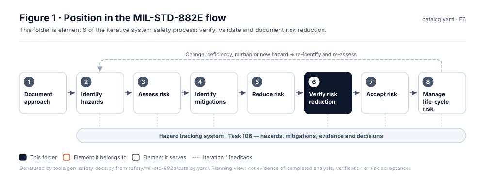
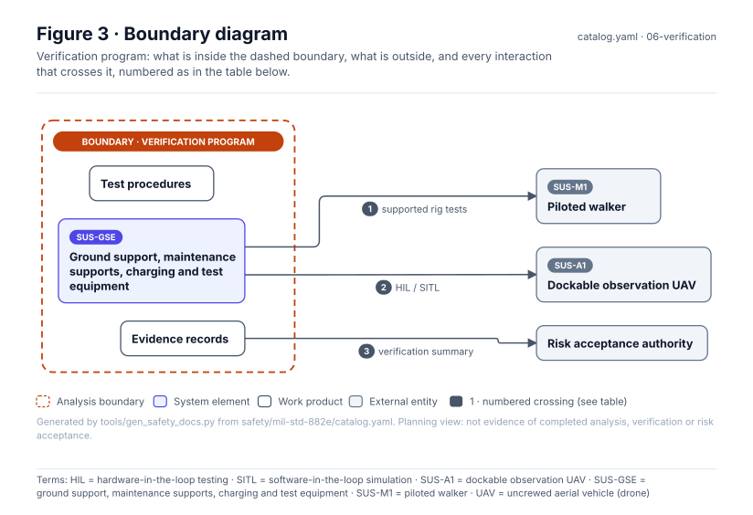
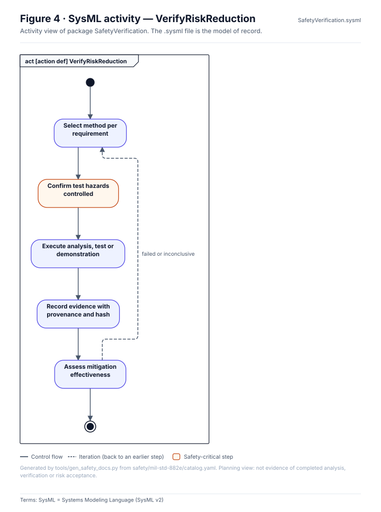
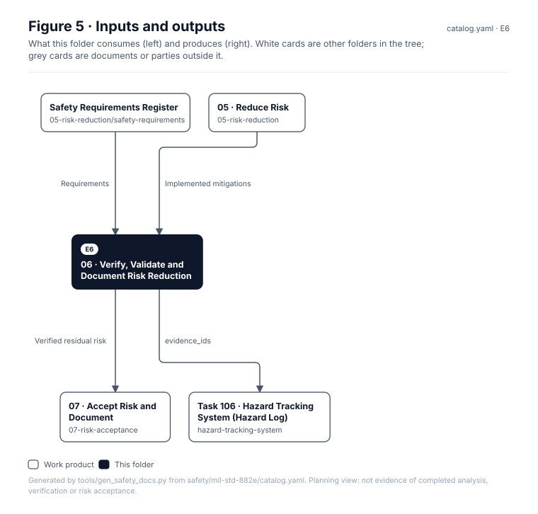

# 06 · Verify, Validate and Document Risk Reduction

> **Status:** Scaffold v0.1 — structure, diagrams and model views only
>
> Planning artifact. No completed hazard analysis, verified mitigation, risk acceptance, certification or MIL-STD-882E compliance is claimed. Category names follow MIL-STD-882E; confirm definitions against the controlled standard and the approved SSPP before formal use.

| Field | Value |
|---|---|
| MIL-STD-882E element | 6 — Verify, validate and document risk reduction |
| Lifecycle gate | G4–G5 |
| Applicability | Selected |
| Accountable role | Test lead with safety lead |
| Parent folder | [MIL-STD-882E System Safety Work Products](../README.md) |

## Purpose

Plans and records evidence that mitigations are implemented and effective: analysis,
inspection, demonstration, simulation and test, including fault injection. Simulated evidence
is labelled as simulated.

## Position in the MIL-STD-882E flow



## Block diagram


Source of truth: [`SusanooSystem.sysml`](../00-system-definition/sysml/SusanooSystem.sysml).

## Boundary diagram



| # | From | To | Crossing / interaction |
|---|---|---|---|
| 1 | SUS-GSE-TST: Test rigs, HIL & simulation | SUS-M1: Piloted walker | supported rig tests |
| 2 | SUS-GSE-TST: Test rigs, HIL & simulation | SUS-A1: Observation UAV | HIL / SITL |
| 3 | Evidence records | EXT-AUTH: Risk acceptance authority | verification summary |

## SysML model

SysML v2 textual view: [`SafetyVerification.sysml`](SafetyVerification.sysml), generated from the catalog. It imports [`SusanooSystem`](../00-system-definition/sysml/SusanooSystem.sysml) and [`SusanooSafety`](../00-system-definition/sysml/SusanooSafety.sysml). The figures are drawn from the same data; the `.sysml` file is the model of record.



<details><summary>SysML v2 source</summary>

```sysml
// SafetyVerification — generated by tools/gen_safety_docs.py from safety/mil-std-882e/catalog.yaml.
// Do not edit by hand: change the catalog and regenerate.
// Status: planning view only; not evidence of completed analysis or verification.

package SafetyVerification {
    private import ScalarValues::*;
    private import SusanooSystem::*;
    private import SusanooSafety::*;
    action def VerifyRiskReduction {
        action planVerification { doc /* Select method per requirement */ }
        action confirmTestSafety { doc /* Confirm test hazards controlled */ }
        action execute { doc /* Execute analysis, test or demonstration */ }
        action recordEvidence { doc /* Record evidence with provenance and hash */ }
        action assessEffectiveness { doc /* Assess mitigation effectiveness */ }
        first start then planVerification;
        first planVerification then confirmTestSafety;
        first confirmTestSafety then execute;
        first execute then recordEvidence;
        first recordEvidence then assessEffectiveness;
        first assessEffectiveness then done;
        // iteration: assessEffectiveness -> planVerification when failed or inconclusive (informal; merge node omitted)
    }
}
```

</details>

## Inputs and outputs



| Input | Source |
|---|---|
| Requirements | [Safety Requirements Register](../05-risk-reduction/safety-requirements/README.md) |
| Implemented mitigations | [05 · Reduce Risk](../05-risk-reduction/README.md) |

| Output | Destination |
|---|---|
| Verified residual risk | [07 · Accept Risk and Document](../07-risk-acceptance/README.md) |
| evidence_ids | [Task 106 · Hazard Tracking System (Hazard Log)](../hazard-tracking-system/README.md) |

## Folder contents

| Item | Description | State |
|---|---|---|
| [`task-303-test-and-evaluation-participation/`](task-303-test-and-evaluation-participation/README.md) | Task 303 · Test and Evaluation Participation | folder |
| [`task-401-safety-verification/`](task-401-safety-verification/README.md) | Task 401 · Safety Verification | folder |
| [`task-402-explosives-hazard-classification-data/`](task-402-explosives-hazard-classification-data/README.md) | Task 402 · Explosives Hazard Classification Data | folder |
| [`task-403-explosive-ordnance-disposal-data/`](task-403-explosive-ordnance-disposal-data/README.md) | Task 403 · Explosive Ordnance Disposal Data | folder |
| [`figures/`](figures/) | Generated SVG figures (do not edit) | generated |
| [`SafetyVerification.sysml`](SafetyVerification.sysml) | Generated SysML v2 view | generated |

<!-- END GENERATED: content below this line is human-authored and preserved -->

## Working content

_No analysis content yet. Add authored material below this heading._
