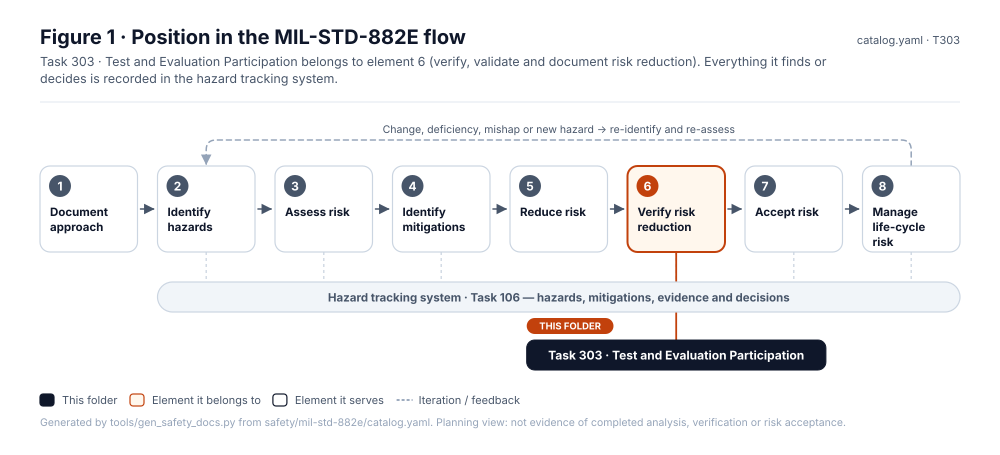
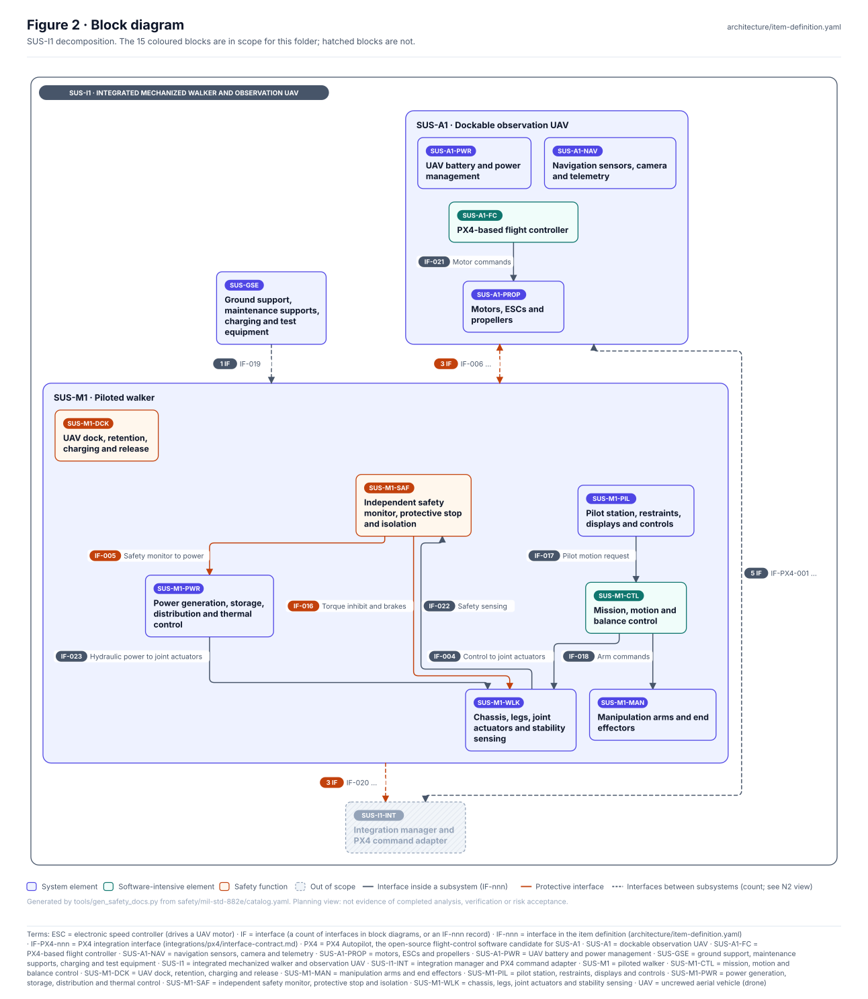
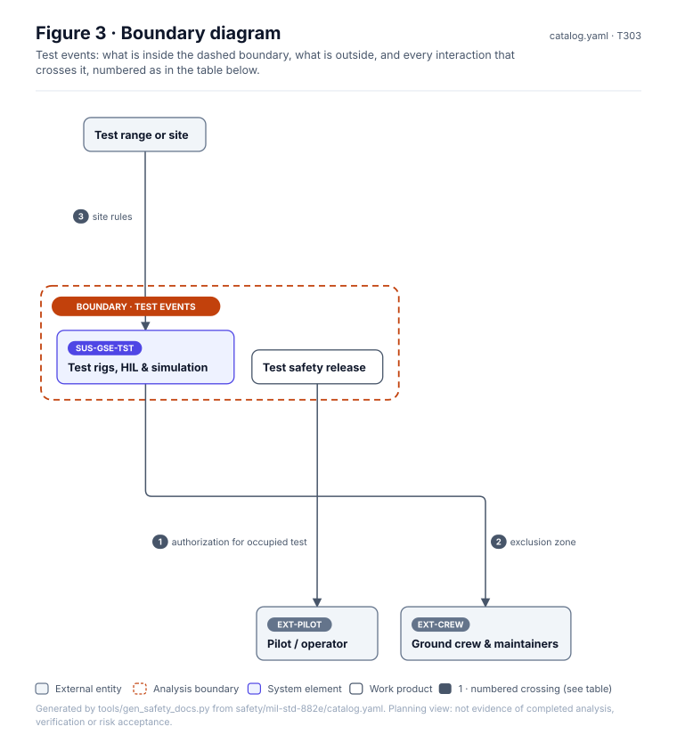
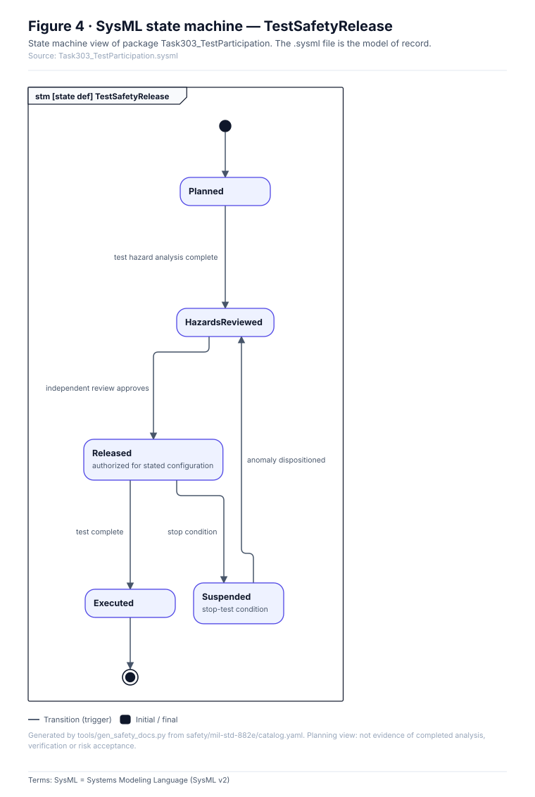
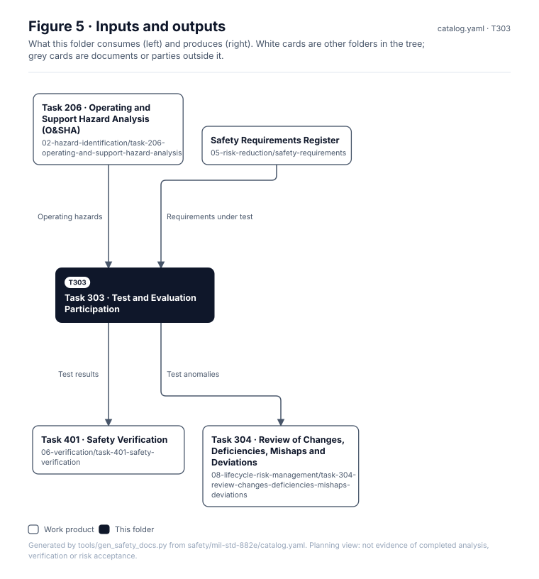

# Task 303 · Test and Evaluation Participation

> **Status:** Scaffold v0.1 — structure, diagrams and model views only
>
> Planning artifact. No completed hazard analysis, verified mitigation, risk acceptance, certification or MIL-STD-882E compliance is claimed. Category names follow MIL-STD-882E; confirm definitions against the controlled standard and the approved SSPP before formal use.

| Field | Value |
|---|---|
| MIL-STD-882E element | 6 — Verify, validate and document risk reduction |
| Tasks | [Task 303 — Test and Evaluation Participation](../../../../docs/wiki/MIL-STD-882E-Task-303.md) |
| Lifecycle gate | G4–G5 |
| Applicability | Selected |
| Accountable role | Safety lead with test lead |
| Parent folder | [06 · Verify, Validate and Document Risk Reduction](../README.md) |

## Purpose

Safety participation in test planning and execution: test hazard analysis, safety releases for
rig and human-in-the-loop tests, and use of test data to update hazards.

## Position in the MIL-STD-882E flow



## Block diagram



Source of truth: [`SusanooSystem.sysml`](../../00-system-definition/sysml/SusanooSystem.sysml).

## Boundary diagram



| # | From | To | Crossing / interaction |
|---|---|---|---|
| 1 | Test safety release | EXT-PILOT: Pilot / operator | authorization for occupied test |
| 2 | SUS-GSE-TST: Test rigs, HIL & simulation | EXT-CREW: Ground crew & maintainers | exclusion zone |
| 3 | Test range or site | SUS-GSE-TST: Test rigs, HIL & simulation | site rules |

## SysML model

SysML v2 textual view: [`Task303_TestParticipation.sysml`](Task303_TestParticipation.sysml), generated from the catalog. It imports [`SusanooSystem`](../../00-system-definition/sysml/SusanooSystem.sysml) and [`SusanooSafety`](../../00-system-definition/sysml/SusanooSafety.sysml). The figures are drawn from the same data; the `.sysml` file is the model of record.



<details><summary>SysML v2 source</summary>

```sysml
// Task303_TestParticipation — generated by tools/gen_safety_docs.py from safety/mil-std-882e/catalog.yaml.
// Do not edit by hand: change the catalog and regenerate.
// Status: planning view only; not evidence of completed analysis or verification.

package Task303_TestParticipation {
    private import ScalarValues::*;
    private import SusanooSystem::*;
    private import SusanooSafety::*;
    attribute def AnomalyDispositioned;
    attribute def IndependentReviewApproves;
    attribute def StopCondition;
    attribute def TestComplete;
    attribute def TestHazardAnalysisComplete;
    state def TestSafetyRelease {
        entry; then Planned;
        state Planned;
        state HazardsReviewed;
        state Released { doc /* authorized for stated configuration */ }
        state Executed;
        state Suspended { doc /* stop-test condition */ }
        transition t1 first Planned accept TestHazardAnalysisComplete then HazardsReviewed;
        transition t2 first HazardsReviewed accept IndependentReviewApproves then Released;
        transition t3 first Released accept TestComplete then Executed;
        transition t4 first Released accept StopCondition then Suspended;
        transition t5 first Suspended accept AnomalyDispositioned then HazardsReviewed;
    }
}
```

</details>

## Inputs and outputs



| Input | Source |
|---|---|
| Operating hazards | [Task 206 · Operating and Support Hazard Analysis (O&SHA)](../../02-hazard-identification/task-206-operating-and-support-hazard-analysis/README.md) |
| Requirements under test | [Safety Requirements Register](../../05-risk-reduction/safety-requirements/README.md) |

| Output | Destination |
|---|---|
| Test results | [Task 401 · Safety Verification](../task-401-safety-verification/README.md) |
| Test anomalies | [Task 304 · Review of Changes, Deficiencies, Mishaps and Deviations](../../08-lifecycle-risk-management/task-304-review-changes-deficiencies-mishaps-deviations/README.md) |

## Folder contents

| Item | Description | State |
|---|---|---|
| `test-safety-releases/` | One release record per test event | planned |
| [`figures/`](figures/) | Generated SVG figures (do not edit) | generated |
| [`Task303_TestParticipation.sysml`](Task303_TestParticipation.sysml) | Generated SysML v2 view | generated |

<!-- END GENERATED: content below this line is human-authored and preserved -->

## Working content

_No analysis content yet. Add authored material below this heading._
