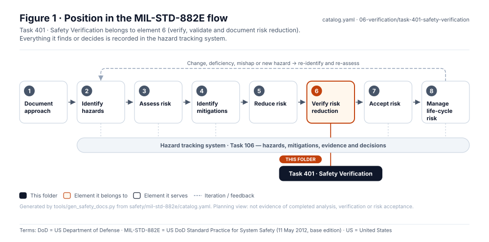
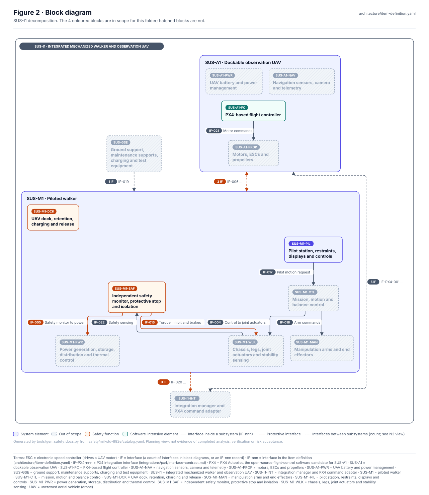
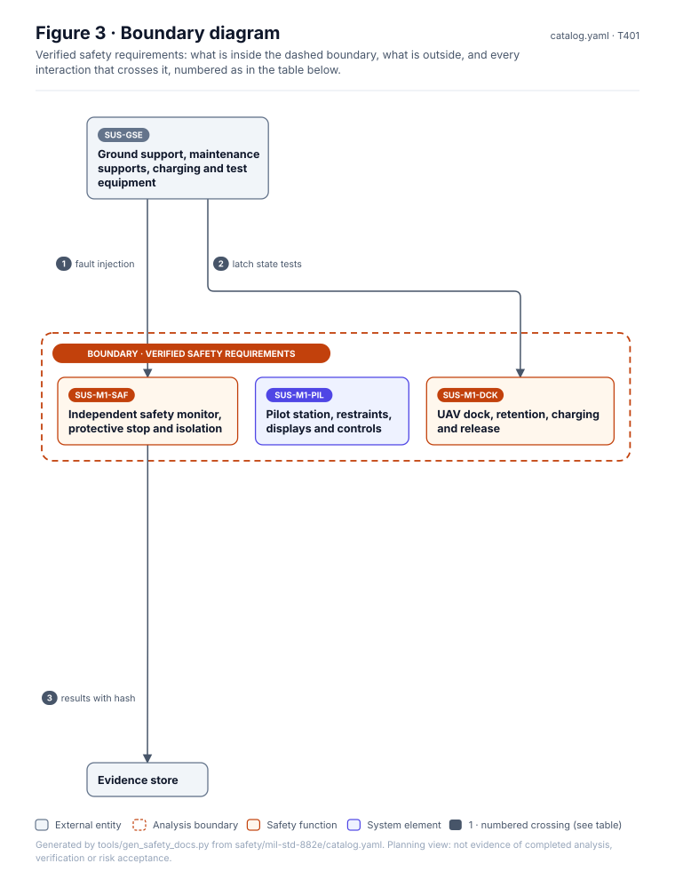
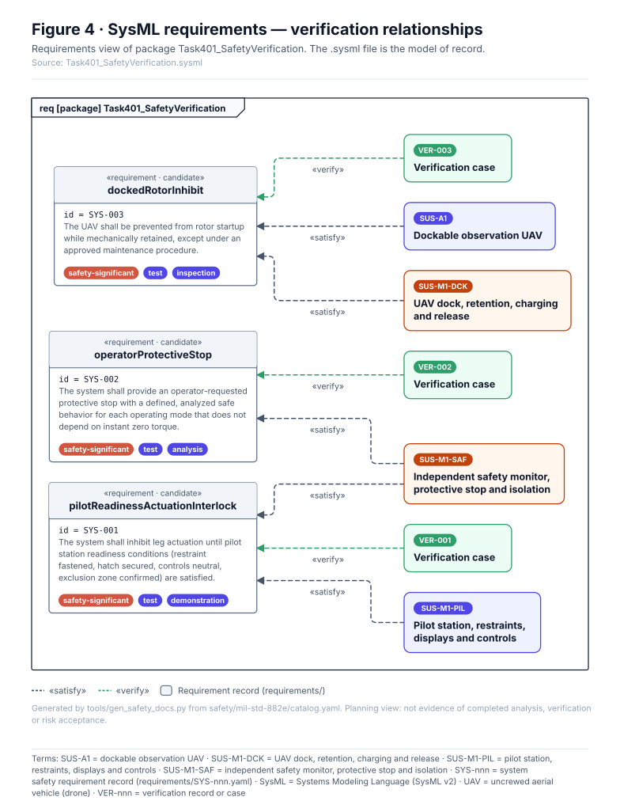
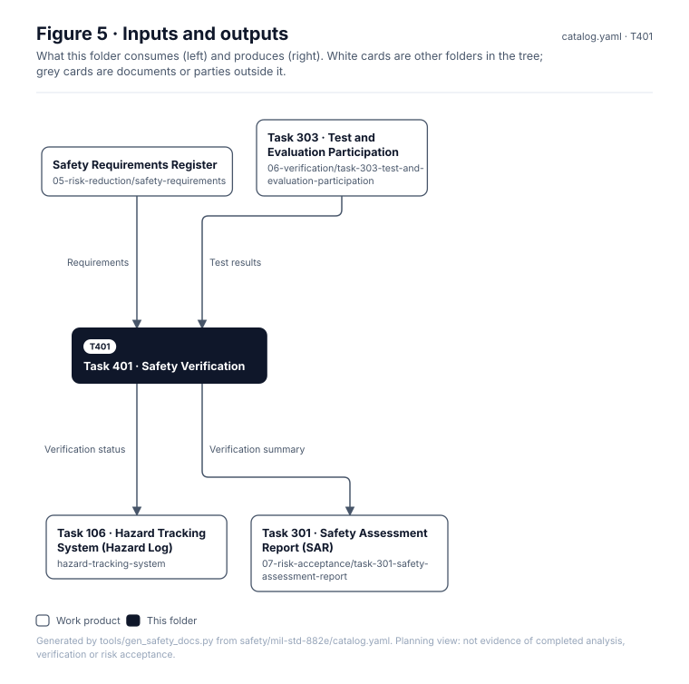

# Task 401 · Safety Verification

> **Status:** Scaffold v0.1 — structure, diagrams and model views only
>
> Planning artifact. No completed hazard analysis, verified mitigation, risk acceptance, certification or MIL-STD-882E compliance is claimed. Category names follow MIL-STD-882E; confirm definitions against the controlled standard and the approved SSPP before formal use.

| Field | Value |
|---|---|
| MIL-STD-882E element | 6 — Verify, validate and document risk reduction |
| Tasks | [Task 401 — Safety Verification](../../../../docs/wiki/MIL-STD-882E-Task-401.md) |
| Lifecycle gate | G4–G5 |
| Applicability | Selected |
| Accountable role | Test lead with safety lead |
| Parent folder | [06 · Verify, Validate and Document Risk Reduction](../README.md) |

## Purpose

Verifies each safety requirement and the effectiveness of each mitigation. Each evidence record
states provenance, version, integrity hash and whether it is simulated (traceability rule 6).

## Position in the MIL-STD-882E flow



## Block diagram



Source of truth: [`SusanooSystem.sysml`](../../00-system-definition/sysml/SusanooSystem.sysml).

## Boundary diagram



| # | From | To | Crossing / interaction |
|---|---|---|---|
| 1 | SUS-GSE-TST: Test rigs, HIL & simulation | SUS-M1-SAF: Safety monitor & protective stop | fault injection |
| 2 | SUS-GSE-TST: Test rigs, HIL & simulation | SUS-M1-DCK: UAV dock - retention, power, data | latch state tests |
| 3 | SUS-M1-SAF: Safety monitor & protective stop | Evidence store | results with hash |

## SysML model

SysML v2 textual view: [`Task401_SafetyVerification.sysml`](Task401_SafetyVerification.sysml), generated from the catalog. It imports [`SusanooSystem`](../../00-system-definition/sysml/SusanooSystem.sysml) and [`SusanooSafety`](../../00-system-definition/sysml/SusanooSafety.sysml). The figures are drawn from the same data; the `.sysml` file is the model of record.



<details><summary>SysML v2 source</summary>

```sysml
// Task401_SafetyVerification — generated by tools/gen_safety_docs.py from safety/mil-std-882e/catalog.yaml.
// Do not edit by hand: change the catalog and regenerate.
// Status: planning view only; not evidence of completed analysis or verification.

package Task401_SafetyVerification {
    private import ScalarValues::*;
    private import SusanooSystem::*;
    private import SusanooSafety::*;
    private import Task203_SRHA::*;
    requirement sys_001 : Task203_SRHA::PilotReadinessInterlock;
    requirement sys_002 : Task203_SRHA::ProtectiveStop;
    requirement sys_003 : Task203_SRHA::RetainedRotorInhibit;
    verification def <'VER-001'> Ver001 {
        objective {
            verify sys_001;
        }
    }
    verification def <'VER-002'> Ver002 {
        objective {
            verify sys_002;
        }
    }
    verification def <'VER-003'> Ver003 {
        objective {
            verify sys_003;
        }
    }
}
```

</details>

## Inputs and outputs



| Input | Source |
|---|---|
| Requirements | [Safety Requirements Register](../../05-risk-reduction/safety-requirements/README.md) |
| Test results | [Task 303 · Test and Evaluation Participation](../task-303-test-and-evaluation-participation/README.md) |

| Output | Destination |
|---|---|
| Verification status | [Task 106 · Hazard Tracking System (Hazard Log)](../../hazard-tracking-system/README.md) |
| Verification summary | [Task 301 · Safety Assessment Report (SAR)](../../07-risk-acceptance/task-301-safety-assessment-report/README.md) |

## Folder contents

| Item | Description | State |
|---|---|---|
| `verification-matrix.csv` | Requirement x method x evidence x result | planned |
| [`figures/`](figures/) | Generated SVG figures (do not edit) | generated |
| [`Task401_SafetyVerification.sysml`](Task401_SafetyVerification.sysml) | Generated SysML v2 view | generated |

<!-- END GENERATED: content below this line is human-authored and preserved -->

## Working content

_No analysis content yet. Add authored material below this heading._
