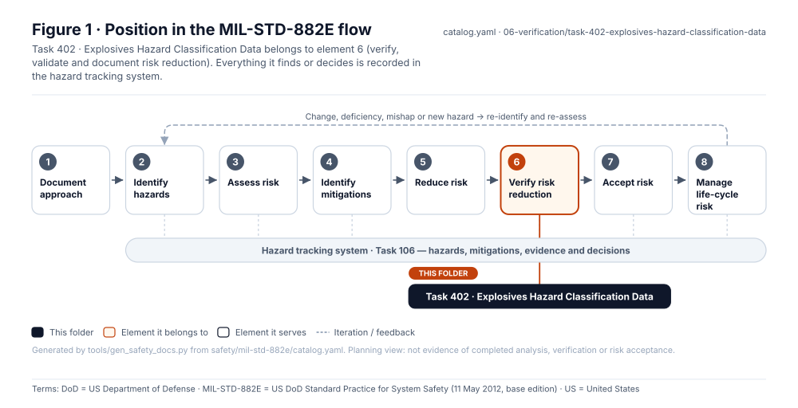
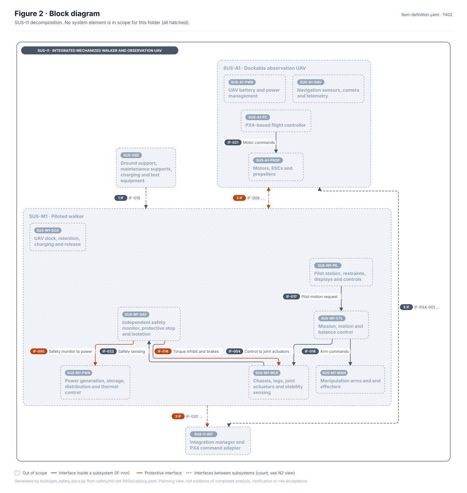
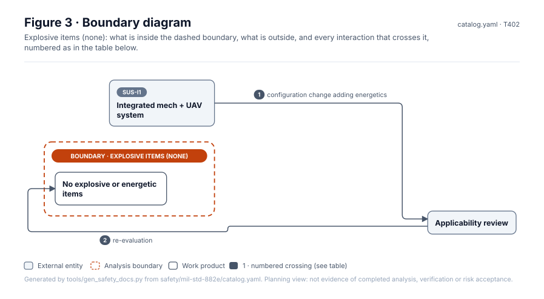
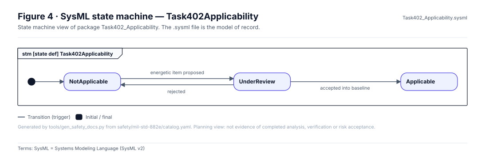
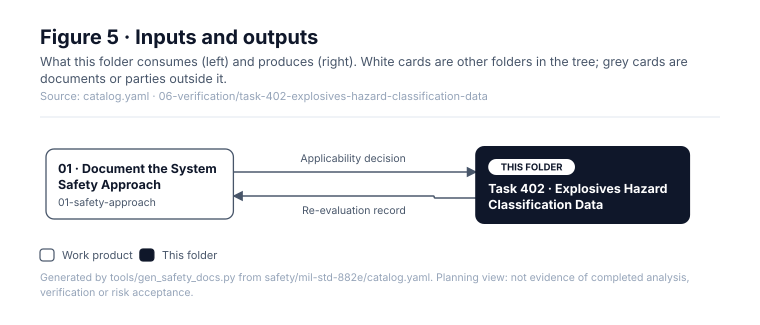

# Task 402 · Explosives Hazard Classification Data

> **Status:** Scaffold v0.1 — structure, diagrams and model views only
>
> Planning artifact. No completed hazard analysis, verified mitigation, risk acceptance, certification or MIL-STD-882E compliance is claimed. Category names follow MIL-STD-882E; confirm definitions against the controlled standard and the approved SSPP before formal use.

| Field | Value |
|---|---|
| MIL-STD-882E element | 6 — Verify, validate and document risk reduction |
| Tasks | [Task 402 — Explosives Hazard Classification Data](../../../../docs/wiki/MIL-STD-882E-Task-402.md) |
| Lifecycle gate | Re-evaluate at each gate |
| Applicability | Not applicable — concept contains no ordnance or explosives |
| Accountable role | Safety lead |
| Parent folder | [06 · Verify, Validate and Document Risk Reduction](../README.md) |

## Purpose

Placeholder that records the not-applicable decision and its re-evaluation trigger. Lithium
cells and fuel are handled by Tasks 108, 207 and 210, not here.

## Position in the MIL-STD-882E flow



## Block diagram



Source of truth: [`SusanooSystem.sysml`](../../00-system-definition/sysml/SusanooSystem.sysml).

## Boundary diagram



| # | From | To | Crossing / interaction |
|---|---|---|---|
| 1 | SUS-I1: Integrated mech + UAV system | Applicability review | configuration change adding energetics |
| 2 | Applicability review | No explosive or energetic items | re-evaluation |

## SysML model

SysML v2 textual view: [`Task402_Applicability.sysml`](Task402_Applicability.sysml), generated from the catalog. It imports [`SusanooSystem`](../../00-system-definition/sysml/SusanooSystem.sysml) and [`SusanooSafety`](../../00-system-definition/sysml/SusanooSafety.sysml). The figures are drawn from the same data; the `.sysml` file is the model of record.



<details><summary>SysML v2 source</summary>

```sysml
// Task402_Applicability — generated by tools/gen_safety_docs.py from safety/mil-std-882e/catalog.yaml.
// Do not edit by hand: change the catalog and regenerate.
// Status: planning view only; not evidence of completed analysis or verification.

package Task402_Applicability {
    private import ScalarValues::*;
    private import SusanooSystem::*;
    private import SusanooSafety::*;
    attribute def AcceptedIntoBaseline;
    attribute def EnergeticItemProposed;
    attribute def Rejected;
    state def Task402Applicability {
        entry; then NotApplicable;
        state NotApplicable;
        state UnderReview;
        state Applicable;
        transition t1 first NotApplicable accept EnergeticItemProposed then UnderReview;
        transition t2 first UnderReview accept Rejected then NotApplicable;
        transition t3 first UnderReview accept AcceptedIntoBaseline then Applicable;
    }
}
```

</details>

## Inputs and outputs



| Input | Source |
|---|---|
| Applicability decision | [01 · Document the System Safety Approach](../../01-safety-approach/README.md) |

| Output | Destination |
|---|---|
| Re-evaluation record | [01 · Document the System Safety Approach](../../01-safety-approach/README.md) |

## Folder contents

| Item | Description | State |
|---|---|---|
| `applicability-decision.yaml` | Not-applicable rationale and trigger | planned |
| [`figures/`](figures/) | Generated SVG figures (do not edit) | generated |
| [`Task402_Applicability.sysml`](Task402_Applicability.sysml) | Generated SysML v2 view | generated |

<!-- END GENERATED: content below this line is human-authored and preserved -->

## Working content

_No analysis content yet. Add authored material below this heading._
