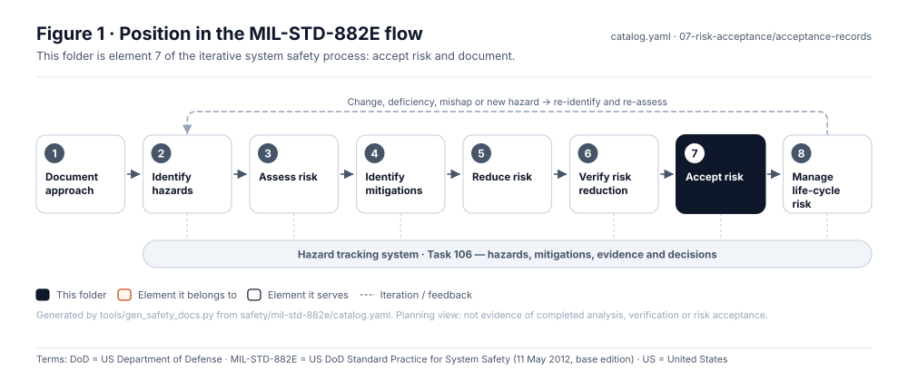
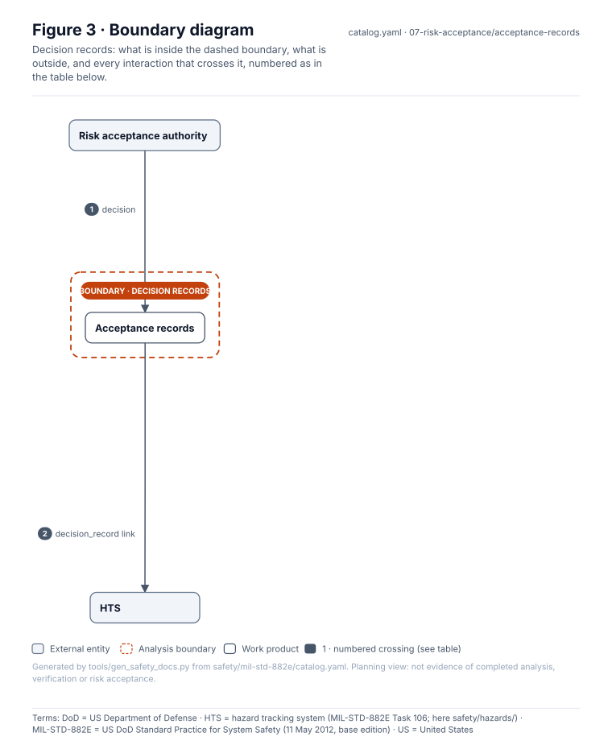
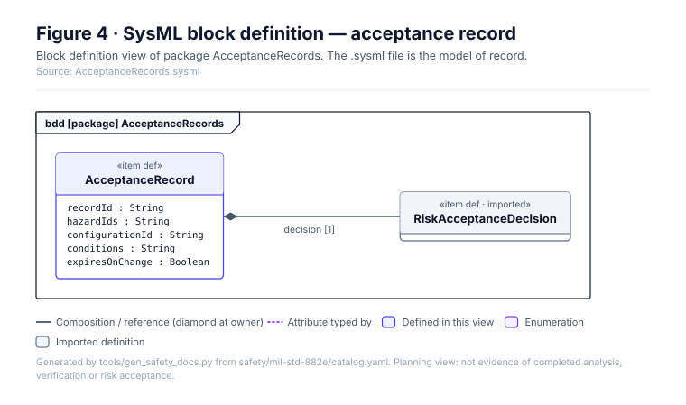
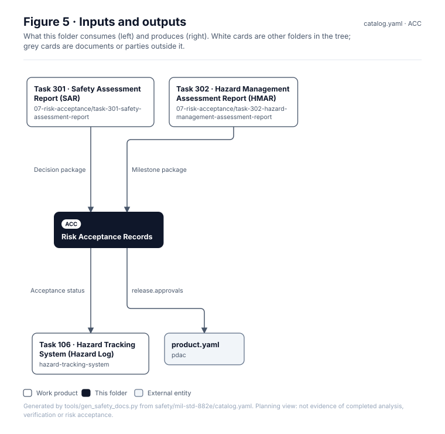

# Risk Acceptance Records

> **Status:** Scaffold v0.1 — structure, diagrams and model views only
>
> Planning artifact. No completed hazard analysis, verified mitigation, risk acceptance, certification or MIL-STD-882E compliance is claimed. Category names follow MIL-STD-882E; confirm definitions against the controlled standard and the approved SSPP before formal use.

| Field | Value |
|---|---|
| MIL-STD-882E element | 7 — Accept risk and document |
| Lifecycle gate | G6 |
| Applicability | Selected |
| Accountable role | Risk acceptance authority |
| Parent folder | [07 · Accept Risk and Document](../README.md) |

## Purpose

Signed residual-risk decisions. Each record names the authority, hazard IDs, accepted risk
level, configuration, conditions and whether the approval is real or illustrative.

## Position in the MIL-STD-882E flow



## Block diagram


Source of truth: [`SusanooSystem.sysml`](../../00-system-definition/sysml/SusanooSystem.sysml).

## Boundary diagram



| # | From | To | Crossing / interaction |
|---|---|---|---|
| 1 | EXT-AUTH: Risk acceptance authority | Acceptance records | decision |
| 2 | Acceptance records | HTS | decision_record link |

## SysML model

SysML v2 textual view: [`AcceptanceRecords.sysml`](AcceptanceRecords.sysml), generated from the catalog. It imports [`SusanooSystem`](../../00-system-definition/sysml/SusanooSystem.sysml) and [`SusanooSafety`](../../00-system-definition/sysml/SusanooSafety.sysml). The figures are drawn from the same data; the `.sysml` file is the model of record.



<details><summary>SysML v2 source</summary>

```sysml
// AcceptanceRecords — generated by tools/gen_safety_docs.py from safety/mil-std-882e/catalog.yaml.
// Do not edit by hand: change the catalog and regenerate.
// Status: planning view only; not evidence of completed analysis or verification.

package AcceptanceRecords {
    private import ScalarValues::*;
    private import SusanooSystem::*;
    private import SusanooSafety::*;
    item def AcceptanceRecord {
        attribute recordId : String;
        attribute hazardIds : String;
        attribute configurationId : String;
        attribute conditions : String;
        attribute expiresOnChange : Boolean;
        ref item decision : RiskAcceptanceDecision[1];
    }
}
```

</details>

## Inputs and outputs



| Input | Source |
|---|---|
| Decision package | [Task 301 · Safety Assessment Report (SAR)](../task-301-safety-assessment-report/README.md) |
| Milestone package | [Task 302 · Hazard Management Assessment Report (HMAR)](../task-302-hazard-management-assessment-report/README.md) |

| Output | Destination |
|---|---|
| Acceptance status | [Task 106 · Hazard Tracking System (Hazard Log)](../../hazard-tracking-system/README.md) |
| release.approvals | [`pdac/product.yaml`](../../../../pdac/product.yaml) |

## Folder contents

| Item | Description | State |
|---|---|---|
| `RA-<id>.yaml` | One record per decision | planned |
| [`figures/`](figures/) | Generated SVG figures (do not edit) | generated |
| [`AcceptanceRecords.sysml`](AcceptanceRecords.sysml) | Generated SysML v2 view | generated |

<!-- END GENERATED: content below this line is human-authored and preserved -->

## Working content

_No analysis content yet. Add authored material below this heading._
