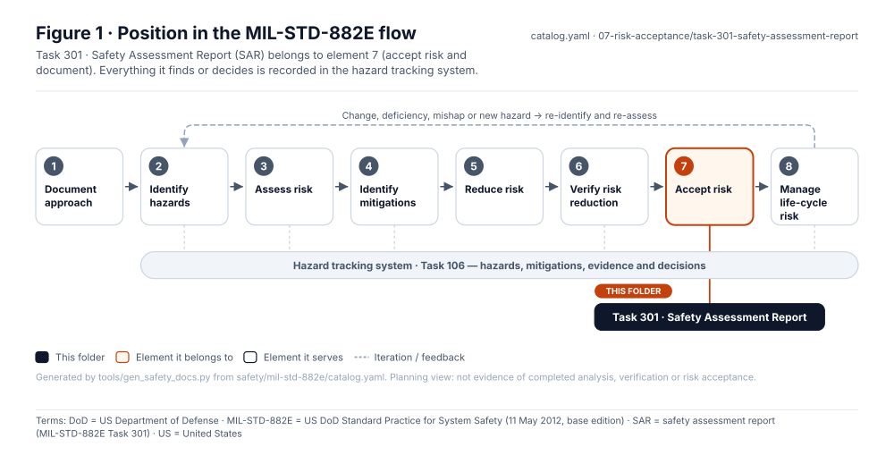
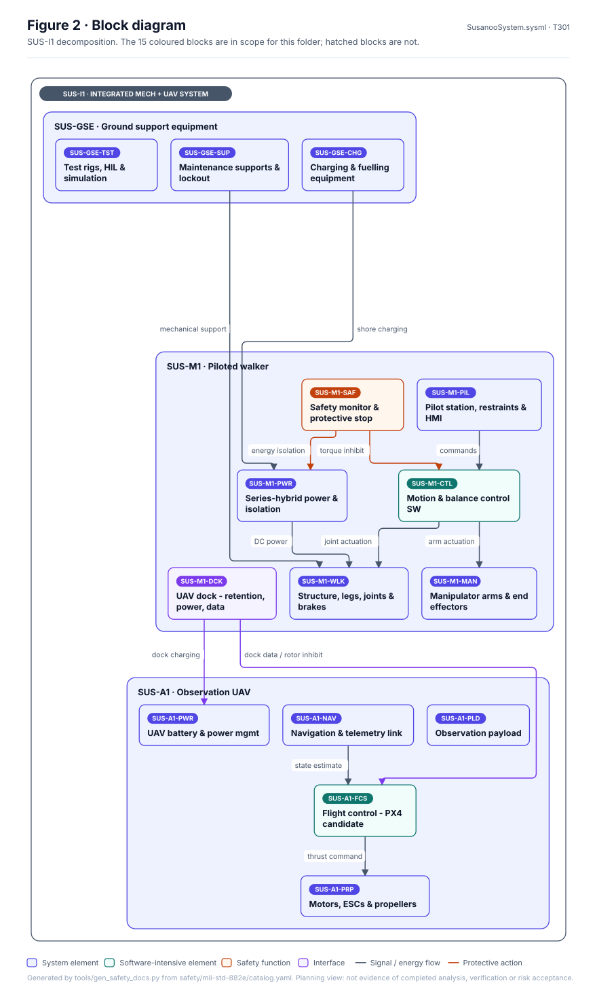
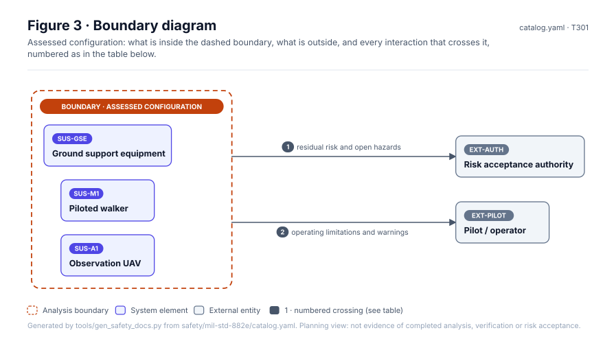
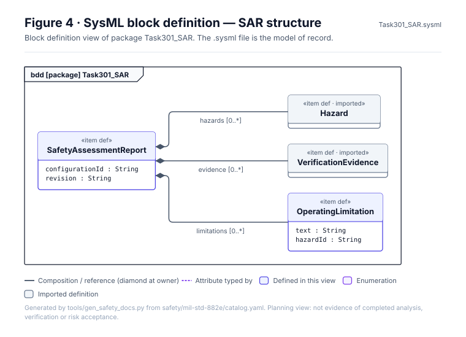
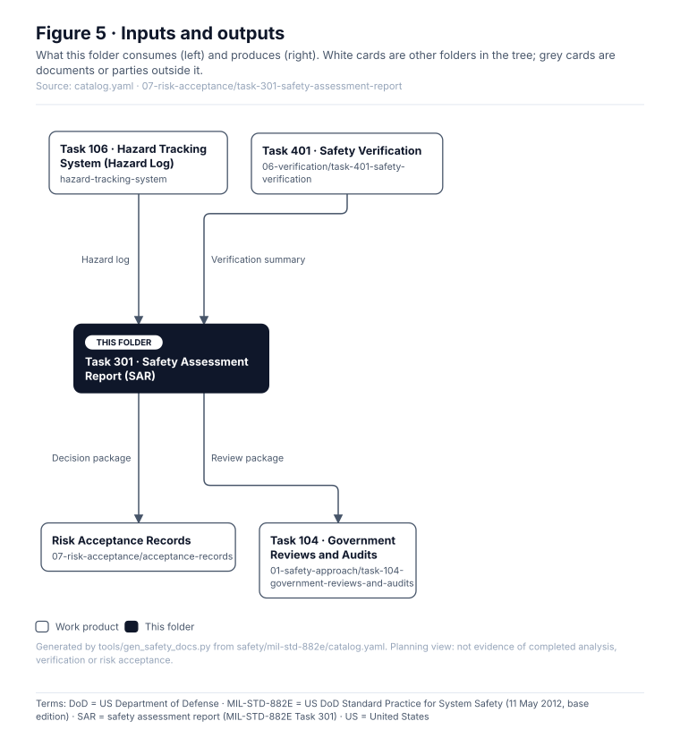

# Task 301 · Safety Assessment Report (SAR)

> **Status:** Scaffold v0.1 — structure, diagrams and model views only
>
> Planning artifact. No completed hazard analysis, verified mitigation, risk acceptance, certification or MIL-STD-882E compliance is claimed. Category names follow MIL-STD-882E; confirm definitions against the controlled standard and the approved SSPP before formal use.

| Field | Value |
|---|---|
| MIL-STD-882E element | 7 — Accept risk and document |
| Tasks | [Task 301 — Safety Assessment Report](../../../../docs/wiki/MIL-STD-882E-Task-301.md) |
| Lifecycle gate | G5–G6 |
| Applicability | Selected |
| Accountable role | Safety lead |
| Parent folder | [07 · Accept Risk and Document](../README.md) |

## Purpose

Comprehensive assessment of residual mishap risk for a specific configuration, prepared to
support acceptance decisions and release.

## Position in the MIL-STD-882E flow



## Block diagram



Elements and interfaces: [`architecture/item-definition.yaml`](../../../../architecture/item-definition.yaml); SysML: [`Architecture.sysml`](../../../../models/sysml/model/Architecture.sysml).

## Boundary diagram



| # | From | To | Crossing / interaction | Interface (item definition) |
|---|---|---|---|---|
| 1 | _Assessed configuration (boundary)_ | Risk acceptance authority | residual risk and open hazards | — |
| 2 | _Assessed configuration (boundary)_ | EXT-PILOT: Pilot | operating limitations and warnings | — |

## SysML model

SysML v2 textual view: [`Task301_SAR.sysml`](Task301_SAR.sysml), generated from the catalog. It imports the project model in [`models/sysml/model`](../../../../models/sysml/model): `SusanooArchitecture` (elements and usage paths) and `SusanooLibrary` (882E vocabulary). The figures are drawn from the same data; the `.sysml` file is the model of record.



<details><summary>SysML v2 source</summary>

```sysml
// Task301_SAR — generated by tools/gen_safety_docs.py from safety/mil-std-882e/catalog.yaml.
// Do not edit by hand: change the catalog and regenerate.
// Status: planning view only; not evidence of completed analysis or verification.

package Task301_SAR {
    private import ScalarValues::*;
    private import SusanooLibrary::*;
    private import SusanooArchitecture::*;
    item def SafetyAssessmentReport {
        attribute configurationId : String;
        attribute revision : String;
        ref item hazards : Hazard[0..*];
        ref item evidence : VerificationEvidence[0..*];
        ref item limitations : OperatingLimitation[0..*];
    }
    item def OperatingLimitation {
        attribute text : String;
        attribute hazardId : String;
    }
}
```

</details>

## Inputs and outputs



| Input | Source |
|---|---|
| Hazard log | [Task 106 · Hazard Tracking System (Hazard Log)](../../hazard-tracking-system/README.md) |
| Verification summary | [Task 401 · Safety Verification](../../06-verification/task-401-safety-verification/README.md) |

| Output | Destination |
|---|---|
| Decision package | [Risk Acceptance Records](../acceptance-records/README.md) |
| Review package | [Task 104 · Government Reviews and Audits](../../01-safety-approach/task-104-government-reviews-and-audits/README.md) |

## Folder contents

| Item | Description | State |
|---|---|---|
| `sar-<configuration-id>.md` | One SAR per assessed configuration | planned |
| [`figures/`](figures/) | Generated SVG figures (do not edit) | generated |
| [`Task301_SAR.sysml`](Task301_SAR.sysml) | Generated SysML v2 view | generated |

<!-- END GENERATED: content below this line is human-authored and preserved -->

## Working content

_No analysis content yet. Add authored material below this heading._
