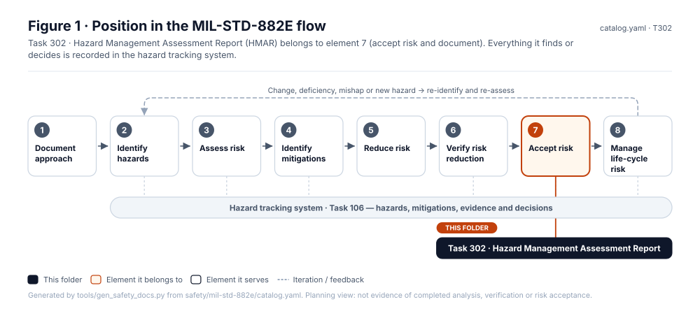
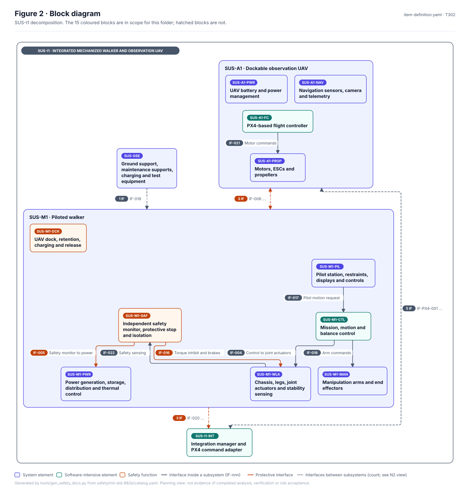
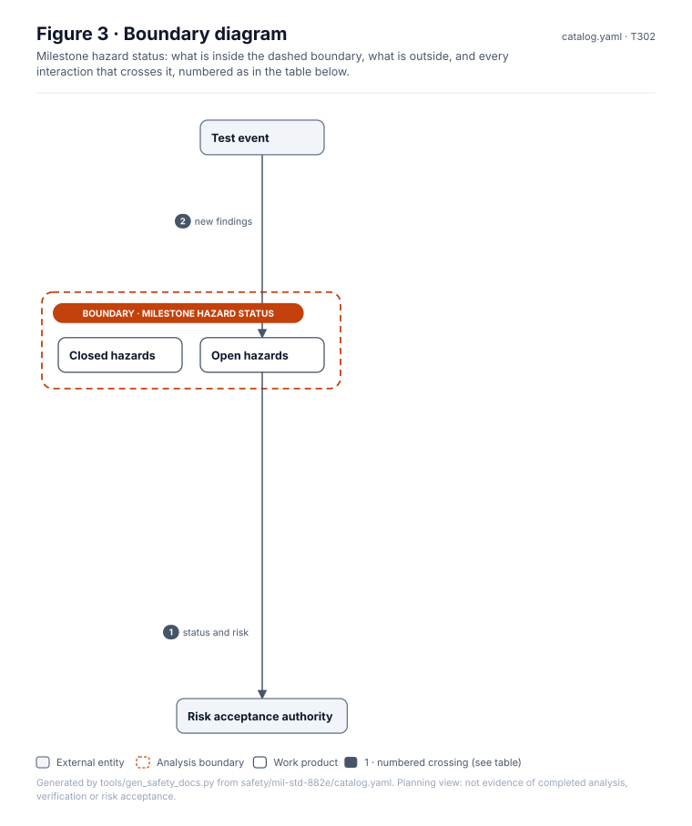
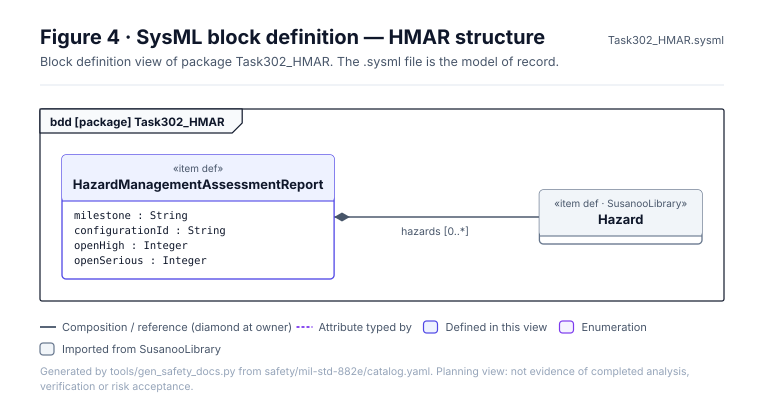
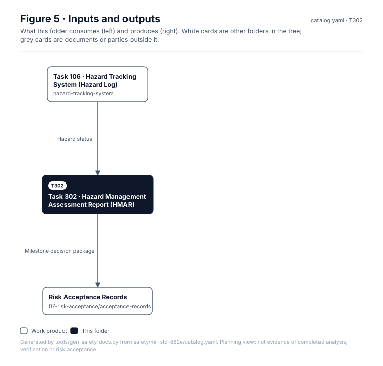

# Task 302 · Hazard Management Assessment Report (HMAR)

> **Status:** Scaffold v0.1 — structure, diagrams and model views only
>
> Planning artifact. No completed hazard analysis, verified mitigation, risk acceptance, certification or MIL-STD-882E compliance is claimed. Category names follow MIL-STD-882E; confirm definitions against the controlled standard and the approved SSPP before formal use.

| Field | Value |
|---|---|
| MIL-STD-882E element | 7 — Accept risk and document |
| Tasks | [Task 302 — Hazard Management Assessment Report](../../../../docs/wiki/MIL-STD-882E-Task-302.md) |
| Lifecycle gate | G5–G6 |
| Applicability | Selected |
| Accountable role | Safety lead |
| Parent folder | [07 · Accept Risk and Document](../README.md) |

## Purpose

Assesses hazard management status and residual risk for a configuration or milestone, typically
for a test or demonstration event.

## Position in the MIL-STD-882E flow



## Block diagram



Source of truth: [`SusanooSystem.sysml`](../../00-system-definition/sysml/SusanooSystem.sysml).

## Boundary diagram



| # | From | To | Crossing / interaction |
|---|---|---|---|
| 1 | Open hazards | EXT-AUTH: Risk acceptance authority | status and risk |
| 2 | Test event | Open hazards | new findings |

## SysML model

SysML v2 textual view: [`Task302_HMAR.sysml`](Task302_HMAR.sysml), generated from the catalog. It imports [`SusanooSystem`](../../00-system-definition/sysml/SusanooSystem.sysml) and [`SusanooSafety`](../../00-system-definition/sysml/SusanooSafety.sysml). The figures are drawn from the same data; the `.sysml` file is the model of record.



<details><summary>SysML v2 source</summary>

```sysml
// Task302_HMAR — generated by tools/gen_safety_docs.py from safety/mil-std-882e/catalog.yaml.
// Do not edit by hand: change the catalog and regenerate.
// Status: planning view only; not evidence of completed analysis or verification.

package Task302_HMAR {
    private import ScalarValues::*;
    private import SusanooSystem::*;
    private import SusanooSafety::*;
    item def HazardManagementAssessmentReport {
        attribute milestone : String;
        attribute configurationId : String;
        attribute openHigh : Integer;
        attribute openSerious : Integer;
        ref item hazards : Hazard[0..*];
    }
}
```

</details>

## Inputs and outputs



| Input | Source |
|---|---|
| Hazard status | [Task 106 · Hazard Tracking System (Hazard Log)](../../hazard-tracking-system/README.md) |

| Output | Destination |
|---|---|
| Milestone decision package | [Risk Acceptance Records](../acceptance-records/README.md) |

## Folder contents

| Item | Description | State |
|---|---|---|
| `hmar-<milestone>.md` | One report per milestone | planned |
| [`figures/`](figures/) | Generated SVG figures (do not edit) | generated |
| [`Task302_HMAR.sysml`](Task302_HMAR.sysml) | Generated SysML v2 view | generated |

<!-- END GENERATED: content below this line is human-authored and preserved -->

## Working content

_No analysis content yet. Add authored material below this heading._
